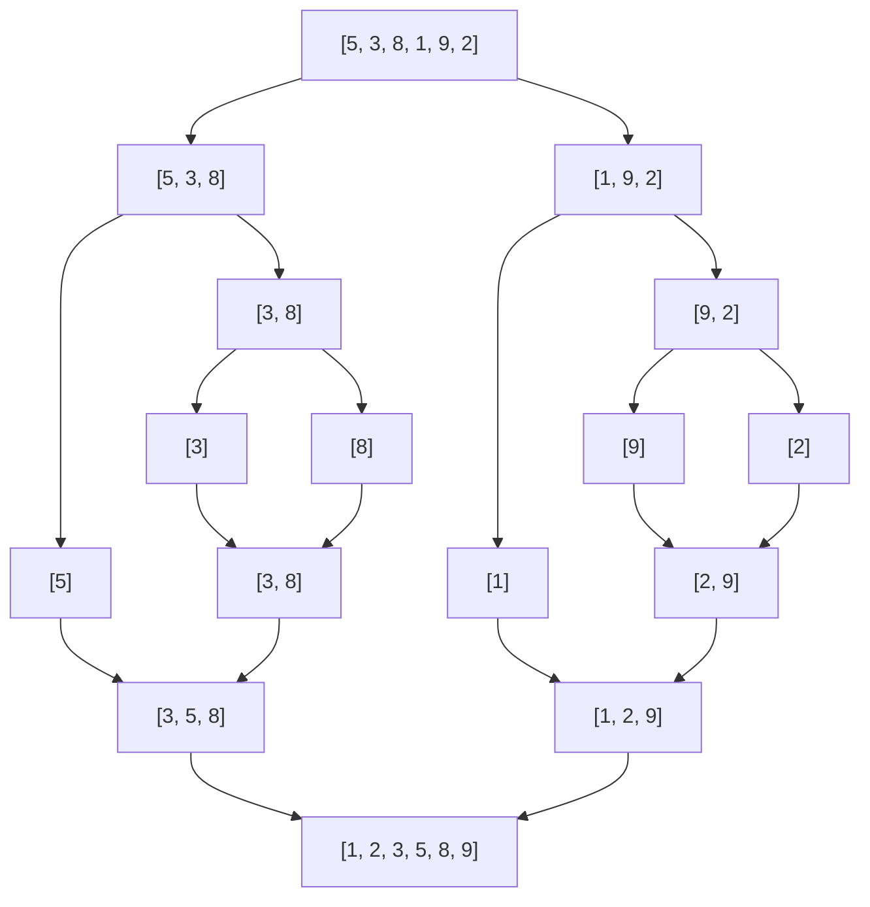

## 核心概念

Merge Sort 是基於**分治法**（Divide and Conquer）的排序演算法：

1. **Divide**：將陣列從中點分成兩半
2. **Conquer**：遞迴排序兩個子陣列
3. **Combine**：合併兩個已排序的子陣列

**時間複雜度**：所有情況均為 O(n log n)
**空間複雜度**：O(n)（標準 out-of-place），O(1) 輔助空間（in-place 版本代價高）
**穩定排序**：是（stable sort，相同元素的相對順序不變）



## Java 實作

```java
public class MergeSort {
    public static void sort(int[] arr) {
        if (arr.length <= 1) return;
        int mid = arr.length / 2;
        int[] left = Arrays.copyOfRange(arr, 0, mid);
        int[] right = Arrays.copyOfRange(arr, mid, arr.length);
        sort(left);
        sort(right);
        merge(arr, left, right);
    }

    private static void merge(int[] arr, int[] left, int[] right) {
        int i = 0, j = 0, k = 0;
        while (i < left.length && j < right.length) {
            // 穩定排序的關鍵：相等時優先取左邊
            if (left[i] <= right[j]) {
                arr[k++] = left[i++];
            } else {
                arr[k++] = right[j++];
            }
        }
        while (i < left.length)  arr[k++] = left[i++];
        while (j < right.length) arr[k++] = right[j++];
    }
}
```

## 為什麼說 Merge Sort 是「穩定」排序

「穩定」指的是：**相同值的元素，排序後保持原始相對順序**。

```
輸入：[(A, 3), (B, 3), (C, 1)]  ← A 和 B 都是 3
期望：[(C, 1), (A, 3), (B, 3)]  ← A 仍在 B 前面
```

Merge Sort 的穩定性來自 merge 步驟中的 `left[i] <= right[j]`（**等號時優先取左邊**）。若改成 `<` 則變成不穩定排序。

Quick Sort 通常不穩定；Heap Sort 也不穩定。這在排序有多個欄位的物件時很重要（先按 age 排、再按 name 排，若 age 相同需保持 name 的原始順序）。

## In-place Merge Sort 的代價

標準 Merge Sort 需要 O(n) 額外空間（`Arrays.copyOfRange`）。理論上可以做 in-place merge，但代價是時間複雜度從 O(n) 提升到 O(n log n)，導致整體從 O(n log n) 退化到 O(n log² n)，實際上比 Quick Sort 慢許多。

**結論**：除非記憶體極度受限，否則不值得用 in-place Merge Sort。

## 外部排序（External Sort）

當資料量超過記憶體（如排序 100GB 的日誌文件），Merge Sort 是最適合的演算法：

1. **分割**：將大文件切成記憶體可容納的小塊，各自排序後寫入暫存文件
2. **合併**：使用 k-way merge（最小堆，O(n log k)）將所有暫存文件合併

```java
// k-way merge 的骨架（概念）
PriorityQueue<int[]> heap = new PriorityQueue<>(Comparator.comparingInt(a -> a[0]));
// a[0] = value, a[1] = which_file, a[2] = position_in_file
for (int i = 0; i < k; i++) {
    heap.offer(new int[]{files[i].readNext(), i, 0});
}
while (!heap.isEmpty()) {
    int[] min = heap.poll();
    output.write(min[0]);
    if (files[min[1]].hasNext()) {
        heap.offer(new int[]{files[min[1]].readNext(), min[1], min[2] + 1});
    }
}
```

這是 Hadoop MapReduce、Spark Sort 的核心排序機制。

## Java Arrays.sort() 使用 Timsort

Java 的 `Arrays.sort(Object[])` 和 `Collections.sort()` 底層使用 **Timsort**，而非純 Merge Sort：

- Timsort 是 Merge Sort + Insertion Sort 的混合
- 對「幾乎已排序」的資料（real-world 最常見）有 O(n) 的最佳效能
- 最壞情況仍為 O(n log n)
- Java 7 起採用（取代舊的 Merge Sort 實作）

```java
// 這些都在底層用 Timsort
Arrays.sort(objects);        // Object[]
Collections.sort(list);      // List
list.sort(comparator);       // Java 8+
```

**注意**：`Arrays.sort(int[])` 等原始型別陣列使用 Dual-Pivot Quick Sort（非穩定，但快）。

## 何時選 Merge Sort

| 情境 | 建議 |
|---|---|
| 需要穩定排序 | Merge Sort（或 Timsort） |
| 外部排序（資料不進記憶體） | Merge Sort |
| 鏈結串列排序 | Merge Sort（不需要隨機存取） |
| 一般陣列排序 | 使用 `Arrays.sort()`（Timsort/Dual-Pivot） |
| 記憶體受限（原始型別） | Quick Sort / Heap Sort |

## 參考

- [Java Arrays.sort() 原始碼](https://github.com/openjdk/jdk/blob/master/src/java.base/share/classes/java/util/TimSort.java)
- [Timsort - Wikipedia](https://en.wikipedia.org/wiki/Timsort)
- Knuth, TAOCP Vol.3 Section 5.2.4
