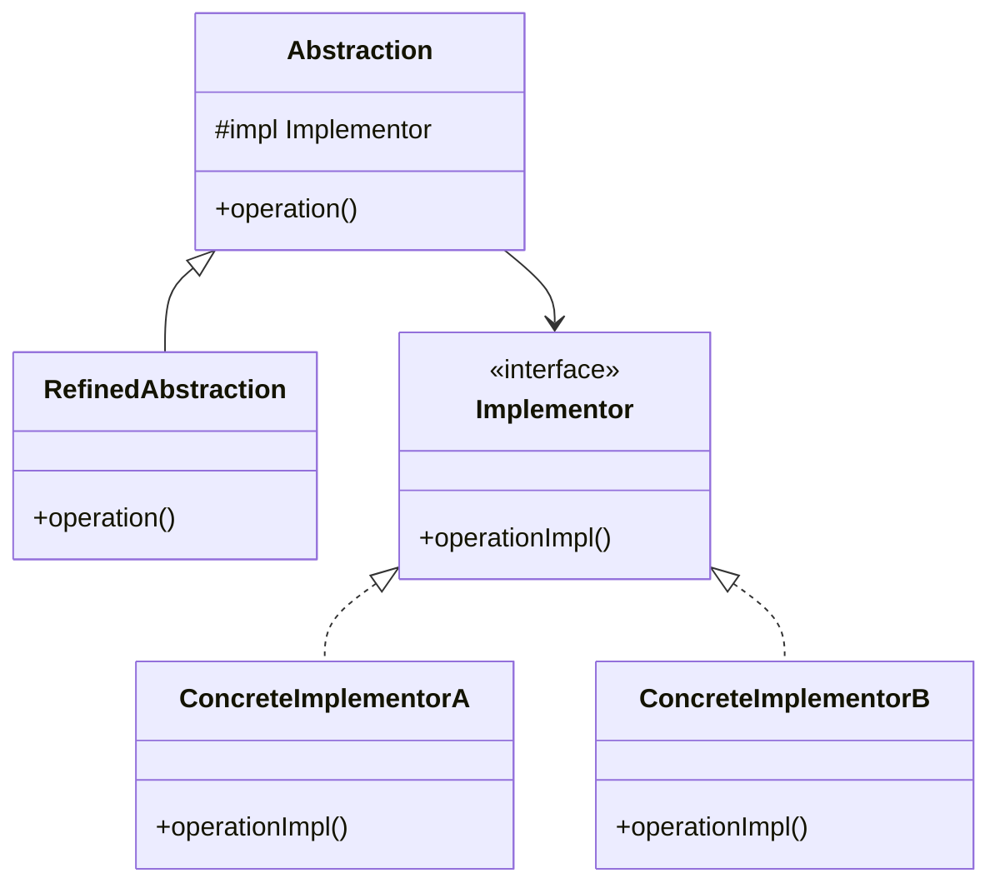

## 1. 意圖

將抽象部分（Abstraction）與其實作部分（Implementation）解耦，使兩者可以獨立變化，以組合取代繼承。

## 2. UML 類圖



## 3. 何時用 / 何時別用

**用**：
- 類別沿兩個獨立維度擴展（例如「訊息類型」×「發送通道」），繼承會爆炸
- 需要在執行期切換實作（如依設定選擇 DB driver）
- 抽象與實作的演進頻率不同，應各自獨立版本化

**別用**：
- 只有一個變化維度，直接繼承或 Strategy 即可
- 類別數量少且不預期擴展，過度設計
- 實作層只有一種且未來不會增加

## 4. Java 範例

以「通知訊息」×「發送通道」為例，兩個維度各自擴展：

```java
// Implementor
public interface MessageSender {
    void send(String recipient, String content);
}

// ConcreteImplementor A
public class EmailSender implements MessageSender {
    @Override
    public void send(String recipient, String content) {
        System.out.println("Email to " + recipient + ": " + content);
    }
}

// ConcreteImplementor B
public class SmsSender implements MessageSender {
    @Override
    public void send(String recipient, String content) {
        System.out.println("SMS to " + recipient + ": " + content);
    }
}

// Abstraction
public abstract class Notification {
    protected final MessageSender sender;

    protected Notification(MessageSender sender) {
        this.sender = sender;
    }

    public abstract void notify(String recipient);
}

// RefinedAbstraction A
public class AlertNotification extends Notification {
    private final String alertMessage;

    public AlertNotification(MessageSender sender, String alertMessage) {
        super(sender);
        this.alertMessage = alertMessage;
    }

    @Override
    public void notify(String recipient) {
        sender.send(recipient, "[ALERT] " + alertMessage);
    }
}

// RefinedAbstraction B
public class PromotionNotification extends Notification {
    private final String promoCode;

    public PromotionNotification(MessageSender sender, String promoCode) {
        super(sender);
        this.promoCode = promoCode;
    }

    @Override
    public void notify(String recipient) {
        sender.send(recipient, "Use promo code: " + promoCode);
    }
}

// 使用：任意組合抽象與實作
Notification n1 = new AlertNotification(new EmailSender(), "Server down");
Notification n2 = new PromotionNotification(new SmsSender(), "SAVE20");
n1.notify("ops@example.com");
n2.notify("+886912345678");
```

## 5. JDK / Spring 真實案例

**JDBC**：`Connection`（Abstraction）+ 各家 JDBC Driver（ConcreteImplementor）。應用程式的 SQL 邏輯不改，僅替換 driver jar 就能切換 DB 品牌，是最廣為人知的 Bridge 範例。

**`java.util.logging` / SLF4J**：`Logger` 是 Abstraction，底層的 Logback、Log4j、JUL 是 Implementation。SLF4J API 層與實作層完全分離，可在部署時替換。

**Spring `PlatformTransactionManager`**：`@Transactional` 的抽象與 `DataSourceTransactionManager`、`JpaTransactionManager` 等實作解耦，業務程式碼不需感知底層事務機制。

## 6. 與相近 Pattern 的差異

| 面向 | Bridge | Adapter | Strategy |
|------|--------|---------|----------|
| 設計時機 | 事前設計，兩維度並行擴展 | 事後補救，相容既有介面 | 同一介面下替換演算法 |
| 關注點 | 抽象與實作解耦 | 介面轉換 | 行為替換 |
| 結構特徵 | Abstraction 持有 Implementor | Adapter 包裝 Adaptee | Context 持有 Strategy |

## 7. 現代 Java 取代方案

若實作層僅在建構時注入且不切換，可用 **建構子注入 + 介面** 直接取代，不需顯式的 Abstraction 層：

```java
// 簡化版：直接依賴倒置即可，無需 Abstraction 抽象類別
public class AlertService {
    private final MessageSender sender; // 注入不同實作即可

    public AlertService(MessageSender sender) {
        this.sender = sender;
    }
}
```

需要多個 RefinedAbstraction 共享行為（模板方法）時，才值得引入抽象類別的 Bridge 結構。

## 8. 參考資料

- GoF Design Patterns (1994), Chapter 4 — Bridge
- Head First Design Patterns, Chapter 6
