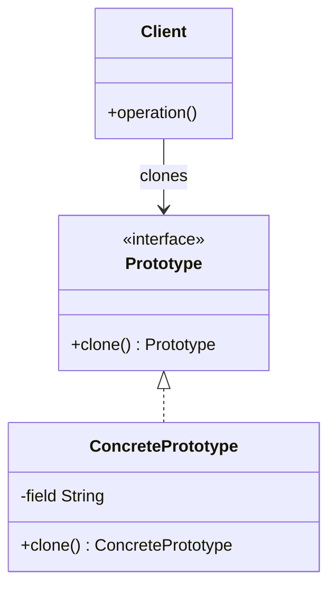

## 1. 意圖

透過複製（clone）一個已存在的實例來建立新物件，而非重新執行昂貴的初始化流程；同時讓客戶端程式碼無須知道被複製物件的具體類別。

## 2. UML 類圖



## 3. 何時用 / 何時別用

**用**：
- 物件初始化成本高（讀檔、查 DB、複雜計算），複製遠快於從頭建立
- 執行期才知道要建立哪種物件（動態原型 Registry）
- 需要建立一批狀態相近但略有差異的物件（預設設定 + 各自微調）

**別用**：
- 物件欄位多且包含深層嵌套可變物件，深拷貝邏輯難以維護
- 只是要建立同類型的新物件且初始化不昂貴，直接 `new` 即可
- 循環引用結構（兩個物件互相持有參考），深拷貝容易陷入無窮遞迴

## 4. Java 範例

**核心陷阱：淺拷貝共享可變物件**

```java
public class OrderTemplate {
    private String product;
    private List<String> tags;  // 可變物件

    public OrderTemplate(String product, List<String> tags) {
        this.product = product;
        this.tags    = tags;
    }

    // 淺拷貝：tags 仍指向同一個 List
    public OrderTemplate shallowCopy() {
        return new OrderTemplate(this.product, this.tags);
    }

    // 深拷貝：透過拷貝建構子，tags 獨立
    public OrderTemplate deepCopy() {
        return new OrderTemplate(this.product, new ArrayList<>(this.tags));
    }

    public List<String> getTags() { return tags; }
    public String getProduct()    { return product; }
}

// 驗證差異
var original = new OrderTemplate("Book", new ArrayList<>(List.of("edu")));
var shallow  = original.shallowCopy();
var deep     = original.deepCopy();

shallow.getTags().add("sale");  // original.tags 也被改動！
deep.getTags().add("promo");    // original.tags 不受影響
```

**使用 Jackson 做任意深拷貝（適合已有 ObjectMapper 的場景）**

```java
public <T> T deepCopy(T source, Class<T> type) {
    return objectMapper.convertValue(source, type);
}
```

## 5. JDK / Spring 真實案例

| 案例 | 說明 |
|------|------|
| `ArrayList.clone()` | 淺拷貝：建立新 List，但元素仍是原來的參考——修改元素物件本身會影響兩份 List |
| `Object.clone()` | JDK 內建淺拷貝機制；需要深拷貝時必須手動覆寫 |
| Spring `BeanUtils.copyProperties(src, dest)` | 淺拷貝欄位到新實例，常用於 Entity → DTO 轉換，同樣只做一層複製 |

## 6. 與相近 Pattern 的差異

| | Prototype | Factory Method | Builder |
|---|---|---|---|
| 建立方式 | 複製現有實例 | 由子類決定 `new` | 逐步組裝新物件 |
| 適用情境 | 初始化貴、需狀態複製 | 類別決策延遲到子類 | 多可選參數 |
| 執行期行為 | 從既有物件取得 | 建立全新物件 | 建立全新物件 |

## 7. 現代 Java 取代方案

**避免 `Cloneable`**（Effective Java Item 13）：

`Cloneable` 介面設計有根本缺陷——它修改 `Object.clone()` 的行為，但 `Cloneable` 本身沒有宣告 `clone()` 方法；子類繼承的 `clone()` 是 `protected`，導致呼叫端無法透過介面呼叫；且無法正確處理 `final` 欄位。

現代推薦的深拷貝替代方案：

```java
// 1. 拷貝建構子（copy constructor） — 首選，明確且可控
public OrderTemplate(OrderTemplate other) {
    this.product = other.product;
    this.tags    = new ArrayList<>(other.tags);
}

// 2. 靜態工廠方法包裝拷貝建構子
public static OrderTemplate copyOf(OrderTemplate other) {
    return new OrderTemplate(other);
}

// 3. Jackson ObjectMapper.convertValue() — 適合 DTO 類別（需有無參建構子）
OrderTemplate copy = mapper.convertValue(original, OrderTemplate.class);
```

Java Records 是不可變的，天生無需深拷貝；只要欄位本身是不可變型別（String、基本型別、`List.copyOf()`），就不存在淺拷貝問題。

## 8. 參考資料

- GoF Design Patterns (1994), Ch. 3 — Prototype
- Effective Java 3rd Ed., Item 13 — Override clone judiciously
- Jackson Databind documentation — `ObjectMapper.convertValue()`
