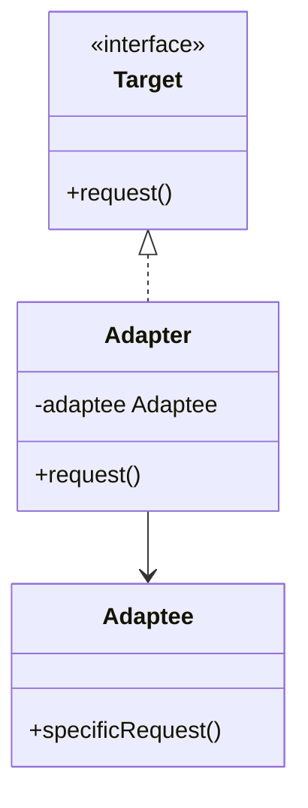

## 1. 意圖

將一個類的介面轉換為客戶端所期望的另一個介面，讓原本因介面不相容而無法協作的類能夠一起工作。

## 2. UML 類圖



## 3. 何時用 / 何時別用

**用**：
- 整合第三方 SDK，其介面與系統定義不同
- 改造遺留系統，在不修改舊程式的前提下接入新介面
- 統一多個來源的異構實作（如多家支付閘道）

**別用**：
- 介面差異極大，轉換邏輯超過 50 行 — 考慮重新設計
- 新系統，沒有遺留限制 — 直接設計統一介面即可
- 只為了「看起來統一」而包裝，沒有實際轉換需求

## 4. Java 範例

Object Adapter（組合，優先選用）：

```java
// 目標介面（系統期望）
public interface PaymentGateway {
    boolean charge(long amountCents, String currency);
}

// 第三方 SDK（不可修改）
public class StripeClient {
    public StripeResponse createCharge(String amount, String currency, Map<String, String> meta) {
        // ... Stripe API call
        return new StripeResponse(true, "ch_123");
    }
}

// Object Adapter
public class StripeAdapter implements PaymentGateway {
    private final StripeClient stripe;

    public StripeAdapter(StripeClient stripe) {
        this.stripe = stripe;
    }

    @Override
    public boolean charge(long amountCents, String currency) {
        String amount = String.valueOf(amountCents);
        Map<String, String> meta = Map.of("source", "adapter");
        StripeResponse resp = stripe.createCharge(amount, currency, meta);
        return resp.isSuccess();
    }
}
```

Class Adapter（繼承，Java 以 implements 模擬）：

```java
// 遺留日誌類
public class LegacyLogger {
    public void writeLog(String level, String message) { /* ... */ }
}

// 目標介面
public interface Logger {
    void info(String msg);
    void error(String msg);
}

// Class Adapter：繼承 Adaptee，實作 Target
public class LegacyLoggerAdapter extends LegacyLogger implements Logger {
    @Override public void info(String msg)  { writeLog("INFO",  msg); }
    @Override public void error(String msg) { writeLog("ERROR", msg); }
}
```

## 5. JDK / Spring 真實案例

**`InputStreamReader`**：將位元組流 `InputStream`（Adaptee）適配為字元流 `Reader`（Target）。`new InputStreamReader(socket.getInputStream())` 是教科書級範例。

**`Arrays.asList()`**：將陣列適配為 `List`，讓陣列可被 Collection API 操作。

**Spring MVC `HandlerAdapter`**：`DispatcherServlet` 透過 `HandlerAdapter` 統一呼叫各種 Handler（Controller、HttpRequestHandler、Servlet），無需關心具體型別。

## 6. 與相近 Pattern 的差異

| 面向 | Adapter | Decorator | Facade |
|------|---------|-----------|--------|
| 目的 | 轉換介面（相容性） | 疊加行為（功能擴充） | 簡化介面（隱藏複雜度） |
| 介面變化 | 轉換為不同介面 | 保持相同介面 | 提供更簡單的介面 |
| 典型時機 | 整合既有元件 | 動態增加功能 | 封裝子系統 |

## 7. 現代 Java 取代方案

Java 8+ 的 lambda 可在介面只有一個方法時直接充當輕量 Adapter：

```java
// 目標：Runnable；Adaptee：舊版 Task
Task legacyTask = new LegacyTask();
Runnable adapter = legacyTask::execute; // 單方法 Adapter，無需額外類別
```

多方法介面仍需傳統 Adapter 類別，此 pattern 仍是標準做法。

## 8. 參考資料

- GoF Design Patterns (1994), Chapter 4 — Adapter
- Effective Java, 3rd ed., Item 20: Prefer interfaces to abstract classes
