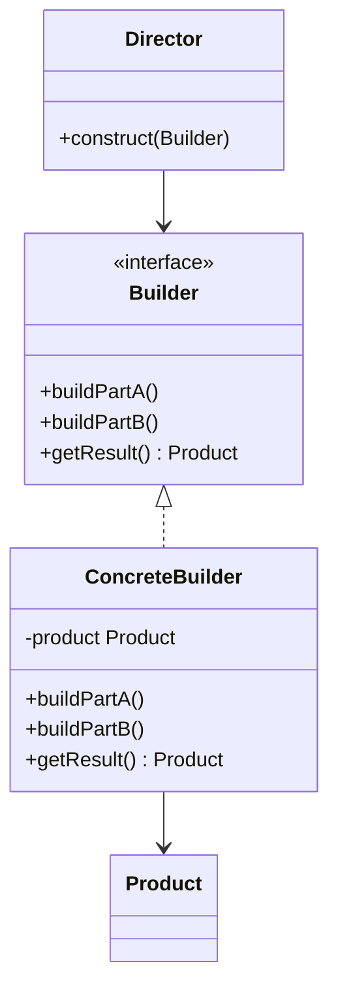

## 1. 意圖

將一個複雜物件的建構步驟與最終表示分離，使同樣的建構流程可以產生不同的物件，同時消除因可選參數過多而衍生的「伸縮建構子」反模式。

## 2. UML 類圖



## 3. 何時用 / 何時別用

**用**：
- 建構子有 4 個以上參數，且部分為可選（Effective Java Item 2）
- 物件不可變（immutable），但欄位多到無法一次傳入
- 需要在 `build()` 時做跨欄位的驗證邏輯

**別用**：
- 欄位少且全為必填，直接用建構子更清晰
- 物件非常簡單（考慮改用 Java Record）
- 效能極敏感路徑（每次 `build()` 都產生一個中間 Builder 物件）

## 4. Java 範例

以 HTTP 請求設定為例，展示必填欄位在 Builder 建構子中固定、可選欄位採 fluent 設定：

```java
public final class HttpRequest {
    private final String method;
    private final String url;
    private final Map<String, String> headers;
    private final String body;
    private final int timeoutMs;

    private HttpRequest(Builder b) {
        this.method     = b.method;
        this.url        = b.url;
        this.headers    = Map.copyOf(b.headers);
        this.body       = b.body;
        this.timeoutMs  = b.timeoutMs;
    }

    public static Builder of(String method, String url) {
        return new Builder(method, url);
    }

    public static final class Builder {
        private final String method;
        private final String url;
        private final Map<String, String> headers = new LinkedHashMap<>();
        private String body;
        private int timeoutMs = 5_000;

        private Builder(String method, String url) {
            if (method == null || method.isBlank()) throw new IllegalArgumentException("method required");
            if (url == null || url.isBlank())       throw new IllegalArgumentException("url required");
            this.method = method;
            this.url    = url;
        }

        public Builder header(String name, String value) {
            headers.put(name, value);
            return this;
        }

        public Builder body(String body) {
            this.body = body;
            return this;
        }

        public Builder timeoutMs(int ms) {
            if (ms <= 0) throw new IllegalArgumentException("timeoutMs must be positive");
            this.timeoutMs = ms;
            return this;
        }

        public HttpRequest build() {
            return new HttpRequest(this);
        }
    }

    // getters omitted for brevity
}

// 呼叫端
HttpRequest req = HttpRequest.of("POST", "https://api.example.com/users")
    .header("Content-Type", "application/json")
    .header("Authorization", "Bearer token")
    .body("{\"name\":\"Alice\"}")
    .timeoutMs(3_000)
    .build();
```

## 5. JDK / Spring 真實案例

| 案例 | 說明 |
|------|------|
| `StringBuilder` / `StringJoiner` | 最基本的 Builder：累積片段，最後呼叫 `toString()` 一次性建立不可變字串 |
| `Stream.Builder<T>` | `Stream.<String>builder().add("a").add("b").build()` — 先收集元素，再建立 Stream |
| Spring `UriComponentsBuilder` | `UriComponentsBuilder.fromHttpUrl(url).queryParam("k","v").build()` — 建構 URI，最後 `build()` 回傳不可變的 `UriComponents` |
| Spring `MockMvcRequestBuilders` | `MockMvcRequestBuilders.post("/api").content(json).contentType(MediaType.APPLICATION_JSON)` — 測試中建構 HTTP 請求 |

## 6. 與相近 Pattern 的差異

| | Builder | Factory Method | Prototype |
|---|---|---|---|
| 關注點 | 逐步建構複雜物件 | 決定建立哪個子類 | 複製現有實例 |
| 參數多寡 | 適合多可選參數 | 通常參數少 | 從既有狀態複製 |
| 回傳時機 | 呼叫 `build()` 才完成 | 方法呼叫立刻回傳 | 呼叫 `clone()` 立刻回傳 |

## 7. 現代 Java 取代方案

**Lombok `@Builder`** 是目前最常見的寫法，它自動生成上述 Builder 樣板：

```java
@Builder
@Value  // 搭配 @Value 讓欄位 final + getter
public class HttpRequest {
    @NonNull String method;
    @NonNull String url;
    @Builder.Default int timeoutMs = 5_000;
    String body;
}
```

Lombok 生成的程式碼等同於手寫的靜態內部 Builder 類，加上 `toBuilder()` 支援 wither-style 複製。

**Java Records** 適合所有欄位皆必填且數量合理的情境，但沒有內建流式 API；多個可選欄位時仍建議搭配 Builder 或 Lombok：

```java
// 適合 Record：欄位少，全必填
public record Point(double x, double y) {}

// 不適合 Record：欄位多且有預設值，用 Builder 更清晰
```

## 8. 參考資料

- GoF Design Patterns (1994), Ch. 3 — Builder
- Effective Java 3rd Ed., Item 2 — Consider a builder when faced with many constructor parameters
- Project Lombok documentation — `@Builder`
