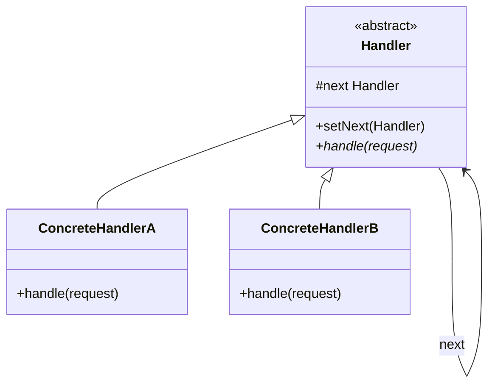

## 1. 意圖

將請求沿著處理者鏈依序傳遞，每個處理者決定自己是否處理，或繼續往下傳。

## 2. UML 類圖



## 3. 何時用 / 何時別用

**用**：
- 超過一個物件可能處理同一請求，且處理者在執行期才決定（審批流、過濾管道）
- 需要動態組裝或重排處理者順序
- 不想讓發送者知道具體由誰處理

**別用**：
- 每個請求必須保證被處理——責任鏈可能讓請求靜默消失
- 處理者固定且少（2-3 個），直接 if/else 更清楚
- 鏈很長時效能敏感的熱路徑

## 4. Java 範例

```java
// 審批請求：金額超過閾值就往上傳
public abstract class Approver {
    private Approver next;

    public Approver setNext(Approver next) {
        this.next = next;
        return next;
    }

    public final void approve(long amount) {
        if (canApprove(amount)) {
            doApprove(amount);
        } else if (next != null) {
            next.approve(amount);
        } else {
            throw new IllegalStateException("No approver for amount: " + amount);
        }
    }

    protected abstract boolean canApprove(long amount);
    protected abstract void doApprove(long amount);
}

public class TeamLead extends Approver {
    @Override protected boolean canApprove(long amount) { return amount <= 1_000; }
    @Override protected void doApprove(long amount) {
        System.out.println("TeamLead approved: " + amount);
    }
}

public class Manager extends Approver {
    @Override protected boolean canApprove(long amount) { return amount <= 10_000; }
    @Override protected void doApprove(long amount) {
        System.out.println("Manager approved: " + amount);
    }
}

public class Director extends Approver {
    @Override protected boolean canApprove(long amount) { return true; }
    @Override protected void doApprove(long amount) {
        System.out.println("Director approved: " + amount);
    }
}

// 組裝鏈
Approver chain = new TeamLead();
chain.setNext(new Manager()).setNext(new Director());

chain.approve(500);     // TeamLead approved: 500
chain.approve(5_000);   // Manager approved: 5000
chain.approve(50_000);  // Director approved: 50000
```

## 5. JDK / Spring 真實案例

**ClassLoader 親委派**：`ClassLoader.loadClass()` 先委派給 parent，parent 找不到才自己載入，這就是責任鏈的「先傳再自處理」變體。

**Servlet FilterChain**：`javax.servlet.Filter.doFilter(request, response, chain)` 呼叫 `chain.doFilter()` 把控制權傳到下一個 Filter，Spring Security 整個過濾器堆疊就是此模式的實作。

**Spring HandlerInterceptor**：`preHandle()` 回傳 `false` 即中斷鏈，`true` 則繼續傳遞，等同於有條件的責任鏈。

## 6. 與相近 Pattern 的差異

| 維度 | Chain of Responsibility | Command |
|------|------------------------|---------|
| 目的 | 路由請求，找到能處理的那個 | 封裝請求為物件，支援 undo/queue |
| 接收者 | 鏈中的某一個（或無人）處理 | 明確指定 Receiver |
| 請求流向 | 沿鏈傳遞，可在任意節點停止 | 直接由 Invoker 呼叫 Command |

## 7. 現代 Java 取代方案

可用函數式組合替代繼承式鏈：

```java
// 用 UnaryOperator 鏈組裝管道
UnaryOperator<String> trim    = String::trim;
UnaryOperator<String> lower   = String::toLowerCase;
UnaryOperator<String> noBlank = s -> s.replaceAll("\\s+", "_");

UnaryOperator<String> pipeline = trim.andThen(lower).andThen(noBlank);
System.out.println(pipeline.apply("  Hello World  ")); // hello_world
```

`Filter` 使用 `Predicate.and()` / `or()` 也是同一精神。傳統繼承式責任鏈在需要 `undo`、狀態保存或動態插拔節點時仍是標準做法。

## 8. 參考資料

- GoF *Design Patterns* (1994), ch.5 Chain of Responsibility
- Oracle Docs — [ClassLoader.loadClass](https://docs.oracle.com/en/java/docs/api/java.base/java/lang/ClassLoader.html)
- Spring Security Reference — Filter Chain
