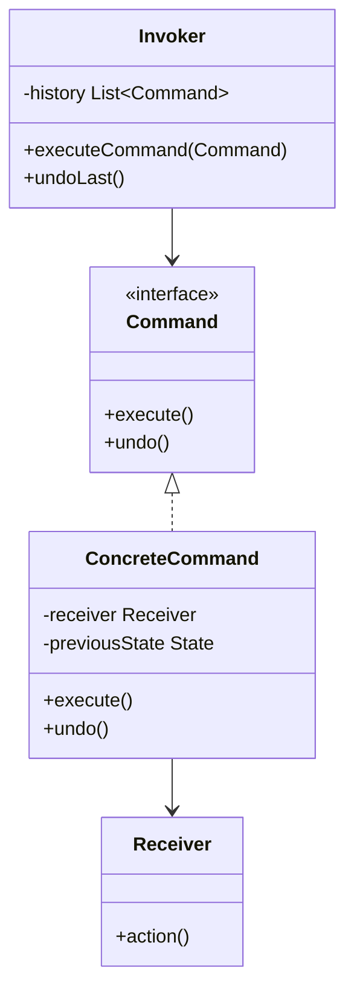

## 1. 意圖

將一個請求封裝為獨立物件（Command），使請求可被排隊、記錄、撤銷或重做。

## 2. UML 類圖



## 3. 何時用 / 何時別用

**用**：
- 需要 undo/redo（文字編輯器、繪圖工具）
- 請求需要排隊、延遲執行或記錄日誌
- 支援 macro 操作（一次執行多個命令）

**別用**：
- 操作簡單且不需要撤銷，引入 Command 只增加類別數量
- Receiver 與呼叫者本就在同一層，直接呼叫更清楚

## 4. Java 範例

```java
// Command 介面
public interface Command {
    void execute();
    void undo();
}

// Receiver
public class TextBuffer {
    private final StringBuilder buf = new StringBuilder();

    public void insert(int pos, String text) { buf.insert(pos, text); }
    public void delete(int pos, int len)    { buf.delete(pos, pos + len); }
    public String content()                 { return buf.toString(); }
}

// ConcreteCommand
public class InsertCommand implements Command {
    private final TextBuffer buf;
    private final int pos;
    private final String text;

    public InsertCommand(TextBuffer buf, int pos, String text) {
        this.buf = buf; this.pos = pos; this.text = text;
    }

    @Override public void execute() { buf.insert(pos, text); }
    @Override public void undo()    { buf.delete(pos, text.length()); }
}

// Invoker（含歷史紀錄）
public class Editor {
    private final Deque<Command> history = new ArrayDeque<>();

    public void execute(Command cmd) {
        cmd.execute();
        history.push(cmd);
    }

    public void undo() {
        if (!history.isEmpty()) history.pop().undo();
    }
}

// 使用
TextBuffer buffer = new TextBuffer();
Editor editor = new Editor();

editor.execute(new InsertCommand(buffer, 0, "Hello"));
editor.execute(new InsertCommand(buffer, 5, " World"));
System.out.println(buffer.content()); // Hello World

editor.undo();
System.out.println(buffer.content()); // Hello
```

## 5. JDK / Spring 真實案例

**`Runnable` / `Callable`**：最精簡的 Command 介面。`Runnable` 是無回傳值的 `execute()`；`Callable<V>` 增加了回傳值，兩者都可丟入 `ExecutorService` 排隊執行。

**`java.swing.Action`**：Swing 的 `Action` 介面就是完整 Command，含 `actionPerformed()`、`setEnabled()`，可同時綁定按鈕與選單。

**Spring `@Async` + TaskExecutor**：`@Async` 方法呼叫被代理成 `Runnable`，丟給 `ThreadPoolTaskExecutor` 佇列，即非同步 Command 佇列的實際應用。

**CQRS Command Bus（Axon / Spring Modulith）**：Command 物件（`CreateOrderCommand`）透過 `CommandBus.send()` 路由到對應的 `CommandHandler`，是命令模式的架構層實踐。

## 6. 與相近 Pattern 的差異

| 維度 | Command | Strategy |
|------|---------|----------|
| 封裝 | 封裝「一次請求」＋ Receiver 參考 | 封裝「演算法」，不帶 Receiver |
| 目的 | 支援 undo、排隊、log | 執行期切換演算法 |
| 可互換性 | 每個 Command 對應一次操作 | Strategy 之間互相可替換 |

## 7. 現代 Java 取代方案

Lambda 可直接充當無狀態的 Command：

```java
// 用 Runnable lambda 代替匿名 Command 類別
Deque<Runnable> undoStack = new ArrayDeque<>();

TextBuffer buf = new TextBuffer();
String text = "Hi";
int pos = 0;

// execute
buf.insert(pos, text);
undoStack.push(() -> buf.delete(pos, text.length()));

// undo
if (!undoStack.isEmpty()) undoStack.pop().run();
```

需要 `undo()`、狀態快照或巨集命令時，完整 Command 類別仍是標準做法。

## 8. 參考資料

- GoF *Design Patterns* (1994), ch.5 Command
- Martin Fowler — [Command Query Separation](https://martinfowler.com/bliki/CommandQuerySeparation.html)
- Axon Framework Docs — Command Handling
