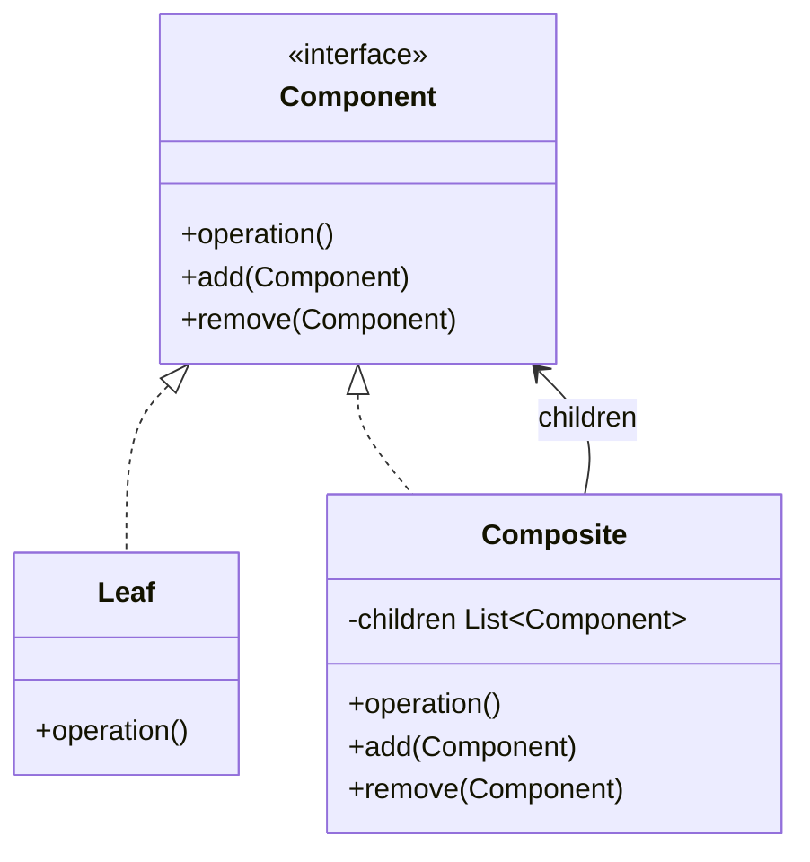

## 1. 意圖

將物件組合成樹狀結構以表示「部分—整體」層次，讓客戶端對單個物件（Leaf）與組合物件（Composite）使用相同的介面。

## 2. UML 類圖



## 3. 何時用 / 何時別用

**用**：
- 資料天然形成樹狀結構（檔案系統、組織圖、選單、UI 元件樹）
- 希望客戶端程式碼不需判斷「這是葉子還是組合」就能統一呼叫

**別用**：
- 結構扁平，沒有遞迴嵌套需求
- 需要對 Leaf 與 Composite 做不同型別處理（型別安全比透明性更重要時，用 Safe 設計或 Visitor）

## 4. Java 範例

**Transparent 設計**（Leaf 實作 add/remove 丟例外）vs **Safe 設計**（Leaf 不宣告 add/remove）。以下示範較常見的 Transparent 設計，並以組織圖為例：

```java
public interface Employee {
    String getName();
    double getSalary();
    void print(String indent);
}

// Leaf
public class Developer implements Employee {
    private final String name;
    private final double salary;

    public Developer(String name, double salary) {
        this.name = name;
        this.salary = salary;
    }

    @Override public String getName()  { return name; }
    @Override public double getSalary() { return salary; }

    @Override
    public void print(String indent) {
        System.out.println(indent + "- " + name + " ($" + salary + ")");
    }
}

// Composite
public class Manager implements Employee {
    private final String name;
    private final double salary;
    private final List<Employee> reports = new ArrayList<>();

    public Manager(String name, double salary) {
        this.name = name;
        this.salary = salary;
    }

    public void add(Employee e)    { reports.add(e); }
    public void remove(Employee e) { reports.remove(e); }

    @Override public String getName()  { return name; }
    @Override public double getSalary() { return salary; }

    public double getTotalCost() {
        return salary + reports.stream().mapToDouble(e ->
            e instanceof Manager m ? m.getTotalCost() : e.getSalary()
        ).sum();
    }

    @Override
    public void print(String indent) {
        System.out.println(indent + "+ " + name + " (mgr, $" + salary + ")");
        reports.forEach(e -> e.print(indent + "  "));
    }
}

// 建構樹狀結構
Manager vp = new Manager("Alice", 200_000);
Manager lead = new Manager("Bob", 120_000);
lead.add(new Developer("Carol", 90_000));
lead.add(new Developer("Dave",  85_000));
vp.add(lead);
vp.print("");
System.out.println("Total cost: " + vp.getTotalCost());
```

## 5. JDK / Spring 真實案例

**`java.awt.Component`**：`Component`（介面）、`Container extends Component`（Composite）、`Button extends Component`（Leaf）。整個 AWT/Swing 元件樹即 Composite Pattern 的實作。

**`javax.faces.component.UIComponent`**：JSF 頁面元件樹，每個元件可包含子元件，渲染時遞迴呼叫 `encodeChildren()`。

**Spring Security `AuthorizationDecision`**：複合授權規則（`CompositeAuthorizationManager`）遞迴評估多個子規則，最終回傳單一 decision。

## 6. 與相近 Pattern 的差異

| 面向 | Composite | Decorator |
|------|-----------|-----------|
| 目的 | 表示樹狀部分—整體層次 | 動態疊加行為 |
| 子節點數量 | 0..N 個子元件 | 只包裝 1 個元件 |
| 焦點 | 結構（樹） | 行為（責任疊加） |

## 7. 現代 Java 取代方案

Java 16+ **sealed interface** 可以明確表達 Leaf/Composite 的封閉型別，讓 `instanceof` 模式匹配取代 `UnsupportedOperationException`：

```java
public sealed interface FileNode permits FileLeaf, FileDirectory {}
public record FileLeaf(String name, long size) implements FileNode {}
public record FileDirectory(String name, List<FileNode> children) implements FileNode {
    public long totalSize() {
        return children.stream().mapToLong(n -> switch (n) {
            case FileLeaf l -> l.size();
            case FileDirectory d -> d.totalSize();
        }).sum();
    }
}
```

Sealed + records 讓結構更明確，且編譯器會強制你處理所有子型別。

## 8. 參考資料

- GoF Design Patterns (1994), Chapter 4 — Composite
- Effective Java, 3rd ed., Item 41: Use marker interfaces to define types
