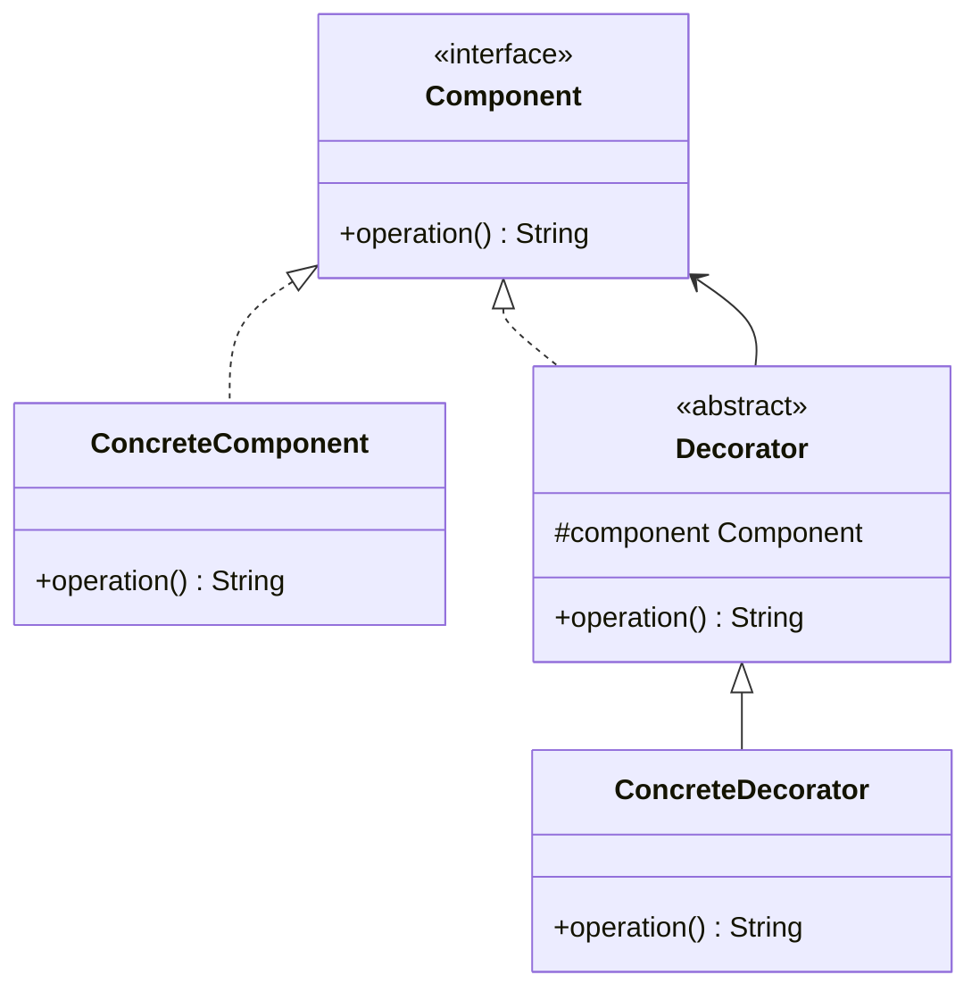

## 1. 意圖

在不修改原始類別的情況下，透過包裝（組合）動態地為物件附加新功能，作為繼承的彈性替代方案。

## 2. UML 類圖



## 3. 何時用 / 何時別用

**用**：
- 需要疊加多個獨立的行為，且組合數量多（繼承會類別爆炸）
- 需要在執行期動態增減功能（不同使用者看到不同裝飾組合）
- 橫切關注點（logging、retry、rate limit）不想侵入核心邏輯

**別用**：
- 只需一種固定擴充，直接繼承或 Strategy 更簡單
- 裝飾器層數超過 3-4 層，Debug 困難，改用 Pipeline / Chain of Responsibility
- 需要明確知道具體型別時（Decorator 會遮蔽真實型別）

## 4. Java 範例

以 HTTP client 為例，疊加 logging 與 retry 裝飾器：

```java
// Component
public interface HttpClient {
    String get(String url);
}

// ConcreteComponent
public class SimpleHttpClient implements HttpClient {
    @Override
    public String get(String url) {
        // 實際 HTTP 呼叫
        return "response from " + url;
    }
}

// 抽象 Decorator
public abstract class HttpClientDecorator implements HttpClient {
    protected final HttpClient delegate;

    protected HttpClientDecorator(HttpClient delegate) {
        this.delegate = delegate;
    }
}

// ConcreteDecorator：Logging
public class LoggingHttpClient extends HttpClientDecorator {
    public LoggingHttpClient(HttpClient delegate) { super(delegate); }

    @Override
    public String get(String url) {
        System.out.println("GET " + url);
        String result = delegate.get(url);
        System.out.println("Response: " + result);
        return result;
    }
}

// ConcreteDecorator：Retry
public class RetryHttpClient extends HttpClientDecorator {
    private final int maxRetries;

    public RetryHttpClient(HttpClient delegate, int maxRetries) {
        super(delegate);
        this.maxRetries = maxRetries;
    }

    @Override
    public String get(String url) {
        for (int i = 0; i < maxRetries; i++) {
            try {
                return delegate.get(url);
            } catch (RuntimeException e) {
                if (i == maxRetries - 1) throw e;
            }
        }
        throw new IllegalStateException("unreachable");
    }
}

// 使用：疊加裝飾器
HttpClient client = new LoggingHttpClient(
    new RetryHttpClient(
        new SimpleHttpClient(), 3));
client.get("https://api.example.com/users");
```

## 5. JDK / Spring 真實案例

**`java.io` 串流**：`BufferedInputStream(new FileInputStream("file.txt"))` 是最經典的 Decorator 應用。`InputStream` 是 Component，`FilterInputStream` 是 Decorator 基類，`BufferedInputStream`、`GZIPInputStream`、`CipherInputStream` 都是 ConcreteDecorator。

**`HttpServletRequestWrapper`**：Spring/Servlet 的 `HttpServletRequestWrapper` 允許在 Filter 中包裝並修改 Request（如解密、重寫 Header），不需繼承 `HttpServletRequest` 的具體實作。

**Spring `TransactionInterceptor`**：`@Transactional` 的底層透過 Spring AOP 在 Bean 外包一個 Proxy（本質是 Decorator），在方法前後插入 begin/commit/rollback，不修改業務程式碼。

## 6. 與相近 Pattern 的差異

| 面向 | Decorator | Proxy | Adapter |
|------|-----------|-------|---------|
| 目的 | 疊加行為（增強） | 控制存取（保護/延遲） | 轉換介面（相容性） |
| 介面 | 與被裝飾物件相同 | 與被代理物件相同 | 轉換為不同介面 |
| 設計時機 | 執行期動態疊加 | 通常編譯期確定 | 整合既有元件 |

## 7. 現代 Java 取代方案

**`Function.compose()` / `Function.andThen()`** 是 Decorator 的函數式版本，適合單一方法轉換鏈：

```java
Function<String, String> trim    = String::trim;
Function<String, String> upper   = String::toUpperCase;
Function<String, String> bracket = s -> "[" + s + "]";

// 組合（等同疊加三層 Decorator）
Function<String, String> pipeline = trim.andThen(upper).andThen(bracket);
System.out.println(pipeline.apply("  hello  ")); // [HELLO]
```

多方法介面的行為疊加仍需傳統 Decorator，此 pattern 仍是標準做法。

## 8. 參考資料

- GoF Design Patterns (1994), Chapter 4 — Decorator
- Effective Java, 3rd ed., Item 18: Favor composition over inheritance
