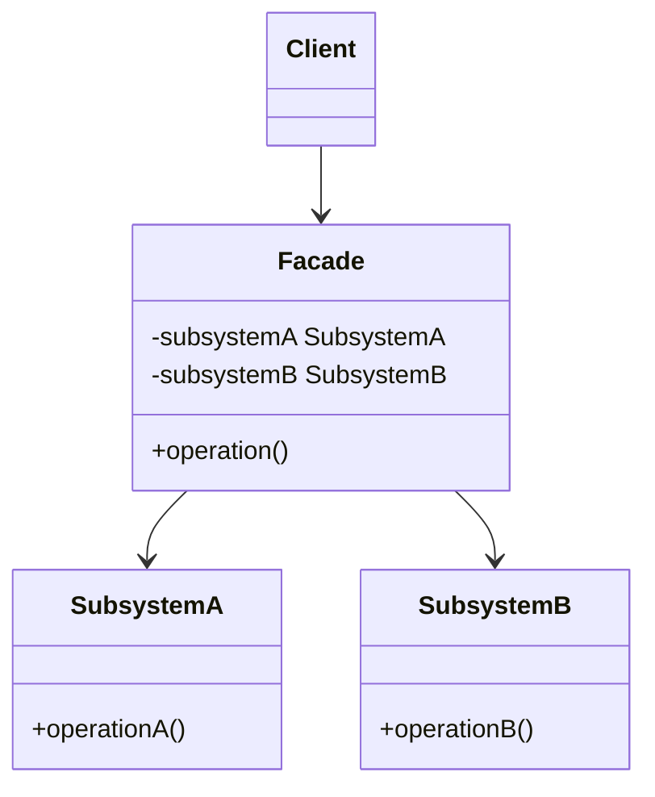

## 1. 意圖

為子系統中一組複雜的介面提供統一、簡化的高階介面，讓客戶端不需了解子系統內部結構即可使用。

## 2. UML 類圖



## 3. 何時用 / 何時別用

**用**：
- 子系統複雜（多個類別、多個步驟），客戶端只需使用常見操作
- 分層架構中降低層與層之間的耦合（如 Service 層封裝 Repository + Cache + Event）
- 替換或重構子系統時，只需更新 Facade，對外介面不變

**別用**：
- 子系統本身已很簡單，Facade 只是增加無意義的轉發層
- 需要存取子系統完整功能的進階用戶 — Facade 不應強制封鎖，高階用戶可直接使用子系統
- 把 Facade 設計成 God Class，聚集過多業務邏輯（Facade 不是業務層）

## 4. Java 範例

電商下訂單流程：封裝庫存、支付、通知三個子系統：

```java
// 子系統 A
public class InventoryService {
    public boolean reserve(String productId, int qty) {
        System.out.println("Reserving " + qty + " x " + productId);
        return true;
    }
}

// 子系統 B
public class PaymentService {
    public boolean charge(String userId, BigDecimal amount) {
        System.out.println("Charging " + userId + " for $" + amount);
        return true;
    }
}

// 子系統 C
public class NotificationService {
    public void sendOrderConfirmation(String userId, String orderId) {
        System.out.println("Email sent to " + userId + " for order " + orderId);
    }
}

// Facade
public class OrderFacade {
    private final InventoryService inventory;
    private final PaymentService payment;
    private final NotificationService notification;

    public OrderFacade(InventoryService inventory,
                       PaymentService payment,
                       NotificationService notification) {
        this.inventory = inventory;
        this.payment = payment;
        this.notification = notification;
    }

    public String placeOrder(String userId, String productId,
                             int qty, BigDecimal price) {
        if (!inventory.reserve(productId, qty)) {
            throw new IllegalStateException("Out of stock: " + productId);
        }
        if (!payment.charge(userId, price.multiply(BigDecimal.valueOf(qty)))) {
            throw new IllegalStateException("Payment failed for user: " + userId);
        }
        String orderId = UUID.randomUUID().toString();
        notification.sendOrderConfirmation(userId, orderId);
        return orderId;
    }
}

// 客戶端只需呼叫一個方法
OrderFacade facade = new OrderFacade(
    new InventoryService(), new PaymentService(), new NotificationService());
String orderId = facade.placeOrder("user-1", "prod-42", 2, new BigDecimal("29.99"));
```

## 5. JDK / Spring 真實案例

**SLF4J**：`LoggerFactory.getLogger()` 是 Facade，隱藏了 Logback、Log4j、JUL 等底層框架的初始化細節。

**Spring `JdbcTemplate`**：封裝了 `Connection` 取得、`PreparedStatement` 建立、例外轉換、資源釋放等步驟，客戶端只需提供 SQL 與 RowMapper。

**Spring `@Service` 層**：典型的 Facade — 一個 `OrderService.placeOrder()` 背後協調 `UserRepository`、`ProductRepository`、`PaymentGateway`、`KafkaTemplate` 等多個元件，Controller 完全不需感知這些細節。

## 6. 與相近 Pattern 的差異

| 面向 | Facade | Mediator | Adapter |
|------|--------|----------|---------|
| 目的 | 簡化子系統存取 | 協調多元件通訊 | 轉換介面相容性 |
| 子系統感知 | 子系統不知道 Facade 存在 | 各元件知道 Mediator | Adaptee 不知道 Adapter |
| 通訊方向 | Client → Facade → Subsystem | 各元件 ↔ Mediator ↔ 各元件 | Client → Adapter → Adaptee |

## 7. 現代 Java 取代方案

N/A — 此 pattern 仍是標準做法，Spring 的 Service 層架構就是 Facade 的最佳實踐。

在 Java 9+ 的模組系統（JPMS）中，`module-info.java` 的 `exports` 宣告可強制在編譯層實現 Facade：只 export 高階 API 套件，子系統套件不 export，架構約束由編譯器保證。

## 8. 參考資料

- GoF Design Patterns (1994), Chapter 4 — Facade
- Clean Architecture, Robert C. Martin — Chapter on Boundaries
