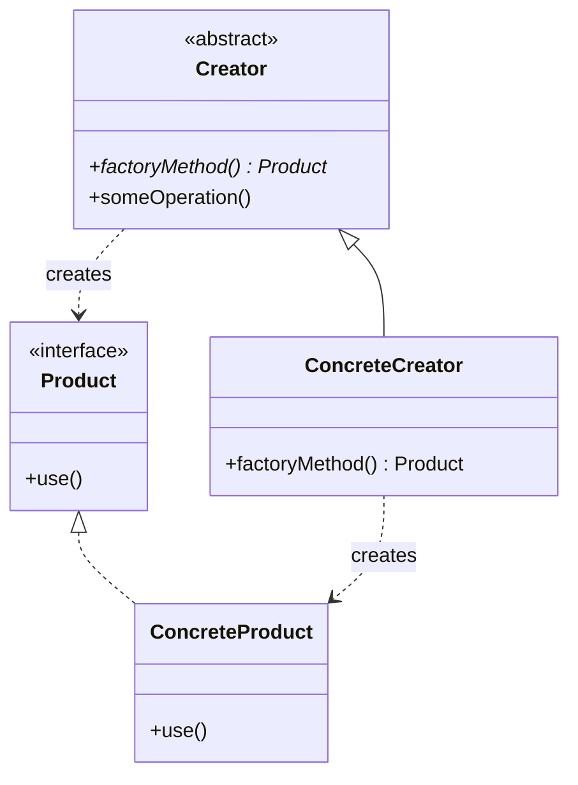

## 1. 意圖

定義一個建立物件的介面，但將實際要實例化哪個類別的決定延遲到子類別，讓框架程式碼只依賴抽象，由具體子類別決定產品。

## 2. UML 類圖



## 3. 何時用 / 何時別用

**用**：
- 框架提供擴充點，讓呼叫端決定要建立哪種物件（如 JUnit TestCase 建立 TestResult）
- 產品類型在編譯期未知，需在執行期由設定或輸入決定
- 希望透過繼承擴充建立邏輯，而非修改既有程式碼（OCP）

**別用**：
- 產品種類固定且少（改用 Static Factory Method 就夠了）
- 為了「彈性」而過度抽象，衍生只有一個 Creator 子類的無謂繼承
- 搭配 Spring DI 時，通常直接注入 `List<Strategy>` 再用 Map 查找即可

## 4. Java 範例

```java
// Product 介面
public interface Notifier {
    void send(String to, String message);
}

// Concrete Products
public class EmailNotifier implements Notifier {
    @Override
    public void send(String to, String message) {
        // 送出 Email
    }
}

public class SmsNotifier implements Notifier {
    @Override
    public void send(String to, String message) {
        // 送出 SMS
    }
}

// Creator
public abstract class NotificationService {

    // Factory Method
    protected abstract Notifier createNotifier();

    public void notify(String to, String message) {
        Notifier notifier = createNotifier();
        notifier.send(to, message);
    }
}

// Concrete Creators
public class EmailNotificationService extends NotificationService {
    @Override
    protected Notifier createNotifier() {
        return new EmailNotifier();
    }
}

public class SmsNotificationService extends NotificationService {
    @Override
    protected Notifier createNotifier() {
        return new SmsNotifier();
    }
}
```

## 5. JDK / Spring 真實案例

| 案例 | 說明 |
|------|------|
| `java.util.Calendar.getInstance()` | 依 Locale / TimeZone 回傳不同子類（BuddhistCalendar、GregorianCalendar）——這是靜態工廠方法，但體現相同「延遲決定具體類別」概念 |
| `java.sql.Connection.createStatement()` | `Connection` 是 Creator，各 JDBC Driver 子類決定回傳哪種 `Statement` |
| `javax.xml.parsers.DocumentBuilderFactory.newDocumentBuilder()` | 抽象工廠方法，實作由 SPI 決定 |
| Spring `BeanFactory.getBean()` | IoC 容器本身是一個大型 Factory Method，`BeanDefinition` 決定實際建立哪個類別 |

## 6. 與相近 Pattern 的差異

> **常見混淆釐清**：

| | Simple Factory | Factory Method（GoF） | Abstract Factory | Effective Java 靜態工廠方法 |
|---|---|---|---|---|
| 是否為 GoF Pattern | 否，是工具方法 | 是 | 是 | 否，是 coding idiom |
| 擴充方式 | 修改 switch/if | 新增子類 | 新增工廠族 | 無繼承，靠方法名 |
| 建立目標 | 單一產品 | 單一產品，子類決定 | 一族相關產品 | 任意 |
| 典型範例 | `VehicleFactory.create(type)` | `DocumentCreator.createDocument()` | `GUIFactory.createButton()` | `List.of()`, `Optional.of()` |

## 7. 現代 Java 取代方案

若產品數量固定，可用 `enum` + 方法參考取代繼承體系：

```java
public enum Channel {
    EMAIL(EmailNotifier::new),
    SMS(SmsNotifier::new);

    private final Supplier<Notifier> factory;

    Channel(Supplier<Notifier> factory) {
        this.factory = factory;
    }

    public Notifier create() {
        return factory.get();
    }
}
```

在 Spring 環境中，透過 `Map<String, Notifier>` 注入所有實作（策略模式），往往比繼承工廠更易測試與維護：

```java
@Service
public class NotificationDispatcher {
    private final Map<String, Notifier> notifiers;

    public NotificationDispatcher(List<Notifier> notifierList) {
        this.notifiers = notifierList.stream()
            .collect(Collectors.toMap(n -> n.getClass().getSimpleName(), n -> n));
    }

    public void dispatch(String channel, String to, String message) {
        Notifier notifier = notifiers.get(channel);
        if (notifier == null) throw new IllegalArgumentException("Unknown channel: " + channel);
        notifier.send(to, message);
    }
}
```

## 8. 參考資料

- GoF Design Patterns (1994), Ch. 3 — Factory Method
- Effective Java 3rd Ed., Item 1 — Consider static factory methods instead of constructors
- Head First Design Patterns 2nd Ed., Ch. 4
