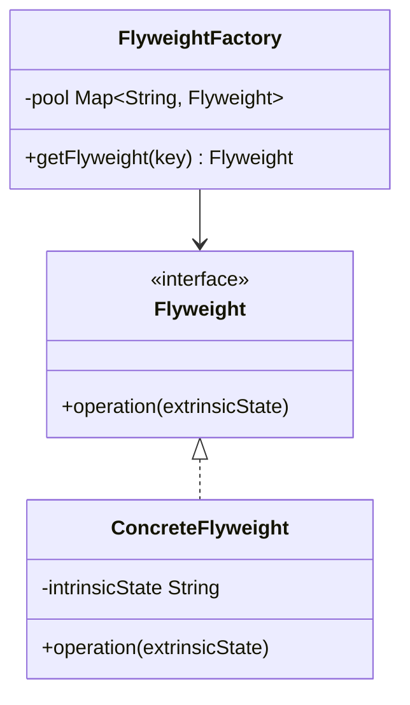

## 1. 意圖

藉由共享內部狀態（intrinsic state），支援大量細粒度物件，避免每個物件都儲存完整狀態造成的記憶體浪費。

## 2. UML 類圖



## 3. 何時用 / 何時別用

**用**：
- 系統中存在大量（數千以上）結構相似的物件
- 物件的大部分狀態可以外部化（由呼叫端傳入）
- 記憶體是主要瓶頸

**別用**：
- 物件數量少（< 幾百個），共享池的管理開銷得不償失
- 物件的狀態幾乎全是外部狀態，共享不了多少
- 需要物件獨立身份（identity）時，共享會破壞語意

## 4. Java 範例

以文字編輯器的字元樣式（字型、大小）為例：

```java
// 內部狀態（共享，不可變）
public record TextStyle(String fontFamily, int fontSize, boolean bold) {}

// Flyweight：只儲存內部狀態
public class CharFlyweight {
    private final TextStyle style; // intrinsic

    public CharFlyweight(TextStyle style) {
        this.style = style;
    }

    // extrinsicState：位置、顏色等由外部傳入
    public void render(char c, int x, int y, String color) {
        System.out.printf("'%c' at (%d,%d) color=%s font=%s %dpx bold=%b%n",
            c, x, y, color, style.fontFamily(), style.fontSize(), style.bold());
    }
}

// Factory：管理共享池
public class CharFlyweightFactory {
    private static final Map<TextStyle, CharFlyweight> POOL = new ConcurrentHashMap<>();

    public static CharFlyweight get(TextStyle style) {
        return POOL.computeIfAbsent(style, CharFlyweight::new);
    }

    public static int poolSize() { return POOL.size(); }
}

// 使用：1000 個字元，但共享池只有 2 個 Flyweight 物件
TextStyle normal = new TextStyle("Arial", 12, false);
TextStyle bold   = new TextStyle("Arial", 14, true);

for (int i = 0; i < 500; i++) {
    CharFlyweight f = CharFlyweightFactory.get(normal);
    f.render('A', i, 0, "black");
}
for (int i = 0; i < 500; i++) {
    CharFlyweight f = CharFlyweightFactory.get(bold);
    f.render('B', i, 20, "red");
}
System.out.println("Pool size: " + CharFlyweightFactory.poolSize()); // 2
```

## 5. JDK / Spring 真實案例

**`Integer.valueOf(int)`**：JDK 快取 -128 到 127 的 `Integer` 實例（`IntegerCache`）。`Integer.valueOf(100) == Integer.valueOf(100)` 為 `true`，因為回傳同一個物件。

**`Boolean.TRUE` / `Boolean.FALSE`**：只有兩個實例，整個 JVM 共享。

**`String.intern()`**：將字串加入字串常量池，相同內容的字串共享同一個物件。過度使用會造成 PermGen/Metaspace 壓力。

## 6. 與相近 Pattern 的差異

| 面向 | Flyweight | Object Pool | Singleton |
|------|-----------|-------------|-----------|
| 目的 | 共享細粒度物件節省記憶體 | 重用昂貴物件（DB connection） | 全域只有一個實例 |
| 物件數量 | 多個（依 key 分類） | 固定數量（池大小） | 唯一一個 |
| 狀態管理 | 內外部狀態分離 | 物件有完整狀態 | 無狀態或全域狀態 |

## 7. 現代 Java 取代方案

Java 16+ **records** 天生是 Flyweight 的 intrinsic state 容器 — 不可變、`equals()/hashCode()` 基於所有欄位、可作為 Map key：

```java
// Record 本身就是不可變的 intrinsic state
public record Glyph(char character, String font, int size) {}

// 搭配 Map 快取，三行實現 Flyweight Factory
private static final Map<Glyph, GlyphRenderer> CACHE = new ConcurrentHashMap<>();
public static GlyphRenderer get(Glyph g) {
    return CACHE.computeIfAbsent(g, GlyphRenderer::new);
}
```

## 8. 參考資料

- GoF Design Patterns (1994), Chapter 4 — Flyweight
- JDK source: `java.lang.Integer.IntegerCache`
