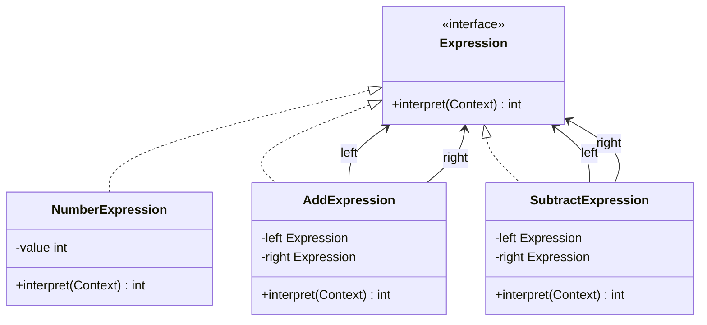

## 1. 意圖

為一個語言定義文法表示，並提供解釋器來處理該文法的句子（AST 節點遞迴求值）。

## 2. UML 類圖



## 3. 何時用 / 何時別用

**用**：
- 語法簡單且穩定（規則引擎、數學運算式、權限 DSL）
- 語句可自然對應樹狀結構，且求值邏輯遞迴清晰
- 不值得引入外部解析器依賴的輕量場景

**別用**：
- 語法複雜或頻繁演進 — 改用 ANTLR、JavaCC 或 parser-combinator
- 效能敏感：每個節點都是物件，深度 AST 造成大量 GC 壓力
- 需要錯誤訊息、型別推導等語言工具鏈功能
- 現代程式中直接使用 Interpreter 的情況已很少見；優先考慮 SpEL、Groovy Script 等現成方案

## 4. Java 範例

四則運算的最小實作：

```java
// Expression 介面
public interface Expression {
    int interpret();
}

// Terminal expression
public record NumberExpr(int value) implements Expression {
    @Override
    public int interpret() { return value; }
}

// Non-terminal expressions
public record AddExpr(Expression left, Expression right) implements Expression {
    @Override
    public int interpret() { return left.interpret() + right.interpret(); }
}

public record SubtractExpr(Expression left, Expression right) implements Expression {
    @Override
    public int interpret() { return left.interpret() - right.interpret(); }
}

public record MultiplyExpr(Expression left, Expression right) implements Expression {
    @Override
    public int interpret() { return left.interpret() * right.interpret(); }
}

// 建構 (3 + 5) * 2
Expression expr = new MultiplyExpr(
    new AddExpr(new NumberExpr(3), new NumberExpr(5)),
    new NumberExpr(2)
);
System.out.println(expr.interpret()); // 16
```

## 5. JDK / Spring 真實案例

| 技術 | 說明 |
|------|------|
| `java.util.regex.Pattern` | 正則表達式引擎；JDK 內建最典型的 Interpreter 實作 |
| Spring Expression Language (SpEL) | `ExpressionParser` 解析 `"#user.age > 18"` 等運算式，廣泛用於 `@Value`、`@Cacheable(condition)` |
| Spring Security `@PreAuthorize` | 以 SpEL 解析 `"hasRole('ADMIN') and #id == authentication.name"`，是規則引擎式的 Interpreter |

```java
// SpEL 範例 — 實際工作中比手寫 Interpreter 更常見
ExpressionParser parser = new SpelExpressionParser();
Expression exp = parser.parseExpression("'Hello World'.toUpperCase()");
String result = (String) exp.getValue(); // HELLO WORLD

// @PreAuthorize 背後即 SpEL Interpreter
@PreAuthorize("hasRole('ADMIN') or #userId == authentication.name")
public UserDto getUser(String userId) { ... }
```

## 6. 與相近 Pattern 的差異

| | Interpreter | Composite |
|--|-------------|-----------|
| 結構 | AST 本身就是 Composite 結構 | 通用樹狀結構，不限於語言解析 |
| 核心操作 | `interpret()` — 對文法節點求值 | `operation()` — 可以是任意遞迴操作 |
| 關係 | Interpreter AST 是 Composite 的一種特化應用 | Composite 不含語言文法語意 |

> 若 AST 上需要多種操作（格式化、型別檢查、程式碼生成），應搭配 **Visitor** pattern，而非在每個節點類別裡堆疊方法。

## 7. 現代 Java 取代方案

**sealed interface + switch expression**（Java 21+）可取代傳統 Visitor 遍歷 AST：

```java
public sealed interface Expr permits Num, Add, Mul {}
public record Num(int value) implements Expr {}
public record Add(Expr left, Expr right) implements Expr {}
public record Mul(Expr left, Expr right) implements Expr {}

static int compute(Expr e) {
    return switch (e) {
        case Num(var v)        -> v;
        case Add(var l, var r) -> compute(l) + compute(r);
        case Mul(var l, var r) -> compute(l) * compute(r);
    };
}
```

編譯器強制窮舉所有 case，比 OOP 遞迴更安全；新增節點類型時編譯期即報錯。

## 8. 參考資料

- GoF Design Patterns (1994), Chapter 5 — Behavioral Patterns
- ANTLR: https://www.antlr.org/
- Spring Expression Language: https://docs.spring.io/spring-framework/docs/current/reference/html/core.html#expressions
