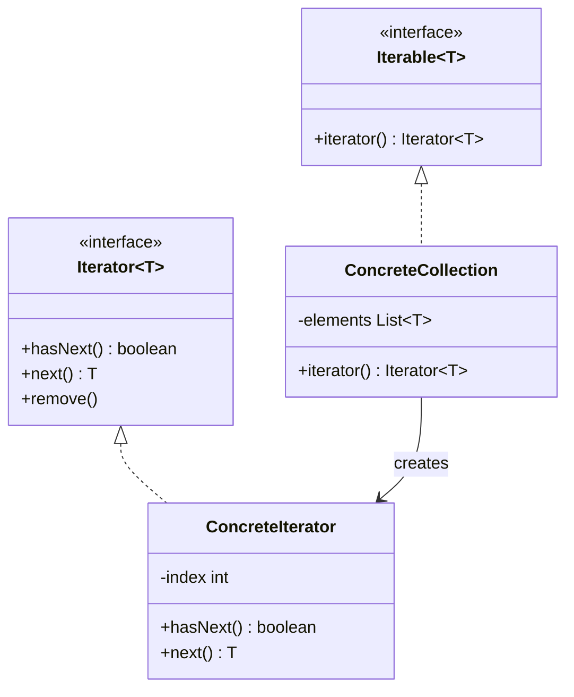

## 1. 意圖

提供一種方式，讓外部程式碼可依序存取聚合物件的元素，而不需要知道其底層結構。

## 2. UML 類圖



## 3. 何時用 / 何時別用

**用**：
- 需要為自訂資料結構（樹、圖、分頁資料）提供統一遍歷介面
- 需要支援多種遍歷方式（正序、逆序、層序）
- 想讓自訂集合可用 enhanced for-loop（只需實作 `Iterable`）

**別用**：
- 直接使用 JDK 集合時，`Stream` 通常比自訂 Iterator 更簡潔
- 資料集合固定且簡單，直接 index 迴圈反而更直覺

## 4. Java 範例

```java
// 自訂範圍迭代器，避免 int[] 陣列浪費記憶體
public class Range implements Iterable<Integer> {
    private final int start;
    private final int end;   // exclusive

    public Range(int start, int end) {
        this.start = start;
        this.end   = end;
    }

    @Override
    public Iterator<Integer> iterator() {
        return new Iterator<>() {
            private int current = start;

            @Override public boolean hasNext() { return current < end; }
            @Override public Integer next() {
                if (!hasNext()) throw new NoSuchElementException();
                return current++;
            }
        };
    }
}

// 使用 enhanced for-loop
for (int n : new Range(1, 6)) {
    System.out.print(n + " "); // 1 2 3 4 5
}

// 轉成 Stream
StreamSupport.stream(new Range(1, 6).spliterator(), false)
    .filter(n -> n % 2 == 0)
    .forEach(System.out::println); // 2 4
```

## 5. JDK / Spring 真實案例

**`java.util.Iterator<T>` + `Iterable<T>`**：所有 JDK 集合實作 `Iterable`，enhanced for-loop 底層即呼叫 `iterator()`。這就是 Iterator Pattern 的標準 Java 實作。

**Fail-fast vs Fail-safe**：
- `ArrayList.iterator()`：fail-fast，迭代期間修改集合拋 `ConcurrentModificationException`（透過 `modCount` 偵測）
- `CopyOnWriteArrayList.iterator()`：fail-safe，迭代快照，不拋例外，但不反映修改
- `ConcurrentHashMap.iterator()`：weakly consistent，既不拋例外，也不保證看到所有修改

**Spring Data `Page<T>` / `Slice<T>`**：`Page` 實作 `Iterable<T>`，`PageImpl.iterator()` 即底層 `List` 的迭代器，配合分頁查詢可用 for-each 遍歷當頁結果。

## 6. 與相近 Pattern 的差異

| 維度 | Iterator | Composite |
|------|----------|-----------|
| 目的 | 遍歷集合元素 | 以樹狀組合物件（整體與部分一致） |
| 搭配 | 常搭配 Composite 遍歷樹結構 | Composite 的遍歷通常需要 Iterator |

Iterator 與 **Visitor** 也常搭配：Iterator 負責遍歷順序，Visitor 負責對每個元素的操作邏輯。

## 7. 現代 Java 取代方案

Java 8+ 的 `Stream` API 覆蓋了大部分迭代需求，且支援 lazy evaluation 與 parallel：

```java
List<String> names = List.of("Alice", "Bob", "Charlie");

// 舊式 Iterator
Iterator<String> it = names.iterator();
while (it.hasNext()) System.out.println(it.next());

// 現代：Stream（更具表達力）
names.stream()
     .filter(n -> n.startsWith("A"))
     .map(String::toUpperCase)
     .forEach(System.out::println);
```

需要自訂遍歷語意（如分頁、懶載入、雙向游標）時，自訂 `Iterator` 仍是正確工具。

## 8. 參考資料

- GoF *Design Patterns* (1994), ch.5 Iterator
- Java SE 21 Docs — [`java.util.Iterator`](https://docs.oracle.com/en/java/docs/api/java.base/java/util/Iterator.html)
- Effective Java 3rd ed., Item 58 — Prefer for-each loops
