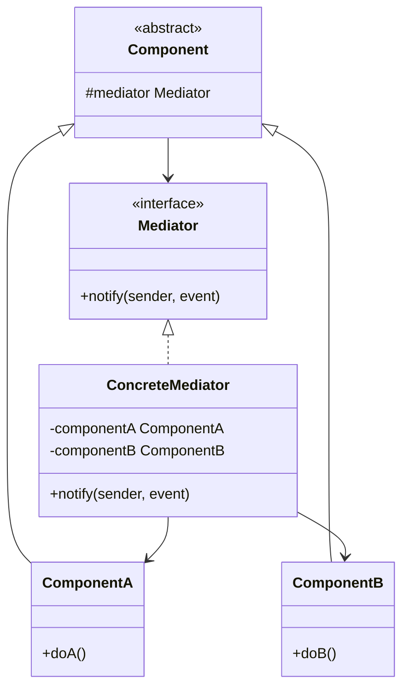

## 1. 意圖

引入中介者物件封裝一組物件間的互動，使它們不需直接相互引用，從而將網狀耦合（mesh）降為星狀（star）。

## 2. UML 類圖



## 3. 何時用 / 何時別用

**用**：
- 多個物件互相依賴，耦合關係複雜（N×(N-1)/2 條連線）
- 需要集中管理通訊流程（例如聊天室、航管、表單欄位聯動）
- 想讓組件可獨立重用，不綁定特定協作對象

**別用**：
- 只有 2–3 個物件互動，直接引用更清晰
- 中介者本身邏輯膨脹成「God Object」時，應拆分或改用事件匯流排
- 需要點對點高效能通訊，中間層增加 latency 不划算

## 4. Java 範例

```java
// 事件類型
public sealed interface ChatEvent permits MessageSent, UserJoined {}
public record MessageSent(String from, String text) implements ChatEvent {}
public record UserJoined(String username) implements ChatEvent {}

// Mediator 介面
public interface ChatMediator {
    void register(ChatUser user);
    void relay(ChatEvent event, ChatUser sender);
}

// ConcreteMediator
public class ChatRoom implements ChatMediator {
    private final List<ChatUser> users = new ArrayList<>();

    @Override
    public void register(ChatUser user) {
        users.add(user);
    }

    @Override
    public void relay(ChatEvent event, ChatUser sender) {
        users.stream()
             .filter(u -> u != sender)
             .forEach(u -> u.receive(event));
    }
}

// Component
public class ChatUser {
    private final String name;
    private final ChatMediator mediator;

    public ChatUser(String name, ChatMediator mediator) {
        this.name = name;
        this.mediator = mediator;
        mediator.register(this);
    }

    public void send(String text) {
        mediator.relay(new MessageSent(name, text), this);
    }

    public void receive(ChatEvent event) {
        switch (event) {
            case MessageSent m -> System.out.printf("[%s] %s: %s%n", name, m.from(), m.text());
            case UserJoined j  -> System.out.printf("[%s] %s joined%n", name, j.username());
        }
    }
}
```

## 5. JDK / Spring 真實案例

| 框架 | 類別 / 機制 | 說明 |
|------|------------|------|
| Spring | `ApplicationEventPublisher` + `@EventListener` | 發布者只呼叫 `publishEvent()`，監聽者以 `@EventListener` 宣告，互相不知道對方 |
| Spring | `ApplicationContext` | Context 本身就是 Mediator，協調所有 Bean 的生命週期 |
| Java Swing | `ActionListener` / `MediatorPanel` | 表單元件透過共同 Controller 通訊，而非彼此直接呼叫 |

Spring 範例：

```java
// 發布端（不依賴任何監聽者）
@Service
public class OrderService {
    private final ApplicationEventPublisher publisher;
    public OrderService(ApplicationEventPublisher publisher) {
        this.publisher = publisher;
    }
    public void placeOrder(Order order) {
        // ... 業務邏輯
        publisher.publishEvent(new OrderPlacedEvent(order));
    }
}

// 監聽端（不知道是誰發布）
@Component
public class InventoryListener {
    @EventListener
    public void onOrderPlaced(OrderPlacedEvent event) {
        // 扣庫存
    }
}
```

## 6. 與相近 Pattern 的差異

| | Mediator | Observer |
|--|---------|---------|
| 知識 | Mediator 知道所有參與者 | Subject 只知道 Observer 介面 |
| 通訊方向 | 雙向（任意方向通過中介） | 單向（Subject → Observer） |
| 適用 | 多對多互動協調 | 一對多狀態變更通知 |
| 耦合點 | 耦合集中在 Mediator | 耦合在訂閱/取消訂閱 |

> Spring `ApplicationEventPublisher` 兼具兩者特色：Mediator 的集中分派 + Observer 的訂閱解耦。

## 7. 現代 Java 取代方案

- **Spring Application Events**（推薦）：`@EventListener` + `ApplicationEventPublisher` 取代手寫 Mediator，支援非同步 (`@Async`)、條件過濾 (`condition`)。
- **Java `sealed interface` + `switch` expression**：如範例所示，以 sealed event hierarchy 取代 `String` 事件名稱，編譯期窮舉檢查。
- 重量級場景可考慮 **Kafka / RabbitMQ**，Mediator 概念延伸至跨服務邊界。

## 8. 參考資料

- GoF Design Patterns (1994), Chapter 5 — Behavioral Patterns
- Spring Framework Docs: [Application Events and Listeners](https://docs.spring.io/spring-framework/docs/current/reference/html/core.html#context-functionality-events)
