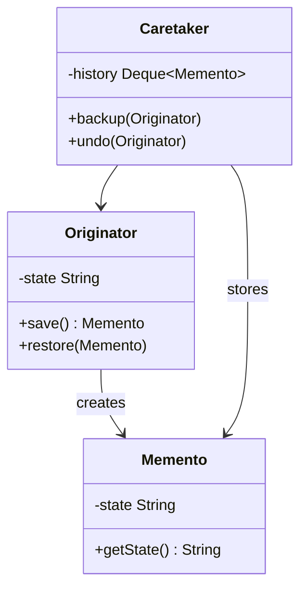

## 1. 意圖

在不破壞封裝的前提下，擷取並儲存物件的內部狀態，並能在稍後將物件恢復至該狀態。

## 2. UML 類圖



## 3. 何時用 / 何時別用

**用**：
- 需要 undo/redo（文字編輯器、繪圖工具、棋局）
- 交易 savepoint：資料庫 JTA rollback、遊戲存檔
- 需要「時光機」式還原，但又不想讓外部直接存取物件欄位

**別用**：
- 狀態物件很大（大量圖片、深層 object graph），每次快照記憶體開銷不可接受
- 外部已有持久化機制（DB、Redis）可直接記錄版本，不需再包一層
- 狀態欄位非常簡單，直接暴露欄位或用 Builder 更清楚

## 4. Java 範例

使用 Java record 作為不可變快照（Java 16+）：

```java
// Memento — record 天然不可變，不需額外封裝
public record EditorMemento(String content, int cursorPos) {}

// Originator
public class TextEditor {
    private String content;
    private int cursorPos;

    public TextEditor(String content) {
        this.content = content;
        this.cursorPos = content.length();
    }

    public void type(String text) {
        content = content.substring(0, cursorPos) + text + content.substring(cursorPos);
        cursorPos += text.length();
    }

    public EditorMemento save() {
        return new EditorMemento(content, cursorPos);
    }

    public void restore(EditorMemento m) {
        this.content = m.content();
        this.cursorPos = m.cursorPos();
    }

    public String getContent() { return content; }
}

// Caretaker
public class UndoManager {
    private final Deque<EditorMemento> history = new ArrayDeque<>();

    public void backup(TextEditor editor) {
        history.push(editor.save());
    }

    public void undo(TextEditor editor) {
        if (!history.isEmpty()) {
            editor.restore(history.pop());
        }
    }
}

// 使用
var editor = new TextEditor("Hello");
var undoMgr = new UndoManager();

undoMgr.backup(editor);       // 快照 "Hello"
editor.type(", World");
System.out.println(editor.getContent()); // Hello, World

undoMgr.undo(editor);
System.out.println(editor.getContent()); // Hello
```

## 5. JDK / Spring 真實案例

| 技術 | 用法 | 說明 |
|------|------|------|
| `java.io.Serializable` | 物件序列化 + deep copy | 可把整個 Originator 序列化成 byte[]，再反序列化還原，本質即 Memento |
| JTA / JDBC Savepoint | `connection.setSavepoint()` | 資料庫層的 Memento，允許 rollback 至某個中間點 |
| Spring `@Transactional(rollbackFor)` | 異常時回滾 | AOP 在 tx 開始前隱式建立 savepoint，出錯還原 |

## 6. 與相近 Pattern 的差異

| | Memento | Command |
|--|---------|---------|
| 目的 | 儲存狀態供還原 | 封裝操作供執行 / 撤銷 |
| 搭配 | 常與 Command 合用：Command 負責執行，Memento 負責存快照 | 可自行記錄 undo 邏輯（不一定需要 Memento） |
| 外部可見性 | 狀態對 Caretaker 不透明 | 操作本身對外可見 |

> Command + Memento 是實作完整 undo/redo 的黃金組合：Command 堆疊記錄動作，Memento 快照記錄狀態。

## 7. 現代 Java 取代方案

- **Java record**（推薦）：天然不可變，欄位直接對應狀態，無需手寫 getter/建構子，比傳統巢狀 `Memento` class 更簡潔。
- **`Object.clone()` / 序列化**：適合狀態複雜但能接受效能開銷的場景；需注意深拷貝陷阱。
- 大型應用可考慮 **Event Sourcing**：以事件序列取代快照，重放事件還原狀態，比 Memento 更適合分散式場景。

## 8. 參考資料

- GoF Design Patterns (1994), Chapter 5 — Behavioral Patterns
- Effective Java, 3rd ed., Item 13 — Override clone judiciously
