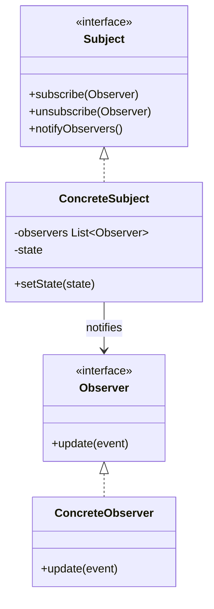

## 1. 意圖

定義物件間一對多的依賴關係，當 Subject 狀態改變時，所有依賴它的 Observer 都會自動收到通知並更新。

## 2. UML 類圖



## 3. 何時用 / 何時別用

**用**：
- 一個物件狀態改變，多個物件需要連動更新（MVC model → view）
- 訂閱關係需要在執行期動態增減
- 跨模組通知，不希望兩者直接相互引用

**別用**：
- 觀察者鏈太長，觸發順序難以追蹤（考慮改用 Mediator）
- 觀察者之間有依賴順序要求（Observer 本身不保證順序，需額外機制）
- 簡單的一對一回呼，直接傳 lambda 更清楚

## 4. Java 範例

Push 模型（Subject 主動推送事件物件）：

```java
// Event
public record PriceChangedEvent(String symbol, double newPrice) {}

// Observer 介面
public interface PriceObserver {
    void onPriceChanged(PriceChangedEvent event);
}

// Subject
public class StockTicker {
    private final List<PriceObserver> observers = new CopyOnWriteArrayList<>();
    private final String symbol;
    private double price;

    public StockTicker(String symbol, double initialPrice) {
        this.symbol = symbol;
        this.price = initialPrice;
    }

    public void subscribe(PriceObserver observer)   { observers.add(observer); }
    public void unsubscribe(PriceObserver observer) { observers.remove(observer); }

    public void updatePrice(double newPrice) {
        this.price = newPrice;
        var event = new PriceChangedEvent(symbol, newPrice);
        observers.forEach(o -> o.onPriceChanged(event));
    }
}

// ConcreteObserver — lambda 即可
StockTicker aapl = new StockTicker("AAPL", 150.0);
aapl.subscribe(e -> System.out.printf("[Display] %s: %.2f%n", e.symbol(), e.newPrice()));
aapl.subscribe(e -> {
    if (e.newPrice() > 160.0)
        System.out.printf("[Alert] %s exceeded 160!%n", e.symbol());
});

aapl.updatePrice(165.0);
```

> 注意：`java.util.Observable` 在 **Java 9 已標記為 `@Deprecated`**，禁止在新程式碼中使用。

## 5. JDK / Spring 真實案例

**`PropertyChangeSupport`（JDK 內建）**：

```java
public class UserProfile {
    private String email;
    private final PropertyChangeSupport pcs = new PropertyChangeSupport(this);

    public void addPropertyChangeListener(PropertyChangeListener l) { pcs.addPropertyChangeListener(l); }
    public void removePropertyChangeListener(PropertyChangeListener l) { pcs.removePropertyChangeListener(l); }

    public void setEmail(String email) {
        String old = this.email;
        this.email = email;
        pcs.firePropertyChange("email", old, email);
    }
}
```

**Spring `@EventListener`（推薦）**：

```java
// 發布端（不依賴任何監聽者）
@Service
public class UserService {
    private final ApplicationEventPublisher publisher;
    public UserService(ApplicationEventPublisher publisher) { this.publisher = publisher; }

    public void register(String email) {
        // ... 儲存邏輯
        publisher.publishEvent(new UserRegisteredEvent(email));
    }
}

// 監聽端
@Component
public class WelcomeEmailListener {
    @EventListener
    @Async   // 非同步，不阻塞主執行緒
    public void onRegistered(UserRegisteredEvent event) {
        // 發送歡迎信
    }
}
```

| 技術 | 適用場景 |
|------|---------|
| `PropertyChangeSupport` | JavaBean / Swing，輕量無框架依賴 |
| Spring `@EventListener` | Spring Boot 應用，跨 Bean 解耦通知 |
| Reactor `Sinks.many()` | WebFlux / 響應式流，背壓、非同步串流 |

## 6. 與相近 Pattern 的差異

| | Observer | Mediator |
|--|---------|---------|
| 知識 | Subject 不知道 Observer 的具體型別 | Mediator 知道所有參與方 |
| 通訊方向 | 單向（Subject → Observer） | 雙向（任意方向透過中介） |
| 適用 | 一對多狀態通知 | 多對多互動協調 |

## 7. 現代 Java 取代方案

- **`java.util.Observable`**：已棄用（Java 9），禁止使用。
- **`PropertyChangeSupport`**（JDK）：適合簡單 JavaBean 場景，無外部依賴。
- **Spring `ApplicationEventPublisher` + `@EventListener`**（推薦）：宣告式、支援 `@Async`、condition 過濾，是 Spring 應用的首選。
- **Project Reactor `Sinks.many().multicast()`**：適合需要背壓、非同步串流的響應式場景：

```java
Sinks.Many<String> sink = Sinks.many().multicast().onBackpressureBuffer();
Flux<String> flux = sink.asFlux();

flux.subscribe(msg -> System.out.println("A: " + msg));
flux.subscribe(msg -> System.out.println("B: " + msg));

sink.tryEmitNext("hello"); // A 和 B 都收到
```

## 8. 參考資料

- GoF Design Patterns (1994), Chapter 5 — Behavioral Patterns
- JDK `java.beans.PropertyChangeSupport` Javadoc
- Spring Framework Docs: [Application Events](https://docs.spring.io/spring-framework/docs/current/reference/html/core.html#context-functionality-events)
- Project Reactor: [Sinks](https://projectreactor.io/docs/core/release/reference/#sinks)
