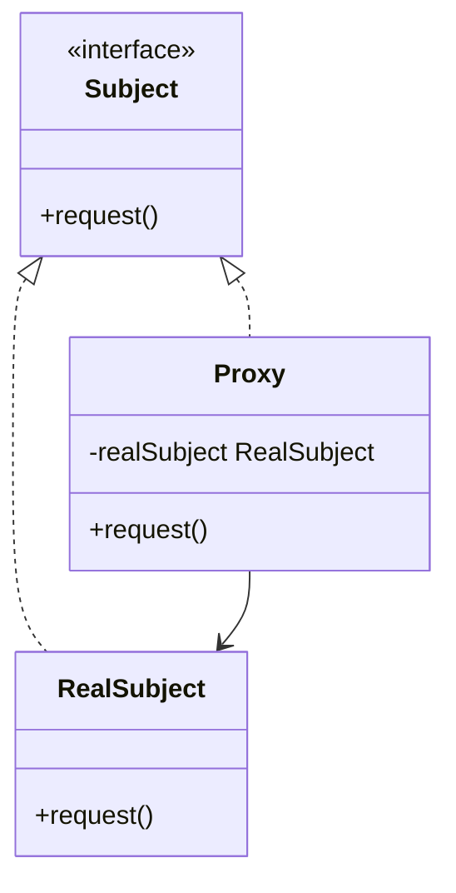
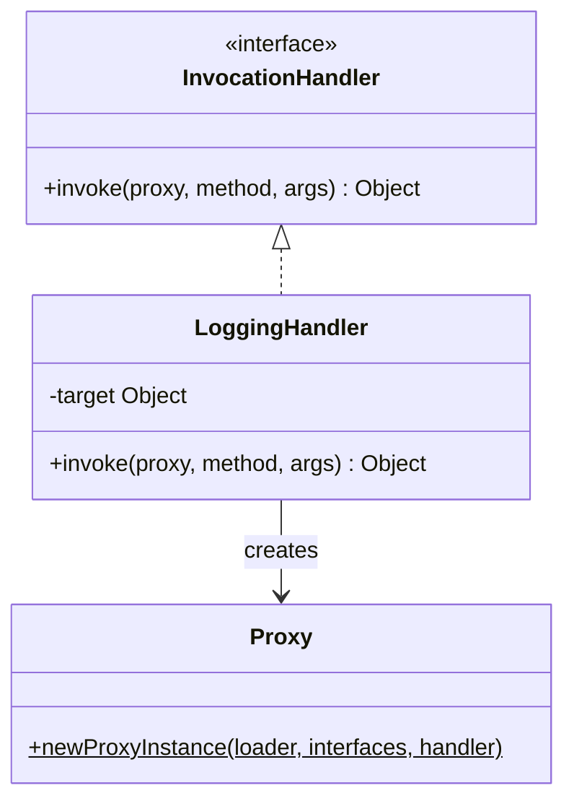

## 1. 意圖

為另一個物件提供替代品（surrogate），在不改變用戶端介面的前提下，攔截並控制對原始物件的存取。

## 2. UML 類圖

### 靜態 Proxy



### JDK Dynamic Proxy



## 3. 何時用 / 何時別用

**用**：
- **Virtual Proxy**：延遲初始化昂貴的物件（大圖、DB 連線）
- **Protection Proxy**：依角色/權限控制方法存取
- **Remote Proxy**：封裝遠端呼叫細節（gRPC stub、Feign client）
- 需要橫切關注點（logging、tracing、caching）但不想修改業務類

**別用**：
- 簡單呼叫不需要任何前後處理 — 代理層只增加間接開銷
- 物件結構非常扁平，用函數組合（decorator function）更直覺
- 需要代理 `final` class 卻無法引入 interface — CGLIB 無法繼承 final 類

## 4. Java 範例

JDK Dynamic Proxy：在不改變 `UserService` 實作的情況下加入 logging。

```java
public interface UserService {
    User findById(long id);
    void save(User user);
}

public class UserServiceImpl implements UserService {
    @Override
    public User findById(long id) { /* ... */ return new User(id, "Alice"); }

    @Override
    public void save(User user) { /* ... */ }
}

// InvocationHandler — 橫切邏輯在此
public class LoggingHandler implements InvocationHandler {
    private final Object target;

    public LoggingHandler(Object target) {
        this.target = target;
    }

    @Override
    public Object invoke(Object proxy, Method method, Object[] args) throws Throwable {
        System.out.printf("[LOG] %s(%s)%n", method.getName(), Arrays.toString(args));
        long start = System.currentTimeMillis();
        try {
            return method.invoke(target, args);
        } finally {
            System.out.printf("[LOG] %s done in %dms%n",
                method.getName(), System.currentTimeMillis() - start);
        }
    }
}

// 建立代理（要求 target 有 interface）
UserService svc = new UserServiceImpl();
UserService proxy = (UserService) Proxy.newProxyInstance(
    svc.getClass().getClassLoader(),
    new Class[]{UserService.class},
    new LoggingHandler(svc)
);

proxy.findById(42);  // 觸發 LoggingHandler.invoke
```

## 5. JDK / Spring 真實案例

**Spring `@Transactional` / `@Cacheable` / `@Async`**
Spring AOP 在 bean 初始化時將其包成代理物件（有 interface 用 JDK Dynamic Proxy，否則用 CGLIB）。呼叫帶有這些標註的方法時，實際執行的是代理的攔截邏輯，再轉交給真實 bean。

**CGLIB vs JDK Dynamic Proxy vs ByteBuddy**

| 機制 | 原理 | 限制 | 使用者 |
|------|------|------|--------|
| JDK Dynamic Proxy | 實作 interface，反射呼叫 | 目標必須有 interface | Spring AOP（有介面時） |
| CGLIB | 繼承目標類，子類覆寫方法 | 不能代理 `final` class / method | Spring AOP（無介面時）、Hibernate lazy loading |
| ByteBuddy | 位元碼操作，生成新類 | 最靈活，設定較複雜 | Mockito、Hibernate（新版） |

**`java.rmi.Remote` 遠端代理**
RMI stub 就是遠端代理的教科書實作，stub 實作與 remote object 相同的介面，隱藏網路呼叫細節。

## 6. 與相近 Pattern 的差異

| Pattern | 相同點 | 關鍵差異 |
|---------|--------|----------|
| Decorator | 都包裝同一介面 | Decorator 疊加功能；Proxy 控制存取（生命週期管理、權限、lazy init） |
| Facade | 都是間接層 | Facade 簡化複雜子系統；Proxy 與 RealSubject 介面相同，可無感替換 |
| Adapter | 都是包裝器 | Adapter 轉換介面；Proxy 保持介面一致 |

## 7. 現代 Java 取代方案

**Spring AOP self-invocation 問題與三種解法**

`this.method()` 是直接呼叫，繞過 Spring 代理，導致 `@Transactional` / `@Cacheable` 失效。

```java
// 方案 1：AopContext（需 exposeProxy = true）
@EnableAspectJAutoProxy(exposeProxy = true)
// 呼叫端：
((MyService) AopContext.currentProxy()).annotatedMethod();

// 方案 2：注入自身
@Service
public class MyService {
    @Autowired
    private MyService self;  // Spring 注入的是代理

    public void outer() { self.inner(); }

    @Transactional
    public void inner() { /* ... */ }
}

// 方案 3：抽取成另一個 bean（最推薦，符合 SRP）
@Service
public class InnerService {
    @Transactional
    public void inner() { /* ... */ }
}
```

動態代理本身仍是 Java 生態的標準做法（Spring AOP、Hibernate、Mockito 都依賴），**N/A — 代理機制本身仍是標準做法**，但 self-invocation 問題有更乾淨的架構解法。

## 8. 參考資料

- GoF *Design Patterns* (1994), ch. 4 — Proxy
- Spring Framework docs: AOP Proxying Mechanisms
- Baeldung: [Introduction to Spring AOP](https://www.baeldung.com/spring-aop)
- Baeldung: [Self-Invocation in Spring](https://www.baeldung.com/spring-aop-self-invocation)
