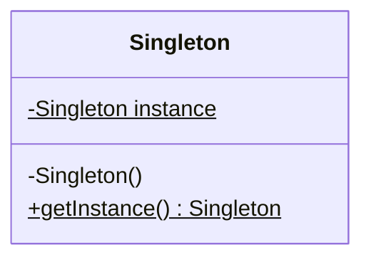

## 1. 意圖

確保一個類別在整個 JVM 中只存在一個實例，並提供全域存取點。

## 2. UML 類圖



## 3. 何時用 / 何時別用

**用**：
- 需要全域唯一狀態的資源管理器（Connection Pool、ConfigRegistry）
- 重量級物件初始化一次即可（載入設定檔、建立 thread pool）

**別用**：
- 帶可變共享狀態的業務邏輯 — 難以測試、造成隱式耦合
- 可以用 DI 容器管理生命週期的場景（Spring 已處理）
- 需要子類化或實作多態的情境

## 4. Java 範例

三種主流寫法，依推薦順序排列。

**Enum 單例（首選）**

```java
public enum AppConfig {
    INSTANCE;

    private final Properties props = new Properties();

    AppConfig() {
        try (var in = getClass().getResourceAsStream("/app.properties")) {
            if (in != null) props.load(in);
        } catch (IOException e) {
            throw new ExceptionInInitializerError(e);
        }
    }

    public String get(String key) {
        return props.getProperty(key);
    }
}
```

Enum 的 JVM 保證讓它天生防止反射攻擊與序列化漏洞。

**Bill Pugh Holder（需延遲初始化時）**

```java
public final class RegistryService {

    private RegistryService() {}

    private static final class Holder {
        static final RegistryService INSTANCE = new RegistryService();
    }

    public static RegistryService getInstance() {
        return Holder.INSTANCE;
    }
}
```

依賴類別載入機制（class loader 保證 `<clinit>` 的原子性），不需要 `synchronized`，也不需要 `volatile`。

**Double-Checked Locking（初始化帶副作用時）**

```java
public final class HeavyResource {

    private static volatile HeavyResource instance;

    private HeavyResource() {
        // 模擬昂貴初始化
    }

    public static HeavyResource getInstance() {
        if (instance == null) {
            synchronized (HeavyResource.class) {
                if (instance == null) {
                    instance = new HeavyResource();
                }
            }
        }
        return instance;
    }
}
```

`volatile` 不可省略：它禁止 JIT 將物件發布前的部分初始化指令重排到 `instance = ...` 之後。

## 5. JDK / Spring 真實案例

| 案例 | 說明 |
|------|------|
| `java.lang.Runtime` | `Runtime.getRuntime()` — Eager Singleton，JVM 啟動時建立 |
| `java.util.logging.LogManager` | `LogManager.getLogManager()` — Holder pattern |
| Spring `ApplicationContext` | Spring Bean 的 `scope=singleton` 是**容器層**單例，由 IoC 容器管理，與 GoF Singleton（class 層）不同：多個容器可以有多個實例 |

> **GoF Singleton vs Spring Singleton 的本質差異**：GoF 在類別層強制唯一，無法繞過；Spring Singleton 是容器內唯一，可以透過 `new` 繞過，也可以在不同 `ApplicationContext` 中各建一份。

## 6. 與相近 Pattern 的差異

| | Singleton | Monostate | Registry |
|---|---|---|---|
| 實例數量 | 1 | 多個但共享靜態狀態 | 可多個，統一管理 |
| 取得方式 | `getInstance()` | `new` 即可 | `Registry.get(key)` |
| 測試難度 | 難（全域狀態） | 難 | 較易（可替換） |
| 適用 | 重量級全域資源 | 不推薦 | 多種類型的全域實例 |

## 7. 現代 Java 取代方案

在 Spring Boot 應用中，直接讓 Spring 管理 Bean 的生命週期：

```java
@Component  // 預設 scope=singleton
public class ConfigService {
    // Spring 保證容器內唯一，且支援 DI、AOP、測試替換
}
```

若無 DI 框架，Enum Singleton（Effective Java Item 3）是類別層單例的現代標準寫法。

`Cloneable` 介面**不應實作在 Singleton 類別上**——根本不要打開複製的大門，而非覆寫 `clone()` 拋例外（Effective Java Item 13）。

## 8. 參考資料

- GoF Design Patterns (1994), Ch. 3 Creational Patterns
- Effective Java 3rd Ed., Item 3 — Enforce the singleton property with a private constructor or an enum type
- Effective Java 3rd Ed., Item 13 — Override clone judiciously
- Java Concurrency in Practice (Goetz, 2006), §16.2 Publication and the JMM
