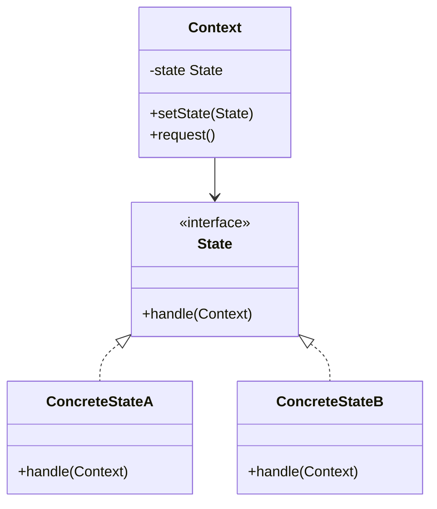

## 1. 意圖

讓物件在其內部狀態改變時自動改變行為，看起來就像換了一個類別。

## 2. UML 類圖



## 3. 何時用 / 何時別用

**用**：
- 物件行為取決於狀態，且狀態在執行期變化
- 存在大量以狀態為條件的 `switch` / `if-else`
- 狀態轉換規則複雜，不同狀態下允許的操作各異（例如訂單狀態機）

**別用**：
- 狀態少且不會演進（2–3 個 boolean flag），直接 `if` 更清晰
- 狀態轉換純粹線性，沒有分支邏輯
- 用 Spring Statemachine 等成熟框架更合適的複雜場景（別重造輪子）

## 4. Java 範例

訂單狀態機（PENDING → PAID → SHIPPED → DELIVERED）：

```java
// State 介面
public interface OrderState {
    void pay(OrderContext ctx);
    void ship(OrderContext ctx);
    void deliver(OrderContext ctx);
}

// Context
public class OrderContext {
    private OrderState state;
    private final String orderId;

    public OrderContext(String orderId) {
        this.orderId = orderId;
        this.state = new PendingState();
    }

    public void setState(OrderState state) { this.state = state; }
    public void pay()     { state.pay(this); }
    public void ship()    { state.ship(this); }
    public void deliver() { state.deliver(this); }
    public String getOrderId() { return orderId; }
}

// Concrete States
public class PendingState implements OrderState {
    @Override
    public void pay(OrderContext ctx) {
        System.out.println(ctx.getOrderId() + " PENDING -> PAID");
        ctx.setState(new PaidState());
    }
    @Override public void ship(OrderContext ctx)    { throw new IllegalStateException("尚未付款"); }
    @Override public void deliver(OrderContext ctx) { throw new IllegalStateException("尚未付款"); }
}

public class PaidState implements OrderState {
    @Override public void pay(OrderContext ctx) { throw new IllegalStateException("已付款"); }
    @Override
    public void ship(OrderContext ctx) {
        System.out.println(ctx.getOrderId() + " PAID -> SHIPPED");
        ctx.setState(new ShippedState());
    }
    @Override public void deliver(OrderContext ctx) { throw new IllegalStateException("尚未出貨"); }
}

public class ShippedState implements OrderState {
    @Override public void pay(OrderContext ctx)  { throw new IllegalStateException("已付款"); }
    @Override public void ship(OrderContext ctx) { throw new IllegalStateException("已出貨"); }
    @Override
    public void deliver(OrderContext ctx) {
        System.out.println(ctx.getOrderId() + " SHIPPED -> DELIVERED");
        ctx.setState(new DeliveredState());
    }
}

public class DeliveredState implements OrderState {
    @Override public void pay(OrderContext ctx)     { throw new IllegalStateException("訂單已完成"); }
    @Override public void ship(OrderContext ctx)    { throw new IllegalStateException("訂單已完成"); }
    @Override public void deliver(OrderContext ctx) { throw new IllegalStateException("訂單已完成"); }
}
```

## 5. JDK / Spring 真實案例

| 技術 | 說明 |
|------|------|
| `java.net.Socket` | 連線前後的行為不同（closed / connected），內部以狀態物件切換 |
| Spring Statemachine | 宣告式狀態機框架，支援 guard、action、history state，適合複雜業務流程 |
| Java `enum` + abstract method | 用 enum 常數各自 override 方法，輕量版 State pattern（見下方） |

**Java enum 實作輕量狀態機**：

```java
public enum TrafficLight {
    RED {
        @Override public TrafficLight next() { return GREEN; }
        @Override public String action()     { return "Stop"; }
    },
    GREEN {
        @Override public TrafficLight next() { return YELLOW; }
        @Override public String action()     { return "Go"; }
    },
    YELLOW {
        @Override public TrafficLight next() { return RED; }
        @Override public String action()     { return "Caution"; }
    };

    public abstract TrafficLight next();
    public abstract String action();
}

// 使用
TrafficLight light = TrafficLight.RED;
light = light.next(); // GREEN
System.out.println(light.action()); // Go
```

## 6. 與相近 Pattern 的差異

| | State | Strategy |
|--|-------|---------|
| 切換時機 | 狀態轉換由物件內部觸發，自動切換 | 演算法由外部 client 主動選擇 |
| 物件感知 | State 物件通常持有 Context 引用，可自行轉換 | Strategy 通常無狀態，不感知 Context |
| 狀態間關係 | State 間可能互相知道（轉換目標） | Strategy 彼此獨立 |

## 7. 現代 Java 取代方案

- **`enum` + abstract method**：狀態少（3–7 個）、轉換簡單時，enum 直接 override 方法比獨立 class 更緊湊。
- **Spring Statemachine**：狀態圖複雜（含 guard、fork/join、並行區域）時，用 DSL 宣告比手寫 State class 更易維護。
- **sealed interface + switch**（Java 21+）：配合 pattern matching 可在單一函式內描述狀態機轉換，適合純函數式風格。

## 8. 參考資料

- GoF Design Patterns (1994), Chapter 5 — Behavioral Patterns
- Spring Statemachine: https://docs.spring.io/spring-statemachine/docs/current/reference/
