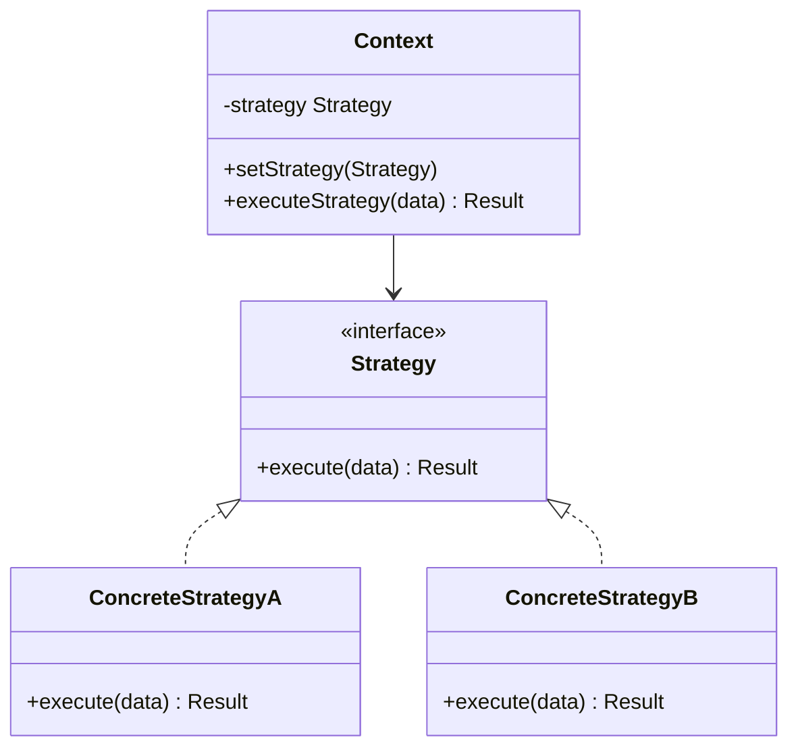

## 1. 意圖

定義一族演算法，各自封裝，讓它們可以互相替換。演算法的變化不影響使用它的客戶端。

## 2. UML 類圖



## 3. 何時用 / 何時別用

**用**：
- 同一行為有多種實作，且在執行期需動態切換（排序、壓縮、付款方式）
- 大量 if/else 或 switch 判斷演算法類型，想用多型取代
- 演算法需要獨立測試

**別用**：
- 只有 2-3 種固定演算法且幾乎不會擴充，enum + switch 更簡單
- 演算法間差異很小，直接 method overloading 即可
- 客戶端需要了解不同策略的差異才能選擇，說明抽象程度不夠

## 4. Java 範例

```java
// Strategy 介面（單一方法，可用 @FunctionalInterface）
@FunctionalInterface
public interface SortStrategy<T> {
    List<T> sort(List<T> data, Comparator<T> comparator);
}

// 兩種具體策略
public class QuickSort<T> implements SortStrategy<T> {
    @Override
    public List<T> sort(List<T> data, Comparator<T> comparator) {
        List<T> result = new ArrayList<>(data);
        result.sort(comparator);   // 借用 JDK TimSort 示意
        System.out.println("QuickSort used");
        return result;
    }
}

public class MergeSort<T> implements SortStrategy<T> {
    @Override
    public List<T> sort(List<T> data, Comparator<T> comparator) {
        // 真實場景放入 merge sort 實作
        List<T> result = new ArrayList<>(data);
        result.sort(comparator);
        System.out.println("MergeSort used");
        return result;
    }
}

// Context
public class Sorter<T> {
    private SortStrategy<T> strategy;

    public Sorter(SortStrategy<T> strategy) { this.strategy = strategy; }
    public void setStrategy(SortStrategy<T> strategy) { this.strategy = strategy; }

    public List<T> sort(List<T> data, Comparator<T> cmp) {
        return strategy.sort(data, cmp);
    }
}

// 使用
Sorter<Integer> sorter = new Sorter<>(new QuickSort<>());
sorter.sort(List.of(3, 1, 4, 1, 5), Comparator.naturalOrder());

// 執行期切換
sorter.setStrategy(new MergeSort<>());
sorter.sort(List.of(3, 1, 4, 1, 5), Comparator.reverseOrder());

// 用 lambda 直接注入（不需要具體類別）
sorter.setStrategy((data, cmp) -> data.stream().sorted(cmp).toList());
```

## 5. JDK / Spring 真實案例

**`Comparator`**：`Collections.sort()` 與 `List.sort()` 的第二個參數就是 Strategy。`Comparator.comparing()` 讓 lambda 成為最常用的 Strategy 形式。

**`java.util.function.Function<T,R>` / `Predicate<T>`**：單方法介面是 Strategy 的函數式表達。`Stream.filter(Predicate)` 即在執行期注入過濾策略。

**Spring `PlatformTransactionManager`**：`DataSourceTransactionManager`、`JpaTransactionManager` 都是 `PlatformTransactionManager` Strategy 的具體實作，Spring `@Transactional` 透過它來切換底層事務策略。

**Spring `ResourceLoader`**：`ClassPathResourceLoader`、`FileSystemResourceLoader`、`UrlResourceLoader` 是不同的資源載入策略，透過 `ResourceLoader` 介面統一呼叫。

## 6. 與相近 Pattern 的差異

| 維度 | Strategy | Command |
|------|----------|---------|
| 封裝 | 封裝「演算法」，不帶 Receiver | 封裝「一次請求」＋ Receiver 參考 |
| 目的 | 執行期切換演算法 | 支援 undo、排隊、log |
| 狀態 | 通常無狀態 | 通常帶有執行前狀態（供 undo） |

Strategy vs **Template Method**：Strategy 用組合切換演算法；Template Method 用繼承固定骨架、讓子類覆寫步驟。組合優於繼承時選 Strategy。

## 7. 現代 Java 取代方案

Java 8+ 的 lambda 與函數式介面幾乎完全取代匿名 Strategy 類別：

```java
// 傳統方式：匿名類別
Comparator<String> byLength = new Comparator<String>() {
    @Override public int compare(String a, String b) {
        return Integer.compare(a.length(), b.length());
    }
};

// 現代方式：lambda
Comparator<String> byLength = Comparator.comparingInt(String::length);

// 組合策略（thenComparing）
Comparator<String> comp = Comparator.comparingInt(String::length)
                                    .thenComparing(Comparator.naturalOrder());
```

若策略帶狀態或需要依賴注入（如 Spring Bean），具體類別仍比 lambda 更好維護。

## 8. 參考資料

- GoF *Design Patterns* (1994), ch.5 Strategy
- Effective Java 3rd ed., Item 42 — Prefer lambdas to anonymous classes
- Spring Framework Docs — [Transaction Management](https://docs.spring.io/spring-framework/docs/current/reference/html/data-access.html#transaction)
