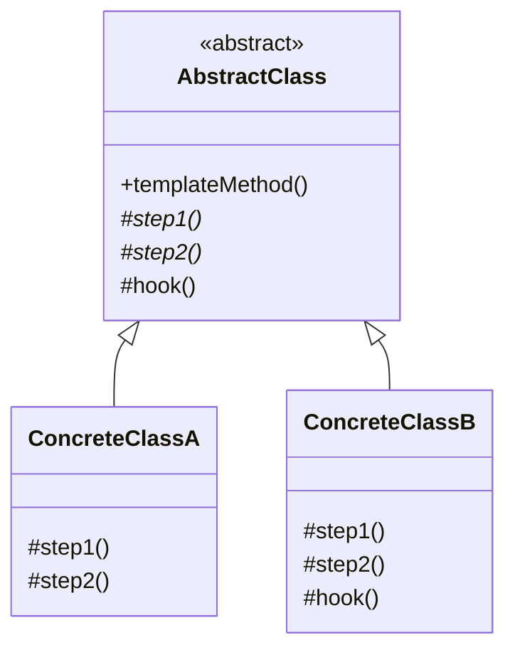

## 1. 意圖

在抽象父類中定義演算法的骨架（`final` 方法），將某些步驟延遲到子類實作，讓子類在不改變整體結構的前提下覆寫特定步驟。

## 2. UML 類圖



## 3. 何時用 / 何時別用

**用**：
- 多個類別共用相同的演算法骨架，只有部分步驟不同
- 想控制子類能擴展的範圍（用 `final` 保護骨架，`protected abstract` 開放步驟）
- 框架設計：讓使用者繼承後填入業務邏輯（Hollywood Principle）

**別用**：
- 步驟差異大，繼承層次超過 2 層——改用 Strategy（組合優於繼承）
- 子類只需客製 1 個步驟，傳入 callback / lambda 比繼承更輕量
- 需要在執行期切換演算法變體，Template Method 是靜態綁定

## 4. Java 範例

```java
// 資料匯出的通用骨架
public abstract class DataExporter {

    // 模板方法：final 保護流程
    public final void export(String destination) {
        List<String> data = fetchData();
        List<String> processed = transform(data);
        write(processed, destination);
        if (needsNotification()) {
            notify(destination);
        }
    }

    protected abstract List<String> fetchData();
    protected abstract List<String> transform(List<String> data);
    protected abstract void write(List<String> data, String destination);

    // hook：子類可選擇覆寫
    protected boolean needsNotification() { return false; }
    protected void notify(String destination) {
        System.out.println("Exported to: " + destination);
    }
}

// 具體實作 A：CSV 匯出
public class CsvExporter extends DataExporter {
    private final List<String> source;

    public CsvExporter(List<String> source) { this.source = source; }

    @Override
    protected List<String> fetchData() { return List.copyOf(source); }

    @Override
    protected List<String> transform(List<String> data) {
        return data.stream().map(s -> "\"" + s + "\"").toList();
    }

    @Override
    protected void write(List<String> data, String destination) {
        System.out.println("Writing CSV to " + destination + ": " + data);
    }

    @Override
    protected boolean needsNotification() { return true; } // 覆寫 hook
}

// 使用
DataExporter exporter = new CsvExporter(List.of("Alice", "Bob"));
exporter.export("/tmp/output.csv");
// Writing CSV to /tmp/output.csv: ["Alice", "Bob"]
// Exported to: /tmp/output.csv
```

## 5. JDK / Spring 真實案例

**`AbstractList`**：`indexOf()`、`lastIndexOf()`、`iterator()` 等方法的骨架實作在 `AbstractList`，只有 `get(int index)` 和 `size()` 是 `abstract`，`ArrayList` 與 `LinkedList` 各自提供這兩個方法。

**`HttpServlet`**：`service()` 方法依 HTTP method 呼叫 `doGet()`、`doPost()` 等，是 Servlet 規範的 Template Method，使用者繼承後只需覆寫對應方法。

**Spring `JdbcTemplate`**：`execute(PreparedStatementCallback)` 處理 Connection 取得、Statement 建立、例外轉換、Connection 釋放，業務邏輯透過回呼填入，是 Template Method 的回呼變體。

**Spring `AbstractBeanFactory.getBean()`**：Bean 的建立流程（`doGetBean`）是模板，`createBean()` 是 abstract 步驟，由 `AbstractAutowireCapableBeanFactory` 實作。

## 6. 與相近 Pattern 的差異

| 維度 | Template Method | Strategy |
|------|----------------|----------|
| 機制 | 繼承（靜態） | 組合（動態） |
| 骨架 | 固定在父類 | Context 決定呼叫哪個 Strategy |
| 切換 | 編譯期決定（子類） | 執行期決定（注入不同 Strategy） |
| 耦合 | 子類與父類強耦合 | Context 與 Strategy 弱耦合 |

當繼承層次超過 2 層或步驟在執行期需要切換，改用 Strategy。

## 7. 現代 Java 取代方案

可用函數式回呼取代繼承，避免類別爆炸：

```java
// 將可變步驟提取為 Function 參數
public class DataExporter {

    public void export(
            Supplier<List<String>>        fetcher,
            UnaryOperator<List<String>>   transformer,
            BiConsumer<List<String>, String> writer,
            String destination) {

        List<String> data = fetcher.get();
        List<String> processed = transformer.apply(data);
        writer.accept(processed, destination);
    }
}

// 呼叫端用 lambda 組裝，無需繼承
DataExporter exporter = new DataExporter();
exporter.export(
    () -> List.of("Alice", "Bob"),
    data -> data.stream().map(String::toUpperCase).toList(),
    (data, dest) -> System.out.println("Write to " + dest + ": " + data),
    "/tmp/output.txt"
);
```

步驟多、流程複雜且需要 hook 控制分支時，傳統 Template Method 的可讀性優於一大串 lambda。

## 8. 參考資料

- GoF *Design Patterns* (1994), ch.5 Template Method
- Effective Java 3rd ed., Item 20 — Prefer interfaces to abstract classes
- Spring Framework Source — `JdbcTemplate`, `AbstractBeanFactory`
