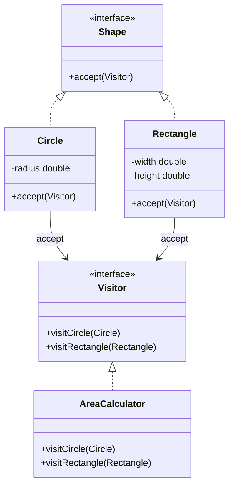

## 1. 意圖

在不修改物件結構的前提下，將新操作以獨立的 Visitor 類加入，透過雙分派（double dispatch）實現型別安全的呼叫。

## 2. UML 類圖



## 3. 何時用 / 何時別用

**用**：
- 物件結構穩定，但需要頻繁新增對元素的操作（如 AST 有新的 code generation pass）
- 同一物件結構需要多種不相關的操作（計算面積、序列化、驗證）
- 不想把所有操作塞進元素類，保持高內聚

**別用**：
- 元素類型頻繁新增 — 每加一種 Element 就要改動所有 Visitor
- 元素類型少（< 3）且操作也少 — 過度設計
- 需要對外隱藏元素型別資訊 — Visitor 必須知道所有具體型別

## 4. Java 範例

以幾何圖形計算面積與輸出 SVG 為例，一個物件結構、兩個 Visitor。

```java
// Element interface
public interface Shape {
    <T> T accept(ShapeVisitor<T> visitor);
}

// Visitor interface
public interface ShapeVisitor<T> {
    T visitCircle(Circle circle);
    T visitRectangle(Rectangle rectangle);
}

// Concrete elements
public record Circle(double radius) implements Shape {
    @Override
    public <T> T accept(ShapeVisitor<T> visitor) {
        return visitor.visitCircle(this);  // double dispatch
    }
}

public record Rectangle(double width, double height) implements Shape {
    @Override
    public <T> T accept(ShapeVisitor<T> visitor) {
        return visitor.visitRectangle(this);
    }
}

// Visitor 1: 計算面積
public class AreaCalculator implements ShapeVisitor<Double> {
    @Override
    public Double visitCircle(Circle c) {
        return Math.PI * c.radius() * c.radius();
    }

    @Override
    public Double visitRectangle(Rectangle r) {
        return r.width() * r.height();
    }
}

// Visitor 2: 產生 SVG 標籤
public class SvgExporter implements ShapeVisitor<String> {
    @Override
    public String visitCircle(Circle c) {
        return "<circle r=\"%.2f\"/>".formatted(c.radius());
    }

    @Override
    public String visitRectangle(Rectangle r) {
        return "<rect width=\"%.2f\" height=\"%.2f\"/>".formatted(r.width(), r.height());
    }
}

// 用法
List<Shape> shapes = List.of(new Circle(5), new Rectangle(3, 4));
var area = new AreaCalculator();
var svg  = new SvgExporter();

shapes.forEach(s -> {
    System.out.println("area=" + s.accept(area));
    System.out.println("svg="  + s.accept(svg));
});
```

**雙分派說明**：Java 是單分派語言，`visitor.visit(element)` 只根據 `visitor` 的靜態型別選方法。加上 `element.accept(visitor)` → `visitor.visitCircle(this)` 這一跳，才能同時根據 visitor 和 element 的執行期型別決定要呼叫哪個方法。

## 5. JDK / Spring 真實案例

**`java.nio.file.Files.walkFileTree(path, FileVisitor)`**
這就是 Visitor pattern 的直接應用。`FileVisitor<T>` 定義 `visitFile`、`visitFileFailed`、`preVisitDirectory`、`postVisitDirectory` 四個 visit 方法，目錄樹就是 element structure。

**`javax.lang.model.element.ElementVisitor`（Java 編譯器 API）**
annotation processor 在遍歷 AST 時使用此介面，每種元素型別（class、method、field）對應一個 visitXxx 方法。

**`org.springframework.beans.factory.config.BeanDefinitionVisitor`**
Spring IoC 容器用來解析 BeanDefinition 中的佔位符（`${...}`），對每個 BeanDefinition 執行字串替換操作。

## 6. 與相近 Pattern 的差異

| Pattern | 相同點 | 關鍵差異 |
|---------|--------|----------|
| Iterator | 都在遍歷物件結構 | Iterator 只負責遍歷；Visitor 帶著操作一起走 |
| Strategy | 都是封裝演算法 | Strategy 替換單一物件的行為；Visitor 跨多種型別的物件結構操作 |
| Composite | 常搭配使用 | Composite 定義樹形結構；Visitor 在這棵樹上執行多種操作 |
| Command | 都將操作物件化 | Command 封裝單一請求；Visitor 針對型別層級做一組配對操作 |

## 7. 現代 Java 取代方案

Java 17+ sealed interface + switch expression（pattern matching）在元素型別固定時可完全取代 Visitor，省去 `accept` 樣板：

```java
sealed interface Shape permits Circle, Rectangle {}
record Circle(double radius) implements Shape {}
record Rectangle(double width, double height) implements Shape {}

// 取代 AreaCalculator visitor
static double area(Shape s) {
    return switch (s) {
        case Circle c    -> Math.PI * c.radius() * c.radius();
        case Rectangle r -> r.width() * r.height();
    };
}
```

差異：sealed + switch 在同一處管理所有 case，編譯器強制窮舉；Visitor 把各型別操作分散到不同 Visitor 類，適合操作數量龐大或需動態組合的場景。

## 8. 參考資料

- GoF *Design Patterns* (1994), ch. 5 — Visitor
- Java SE `java.nio.file.FileVisitor` Javadoc
- Spring Framework `BeanDefinitionVisitor` source
