在瀏覽器打開網站一切正常，同一個網址換成 `mvn`、`curl`、`docker build` 或 Spring Boot 的 `RestClient` 卻跳出 `PKIX path building failed`、`self signed certificate in certificate chain`。遇到這種狀況，很多人會加 `-k`、關掉驗證，或者到處亂 import 憑證，然後問題就這樣過去了，下次再碰到還是不知道原因。

這篇把「憑證為什麼被信任」從頭拆一次，依序講 9 個主題。每一節的格式都一樣：

1. **白話版**：先用一個生活比喻建立直覺
2. **動態圖**：點圖可以開原尺寸（手機上建議點開看）
3. **工程師版**：欄位、規則、實測輸出
4. **常見誤解與踩坑**

最後是兩個實戰案例（公司防火牆 SSL inspection、自建內部 CA）和一張速查表。

> **實測環境**：macOS、OpenSSL 4.1.0（Homebrew）、macOS 內建 curl 8.7.1（LibreSSL）、Amazon Corretto 21（`keytool`、`java.net.http.HttpClient`），測試站台用 `github.com` 與 [badssl.com](https://badssl.com/)。指令輸出都是實際跑出來的結果，原樣貼在 `#` 註解或輸出區塊。Dockerfile、Spring Boot 設定、Keychain 匯出、Windows 相關的內容是依官方文件撰寫的，沒有在本機實跑，文中會標註。

---

## 目錄

- [打開 https://github.com 時，依序發生了什麼](#overview)
- [1. TLS Handshake：先握手，再講話](#tls-handshake)
- [2. X.509 憑證：網站的身分證](#x509)
- [3. Chain of Trust：根憑證 → 中繼憑證 → 網站憑證](#chain-of-trust)
- [4. Root CA 與 Trust Store：信任名單在誰手上](#trust-store)
- [5. Wildcard 與 SAN：這張證件能代表哪些名字](#wildcard-san)
- [6. 防火牆：中間人合法化之後](#firewall)
- [7. HSTS：讓瀏覽器記住只走 HTTPS](#hsts)
- [8. 憑證過期、續約與「自動信任」](#renewal)
- [9. openssl 排錯工具箱：自己當一次 CA](#openssl)
- [實戰案例 A：公司防火牆 SSL inspection](#case-firewall)
- [實戰案例 B：自簽憑證與內部 CA](#case-internal-ca)
- [速查表：錯誤訊息 → 原因 → 第一個指令](#cheatsheet)
- [參考資料](#references)

---

## 打開 https://github.com 時，依序發生了什麼<a id="overview"></a>

先看全貌。9 個主題其實是同一件事的不同步驟：

| 順序 | 發生的事 | 對應章節 |
|---|---|---|
| 1 | 你輸入 `github.com`，瀏覽器查 HSTS 清單，發現它「只能走 HTTPS」，內部直接改成 `https://` | [7. HSTS](#hsts) |
| 2 | 如果你在公司網路，這條連線可能先被防火牆接走 | [6. 防火牆](#firewall) |
| 3 | 瀏覽器送出 ClientHello，雙方協商出加密金鑰 | [1. TLS Handshake](#tls-handshake) |
| 4 | 伺服器送來憑證：一張 leaf 加上一張中繼憑證 | [2. X.509](#x509) |
| 5 | 瀏覽器檢查憑證的 SAN 有沒有包含 `github.com` | [5. Wildcard / SAN](#wildcard-san) |
| 6 | 從 leaf 往上一張一張驗簽章，直到某張 root | [3. Chain of Trust](#chain-of-trust) |
| 7 | 確認這張 root 在自己的信任名單（trust store）裡 | [4. Root CA / Trust Store](#trust-store) |
| 8 | 確認每張憑證都在效期內 | [8. 過期與續約](#renewal) |
| 9 | 全部通過，網址列出現鎖頭；任何一步失敗，你就會看到錯誤頁 | [9. openssl](#openssl) 教你把每一步拆開來看 |

```diagram
title: 打開 https://github.com 的九個步驟
actors: TS 信任名單 | B 瀏覽器 | FW 公司防火牆 | S github.com
note B: 查 HSTS：只能走 HTTPS
  輸入 github.com，瀏覽器先查 HSTS 清單，發現這個網站只能走 HTTPS，內部直接改成 https://。
note FW: 公司網路：可能先被接走
  如果你在公司網路，這條連線可能先被防火牆接走，由它代替你和伺服器連線。
B -> S: ClientHello
  瀏覽器送出 ClientHello，雙方協商出這次連線要用的加密金鑰。
S --> B: 憑證：leaf + 中繼
  伺服器送來憑證：一張 leaf，加上一張中繼憑證。
note B: SAN 有 github.com 嗎？
  瀏覽器檢查憑證的 SAN 有沒有包含 github.com。
note B: leaf → 中繼 → root 驗簽章
  從 leaf 往上一張一張驗簽章，直到某一張 root。
B -> TS: 這張 root 在名單裡嗎？
  確認這張 root 在自己的信任名單（trust store）裡。名單在 client 手上，不是伺服器說了算。
TS --> B: 在名單裡 [ok]
  root 在名單裡，整條鏈就被信任。換成另一個 client，例如 Java，拿的是另一份名單，答案可能不同。
note B: 都在效期內，出現鎖頭 [ok]
  確認每張憑證都在效期內。全部通過，網址列出現鎖頭；任何一步失敗，你就會看到錯誤頁。
```

記住一件事就好：**「信任」不是伺服器說了算，是 client 拿自己手上的名單判斷的**。同一張憑證，Chrome 說 OK、Java 說不行，兩邊都沒有錯，因為它們拿的是不同的名單。後面幾乎所有的踩坑都是從這句話延伸出來的。

---

## 1. TLS Handshake：先握手，再講話<a id="tls-handshake"></a>

> **白話版**
> 你要和一個沒見過面的人講悄悄話，周圍都是偷聽的人。你們先當著大家的面各出一半密碼（偷聽的人就算聽到兩半，也拼不出完整的密碼），然後對方亮出一張由公家機關發的身分證，並當場簽名，證明證件真的是他的。確認身分之後，接下來的對話全部用剛剛拼出來的密碼加密。
> 「拼密碼」是金鑰交換，「亮證件並簽名」是憑證和 CertificateVerify。**憑證只負責證明「你是誰」，不負責加密資料。**

[](/images/web-certificate/tls13-handshake.svg)

### TLS 要達成的三件事

| 目標 | 意思 | 靠什麼達成 |
|---|---|---|
| 機密性 | 路上的人看不懂內容 | 握手協商出的對稱金鑰（AES-GCM、ChaCha20-Poly1305） |
| 完整性 | 內容被改過會被發現 | AEAD 加密模式內建的驗證標籤 |
| 身分驗證 | 確定對方真的是 `github.com`，不是冒牌貨 | **憑證 + 憑證鏈 + trust store** |

前兩項是密碼學的事，幾乎不會出錯。實務上碰到的「憑證問題」，99% 都卡在第三項：client 不相信伺服器的身分。

### TLS 1.3 一步一步拆解

用 `openssl s_client -msg` 對 `github.com` 抓到的實際順序（只留訊息名稱）：

```text
>>> ClientHello
<<< ServerHello
<<< ChangeCipherSpec        # 相容舊中介設備用的假訊息，1.3 沒有實際作用
<<< EncryptedExtensions     # 從這裡開始已經加密
<<< Certificate
<<< CertificateVerify
<<< Finished
>>> ChangeCipherSpec
>>> Finished
```

| 訊息 | 方向 | 內容與用途 |
|---|---|---|
| ClientHello | C → S | 支援的 cipher suite、**SNI**（要連哪個網域）、**ALPN**（要講 `h2` 還是 `http/1.1`）、**key_share**（client 的 ECDHE 公鑰，通常是 X25519） |
| ServerHello | S → C | 選定的 cipher suite、伺服器的 key_share。到這一步，雙方用 ECDHE 各自算出同一把共享密鑰，路上的人算不出來 |
| EncryptedExtensions | S → C | 其他協商結果（例如 ALPN 選了 `h2`），**已經加密** |
| Certificate | S → C | 憑證鏈（leaf + 中繼憑證），**在 1.3 也是加密傳送的** |
| CertificateVerify | S → C | 伺服器用**憑證對應的私鑰**，對「到目前為止的握手內容」簽名。client 用憑證裡的公鑰驗這個簽名，確認對方手上真的有私鑰 |
| Finished | 雙向 | 對整段握手做 MAC，確認雙方看到的握手內容一致、沒被竄改 |

只要 client 驗證憑證鏈失敗，就會在收到 Certificate 之後送出 alert 並中斷連線。Java 的 `SSLHandshakeException` 就是在這一步丟出來的。

### 憑證的公鑰在 1.3 不是拿來加密 session key

很多教材還在講 TLS 1.2 RSA 金鑰交換的流程：「client 產生 pre-master secret，用伺服器憑證的公鑰加密送過去」。**TLS 1.3 已經拿掉這種做法**，現在一律是：

- 金鑰交換：ECDHE（每次連線產生新的臨時金鑰對）
- 憑證的公鑰：**只用來驗證 CertificateVerify 的簽名**

這就是 **forward secrecy**：就算伺服器的私鑰哪天外洩，攻擊者拿著私鑰也解不開以前錄下來的流量，因為每次連線的金鑰都是臨時算出來、用完就丟的。

### TLS 1.2 vs 1.3

| 項目 | TLS 1.2 | TLS 1.3 |
|---|---|---|
| 完整握手來回次數 | 2-RTT | **1-RTT** |
| 金鑰交換 | RSA 或 (EC)DHE 都可以 | 只剩 (EC)DHE，強制 forward secrecy |
| 憑證傳送 | 明文，路上看得到 | **加密** |
| Cipher suite 範例 | `ECDHE-ECDSA-AES128-GCM-SHA256` | `TLS_AES_128_GCM_SHA256`（金鑰交換和簽章另外協商） |
| 0-RTT | 無 | 有（重連時可以直接送資料，但有 replay 風險，只適合冪等請求） |
| SNI | 明文 | **還是明文**（除非啟用 ECH） |

實測同一台伺服器，強制用 1.2 會拿到不同的 cipher suite 命名格式：

```bash
openssl s_client -connect github.com:443 -servername github.com -brief </dev/null
# CONNECTION ESTABLISHED
# Protocol version: TLSv1.3
# Ciphersuite: TLS_AES_128_GCM_SHA256
# Peer certificate: CN=github.com
# Hash used: SHA256
# Signature type: ecdsa_secp256r1_sha256
# Verification: OK
# Peer Temp Key: X25519, 253 bits

openssl s_client -connect github.com:443 -servername github.com -tls1_2 -brief </dev/null
# Protocol version: TLSv1.2
# Ciphersuite: ECDHE-ECDSA-AES128-GCM-SHA256
```

輸出怎麼對應到握手：

- `Peer Temp Key: X25519`：ECDHE 用的臨時金鑰（key_share）
- `Signature type: ecdsa_secp256r1_sha256`：CertificateVerify 用的簽章演算法，代表憑證是 EC P-256 金鑰
- `Verification: OK`：憑證鏈驗證通過（第 3、4 節的內容）

### SNI 為什麼重要

一台伺服器（一個 IP）常常同時服務好幾個網域。伺服器在送憑證之前，需要先知道 client 要連哪個網域，才知道該送哪一張憑證，這就是 SNI 的用途。

- `openssl s_client` 在 OpenSSL 1.1.1 之後預設會帶 SNI（用 `-connect` 的主機名），但連 IP 或要測別的網域時，要自己加 `-servername`
- SNI 在 ClientHello 裡**是明文**。這就是為什麼公司防火牆不用解密，也能知道你連到哪個網站（第 6 節）
- ECH（Encrypted Client Hello）可以把 SNI 也加密，但需要伺服器和 DNS 都支援。本機 OpenSSL 4.1 對 github.com 的輸出是 `ECH: NOT CONFIGURED`，代表 github.com 目前沒有啟用

### 常見誤解與踩坑

- **「HTTPS 很慢，因為要做非對稱加密」**：握手只做一次，之後全部是對稱加密，CPU 有 AES-NI 指令的話幾乎沒有負擔。真正的延遲在 RTT，所以 1.3 把握手從 2-RTT 減為 1-RTT。
- **「憑證的公鑰用來加密資料」**：不是。1.3 的憑證只用來驗證身分。
- **「握手失敗一定是憑證問題」**：不一定。`handshake_failure` 也可能是雙方沒有共同支援的版本或 cipher suite，例如很舊的 Java 6/7 client 連只開 TLS 1.3 的伺服器。看錯誤訊息裡有沒有 `PKIX`、`certificate` 字樣可以快速分辨。
- **連 IP 卻拿到錯的憑證**：用 `openssl s_client -connect 1.2.3.4:443` 沒加 `-servername`，伺服器只能送預設憑證，看起來就像「憑證錯了」。

---

## 2. X.509 憑證：網站的身分證<a id="x509"></a>

> **白話版**
> 憑證就像身分證：上面有姓名（Subject、SAN）、發證機關（Issuer）、有效期限（Validity）、照片（公鑰），最後蓋上發證機關的防偽鋼印（Signature）。
> 身分證本身誰都可以影印，所以**拿得出證件不代表你就是本人**。能證明你是本人的，是「只有本人才有的東西」，也就是私鑰。握手時的 CertificateVerify 就是當場用私鑰簽名給你看。

[](/images/web-certificate/x509-anatomy.svg)

### 結構：被簽的內容 + 簽章

X.509 v3（RFC 5280）的結構只有三塊：

```text
Certificate
├── tbsCertificate        # "to be signed"，所有欄位都在這裡
│   ├── version, serialNumber, signature algorithm
│   ├── issuer, validity, subject
│   ├── subjectPublicKeyInfo
│   └── extensions        # v3 才有，現代驗證規則幾乎都在這裡
├── signatureAlgorithm
└── signatureValue        # Issuer 用自己的私鑰，對 tbsCertificate 簽名
```

改了 tbsCertificate 裡任何一個 byte，簽章就對不上。所以沒人能把 `example.com` 的憑證改成 `github.com` 再拿來用。

### 實際看一張：github.com 的 leaf

```bash
openssl x509 -in github-0.pem -noout -text
```

以下是實際輸出（刪掉了 SCT 簽章的 hex，加上 `#` 註解）：

```text
Certificate:
    Data:
        Version: 3 (0x2)
        Serial Number:
            3e:1d:60:26:b4:b0:ae:a2:79:dc:a2:ef:bb:ce:d8:2b     # CA 內唯一，撤銷時靠它識別
        Signature Algorithm: ecdsa-with-SHA256
        Issuer: C=GB, O=Sectigo Limited, CN=Sectigo Public Server Authentication CA DV E36
        Validity
            Not Before: Oct 30 00:00:00 2026 GMT
            Not After : Jan 27 23:59:59 2027 GMT                # 約 90 天
        Subject: CN=github.com                                   # 只有 CN，沒有 O：這是 DV 憑證
        Subject Public Key Info:
            Public Key Algorithm: id-ecPublicKey
                Public-Key: (256 bit field, 128 bit security level)
                ASN1 OID: prime256v1
                NIST CURVE: P-256
        X509v3 extensions:
            X509v3 Authority Key Identifier:
                17:99:A8:04:C1:6F:E4:2D:70:A8:0A:10:3D:03:D3:E9:1A:B8:26:63   # = 上一層的 SKI
            X509v3 Subject Key Identifier:
                8C:B0:2A:1E:AE:EE:86:5D:00:01:35:B1:E5:8B:69:23:A5:3E:3C:71
            X509v3 Key Usage: critical
                Digital Signature
            X509v3 Basic Constraints: critical
                CA:FALSE                                         # 不能再拿去簽別的憑證
            X509v3 Extended Key Usage:
                TLS Web Server Authentication                    # serverAuth
            X509v3 Certificate Policies:
                Policy: 1.3.6.1.4.1.6449.1.2.2.7
                  CPS: https://sectigo.com/CPS
                Policy: 2.23.140.1.2.1                           # CA/B Forum 的 DV 標記
            Authority Information Access:
                CA Issuers - URI:http://crt.sectigo.com/SectigoPublicServerAuthenticationCADVE36.crt
                OCSP - URI:http://ocsp.sectigo.com
            X509v3 Subject Alternative Name:
                DNS:github.com, DNS:www.github.com               # 主機名比對只看這裡
            CT Precertificate SCTs:
                Signed Certificate Timestamp:                    # 已登錄到公開的 CT log
                    Timestamp : Oct 30 00:21:07.488 2026 GMT
                ...
    Signature Algorithm: ecdsa-with-SHA256
    Signature Value:
        30:44:02:20:22:21:55:0b:...
```

### 欄位對照表

| 欄位 | 用途 | 排錯時要注意的事 |
|---|---|---|
| Serial Number | CA 內唯一的編號 | CRL 撤銷名單用它來列 |
| Issuer | 誰簽的 | 必須**等於**上一層憑證的 Subject，鏈才串得起來 |
| Validity | `notBefore` ～ `notAfter` | client 時鐘不準也會讓它失敗 |
| Subject | 持有者名稱 | 現代 client **不再用 CN 比對主機名**（第 5 節） |
| Subject Public Key Info | 公鑰與演算法 | 必須跟伺服器上的私鑰成對（第 9 節有比對指令） |
| Subject Alternative Name (SAN) | 這張憑證能代表的主機名 / IP | 少了 SAN，Chrome、Java、OpenSSL 都會判失敗 |
| Key Usage | 金鑰能做什麼（簽章、簽憑證…） | CA 憑證必須有 `Certificate Sign` |
| Extended Key Usage (EKU) | 用途：`serverAuth`、`clientAuth`… | TLS 伺服器憑證要有 `serverAuth`，Apple 平台強制要求 |
| Basic Constraints | `CA:TRUE/FALSE`、`pathlen` | 中繼憑證少了 `CA:TRUE` 會讓整條鏈失效 |
| AKI / SKI | 金鑰識別碼 | 子憑證的 AKI = 父憑證的 SKI，用來在多張同名 CA 中挑出正確的那張 |
| Authority Information Access (AIA) | 上一層憑證的下載網址、OCSP 網址 | 瀏覽器會用它自動補抓中繼憑證（第 3 節） |
| CRL Distribution Points | 撤銷名單的網址 | 防火牆擋掉這個網址時，某些 client 會失敗 |
| CT SCTs | 憑證已經公開登錄的證明 | Chrome、Safari 要求公開信任的憑證一定要有 |
| Certificate Policies | 驗證等級 | `2.23.140.1.2.1` = DV、`.2.2` = OV、`2.23.140.1.1` = EV |

### DV / OV / EV

| 等級 | CA 驗證了什麼 | Subject 長怎樣 |
|---|---|---|
| DV（Domain Validated） | 你控制這個網域（DNS 或 HTTP 驗證） | 只有 `CN=網域` |
| OV（Organization Validated） | 加驗公司實體 | 有 `O=公司名`、`L=`、`C=` |
| EV（Extended Validation） | 更嚴格的公司驗證 | 有更多欄位 |

瀏覽器早就不在網址列顯示公司名稱，對連線安全性來說三者**沒有差別**，加密強度和驗證邏輯完全一樣。github.com 用的就是 DV。

### 私鑰、公鑰、CSR、憑證的關係

```text
你產生私鑰 (private key) ──推導出──> 公鑰 (public key)
        │                                 │
        │                                 ▼
        └──── 用私鑰簽名 ────────> CSR（公鑰 + 想要的名稱）
                                          │ 送給 CA
                                          ▼
                    CA 驗證你擁有網域後，用「CA 自己的私鑰」簽名
                                          │
                                          ▼
                            憑證（你的公鑰 + 名稱 + CA 簽章）
```

- **私鑰從頭到尾不離開你的機器**，CA 從來不會看到你的私鑰
- CSR 上的簽名只是證明「送 CSR 的人手上有對應私鑰」
- 憑證過期續約時，可以沿用舊私鑰，也可以換新私鑰，自動化工具通常會換新的

### 檔案格式與副檔名

| 名稱 | 實際內容 | 常見副檔名 |
|---|---|---|
| PEM | Base64 文字，`-----BEGIN CERTIFICATE-----` 開頭；一個檔案可以放多張 | `.pem`、`.crt`、`.cer`、`.key` |
| DER | 同樣的 ASN.1 結構，二進位 | `.der`、`.cer` |
| PKCS#12 | 憑證 + 私鑰 + 鏈打包成一個檔案，可加密碼 | `.p12`、`.pfx` |
| JKS | Java 舊的專有格式 | `.jks`（JDK 9 之後預設改用 PKCS#12） |

副檔名**不可靠**：`.crt` 和 `.cer` 可能是 PEM 也可能是 DER，用 `head -1` 看一眼就知道。格式轉換的指令請看 [openssl 指令筆記](/post/cli/openssl/)。

### 常見誤解與踩坑

- **「憑證要保密」**：憑證是公開的，每次握手都會送給任何連進來的人。要保密的是**私鑰**。
- **「EV 憑證比較安全」**：加密強度一樣，瀏覽器也不再特別顯示。
- **「憑證和私鑰放錯檔案」**：上線後一直握手失敗，原因可能是 `cert.pem` 跟 `key.pem` 不是一對（例如續約時換了私鑰卻沒換憑證）。比對方法在第 9 節。
- **`.cer` 給 Windows 用、`.crt` 給 Linux 用**：這只是習慣，不是格式差異。看內容，不要看副檔名。

---

## 3. Chain of Trust：根憑證 → 中繼憑證 → 網站憑證<a id="chain-of-trust"></a>

> **白話版**
> 你不認識這家餐廳的廚師，但你信任衛生局。衛生局授權給縣市衛生所（中繼），衛生所發合格證給這家餐廳（網站）。你看到合格證時，會一層一層往上確認：合格證上的章是衛生所的、衛生所的授權是衛生局給的，而衛生局本來就在你「信得過」的名單裡。
> 最上面的衛生局沒有人替它背書，**它被信任的唯一原因，是它本來就在你的名單裡**。

[](/images/web-certificate/chain-of-trust.svg)

### 實際的鏈：github.com

```bash
openssl s_client -connect github.com:443 -servername github.com -showcerts </dev/null
```

只留憑證鏈的部分：

```text
Certificate chain
 0 s:CN=github.com
   i:C=GB, O=Sectigo Limited, CN=Sectigo Public Server Authentication CA DV E36
   a:PKEY: EC, (prime256v1); sigalg: ecdsa-with-SHA256
   v:NotBefore: Oct 30 00:00:00 2026 GMT; NotAfter: Jan 27 23:59:59 2027 GMT
 1 s:C=GB, O=Sectigo Limited, CN=Sectigo Public Server Authentication CA DV E36
   i:C=GB, O=Sectigo Limited, CN=Sectigo Public Server Authentication Root E46
   a:PKEY: EC, (prime256v1); sigalg: ecdsa-with-SHA384
   v:NotBefore: Mar 22 00:00:00 2021 GMT; NotAfter: Mar 21 23:59:59 2036 GMT
 2 s:C=GB, O=Sectigo Limited, CN=Sectigo Public Server Authentication Root E46
   i:C=US, ST=New Jersey, L=Jersey City, O=The USERTRUST Network, CN=USERTrust ECC Certification Authority
   a:PKEY: EC, (secp384r1); sigalg: ecdsa-with-SHA384
   v:NotBefore: Mar 22 00:00:00 2021 GMT; NotAfter: Jan 18 23:59:59 2038 GMT
```

怎麼讀：

- `s:` 是 Subject，`i:` 是 Issuer
- **第 N 張的 `i:` 要等於第 N+1 張的 `s:`**，鏈才串得起來：0 的 issuer 是 DV E36 → 1 的 subject 就是 DV E36
- 第 2 張比較特別：它是 `Root E46` 的**交叉簽署（cross-sign）版本**，issuer 是更老的 `USERTrust ECC`。用意是讓還沒把 Root E46 放進名單的舊 client，也能一路驗到 USERTrust ECC

再看金鑰識別碼，也對得上：

```text
leaf          AKI = 17:99:A8:...    ──等於──>  DV E36 的 SKI
DV E36 中繼   AKI = D1:22:DA:...    ──等於──>  Root E46 的 SKI
```

### Client 實際做了哪些檢查

RFC 5280 的 path validation 很長，簡化成實務上會碰到的幾步：

| 步驟 | 檢查內容 | 失敗時 OpenSSL 的錯誤碼 |
|---|---|---|
| 1. 建鏈 | 從 leaf 開始，用 Issuer（加上 AKI）找上一層，直到找到 trust store 裡的某張 root | 20 `unable to get local issuer certificate`、2 `unable to get issuer certificate` |
| 2. 驗簽章 | 用上一層的公鑰驗下一層的簽章 | 7 `certificate signature failure` |
| 3. 效期 | 每一張都要在效期內（用 client 自己的時鐘） | 10 `certificate has expired`、9 `not yet valid` |
| 4. CA 權限 | 除了 leaf，每張都要 `CA:TRUE`；`pathlen` 限制下面還能有幾層 CA | 79 `invalid CA certificate`（OpenSSL 4.1 實測） |
| 5. 用途 | leaf 的 EKU 要有 `serverAuth` | 26 `unsuitable certificate purpose` |
| 6. 主機名 | SAN 要包含連線的主機名（第 5 節） | 62 `hostname mismatch` |
| 7. 撤銷 | CRL / OCSP（很多 client 預設不檢查，或 soft-fail） | 23 `certificate revoked` |
| 8. 終點 | 鏈的最上面必須是 **trust store 裡的** root | 19 `self-signed certificate in certificate chain`、18 `self-signed certificate` |

注意第 8 步：伺服器送了 root 也沒用。**root 一定要從 client 自己的 trust store 來**，否則任何人都能自己生一張 root 並跟著鏈一起送來。

### 為什麼需要中繼憑證

如果 root 直接簽網站憑證，root 的私鑰就必須一直在線上工作。root 一旦外洩，所有信任它的裝置都要更新名單，這可能要花好幾年。所以 CA 的做法是：

- **Root 的私鑰離線保存**（在 HSM 裡、鎖在機房），只在簽中繼憑證時才拿出來
- **中繼憑證負責日常簽發**，效期較短；出事時撤銷這張中繼憑證、換一張新的就好，root 不受影響

Basic Constraints 的 `pathlen:0` 意思是「這張 CA 下面不能再有 CA，只能簽 leaf」。github.com 的中繼憑證就是 `pathlen:0`。

### 伺服器該送哪幾張

| 要不要送 | 原因 |
|---|---|
| **Leaf**：一定要送 | 這是主角 |
| **所有中繼憑證**：一定要送 | client 的名單裡只有 root，沒有中繼憑證 |
| Root：可以不送 | client 一定用自己名單裡的那張，送了只是浪費流量（送了通常也不會出錯） |

Nginx 的 `ssl_certificate` 要指向 **fullchain**（leaf + 中繼，順序是 leaf 在前），不是只有 leaf 的 `cert.pem`。這是最常見的上線錯誤之一。

### 缺中繼憑證：為什麼瀏覽器 OK、curl 和 Java 卻失敗

伺服器忘了送中繼憑證時，各 client 的表現不一樣：

| Client | 結果 | 原因 |
|---|---|---|
| Chrome、Edge、Safari | 通常 OK | 會讀 leaf 的 **AIA `CA Issuers` 網址，自動下載中繼憑證**；或者之前造訪其他網站時已經快取過 |
| Firefox | 通常 OK | 內建一份常見中繼憑證的清單（preload） |
| curl、git、OpenSSL | 失敗 | 不會自動補抓 |
| Java | 失敗 | 預設不補抓，要加 `-Dcom.sun.security.enableAIAcaIssuers=true` 才會 |

用 badssl.com 實測：

```bash
openssl s_client -connect incomplete-chain.badssl.com:443 -servername incomplete-chain.badssl.com </dev/null 2>/dev/null | grep -E 'verify error|Verify return'
# verify error:num=20:unable to get local issuer certificate
# verify error:num=21:unable to verify the first certificate
# Verify return code: 21 (unable to verify the first certificate)
```

Java（`HttpClient` 對同一個網址發 GET）：

```text
# 預設
javax.net.ssl.SSLHandshakeException: PKIX path building failed:
  sun.security.provider.certpath.SunCertPathBuilderException:
  unable to find valid certification path to requested target

# 加上 -Dcom.sun.security.enableAIAcaIssuers=true
200
```

這就是「瀏覽器明明可以開」的經典陷阱：**瀏覽器幫你掩蓋了伺服器的設定錯誤**。正確的修法是讓伺服器送完整的鏈，而不是在每個 client 開 AIA 補抓。

### Cross-sign 與 2021 年的 Let's Encrypt 事件

新的 root 要被各家 OS 和裝置收進名單，需要好幾年。這段期間，CA 會請一家老牌 root 幫新 root「交叉簽署」，讓舊裝置也能透過老 root 驗過。

Let's Encrypt 早期就是靠 IdenTrust 的 **DST Root CA X3** 交叉簽署 ISRG Root X1。2021 年 9 月 30 日 DST Root CA X3 到期時：

- 新的 OS、瀏覽器：名單裡已經有 ISRG Root X1，建鏈時直接停在 X1，不受影響
- 舊的 OpenSSL 1.0.x 等：建鏈演算法會一路走到過期的 DST Root CA X3，然後判定失敗，即使名單裡也有 X1
- 沒更新 trust store 的老舊 Docker image、嵌入式裝置：名單裡沒有 X1，只能失敗

教訓：**同一張 leaf，不同 client 可能建出不同的鏈**。排錯時要看「這個 client 建出來的是哪一條鏈」，`openssl verify -show_chain` 可以看到（第 9 節）。

### 常見誤解與踩坑

- **「把 root 一起送給 client，client 就會信任」**：不會。root 只能來自 client 自己的名單。
- **「憑證鏈的順序隨便放」**：leaf 一定要放第一張。RFC 8446 要求實作容忍中繼憑證的順序混亂，但舊 client 不一定做得到。一律照 leaf → 中繼 → (root) 的順序放。
- **只在瀏覽器測試新憑證**：瀏覽器會補抓中繼憑證，這會讓你看不到問題。上線後一定要用 `openssl s_client` 或 `curl` 再測一次。
- **Issuer「看起來」一樣就好**：RFC 5280 的名稱比對會忽略大小寫和多餘空白，但欄位種類和順序必須相同。自建 CA 時，Subject 跟 Issuer 最好都從同一份設定產生，不要手打。

---

## 4. Root CA 與 Trust Store：信任名單在誰手上<a id="trust-store"></a>

> **白話版**
> 每間公司的警衛手上都有一份「認可的發證機關」名單。同一張識別證，A 公司的警衛認得、B 公司的警衛不認得，不是證件有問題，是**兩位警衛拿的名單不一樣**。
> 你電腦上的 Chrome、Java、curl、Docker container 就是好幾位不同的警衛，各自拿著各自的名單。

[](/images/web-certificate/trust-stores.svg)

### Root 憑證的信任從哪裡來

Root 憑證是**自簽**的：Issuer 等於 Subject，簽章是用它自己的私鑰簽的。驗證自簽的簽章只能證明「這張憑證沒被改過」，不能證明「它值得信任」，因為任何人都能在 10 秒內生一張自簽的 root。

所以 root 的信任只有一個來源：**它被放進了 client 的 trust store**。誰決定放進去？

| Root program | 管理者 | 影響範圍 |
|---|---|---|
| Chrome Root Program | Google | Chrome（iOS 版除外，iOS 上的 Chrome 用的是 Apple 的名單） |
| Apple Root Certificate Program | Apple | macOS、iOS 的系統 store 與 Safari |
| Microsoft Trusted Root Program | Microsoft | Windows 系統 store、Edge |
| Mozilla CA Certificate Program | Mozilla | Firefox，以及**大多數 Linux 發行版的 `ca-certificates` 套件**（Debian、Ubuntu、Alpine 都從 Mozilla 名單產生） |

Java 的 `cacerts` 則是 JDK 廠商（Oracle、Amazon Corretto、Eclipse Temurin…）各自維護的名單。

一家 CA 犯錯（例如誤發憑證、稽核不合格）時，root program 可以把它踢出名單。例如 Chrome 從 131 版起，不再信任 2024 年 11 月 11 日之後簽發的 Entrust 憑證（以 SCT 的時間戳記判斷）。被踢掉的 CA 簽出來的憑證，在 Chrome 會失敗，但在還沒更新名單的 Java 可能照樣通過。

### 實際數一數：同一台 Mac 上有幾份名單

```bash
# macOS 系統內建的 root（Safari、多數 macOS App 用這份）
security find-certificate -a /System/Library/Keychains/SystemRootCertificates.keychain | grep -c '"labl"'
# 151

# macOS 內建 curl（LibreSSL）用的 bundle
grep -c 'BEGIN CERTIFICATE' /etc/ssl/cert.pem
# 128

# Homebrew 的 OpenSSL 用的 bundle
grep -c 'BEGIN CERTIFICATE' /opt/homebrew/etc/openssl@4/cert.pem
# 188

# Java（Corretto 21 GA 版，2023-09 發佈）
keytool -list -cacerts -storepass changeit | grep -c trustedCertEntry
# 145
```

同一台機器，四份名單，張數都不一樣。再看 Java 的名單裡有沒有 github.com 用的 `Sectigo Root E46`：

```bash
keytool -list -cacerts -storepass changeit | grep -iE 'usertrustecc|sectigo|isrg'
# letsencryptisrgx1 [jdk], ..., trustedCertEntry,
# usertrusteccca [jdk], ..., trustedCertEntry,
```

**沒有 Sectigo Root E46**。那 Java 為什麼還能連 github.com？因為 github.com 有送第 3 節看到的交叉簽署版 E46，它的 issuer 是 `USERTrust ECC Certification Authority`，而這張在 Java 的名單裡。這就是交叉簽署存在的意義。

Java 查 truststore 的順序：

```text
1. -Djavax.net.ssl.trustStore 指定的檔案
2. $JAVA_HOME/lib/security/jssecacerts（如果存在）
3. $JAVA_HOME/lib/security/cacerts
```

JVM 加上 `-Djavax.net.debug=ssl:trustmanager` 就能在 log 看到這個過程。實測沒指定時，log 會先嘗試 jssecacerts（`Inaccessible`，因為檔案不存在），然後才讀 cacerts。

### Trust store 位置總表

| Client | 用的名單 | 位置 / 管理方式 |
|---|---|---|
| macOS（Safari、多數 App） | 系統 Keychain | 「鑰匙圈存取」；系統 root 在 `SystemRootCertificates.keychain`，自己加的放在 System 或 login keychain |
| Windows（Edge、多數 App） | 系統憑證存放區 | `certlm.msc`（本機電腦）→ 受信任的根憑證授權單位 |
| Debian / Ubuntu | `ca-certificates` | 放到 `/usr/local/share/ca-certificates/*.crt`，執行 `update-ca-certificates`，產生 `/etc/ssl/certs/ca-certificates.crt` |
| RHEL / Amazon Linux | `ca-certificates` | 放到 `/etc/pki/ca-trust/source/anchors/`，執行 `update-ca-trust` |
| Alpine | `ca-certificates` | 跟 Debian 一樣用 `update-ca-certificates`，但 image 預設**可能沒裝**這個套件 |
| Chrome / Edge | Chrome Root Store + OS 裡使用者或企業自己加的 root | 公開 root 由 Google 管；你加進 OS 的 root 會被採用 |
| Firefox | 自己內建的 NSS 名單 | 預設不看 OS；`security.enterprise_roots.enabled = true` 時才讀 OS 裡加的 root |
| curl（macOS 內建） | `/etc/ssl/cert.pem` | `curl -v` 會印 `CAfile: /etc/ssl/cert.pem` |
| curl（Linux） | 發行版的 bundle | 通常是 `/etc/ssl/certs/ca-certificates.crt` |
| git | 編譯時決定的 bundle | 可用 `http.sslCAInfo` 指定檔案 |
| Java | `cacerts` | `$JAVA_HOME/lib/security/cacerts`，用 `keytool -cacerts` 管理 |
| IntelliJ 裡跑的 Gradle / Maven | **IDE 選定的那個 JDK 的 cacerts** | 如果用 IDE 自帶的 JBR，就是 JBR 裡的另一份 cacerts |
| Docker container | **image 裡的** `/etc/ssl/certs` | 跟 host 完全無關，是 build image 那一刻的 `ca-certificates` 版本 |

### 「信任」是 client 自己的決定

把上面那張表記住，第 6 節和案例 A 的問題就幾乎都能解釋：

- 公司 IT 用 MDM 把公司 root 裝進 macOS 系統 Keychain → Safari、Chrome 立刻信任
- 但 Java 的 cacerts、curl 的 `/etc/ssl/cert.pem`、Docker image 裡的 `/etc/ssl/certs` **都沒被動到** → 這些 client 全部失敗

所以修法永遠是：**找到那個 client 用的是哪一份名單，把 root 加到那一份**。

### 加入一張 root 的代價

在名單裡加一張 root，等於宣告「這張 root 簽的任何網域，我都相信」。它簽 `github.com`、`yourbank.com.tw` 都會被接受。

- 只加你確定來源的 root，並且跟發放者（例如公司 IT）**核對 SHA-256 指紋**
- 自建 CA 的私鑰外洩，所有信任它的電腦都會暴露在中間人攻擊之下
- 能用 Name Constraints 限制網域範圍的話就加上（例如只允許簽 `*.corp.internal`），但不是所有 client 都支援這個擴充欄位

### 常見誤解與踩坑

- **「我已經把憑證裝進 Keychain 了，為什麼 Java 還是不行？」**：Java 不讀 Keychain，讀的是自己的 cacerts。
- **「升級 JDK 就好了」**：升級 JDK 會拿到新的 cacerts，但**你之前手動 import 的憑證不會跟著搬過去**，要重新匯入。
- **把 leaf 憑證加進 trust store**：可以讓那一台伺服器暫時通過，但憑證一續約，指紋就變了，又會失敗。應該加的是簽發它的 root。
- **改 cacerts 改到錯的 JDK**：一台機器上常常有好幾個 JDK（`/usr/libexec/java_home -V` 可以列出來）。Maven、Gradle、IDE 各自用的可能不是同一個。

---

## 5. Wildcard 與 SAN：這張證件能代表哪些名字<a id="wildcard-san"></a>

> **白話版**
> 憑證的 SAN 欄位是一張「名字清單」，上面寫的每個名字這張憑證都可以代表。`*.example.com` 是一張「萬用名牌」，可以代表 `api.example.com`、`www.example.com`，但**只能往下代表一層**：它不能代表 `a.b.example.com`，也不能代表沒有前綴的 `example.com` 本身。

[](/images/web-certificate/wildcard-san.svg)

### 比對規則（RFC 9525）

RFC 9525 在 2023 年取代了 RFC 6125，把現代 client 早就在做的規則寫成標準：

| 規則 | 說明 |
|---|---|
| **只看 SAN** | 不能再用 Subject 的 CN 比對主機名。憑證只有 CN、沒有 SAN 的話，就是不符 |
| wildcard 只能是**最左邊、完整的一個 label** | `*.example.com` 合法；`api.*.example.com`、`a*.example.com` 現代 client 不接受（部分舊實作會接受 `a*` 這種寫法） |
| wildcard 只代表**一層** | `*.example.com` 不符合 `a.b.example.com` |
| wildcard 不包含**父網域本身** | `*.example.com` 不符合 `example.com` |
| IP 必須**完全相同** | 連 `https://10.0.0.5` 時，SAN 裡要有 `IP:10.0.0.5`，寫成 `DNS:10.0.0.5` 不算 |
| 比對不分大小寫 | `GitHub.com` 等於 `github.com` |

CA/B Forum 的規範還禁止公開 CA 簽 public suffix 的 wildcard（例如 `*.com`、`*.co.uk`）。

### 實測：自建 CA 簽一張 wildcard 憑證

第 9 節的實驗會簽出一張 SAN 為 `DNS:localhost, DNS:*.lab.test, IP:127.0.0.1` 的憑證，用 `openssl verify -verify_hostname` 一個一個試：

```bash
openssl x509 -in leaf.pem -noout -ext subjectAltName
# X509v3 Subject Alternative Name:
#     DNS:localhost, DNS:*.lab.test, IP Address:127.0.0.1

openssl verify -CAfile root.pem -untrusted intermediate.pem -verify_hostname api.lab.test leaf.pem
# leaf.pem: OK

openssl verify -CAfile root.pem -untrusted intermediate.pem -verify_hostname lab.test leaf.pem
# CN=localhost
# error 62 at 0 depth lookup: hostname mismatch
# error leaf.pem: verification failed

openssl verify -CAfile root.pem -untrusted intermediate.pem -verify_hostname a.b.lab.test leaf.pem
# CN=localhost
# error 62 at 0 depth lookup: hostname mismatch
# error leaf.pem: verification failed

openssl verify -CAfile root.pem -untrusted intermediate.pem -verify_ip 127.0.0.2 leaf.pem
# CN=localhost
# error 64 at 0 depth lookup: IP address mismatch
# error leaf.pem: verification failed
```

只有 CN、沒有 SAN 的憑證，就算主機名跟 CN 一模一樣，OpenSSL 4.1 也判失敗，不會退回去比對 CN：

```bash
openssl x509 -in cn-only.pem -noout -subject -ext subjectAltName
# No extensions in certificate          （沒有 SAN）
# subject=CN=legacy.lab.test

openssl verify -CAfile root.pem -untrusted intermediate.pem cn-only.pem
# cn-only.pem: OK                        （不檢查主機名時，鏈本身沒問題）

openssl verify -CAfile root.pem -untrusted intermediate.pem -verify_hostname legacy.lab.test cn-only.pem
# CN=legacy.lab.test
# error 62 at 0 depth lookup: hostname mismatch
# error cn-only.pem: verification failed
```

### 主機名不符時，各工具怎麼說

用 `https://wrong.host.badssl.com/` 實測（它的 SAN 是 `*.badssl.com` 和 `badssl.com`，`wrong.host.badssl.com` 有兩層，不符）：

| 工具 | 錯誤訊息 |
|---|---|
| Chrome | `NET::ERR_CERT_COMMON_NAME_INVALID` |
| curl | `SSL: no alternative certificate subject name matches target host name 'wrong.host.badssl.com'` |
| openssl s_client（加 `-verify_hostname`） | `verify error:num=62:hostname mismatch` |
| Java | `javax.net.ssl.SSLHandshakeException: No subject alternative DNS name matching wrong.host.badssl.com found.` |

Java 的訊息很直白，有出現 `subject alternative` 就是這一類。注意 `openssl s_client` **預設不檢查主機名**，只驗鏈；要加 `-verify_hostname 主機名` 才會檢查。

### Wildcard 還是多個 SAN

| 考量 | Wildcard（`*.example.com`） | 多個 SAN（逐一列出） |
|---|---|---|
| 新增子網域 | 不用重簽 | 要重簽 |
| 私鑰外洩的影響範圍 | **所有子網域**都能被冒充 | 只有列出的那幾個 |
| 私鑰散布 | 常常被複製到很多台機器，外洩機率跟著變高 | 可以每個服務一張，各自保管私鑰 |
| 暴露子網域 | 不會在 CT log 透露子網域名稱 | 每個 SAN 都會出現在公開的 CT log |
| Let's Encrypt | **只能用 DNS-01 驗證** | HTTP-01 或 DNS-01 都可以 |
| EV | 不能簽 wildcard | 可以 |

實務建議：

- 對外服務，能自動化的話，每個服務一張多 SAN 的憑證，影響範圍最小
- 子網域多又常變動（例如每個 PR 一個預覽環境），用 wildcard 比較省事，但私鑰要集中管理（例如只放在 ingress 或 load balancer）
- 兩者可以並用：`SAN: example.com, *.example.com` 是最常見的組合

### CT log：你的 SAN 是公開的

公開 CA 簽出來的每張憑證都要登錄到 Certificate Transparency log，第 2 節看到的 `CT Precertificate SCTs` 就是登錄證明。任何人都可以到 [crt.sh](https://crt.sh/) 查某個網域簽過哪些憑證。

- 好處：網域擁有者可以監控「有沒有人幫我的網域誤簽或惡意簽發憑證」
- 代價：`staging-internal-admin.example.com` 這種名字只要出現在公開憑證的 SAN 裡，全世界都看得到。不想曝光的內部主機名，用 wildcard 或內部 CA（案例 B）

### 常見誤解與踩坑

- **「`*.example.com` 也包含 `example.com`」**：不包含，兩個都要列。
- **「CN 寫對就好」**：Chrome 58（2017）之後就不看 CN 了，Java、OpenSSL 也一樣。自簽憑證最常漏的就是 SAN。
- **用 IP 連線卻只放了 DNS SAN**：內部服務用 IP 互連時，SAN 要有 `IP:`。
- **多層子網域用一張 wildcard**：`*.example.com` 蓋不到 `api.dev.example.com`，要另外簽 `*.dev.example.com`。

---

## 6. 防火牆：中間人合法化之後<a id="firewall"></a>

> **白話版**
> 公司收發室規定所有包裹都要拆開檢查。收發室把你寄出去的包裹拆開、檢查完，重新封好，寄給收件人；收件人回寄的包裹也一樣先被拆開、檢查，再用**收發室自己的封條**重新封好交給你。
> 你看到的封條不是原寄件人的，而是收發室的。你願意收，是因為公司事先告訴你「認得收發室的封條就好」。這張封條就是**公司 root**。

[](/images/web-certificate/tls-inspection.svg)

### 防火牆碰 TLS 的三種程度

| 程度 | 做法 | 你會感覺到什麼 |
|---|---|---|
| 1. 不解密，只看名字 | 讀 ClientHello 裡的明文 **SNI** 和 DNS 查詢，決定放行或阻擋 | 被擋時連線直接斷掉或 timeout，憑證**不會**變 |
| 2. SSL inspection（解密重簽） | 防火牆終結你的 TLS 連線，自己再連真正的伺服器；然後用**公司 root 即時簽一張同名的假憑證**給你 | 憑證的 Issuer 變成公司的 CA；沒裝公司 root 的 client 全部報錯 |
| 3. 擋掉憑證相關的附屬流量 | 擋 OCSP、CRL、AIA 的 HTTP 網址 | 要上網撤銷檢查或補抓中繼憑證的 client 會變慢或失敗 |

第 2 種就是大家最常碰到的狀況。各家產品名稱不同：SSL inspection、SSL decryption、TLS interception、HTTPS scanning，原理都一樣，就是**一個公司授權的中間人**。

### 怎麼確認自己被攔截

最直接的方法：看 issuer 是誰。

```bash
openssl s_client -connect github.com:443 -servername github.com </dev/null 2>/dev/null \
  | openssl x509 -noout -issuer -fingerprint -sha256
```

- 在家或手機熱點：`issuer=C=GB, O=Sectigo Limited, CN=Sectigo Public Server Authentication CA DV E36`
- 在公司網路：如果變成 `issuer=... CN=Corp Firewall Root`、`Zscaler`、`Fortinet`、`Palo Alto` 之類的名字，就是被攔截了

也可以比對 SHA-256 指紋。github.com 的 leaf 在本文撰寫時是 `7D:C4:D8:5C:...:2C:27:76`。同一個時間點在公司和在家拿到的指紋不一樣，就代表中間有人換了憑證。（憑證續約後指紋會變，所以要在同一個時段比對。）

瀏覽器也看得到：點網址列的鎖頭 → 連線安全 → 憑證，看「簽發者」。

### 為什麼瀏覽器 OK，工具全掛

這就是第 4 節講的「每個 client 拿自己的名單」：

| 誰 | 公司 root 有沒有在它的名單裡 | 結果 |
|---|---|---|
| Chrome、Edge、Safari | 公司用 MDM（macOS）或 GPO（Windows）裝進 OS store，瀏覽器會讀 | 正常 |
| Firefox | 預設不讀 OS 的 store；企業政策開了 `security.enterprise_roots.enabled` 才會讀 | 看公司有沒有設定 |
| Java（Maven、Gradle、Spring Boot） | 讀自己的 `cacerts`，MDM 不會碰 | `PKIX path building failed` |
| curl、git | 讀 `/etc/ssl/cert.pem` 或自己指定的 bundle | `self signed certificate in certificate chain` |
| Docker container | 讀 image 裡的名單 | `docker build` 裡的 `apt-get`、`mvn` 全部失敗 |

這也解釋了為什麼錯誤訊息常常是 **self signed certificate in certificate chain**：防火牆把公司 root（自簽）跟著鏈一起送過來，client 驗到最上面發現是一張不在名單裡的自簽憑證，就判定失敗（對應 OpenSSL 的錯誤碼 19）。

### 會被 SSL inspection 弄壞的東西

就算你把公司 root 加進所有名單，有些東西還是會壞：

- **Certificate pinning**：App 或 SDK 寫死了只接受特定的公鑰或 CA，換成公司 root 簽的憑證一律拒絕。手機 App、某些 SDK 的更新檢查會遇到
- **mTLS（雙向 TLS）**：client 要出示自己的憑證給伺服器，但防火牆終結了連線，伺服器看到的是防火牆，不是你。這類流量通常要請 IT 加進「不解密」的例外清單
- **HSTS 網站的錯誤頁不能略過**：沒裝公司 root 時，瀏覽器碰到 HSTS 網站（例如 github.com）會直接擋下，連「繼續前往」的按鈕都沒有（第 7 節）

### 常見誤解與踩坑

- **「HTTPS 加密了，公司看不到我在做什麼」**：有 SSL inspection 的網路，公司看得到完整內容。沒有 SSL inspection 時，公司也看得到你連到哪個網域（SNI 是明文）。
- **「錯誤是 self signed，代表網站自己簽憑證」**：在公司網路上，十之八九是防火牆的公司 root，不是網站的問題。先看 issuer。
- **在家可以、到公司不行**（或反過來）：先懷疑網路路徑上的 SSL inspection 或 proxy，不要先懷疑程式碼。
- **一律關掉驗證**：`curl -k`、trust-all `TrustManager` 能讓錯誤消失，但也等於接受任何中間人。正確修法見[案例 A](#case-firewall)。

---

## 7. HSTS：讓瀏覽器記住只走 HTTPS<a id="hsts"></a>

> **白話版**
> 你第一次去朋友家時走錯門，朋友在後門告訴你：「以後都走前門，一年內都不要再走後門了。」從那天起，你每次去都直接走前門，連後門都不會靠近。
> 後門就是 `http://`，前門就是 `https://`。HSTS 就是那句「以後都走前門」，而且**瀏覽器會記住**。

[](/images/web-certificate/hsts-flow.svg)

### 它要解決的問題：SSL stripping

使用者在網址列打 `github.com`，瀏覽器傳統上會先送 `http://github.com`，伺服器再用 301 導到 HTTPS。問題出在**第一個 http 請求是明文的**：

1. 攻擊者在咖啡廳 Wi-Fi 上攔截這個明文請求
2. 攻擊者自己用 HTTPS 去連 github.com，再用 **http** 把內容轉給你
3. 你一直停在 `http://`，網址列沒有鎖頭，但大多數人不會注意到，帳號密碼就這樣被看光

HSTS（RFC 6797）讓瀏覽器在第一次收到 header 之後，**以後連第一個 http 請求都不送**，攻擊者就沒有機會攔截。

### Header 語法

```text
Strict-Transport-Security: max-age=31536000; includeSubDomains; preload
```

| 參數 | 意思 |
|---|---|
| `max-age=秒數` | 瀏覽器要記住多久。`31536000` = 一年。設成 `0` 等於叫瀏覽器忘掉 |
| `includeSubDomains` | 所有子網域也一起適用 |
| `preload` | 表示你同意被收進瀏覽器內建的 preload 清單（這個參數本身不在 RFC 裡，是 hstspreload.org 的要求） |

實測 github.com：

```bash
curl -sI https://github.com | grep -i '^strict'
# strict-transport-security: max-age=31536000; includeSubdomains; preload

curl -sI http://github.com | grep -iE '^HTTP|^location'
# HTTP/1.1 301 Moved Permanently
# location: https://github.com/
```

### 運作細節

- **只有透過 HTTPS 收到的 header 才算數**。在 http 回應裡放這個 header 會被忽略，否則攻擊者也能偽造一個來搗亂
- 記住之後，使用者再輸入 `http://github.com`，瀏覽器會在**內部**改寫成 https。Chrome DevTools 的 Network 分頁會看到一筆 `307 Internal Redirect`，response header 有 `Non-Authoritative-Reason: HSTS`。這個 307 不是伺服器回的
- 每次收到新的 header 就重新起算 `max-age`

### HSTS 網站的憑證錯誤不能略過

這是 HSTS 對排錯影響最大的地方。一般網站的憑證有問題時，Chrome 錯誤頁有「進階 → 繼續前往」；**HSTS 網站沒有這個按鈕**（RFC 6797 規定瀏覽器不能讓使用者略過）。

所以在公司網路沒裝公司 root 時：

- 一般網站：還能點「繼續前往」（不建議）
- github.com、google.com 這類 HSTS 網站：完全打不開，只能修 trust store

### Preload 清單與 `.dev` 陷阱

第一次造訪前，瀏覽器還不知道這個網站有 HSTS，第一個請求仍然是明文的。**Preload 清單**就是用來補這個洞：Chrome 內建一份清單（Firefox、Safari、Edge 也採用），清單上的網域從一開始就只走 HTTPS。

到 [hstspreload.org](https://hstspreload.org/) 申請的條件：

- 有效的憑證
- http 導向同一個主機的 https
- 所有子網域都支援 HTTPS
- 主網域的 header 要有 `max-age` 至少一年（`31536000`）、`includeSubDomains`、`preload`

查 github.com 的狀態（hstspreload.org 的 API）：

```bash
curl -s 'https://hstspreload.org/api/v2/status?domain=github.com'
# {
#   "name": "github.com",
#   "status": "preloaded",
#   "bulk": true,
#   "preloadedDomain": "github.com"
# }
```

**整個 TLD 也可以被 preload**。Google 管理的 `.dev`、`.app` 就是整個頂級網域都在清單上，API 查 `dev` 會回 `preloaded`。所以：

- 本機開發用 `myapp.dev` 當主機名，瀏覽器一定強制 https，你的 http dev server 永遠打不開
- 本機開發請用 `.test`、`.localhost`（RFC 6761 保留給測試用，不會有人註冊），或公司內部專用的網域

### `includeSubDomains` 的風險與漸進上線

`includeSubDomains` 一開，所有子網域都會被強制 https，包括你忘記的那台 `legacy.example.com`（只有 http）、內部的 `printer.example.com`。而且**瀏覽器會記住整整 `max-age` 那麼久**，你把 header 拿掉也沒用，已經記住的瀏覽器要等到期才會忘。被收進 preload 清單後要移除更久，要等瀏覽器的版本更新。

安全的上線方式：

1. 先 `max-age=300`（5 分鐘），不加 `includeSubDomains`，觀察一陣子
2. 確認所有子網域都有 HTTPS 之後，加 `includeSubDomains`，`max-age` 拉長到一週、一個月
3. 最後才用 `max-age=31536000`，確定要的話再加 `preload` 並申請

本機要清掉某個網域的 HSTS 紀錄：Chrome 打開 `chrome://net-internals/#hsts`，在「Delete domain security policies」輸入網域。preload 清單上的網域刪不掉。

### 在伺服器設定 HSTS

**Spring Security**：預設就會加 HSTS header，內容是 `max-age=31536000 ; includeSubDomains`，但**只在 `request.isSecure()` 為 true 時才加**。要加上 `preload` 時要自己設定：

```java
@Bean
SecurityFilterChain securityFilterChain(HttpSecurity http) throws Exception {
    http.headers(headers -> headers
            .httpStrictTransportSecurity(hsts -> hsts
                    .includeSubDomains(true)
                    .preload(true)
                    .maxAgeInSeconds(31536000)));
    return http.build();
}
```

常見坑：Spring Boot 跑在 load balancer 或 reverse proxy 後面，TLS 在 LB 就結束了，應用程式收到的是 http，`isSecure()` 是 false，**HSTS header 就不會出現**。要讓應用程式讀 `X-Forwarded-Proto`：

```yaml
server:
  forward-headers-strategy: NATIVE   # 或 FRAMEWORK；Tomcat 也可以用 server.tomcat.remoteip.*
```

**Nginx**（依官方文件撰寫，未在本機實跑）：

```nginx
add_header Strict-Transport-Security "max-age=31536000; includeSubDomains" always;
```

- `always` 讓 4xx、5xx 回應也帶上 header
- Nginx 的 `add_header` 有繼承陷阱：`location` 區塊裡只要寫了任何一個 `add_header`，就不會繼承 `server` 區塊的 `add_header`

### HTTPS-First

除了 HSTS，瀏覽器本身也在往「預設 HTTPS」移動。Chrome 有「Always Use Secure Connections」設定，開啟後所有網站都先試 https，失敗才問你要不要退回 http。Google 在 2025 年 10 月宣布，預計從 2026 年 10 月的 Chrome 154 起，對公開網站預設開啟這個設定（撰寫本文時無法確認是否已全面上線）。

### 常見誤解與踩坑

- **「有 HSTS 就不用 301 了」**：還是要。第一次造訪（沒被 preload 時）仍然靠 301 把使用者導到 https，才能收到 header。
- **「在 http 回應加 HSTS header」**：無效，瀏覽器會忽略。
- **在 staging 開了 `includeSubDomains` 加長 `max-age`**：如果 staging 跟其他內部服務共用主網域，可能把整個內網的 http 服務都封掉。
- **本機用 `.dev` 網域**：一定會被強制 https，改用 `.test` 或 `.localhost`。

---

## 8. 憑證過期、續約與「自動信任」<a id="renewal"></a>

> **白話版**
> 憑證跟護照一樣有期限，過期就不能用，就算你本人一點都沒變也一樣。聰明的做法是設個提醒，在**還剩三分之一效期時**就去換新的，不要等到要出國的前一天。
> 現在的效期越縮越短，短到人工根本來不及換，所以「自動續約」已經不是加分項，而是必備功能。

[](/images/web-certificate/cert-lifecycle.svg)

### 效期越來越短

CA/Browser Forum 在 2025 年 4 月通過 Ballot SC-081v3，公開信任的 TLS 憑證最長效期會分階段縮短：

| 生效日 | 最長效期 | 網域驗證結果可重用多久 |
|---|---|---|
| 2026-03-15 以前 | 398 天 | 398 天 |
| 2026-03-15 起 | **200 天** | 200 天 |
| 2027-03-15 起 | 100 天 | 100 天 |
| 2029-03-15 起 | **47 天** | **10 天** |

本文撰寫時（2026 年 11 月）已經是 200 天的階段。到 2029 年，一年至少要換 8 次憑證，而且網域驗證每 10 天就要重做，人工續約已經不可行。

Let's Encrypt 走得更快：

- 預設（`classic` profile）目前是 90 天，2027-02-10 起改為 64 天，2028-02-16 起改為 45 天
- `tlsserver` profile 從 2026-05-13 起可以選 45 天
- `shortlived` profile 是 6 天

### 過期時各工具怎麼說

用 `https://expired.badssl.com/`（2015 年 4 月就過期了）實測：

| 工具 | 錯誤訊息 |
|---|---|
| Chrome | `NET::ERR_CERT_DATE_INVALID` |
| openssl | `verify error:num=10:certificate has expired` |
| curl | `SSL certificate problem: certificate has expired` |
| Java | `PKIX path validation failed: java.security.cert.CertPathValidatorException: validity check failed`，往下追 cause 是 `java.security.cert.CertificateExpiredException: NotAfter: Mon Apr 13 07:59:59 CST 2015` |

注意 Java 這裡是 **path validation failed**（鏈建得起來，但驗證沒過），跟 trust store 問題的 **path building failed**（連鏈都建不起來）不一樣。看到 `validation` 先查效期，看到 `building` 先查 trust store。

### Client 時鐘不準也會「過期」

效期是用 **client 自己的時鐘**判斷的。時鐘錯了，好好的憑證也會被判過期或「還沒生效」：

- 虛擬機休眠後恢復、容器沒同步時間、CMOS 電池沒電的舊機器
- 開發時把系統時間調到未來測試

用 `openssl verify -attime` 可以模擬「如果現在是某個時間點」：

```bash
# 假裝現在是 2027-03-01（leaf 在 2027-01-30 到期）
openssl verify -CAfile root.pem -untrusted intermediate.pem \
  -attime $(date -j -f %Y-%m-%d 2027-03-01 +%s) leaf.pem
# CN=localhost
# error 10 at 0 depth lookup: certificate has expired
# error leaf.pem: verification failed

# 假裝現在是 2026-01-01（root 是 2026-11 才建立的）
openssl verify -CAfile root.pem -untrusted intermediate.pem \
  -attime $(date -j -f %Y-%m-%d 2026-01-01 +%s) leaf.pem
# C=TW, O=Bill Lab, CN=Bill Lab Root CA
# error 9 at 2 depth lookup: certificate is not yet valid or the system clock is incorrect
# error leaf.pem: verification failed
```

（`date -j -f` 是 macOS 的寫法，GNU date 用 `date -d 2027-03-01 +%s`。）

錯誤碼 9 的訊息直接提示「或是系統時鐘不正確」。看到這個錯誤，先跑 `date` 確認時間。

### 歷史案例：root 過期一樣會出事

Leaf 自動續約了，root 也會過期：

| 日期 | 事件 | 誰受影響 |
|---|---|---|
| 2020-05-30 | Sectigo 的 **AddTrust External CA Root** 到期 | 伺服器還在送舊的交叉簽署鏈，舊版 OpenSSL、GnuTLS 建鏈時走到過期的 AddTrust 就失敗 |
| 2021-09-30 | IdenTrust 的 **DST Root CA X3** 到期 | 第 3 節講過，Let's Encrypt 的舊交叉簽署鏈 |

共同點：**新的 client 不受影響，舊的 client 和沒更新 trust store 的系統大量失敗**。如果你的服務要呼叫一大堆外部 API，又跑在很久沒更新的 base image 上，就很容易中招。

### ACME：自動續約的標準協定

ACME（RFC 8555）是 Let's Encrypt 推出、現在多數 CA 都支援的自動簽發協定，流程就是圖上的四步：

1. **建立訂單**：告訴 CA 要簽哪些網域
2. **完成挑戰**：證明你控制這些網域
3. **送 CSR**：CA 驗證通過後簽發憑證
4. **換上新憑證**：reload 伺服器

挑戰（challenge）有三種：

| 類型 | 怎麼證明 | 適合 | 限制 |
|---|---|---|---|
| HTTP-01 | 在 `http://網域/.well-known/acme-challenge/<token>` 放一個檔案 | 一般網站 | 需要 port 80 對外開放；**不能簽 wildcard** |
| DNS-01 | 新增一筆 `_acme-challenge.網域` 的 TXT 記錄 | wildcard、內網服務、沒開 port 80 | 需要 DNS 供應商的 API 權限 |
| TLS-ALPN-01 | 在 port 443 用特殊的 ALPN（`acme-tls/1`）回應一張驗證用憑證 | 只開 443 的環境 | 需要伺服器支援，較少用 |

**ARI**（ACME Renewal Information，RFC 9773，2025 年 6 月發佈）讓 CA 告訴 client「建議什麼時候續約」。CA 需要大量撤銷憑證時，可以透過 ARI 通知 client 提早續約。

Let's Encrypt 官方建議：**在效期剩三分之一時續約，不要寫死「每 60 天跑一次」**，因為效期會變。支援 ARI 的 client 就照 ARI 的建議時間。

常見的自動化工具：

| 工具 | 適用情境 |
|---|---|
| certbot | 傳統 VM 上的 Nginx / Apache |
| Caddy | Web server 本身內建 ACME，設定網域就自動處理 |
| cert-manager | Kubernetes，把憑證當成 CRD 管理 |
| AWS Certificate Manager（ACM） | 憑證掛在 ALB、CloudFront 上，AWS 代管續約（用 DNS 驗證並保留 CNAME 記錄就能全自動） |

### 監控：自動化會失敗

自動續約最大的風險是「**壞掉了沒人知道**」：DNS API 的 token 過期、防火牆規則改了擋住 port 80、cron 沒跑、reload 指令失敗。

Let's Encrypt 從 2025 年 6 月起**不再寄到期通知信**，監控要自己做。

用 `openssl x509 -checkend` 檢查「N 秒內會不會過期」，exit code 0 表示不會、1 表示會：

```bash
openssl x509 -in leaf.pem -noout -enddate -checkend $((30*86400))
# notAfter=Jan 30 15:35:13 2027 GMT
# Certificate will not expire
echo $?
# 0

openssl x509 -in leaf.pem -noout -checkend $((100*86400))
# Certificate will expire
echo $?
# 1
```

批次檢查線上服務（可以放進 cron 或 CI）：

```bash
for host in github.com expired.badssl.com; do
  pem=$(openssl s_client -connect "$host:443" -servername "$host" </dev/null 2>/dev/null)
  end=$(echo "$pem" | openssl x509 -noout -enddate | cut -d= -f2)
  if echo "$pem" | openssl x509 -noout -checkend $((30*86400)) >/dev/null; then
    echo "OK     $host  $end"
  else
    echo "RENEW  $host  $end"
  fi
done
# OK     github.com  Jan 27 23:59:59 2027 GMT
# RENEW  expired.badssl.com  Apr 12 23:59:59 2015 GMT
```

有 Prometheus 的話，用 `blackbox_exporter` 的 `probe_ssl_earliest_cert_expiry` 指標設告警，例如剩不到 14 天就通知。它看的是整條鏈中**最早**到期的那張，中繼憑證快過期也抓得到。

### 「自動信任」的四層意思

「自動信任」這個詞在不同的情境指不同的事。我的整理如下，分成四層：

**1. Leaf 自動續約**：就是上面的 ACME。伺服器端自己換新憑證，client 不用做任何事，因為新憑證還是同一個 CA 簽的，鏈的上游不變。

**2. Trust store 自動更新**：root 名單本身也會變（新 CA 加入、出事的 CA 被移除）。

| 名單 | 怎麼更新 |
|---|---|
| macOS、Windows | 跟著 OS 更新 |
| Chrome | 跟著瀏覽器更新（Chrome Root Store 是瀏覽器自己帶的） |
| Linux | 更新 `ca-certificates` 套件 |
| Java | **跟著 JDK 版本走**。本文用的 Corretto 21 GA 版是 2023 年 9 月的，cacerts 停在那個時間點，裡面就沒有 Sectigo Root E46 |
| Docker container | **停在 build image 的那一刻**。兩年沒重 build 的 image，`ca-certificates` 就是兩年前的版本 |

所以「定期重 build image、跟上 JDK 的 patch 版本」不只是為了安全修補，也是為了更新 trust store。

**3. AIA 自動補抓中繼憑證**：第 3 節講的，瀏覽器會自動下載缺少的中繼憑證，curl 和 Java 預設不會。這是 client 端的「自動」，會掩蓋伺服器的設定錯誤。

**4. 撤銷（revocation）**：憑證還沒過期，但私鑰外洩了，CA 要宣告這張憑證作廢。

| 機制 | 做法 | 現況 |
|---|---|---|
| CRL | CA 定期發佈一份作廢憑證的序號清單 | Let's Encrypt 現在只剩這個 |
| OCSP | client 即時問 CA「這張憑證還有效嗎」 | 有隱私問題（CA 知道你連了哪些網站）。Let's Encrypt 從 2025 年 5 月起憑證不再帶 OCSP 網址，2025 年 8 月關閉 OCSP 服務 |
| OCSP Stapling | 伺服器先問好，把回應「釘」在握手裡一起送 | 解決隱私和效能問題，但 OCSP 本身在退場 |
| 瀏覽器推送 | Chrome 用 CRLSets、Firefox 用 CRLite，把撤銷資料壓縮後推給瀏覽器 | 主流瀏覽器的實際做法 |

大部分 client 對撤銷檢查是 **soft-fail**：查不到撤銷資訊（例如防火牆擋了 OCSP）就當作沒被撤銷。Java 的預設 TrustManager 甚至**預設不檢查撤銷**。這也是效期一直縮短的原因之一：撤銷機制不可靠，那就讓憑證短命一點，外洩的私鑰最多也只能用幾十天。

### 常見誤解與踩坑

- **「我們有自動續約，不用監控」**：自動續約最常見的失敗就是靜悄悄地壞掉，一定要有獨立的到期監控。
- **「憑證續約了，可是使用者還是看到舊的」**：伺服器沒有 reload，記憶體裡還是舊憑證。Spring Boot 的 SSL bundle 可以設 `reload-on-update: true` 自動重載（案例 B）。
- **續約後只換了 leaf，沒換中繼憑證**：CA 換了中繼憑證時，舊的 fullchain 會對不上。用 ACME client 產出的 `fullchain.pem`，不要自己拼。
- **長效期的內部憑證**：內部 CA 簽 10 年的 leaf 看似省事，但私鑰外洩就要撐 10 年。內部也盡量自動化、縮短效期。

---

## 9. openssl 排錯工具箱：自己當一次 CA<a id="openssl"></a>

> **白話版**
> 前面 8 節講的都是「瀏覽器在背後偷偷做的事」。openssl 就像一台透視機，讓你把握手、憑證、鏈、名單一步一步攤開來看。看得到之後，排錯就從「猜」變成「查」。

金鑰產生、格式轉換、`enc` / `dgst` 這些基礎指令請看 [openssl 指令筆記](/post/cli/openssl/)，這一節只講跟「信任」有關的排錯。

先確認自己用的是哪個 openssl。macOS 內建的 `/usr/bin/openssl` 其實是 LibreSSL，選項和輸出格式跟 OpenSSL 有差異；本文的指令都是用 Homebrew 的 OpenSSL 4.1 跑的：

```bash
/usr/bin/openssl version
# LibreSSL 3.3.6
openssl version
# OpenSSL 4.1.0 23 Oct 2026 (Library: OpenSSL 4.1.0 23 Oct 2026)
openssl version -d          # 預設 trust store 所在的目錄
# OPENSSLDIR: "/opt/homebrew/etc/openssl@4"
```

### 抓下伺服器送來的整條鏈

```bash
openssl s_client -connect github.com:443 -servername github.com -showcerts </dev/null
```

| 參數 | 用途 |
|---|---|
| `-servername` | 送出 SNI。連 IP 或測試別的網域時一定要加 |
| `-showcerts` | 印出伺服器送來的**每一張**憑證（不加的話只印 leaf） |
| `</dev/null` | 握手完立刻結束，不會停在那邊等你輸入 |
| `-verify_hostname 名稱` | 順便檢查主機名，s_client 預設不檢查 |
| `-CAfile 檔案` | 改用指定的 root 驗證，不用預設名單 |
| `-brief` | 只印摘要 |

輸出最重要的幾段（第 3 節已經逐行解讀過 `Certificate chain`）：

```text
Certificate chain
 0 s:CN=github.com
   i:C=GB, O=Sectigo Limited, CN=Sectigo Public Server Authentication CA DV E36
 ...
---
Server certificate
subject=CN=github.com
issuer=C=GB, O=Sectigo Limited, CN=Sectigo Public Server Authentication CA DV E36
---
Peer signature type: ecdsa_secp256r1_sha256
Peer Temp Key: X25519, 253 bits
---
SSL handshake has read 3133 bytes and written 1835 bytes
Verification: OK
---
New, TLSv1.3, Cipher is TLS_AES_128_GCM_SHA256
Protocol: TLSv1.3
Verify return code: 0 (ok)
```

排錯時先看最後一行 `Verify return code`，0 就是驗證通過，其他數字對照下面的錯誤碼表。

### 把鏈拆成一張一張的檔案

`-showcerts` 的輸出有好幾段 `BEGIN/END CERTIFICATE`，用 awk 拆成 `github-0.pem`、`github-1.pem`…：

```bash
openssl s_client -connect github.com:443 -servername github.com -showcerts </dev/null 2>/dev/null \
  | awk '/BEGIN CERTIFICATE/{n++; f=sprintf("github-%d.pem", n-1)}
         /BEGIN CERTIFICATE/,/END CERTIFICATE/{print > f}'

ls github-*.pem
# github-0.pem  github-1.pem  github-2.pem
```

接著就能逐張看：

```bash
openssl x509 -in github-0.pem -noout -subject -issuer -dates -ext subjectAltName
openssl x509 -in github-0.pem -noout -fingerprint -sha256
# sha256 Fingerprint=7D:C4:D8:5C:F1:E3:10:97:12:25:BC:9A:92:57:67:90:43:A2:43:D7:0A:3C:C2:A9:1C:C5:D3:89:89:2C:27:76
```

### 離線驗證：`openssl verify`

`openssl verify` 不用連線，直接拿檔案驗。最重要的是分清楚兩種輸入：

| 參數 | 意思 |
|---|---|
| `-CAfile` | **信任的** root（trust anchor）。不給的話用 OpenSSL 預設的名單 |
| `-untrusted` | **不信任但可以拿來建鏈**的中繼憑證，相當於伺服器送來的那些 |

```bash
# 只給 leaf：預設名單裡沒有中繼憑證，建不了鏈
openssl verify github-0.pem
# CN=github.com
# error 20 at 0 depth lookup: unable to get local issuer certificate
# error github-0.pem: verification failed

# 補上中繼憑證
openssl verify -untrusted github-1.pem github-0.pem
# github-0.pem: OK

# -show_chain 看實際建出來的鏈
openssl verify -untrusted github-1.pem -show_chain github-0.pem
# github-0.pem: OK
# Chain:
# depth=0: CN=github.com (untrusted)
# depth=1: C=GB, O=Sectigo Limited, CN=Sectigo Public Server Authentication CA DV E36 (untrusted)
# depth=2: C=GB, O=Sectigo Limited, CN=Sectigo Public Server Authentication Root E46
```

注意 depth=2：Homebrew OpenSSL 的名單裡**有** Root E46，所以鏈停在自簽的 E46（沒有標 untrusted，表示來自名單）。第 4 節看過，Java 的 cacerts **沒有** E46，Java 會改走交叉簽署那張，一路驗到 USERTrust ECC。**同一張 leaf，不同 client 建出不同的鏈**，`-show_chain` 讓你看到這件事。

### 錯誤碼對照表

以下都是本文用 OpenSSL 4.1 實際跑出來的錯誤碼：

| Code | 訊息 | 意思 | 第一個要查的 |
|---|---|---|---|
| 0 | `ok` | 通過 | |
| 9 | `certificate is not yet valid or the system clock is incorrect` | 還沒生效 | client 的時鐘 |
| 10 | `certificate has expired` | 過期 | `-dates`、client 的時鐘 |
| 18 | `self-signed certificate` | leaf 本身就是自簽，而且不在名單裡 | 是不是自簽憑證；要信任的話加進名單 |
| 19 | `self-signed certificate in certificate chain` | 鏈的頂端是一張不在名單裡的自簽 root | **防火牆 SSL inspection**、內部 CA 沒加進名單 |
| 20 | `unable to get local issuer certificate` | 往上找不到任何在名單裡的憑證 | 缺中繼憑證，或 root 不在名單裡 |
| 21 | `unable to verify the first certificate` | 連 leaf 的上一層都找不到 | 伺服器沒送中繼憑證 |
| 26 | `unsuitable certificate purpose` | EKU 不符（例如只有 clientAuth） | `-ext extendedKeyUsage` |
| 62 | `hostname mismatch` | SAN 不包含這個主機名 | `-ext subjectAltName` |
| 64 | `IP address mismatch` | SAN 不包含這個 IP | SAN 有沒有 `IP:` |
| 79 | `invalid CA certificate` | 鏈中的 CA 沒有 `CA:TRUE` | 中繼憑證的 Basic Constraints |

錯誤訊息裡的 `at N depth` 告訴你是哪一張出問題：0 是 leaf、1 是 leaf 的上一層，依此類推。

### 私鑰和憑證是不是一對

比對兩邊**公鑰**的 hash，一樣就是一對：

```bash
openssl x509 -in leaf.pem -noout -pubkey | openssl sha256
# SHA2-256(stdin)= 80ccfd2ffa6dfd8225a479c6ec3134022c54934820d0956864243e1484215af5
openssl pkey -in leaf.key -pubout | openssl sha256
# SHA2-256(stdin)= 80ccfd2ffa6dfd8225a479c6ec3134022c54934820d0956864243e1484215af5   ← 相同，是一對

openssl pkey -in intermediate.key -pubout | openssl sha256
# SHA2-256(stdin)= b369fc0f2f16fb1b374ec572e0d1ec7f6f1dd1a59a9670381dfd6a27ff125a8c   ← 不同
```

這個方法 RSA 和 EC 金鑰都適用。網路上常見的 `openssl rsa -modulus` 只能比 RSA。

### 實驗：自己當一次 CA

自己做一次 Root → Intermediate → Leaf，第 3、4、5 節的觀念就會串起來。案例 B 也會沿用這裡產出的檔案。以下指令用 OpenSSL 4.1 實跑，語法在 OpenSSL 3.x 也適用；macOS 內建的 LibreSSL 3.3.6 缺少部分參數（例如 `verify -show_chain`、`x509 -ext`），請改用 Homebrew 的 OpenSSL。

**準備兩個擴充欄位設定檔**：

`intermediate.ext`：

```ini
basicConstraints=critical,CA:TRUE,pathlen:0
keyUsage=critical,keyCertSign,cRLSign
subjectKeyIdentifier=hash
authorityKeyIdentifier=keyid:always
```

`leaf.ext`：

```ini
basicConstraints=critical,CA:FALSE
keyUsage=critical,digitalSignature
extendedKeyUsage=serverAuth
subjectAltName=DNS:localhost,DNS:*.lab.test,IP:127.0.0.1
subjectKeyIdentifier=hash
authorityKeyIdentifier=keyid:always
```

**1. Root CA**（自簽，10 年）：

```bash
openssl genpkey -algorithm EC -pkeyopt ec_paramgen_curve:P-256 -out root.key
openssl req -x509 -new -key root.key -sha256 -days 3650 \
  -subj "/C=TW/O=Bill Lab/CN=Bill Lab Root CA" \
  -addext "basicConstraints=critical,CA:TRUE" \
  -addext "keyUsage=critical,keyCertSign,cRLSign" \
  -out root.pem
```

**2. Intermediate CA**（由 root 簽，5 年，`pathlen:0`）：

```bash
openssl genpkey -algorithm EC -pkeyopt ec_paramgen_curve:P-256 -out intermediate.key
openssl req -new -key intermediate.key \
  -subj "/C=TW/O=Bill Lab/CN=Bill Lab Intermediate CA" -out intermediate.csr
openssl x509 -req -in intermediate.csr -CA root.pem -CAkey root.key \
  -days 1825 -sha256 -extfile intermediate.ext -out intermediate.pem
# Certificate request self-signature ok
# subject=C=TW, O=Bill Lab, CN=Bill Lab Intermediate CA
```

**3. Leaf**（由中繼簽，90 天）：

```bash
openssl genpkey -algorithm EC -pkeyopt ec_paramgen_curve:P-256 -out leaf.key
openssl req -new -key leaf.key -subj "/CN=localhost" -out leaf.csr
openssl x509 -req -in leaf.csr -CA intermediate.pem -CAkey intermediate.key \
  -days 90 -sha256 -extfile leaf.ext -out leaf.pem
# Certificate request self-signature ok
# subject=CN=localhost

cat leaf.pem intermediate.pem > fullchain.pem      # 給伺服器用：leaf 在前
```

`req -new` 只會產生 CSR，SAN、EKU 這些擴充欄位是在 CA 簽發時（`x509 -req -extfile`）才加上去的。這也是真實世界的運作方式：**憑證裡有什麼欄位，最終由 CA 決定**。

**4. 故意失敗，再讓它成功**：

```bash
# 只信任 root，沒給中繼憑證 → 20（伺服器沒送中繼憑證就是這個狀況）
openssl verify -CAfile root.pem leaf.pem
# CN=localhost
# error 20 at 0 depth lookup: unable to get local issuer certificate
# error leaf.pem: verification failed

# 補上中繼憑證 → OK
openssl verify -CAfile root.pem -untrusted intermediate.pem -show_chain leaf.pem
# leaf.pem: OK
# Chain:
# depth=0: CN=localhost (untrusted)
# depth=1: C=TW, O=Bill Lab, CN=Bill Lab Intermediate CA (untrusted)
# depth=2: C=TW, O=Bill Lab, CN=Bill Lab Root CA

# 把 root 跟著鏈一起「送」，但不放進信任名單 → 19（防火牆 SSL inspection 就是這個狀況）
cat intermediate.pem root.pem > chain-with-root.pem
openssl verify -untrusted chain-with-root.pem leaf.pem
# C=TW, O=Bill Lab, CN=Bill Lab Root CA
# error 19 at 2 depth lookup: self-signed certificate in certificate chain
# error leaf.pem: verification failed

# 只用系統名單 → 20 at 1（內部 CA 沒加進名單）
openssl verify -untrusted intermediate.pem leaf.pem
# C=TW, O=Bill Lab, CN=Bill Lab Intermediate CA
# error 20 at 1 depth lookup: unable to get local issuer certificate
# error leaf.pem: verification failed

# 單獨驗 root → 18
openssl verify root.pem
# C=TW, O=Bill Lab, CN=Bill Lab Root CA
# error 18 at 0 depth lookup: self-signed certificate
# error root.pem: verification failed
```

**5. 故意簽錯的憑證**：簽發指令跟上面一樣，只是換掉 `-extfile`。`bad-int.pem` 是把 `intermediate.ext` 的 Basic Constraints 改成 `critical,CA:FALSE` 簽出來的中繼憑證，`leaf-bad.pem` 是用它簽的 leaf；`leaf-client.pem` 是把 `leaf.ext` 的 EKU 改成 `clientAuth` 簽出來的 leaf。

```bash
# 中繼憑證設成 CA:FALSE，再用它簽 leaf → 79
openssl verify -CAfile root.pem -untrusted bad-int.pem leaf-bad.pem
# C=TW, O=Bill Lab, CN=Bad Intermediate
# error 79 at 1 depth lookup: invalid CA certificate
# error leaf-bad.pem: verification failed

# leaf 的 EKU 只有 clientAuth
openssl verify -CAfile root.pem -untrusted intermediate.pem leaf-client.pem
# leaf-client.pem: OK                     ← 不指定用途時不檢查 EKU
openssl verify -CAfile root.pem -untrusted intermediate.pem -purpose sslserver leaf-client.pem
# CN=localhost
# error 26 at 0 depth lookup: unsuitable certificate purpose
# error leaf-client.pem: verification failed
```

`openssl verify` 預設不檢查用途，所以 EKU 寫錯時它會說 OK，但瀏覽器和 Java 會拒絕。驗伺服器憑證時記得加 `-purpose sslserver`。

**6. 實際跑一次 TLS 握手**（**這一步沒有實跑**：sandbox 不允許綁定本機 port，連 Unix socket 也不行。以下是依官方文件寫的指令與預期結果）：

```bash
# 終端機 A：用 leaf + 中繼憑證開一個 TLS server
openssl s_server -accept 8443 -cert leaf.pem -key leaf.key -cert_chain intermediate.pem -www

# 終端機 B：用自己的 root 驗證
openssl s_client -connect localhost:8443 -CAfile root.pem -verify_hostname localhost </dev/null
# 預期：Verify return code: 0 (ok)
# 拿掉 -CAfile 改用系統名單：預期 Verify return code: 20
```

### 常見誤解與踩坑

- **用 macOS 內建的 `openssl`**：那是 LibreSSL，`-show_chain`、`x509 -ext` 等參數沒有，輸出格式也不同。`which openssl` 確認一下。
- **`s_client` 顯示 `Verification: OK` 就代表一切正常**：s_client 預設不檢查主機名，要加 `-verify_hostname`。
- **搞混 `-CAfile` 和 `-untrusted`**：把中繼憑證放進 `-CAfile` 會讓它變成 trust anchor，驗證會通過，但跟真實 client 的行為不同，可能讓你漏掉「伺服器沒送中繼憑證」的問題。
- **`openssl verify` 說 OK，Java 卻失敗**：兩邊用的名單不同。用 `-CAfile` 指定跟目標 client 相同的名單再驗一次（Java 的 cacerts 可以用 `keytool -exportcert -rfc` 匯出成 PEM）。

---

## 實戰案例 A：公司防火牆 SSL inspection<a id="case-firewall"></a>

情境：到新公司報到，瀏覽器一切正常，但 `mvn package` 下載不了依賴、`git clone` 失敗、`docker build` 裡的 `apt-get update` 也掛了。第 6 節已經解釋原因，這裡講怎麼一步一步修。

### 症狀對照：這些錯誤都是同一個原因

| 工具 | 錯誤訊息 |
|---|---|
| Java（Spring Boot `RestClient`、`HttpClient`） | `javax.net.ssl.SSLHandshakeException: PKIX path building failed: ... unable to find valid certification path to requested target` |
| Maven | 下載依賴時出現上面那串 PKIX 訊息，前面通常是 `Could not transfer artifact` |
| Gradle | `Could not resolve ...`，往下翻會看到同樣的 PKIX 訊息 |
| curl | `curl: (60) SSL certificate problem: self signed certificate in certificate chain` |
| git | `SSL certificate problem: self signed certificate in certificate chain` |
| `docker build` | 容器裡的 `apt-get`、`apk`、`mvn` 出現上面任一種 |

Java 的訊息特別麻煩：**root 不在名單、缺中繼憑證、自簽憑證，三種原因都是同一句 `PKIX path building failed`**（實測 untrusted-root、incomplete-chain、self-signed 三個 badssl 站台，訊息一字不差）。所以碰到 PKIX 錯誤時，不要猜，先用 openssl 看鏈。

### Step 1：確認真的被攔截

```bash
openssl s_client -connect repo.maven.apache.org:443 -servername repo.maven.apache.org -showcerts </dev/null 2>/dev/null \
  | grep -E '^ *[0-9] s:|^ *i:'
```

如果最上面那張的 `s:` 和 `i:` 一樣、而且是公司或資安廠商的名字（`Corp Root CA`、`Zscaler Root CA`、`Fortinet`…），就確定是 SSL inspection。

也可以用 Java 自己看：在 JVM 加上 `-Djavax.net.debug=ssl:handshake`，log 裡會印出伺服器送來的每張憑證的 Subject 和 Issuer。

### Step 2：取得公司 root，並核對指紋

| 來源 | 做法 | 備註 |
|---|---|---|
| **IT 部門提供**（優先） | 通常放在內部 wiki 或 MDM 入口 | 最可靠 |
| macOS Keychain 匯出 | `security find-certificate -c "Corp Root CA" -p /Library/Keychains/System.keychain > corp-root.pem` | 依官方文件撰寫，未在本機實跑；`-c` 後面換成實際的憑證名稱 |
| 從連線中擷取 | 用第 9 節的 awk 拆鏈，最後一張自簽的就是 | **一定要跟 IT 核對指紋**，否則你可能信任了一個真正的攻擊者 |

核對指紋：

```bash
openssl x509 -in corp-root.pem -noout -subject -fingerprint -sha256
```

把 SHA-256 指紋跟 IT 公告的值逐字比對，一樣才往下做。

### Step 3：每個 client 各自加進去：「附加」還是「取代」

這是最容易做錯的地方。各工具的設定可以分成兩類：

- **附加**：在原本的名單**之外**多信任一張。設完之後，公開網站和公司 root 都會通過
- **取代**：**只信任**你給的這份名單。如果只放公司 root，連 github.com 這種正常網站都會失敗（在不經過防火牆的網路時）

實測結果（用 badssl.com 的 untrusted root 扮演公司 root）：

| 做法 | 類型 | 實測結果 |
|---|---|---|
| 複製一份 cacerts，用 `keytool -importcert` 加入那張 root | 附加 | badssl 和 github 都 200 |
| 新建一個**只含那張 root** 的 PKCS12 truststore，用 `-Djavax.net.ssl.trustStore` 指定 | **取代** | badssl 200，**github 出現 PKIX 錯誤** |
| `curl --cacert 只含那張root.pem` | **取代** | github 回 `(60)` |
| `curl --cacert (系統 bundle + 那張 root)` | 取代，但名單完整 | 兩邊都 200 |
| `git -c http.sslCAInfo=只含那張root.pem` | **取代** | github 失敗 |
| `git -c http.sslCAInfo=(系統 bundle + 那張 root)` | 取代，但名單完整 | 兩邊都成功 |

結論：**凡是「指定一個檔案」的設定，幾乎都是取代**。要嘛用附加的方式，要嘛給一份「系統名單 + 公司 root」合併後的完整 bundle。

### Java：加進 cacerts

**做法 1：直接改 JDK 的 cacerts**（最簡單，影響這個 JDK 的所有程式）

```bash
sudo keytool -importcert -cacerts -alias corp-root -file corp-root.pem -storepass changeit -noprompt
keytool -list -cacerts -storepass changeit -alias corp-root
```

- `-cacerts` 會自動找到目前 `JAVA_HOME` 的 cacerts，不用自己拼路徑
- cacerts 的預設密碼是 `changeit`
- 需要 sudo，因為 cacerts 在 JDK 的安裝目錄下

**做法 2：複製一份，不動 JDK**（推薦，升級 JDK 也不會不見）

```bash
mkdir -p ~/.certs
cp "$JAVA_HOME/lib/security/cacerts" ~/.certs/java-cacerts
keytool -importcert -keystore ~/.certs/java-cacerts -storepass changeit \
  -alias corp-root -file corp-root.pem -noprompt
```

然後讓 JVM 用這份：

```bash
java -Djavax.net.ssl.trustStore=$HOME/.certs/java-cacerts \
     -Djavax.net.ssl.trustStorePassword=changeit -jar app.jar
```

要讓這台機器上所有的 Java 程式都套用，可以放進環境變數 `JAVA_TOOL_OPTIONS`（JVM 啟動時會印出 `Picked up JAVA_TOOL_OPTIONS: ...`）。

**Maven、Gradle**（依官方文件撰寫，未在本機實跑）：

```bash
# Maven：放在專案的 .mvn/jvm.config，或環境變數 MAVEN_OPTS
-Djavax.net.ssl.trustStore=/Users/you/.certs/java-cacerts
-Djavax.net.ssl.trustStorePassword=changeit
```

```properties
# Gradle：~/.gradle/gradle.properties（不要提交到專案的 git）
systemProp.javax.net.ssl.trustStore=/Users/you/.certs/java-cacerts
systemProp.javax.net.ssl.trustStorePassword=changeit
```

**IntelliJ**（依官方文件撰寫）：IntelliJ 裡跑的 Gradle 用的是 Settings → Build Tools → Gradle → **Gradle JVM** 選的那個 JDK，Maven 則是 Maven → Runner → JRE。如果選的是 IDE 自帶的 JBR，它有自己的 cacerts，你在系統 JDK 做的修改不會生效。最簡單的做法是把它改成你已經修好的那個 JDK。IDE 自己連外的時候（外掛市集、Git 整合）用的是 Settings → Tools → **Server Certificates**，那又是另一份名單。

**升級 JDK 之後**：做法 1 改的是舊 JDK 的 cacerts，新 JDK 要重做一次。做法 2 的那份副本是從舊 JDK 複製的，新 JDK 新增的 root 不會出現在裡面，所以升級後最好重新複製再匯入。

**Windows**（依官方文件撰寫，未實跑）：JDK 可以直接讀 Windows 的系統憑證存放區，公司用 GPO 推送的 root 就會生效：

```bash
java -Djavax.net.ssl.trustStoreType=Windows-ROOT -jar app.jar
```

### 用一支小程式確認 Java 看到什麼

改完設定後，用下面這支程式確認（JDK 11 之後可以直接 `java TlsCheck.java` 執行，不用先編譯）：

```java
import java.net.URI;
import java.net.http.HttpClient;
import java.net.http.HttpRequest;
import java.net.http.HttpResponse;

public class TlsCheck {

    public static void main(String[] args) {
        HttpClient client = HttpClient.newHttpClient();
        for (String url : args) {
            try {
                HttpRequest request = HttpRequest.newBuilder(URI.create(url)).build();
                int status = client.send(request, HttpResponse.BodyHandlers.discarding()).statusCode();
                System.out.println(url + " " + status);
            } catch (Exception e) {
                Throwable root = e;
                while (root.getCause() != null) {
                    root = root.getCause();
                }
                System.out.println(url + " FAIL " + e);
                System.out.println("  root cause: " + root);
            }
        }
    }
}
```

```bash
java -Djavax.net.ssl.trustStore=$HOME/.certs/java-cacerts -Djavax.net.ssl.trustStorePassword=changeit \
  TlsCheck.java https://github.com https://repo.maven.apache.org
```

（本文的實測是用同樣邏輯的程式，另外加上 sandbox 需要的 proxy 設定。）印出 root cause 很重要：`PKIX path building failed` 往下追，才看得到 `CertificateExpiredException` 這類真正的原因。

### curl、git：給一份完整的 bundle

兩者都是取代，所以先做一份「系統名單 + 公司 root」：

```bash
cat /etc/ssl/cert.pem corp-root.pem > ~/.certs/ca-bundle.pem

# curl：單次用 --cacert，長期用環境變數
curl --cacert ~/.certs/ca-bundle.pem https://github.com
export CURL_CA_BUNDLE=$HOME/.certs/ca-bundle.pem

# git
git config --global http.sslCAInfo ~/.certs/ca-bundle.pem
```

系統名單更新時（macOS 更新），這份合併的 bundle 不會跟著更新，記得偶爾重新產生。

### Docker：容器有自己的名單

`docker build` 裡的每一個 `RUN` 都跑在 image 的環境裡，看的是 **image 裡的** `/etc/ssl/certs`，跟 host 的 Keychain、cacerts 完全無關。（以下 Dockerfile 依官方文件撰寫，未在本機實跑。）

**Debian / Ubuntu 系的 image**：

```dockerfile
COPY corp-root.pem /usr/local/share/ca-certificates/corp-root.crt
RUN update-ca-certificates
```

- 檔案一定要是 `.crt` 副檔名、PEM 格式，`update-ca-certificates` 才會讀
- Alpine 要先 `apk add ca-certificates`

**JDK 的 image**：系統名單和 Java 的 cacerts 是兩份。`update-ca-certificates` 不一定會更新 Java 的 cacerts，要看 image 怎麼做。以 `eclipse-temurin` 為例，它的 entrypoint 支援在**容器啟動時**匯入憑證：把憑證掛載到 `/certificates`，並設定環境變數 `USE_SYSTEM_CA_CERTS=1`。

```bash
docker run -v "$(pwd)/certs:/certificates/" -e USE_SYSTEM_CA_CERTS=1 eclipse-temurin:21
```

但這只在容器啟動時生效，`docker build` 期間的 `RUN mvn ...` 用不到。build 期間需要的話，直接在 Dockerfile 用 keytool 匯入。

**公司 CA 不要燒進要上 production 的 image**：用 multi-stage build，只在 build stage 加公司 root：

```dockerfile
FROM eclipse-temurin:21-jdk AS build
COPY corp-root.pem /tmp/corp-root.pem
RUN keytool -importcert -cacerts -storepass changeit -noprompt -alias corp-root -file /tmp/corp-root.pem
COPY . /app
WORKDIR /app
RUN ./mvnw -q package -DskipTests

FROM eclipse-temurin:21-jre
COPY --from=build /app/target/app.jar /app/app.jar
ENTRYPOINT ["java", "-jar", "/app/app.jar"]
```

最終的 runtime image 從乾淨的 `eclipse-temurin:21-jre` 開始，不含公司 root。CI 不經過公司防火牆時，build stage 那段也可以用 build arg 控制要不要加。

### 反模式：不要這樣修

| 寫法 | 問題 |
|---|---|
| `curl -k` / `curl --insecure` | 完全不驗證，接受任何中間人 |
| `git config --global http.sslVerify false` | 全域關掉 git 的驗證，而且很容易忘記改回來 |
| Java 自己寫 trust-all `X509TrustManager`（`checkServerTrusted` 什麼都不做） | 同上，而且常常不小心被帶進 production |
| `HostnameVerifier` 永遠回傳 `true` | 任何網站的合法憑證都能冒充你要連的網站 |
| `-Dmaven.wagon.http.ssl.insecure=true` 等關閉驗證的參數 | 依賴可能在路上被換掉，供應鏈攻擊的入口 |
| 把公司 root 加進要上 production 的 image | production 環境開始信任一張跟它無關的 root |

這些寫法能讓錯誤消失，代價是**整條連線失去身分驗證**。正確的修法一定是「把正確的 root 加到正確的名單」。

---

## 實戰案例 B：自簽憑證與內部 CA<a id="case-internal-ca"></a>

情境：內部服務之間要走 HTTPS（例如 Spring Boot 服務互相呼叫、內部管理後台），但這些主機名不對外，公開 CA 簽不了（或你不想讓主機名出現在公開的 CT log 上）。

### 自簽 leaf 還是內部 CA

| 做法 | 怎麼做 | 優點 | 缺點 |
|---|---|---|---|
| 每台伺服器自簽 leaf | `openssl req -x509` 直接產生 | 最快 | 每台都要各自被信任；憑證一換，所有 client 都要重新信任；錯誤碼 18 |
| **內部 CA**（推薦） | 建一個 root，用它簽各台的 leaf | client 只要信任 root 一次；leaf 可以短效期、自動續約 | 要保管好 root 私鑰 |

自簽 leaf 的問題就是第 4 節說的「把 leaf 加進 trust store」：每次續約都要重來一次。只要服務超過一兩台，就值得建內部 CA。

### 工具選擇

| 情境 | 工具 | 說明 |
|---|---|---|
| 個人本機開發 | **mkcert** | `mkcert -install` 建立本機 CA，並裝進 macOS / Windows / Linux 系統名單、Firefox（macOS、Linux）、Chrome，以及 Java（需要設定 `JAVA_HOME`）。然後 `mkcert localhost 127.0.0.1` 簽發 |
| 團隊、測試環境 | step-ca、HashiCorp Vault PKI | 支援 ACME，可以用第 8 節的自動續約流程 |
| 雲端 | AWS Private CA | 代管 root 私鑰，可以跟 ACM 整合 |
| 學習、一次性實驗 | 純 openssl | 第 9 節的實驗 |

mkcert 的 root 私鑰就放在你的電腦上，只適合本機開發，**不要把它產生的 root 發給別人信任**。（mkcert 的部分依官方 README 撰寫，未在本機實跑。）

### 沿用第 9 節的實驗結果

第 9 節已經簽好了：

| 檔案 | 內容 | 給誰 |
|---|---|---|
| `root.pem` | Bill Lab Root CA | **發給所有 client 信任** |
| `root.key` | root 私鑰 | **離線保管**，只有簽中繼憑證時才用 |
| `intermediate.pem` / `.key` | 中繼 CA | 簽發 leaf 用 |
| `fullchain.pem` | leaf + 中繼 | 給伺服器 |
| `leaf.key` | leaf 私鑰 | 給伺服器 |

實際使用時，root 私鑰至少要加密碼保護（`genpkey` 加上 `-aes256`），並放在離線的地方。

### 把 root 發佈到各個 client

依官方文件撰寫，未在本機實跑：

```bash
# macOS：加進系統 Keychain 並設為信任（Safari、Chrome 會生效）
sudo security add-trusted-cert -d -r trustRoot -k /Library/Keychains/System.keychain root.pem

# Ubuntu / Debian
sudo cp root.pem /usr/local/share/ca-certificates/bill-lab-root.crt
sudo update-ca-certificates

# RHEL / Amazon Linux
sudo cp root.pem /etc/pki/ca-trust/source/anchors/bill-lab-root.pem
sudo update-ca-trust
```

Java 的做法跟案例 A 一樣（`keytool -importcert`），或者用下面的 Spring Boot SSL bundle，只讓需要的 client 信任。

公司規模大的話，用 MDM（macOS）或 GPO（Windows）統一推送，就是案例 A 裡公司 root 的做法。

### Spring Boot：用 SSL bundle 設定伺服器與 client

Spring Boot 的 SSL bundle 可以直接讀 PEM 檔，不用先轉成 JKS / PKCS12。以下設定依 Spring Boot 官方文件撰寫（4.1 版），未在本機啟動驗證。

**伺服器端**：用 fullchain + 私鑰開 HTTPS

```yaml
spring:
  ssl:
    bundle:
      pem:
        server:
          reload-on-update: true
          keystore:
            certificate: "file:/etc/app/tls/fullchain.pem"
            private-key: "file:/etc/app/tls/leaf.key"

server:
  port: 8443
  ssl:
    bundle: "server"
```

- `certificate` 要放 **fullchain**（leaf + 中繼），不然 client 會遇到第 3 節的「缺中繼憑證」
- `reload-on-update: true`：檔案更新時自動重新載入，不用重啟（Tomcat、Netty 支援）。搭配 cert-manager 或 ACME client 自動續約時很好用；它的 file watcher 會跟隨 symlink，所以 Kubernetes Secret 掛載的檔案也能偵測到

**Client 端**：只信任內部 root

```yaml
spring:
  ssl:
    bundle:
      pem:
        internal-ca:
          truststore:
            certificate: "classpath:certs/root.pem"
```

```java
import org.springframework.boot.restclient.autoconfigure.RestClientSsl;   // Spring Boot 4.x
import org.springframework.context.annotation.Bean;
import org.springframework.context.annotation.Configuration;
import org.springframework.web.client.RestClient;

@Configuration
class InternalApiClientConfig {

    @Bean
    RestClient internalApiClient(RestClient.Builder builder, RestClientSsl ssl) {
        return builder
                .baseUrl("https://api.lab.test:8443")
                .apply(ssl.fromBundle("internal-ca"))
                .build();
    }
}
```

（Spring Boot 3.x 的 `RestClientSsl` 在不同的 package，讓 IDE 自動 import 就好。）

注意這個 bundle 的 truststore **只有內部 root**，是案例 A 說的「取代」：這個 `RestClient` 只能連內部服務，連 github.com 會失敗。這在這裡反而是**好事**：

- 信任範圍被限制在這一個 client，其他 `RestClient` 和整個 JVM 的 cacerts 都不受影響
- 就算內部 CA 被盜用，攻擊者也只能冒充內部服務給這個 client，不能冒充公開網站

比起直接改 JDK 的 cacerts，這是更乾淨的做法。

### 常見錯誤

| 症狀 | 原因 | 怎麼確認 |
|---|---|---|
| Chrome `NET::ERR_CERT_COMMON_NAME_INVALID`、Java `No subject alternative DNS name matching` | 只有 CN、沒有 SAN | `openssl x509 -noout -ext subjectAltName` |
| openssl 錯誤碼 79 `invalid CA certificate` | 中繼憑證沒有 `CA:TRUE` | `openssl x509 -noout -ext basicConstraints` |
| openssl 錯誤碼 26（加 `-purpose sslserver` 時）、macOS / iOS 拒絕 | leaf 沒有 EKU `serverAuth` | `openssl x509 -noout -ext extendedKeyUsage` |
| openssl 錯誤碼 21、Java PKIX | 伺服器只送 leaf，沒送中繼憑證 | `openssl s_client -showcerts` 看送了幾張 |
| openssl 錯誤碼 19 / 20、Java PKIX | client 沒有信任 root | 確認 root 在那個 client 的名單裡（第 4 節總表） |
| macOS / iOS 不信任，其他平台正常 | 不符合 Apple 的 TLS 憑證規定 | 見下方 |
| 本機 `https://myapp.dev` 被強制 https 且打不開 | `.dev` 整個 TLD 在 HSTS preload 清單上 | 改用 `.test`、`.localhost`（第 7 節） |

**Apple 對 TLS 伺服器憑證的要求**（[support.apple.com/103769](https://support.apple.com/103769)，連你自己的內部 CA 簽的也適用）：

- 效期**不能超過 825 天**
- 主機名必須放在 **SAN**，不看 CN
- 必須有 EKU **`serverAuth`**
- RSA 金鑰至少 2048 bit

內部 CA 很常簽 10 年效期的 leaf「一勞永逸」，在 macOS 和 iOS 上會直接被拒絕。leaf 的效期控制在一年內，配合自動續約，是比較好的做法。

---

## 速查表：錯誤訊息 → 原因 → 第一個指令<a id="cheatsheet"></a>

| 你看到的錯誤 | 最可能的原因 | 第一個要跑的指令 |
|---|---|---|
| Java `PKIX path building failed` | root 不在 Java 的 cacerts（防火牆、內部 CA）、伺服器缺中繼憑證、自簽憑證（[第 3 節](#chain-of-trust)、[案例 A](#case-firewall)） | `s_client -showcerts`（[第 9 節](#openssl)）看鏈的頂端是誰 |
| Java `PKIX path validation failed ... validity check failed` | 憑證過期或 client 時鐘錯誤（[第 8 節](#renewal)） | `date`；`openssl x509 -noout -dates` |
| Java `No subject alternative DNS name matching` | SAN 不含這個主機名（[第 5 節](#wildcard-san)） | `openssl x509 -noout -ext subjectAltName` |
| curl `(60) self signed certificate in certificate chain` / openssl 19 | 鏈頂端是不在名單的 root，**最常見是公司防火牆**（[第 6 節](#firewall)） | `... -showcerts` 看最後一張的 `s:` / `i:` |
| curl `(60) unable to get local issuer certificate` / openssl 20 | 缺中繼憑證或 root 不在名單（[第 9 節](#openssl)） | `openssl verify -show_chain -untrusted 中繼.pem leaf.pem` |
| openssl 21 `unable to verify the first certificate` | 伺服器沒送中繼憑證（[第 3 節](#chain-of-trust)） | `... -showcerts` 數一數送了幾張 |
| curl `self signed certificate` / openssl 18 | leaf 就是自簽（[案例 B](#case-internal-ca)） | `openssl x509 -noout -subject -issuer`（兩者相同） |
| curl `certificate has expired` / openssl 10 / Chrome `NET::ERR_CERT_DATE_INVALID` | 過期（[第 8 節](#renewal)） | `openssl x509 -noout -enddate -checkend 0` |
| openssl 9 `not yet valid or the system clock is incorrect` | client 時鐘落後（[第 8 節](#renewal)） | `date` |
| curl `no alternative certificate subject name matches` / openssl 62 / Chrome `NET::ERR_CERT_COMMON_NAME_INVALID` | 主機名不符、wildcard 跨層、只有 CN（[第 5 節](#wildcard-san)） | `openssl x509 -noout -ext subjectAltName` |
| openssl 64 `IP address mismatch` | 用 IP 連線，但 SAN 沒有 `IP:`（[第 5 節](#wildcard-san)） | 同上 |
| openssl 79 `invalid CA certificate` | 中繼憑證沒有 `CA:TRUE`（[案例 B](#case-internal-ca)） | `openssl x509 -noout -ext basicConstraints` |
| openssl 26 `unsuitable certificate purpose` | EKU 沒有 `serverAuth`（[案例 B](#case-internal-ca)） | `openssl x509 -noout -ext extendedKeyUsage` |
| 瀏覽器可以，curl / Java 不行 | 名單不同（防火牆），或伺服器缺中繼憑證（瀏覽器靠 AIA 補抓）（[第 3 節](#chain-of-trust)、[第 4 節](#trust-store)） | 先看 issuer 是不是公司 CA；再看 `-showcerts` 送了幾張 |
| 本機可以，Docker container 裡不行 | container 用 image 裡的名單（[案例 A](#case-firewall)） | `docker run --rm 你的image ls /etc/ssl/certs` |
| Chrome 錯誤頁沒有「繼續前往」 | 網站有 HSTS（[第 7 節](#hsts)） | 修 trust store，不要想辦法略過 |
| 憑證續約了，使用者還是拿到舊的 | 伺服器沒有 reload（[第 8 節](#renewal)） | `openssl s_client ... \| openssl x509 -noout -dates` 看線上那張 |
| 伺服器啟動失敗，或握手時 `CertificateVerify` 驗不過 | 私鑰和憑證不是一對（[第 9 節](#openssl)） | 比對 `x509 -pubkey` 與 `pkey -pubout` 的 sha256 |

---

## 參考資料<a id="references"></a>

**RFC 與標準**

- [RFC 8446 - The Transport Layer Security (TLS) Protocol Version 1.3](https://www.rfc-editor.org/rfc/rfc8446)
- [RFC 5280 - Internet X.509 Public Key Infrastructure Certificate and CRL Profile](https://www.rfc-editor.org/rfc/rfc5280)
- [RFC 9525 - Service Identity in TLS](https://www.rfc-editor.org/rfc/rfc9525)
- [RFC 6797 - HTTP Strict Transport Security (HSTS)](https://www.rfc-editor.org/rfc/rfc6797)
- [RFC 8555 - Automatic Certificate Management Environment (ACME)](https://www.rfc-editor.org/rfc/rfc8555)
- [RFC 9773 - ACME Renewal Information (ARI) Extension](https://www.rfc-editor.org/rfc/rfc9773)
- [CA/Browser Forum - Ballot SC-081v3: Introduce Schedule of Reducing Validity and Data Reuse Periods](https://cabforum.org/2025/04/11/ballot-sc081v3-introduce-schedule-of-reducing-validity-and-data-reuse-periods/)

**瀏覽器與平台**

- [Chrome Root Program - FAQ](https://chromium.googlesource.com/chromium/src/+/main/net/data/ssl/chrome_root_store/faq.md)
- [Google Security Blog - Sustaining Digital Certificate Security - Entrust Certificate Distrust](https://security.googleblog.com/2024/06/sustaining-digital-certificate-security.html)
- [Google Security Blog - HTTPS by default](https://security.googleblog.com/2025/10/https-by-default.html)
- [Apple - Requirements for trusted certificates in iOS 13 and macOS 10.15](https://support.apple.com/103769)
- [Mozilla - How to disable the Enterprise Roots preference](https://support.mozilla.org/kb/how-disable-enterprise-roots-preference)
- [HSTS Preload List Submission](https://hstspreload.org/)

**Let's Encrypt**

- [Challenge Types](https://letsencrypt.org/docs/challenge-types/)
- [Decreasing Certificate Lifetimes to 45 Days](https://letsencrypt.org/2025/12/02/from-90-to-45)
- [OCSP Service Has Reached End of Life](https://letsencrypt.org/2025/08/06/ocsp-service-has-reached-end-of-life)
- [ACME Renewal Information (ARI) Published as RFC 9773](https://letsencrypt.org/2025/09/16/ari-rfc)

**工具文件**

- [OpenSSL - openssl-s_client](https://docs.openssl.org/master/man1/openssl-s_client/)
- [OpenSSL - openssl-verify](https://docs.openssl.org/master/man1/openssl-verify/)
- [Oracle JDK 21 - keytool](https://docs.oracle.com/en/java/javase/21/docs/specs/man/keytool.html)
- [Oracle JDK 21 - Java Secure Socket Extension (JSSE) Reference Guide](https://docs.oracle.com/en/java/javase/21/security/java-secure-socket-extension-jsse-reference-guide.html)
- [OpenJDK net-dev 郵件論壇 - AIA caIssuers 屬性說明](https://mail.openjdk.org/pipermail/net-dev/2020-July/014161.html)
- [Spring Boot - SSL](https://docs.spring.io/spring-boot/reference/features/ssl.html)
- [Spring Boot - Calling REST Services (RestClient SSL)](https://docs.spring.io/spring-boot/reference/io/rest-client.html)
- [Spring Security - Security HTTP Response Headers](https://docs.spring.io/spring-security/reference/features/exploits/headers.html)
- [Eclipse Temurin Docker image - README](https://github.com/docker-library/docs/blob/master/eclipse-temurin/README.md)
- [mkcert](https://github.com/FiloSottile/mkcert)
- [badssl.com](https://badssl.com/)
- [openssl 指令筆記](/post/cli/openssl/)
