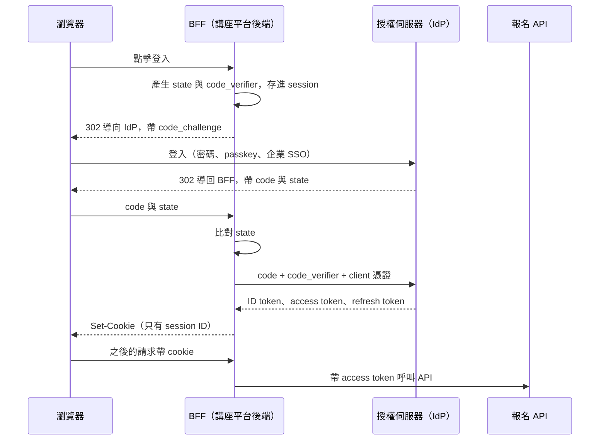

> **System Design 系列** Part 8-1｜上一篇：[Batch 與 Stream](/post/systemdesign/batch-vs-stream/)｜下一篇：[授權模型與 OWASP API Top 10](/post/systemdesign/authorization-owasp-api-top10/)｜[系列地圖](/post/systemdesign/system-design-thinking/#系列地圖)

## 情境與問題

講座平台現在有四種登入需求：

- **會員**：用網頁（SPA）與手機 App 報名、付款、看自己的票券
- **講者**：在後台管理講座、看報名名單與分潤
- **企業客戶**：希望員工用公司的帳號登入（SSO），離職時公司停用帳號就不能再登入
- **服務之間**：報名服務呼叫付款服務（[Part 7](/post/systemdesign/monolith-vs-microservices/)），付款服務要知道「是誰、代表誰」在呼叫，這留到 [8-3](/post/systemdesign/identity-propagation/) 再談

[系列導讀的 STRIDE 表](/post/systemdesign/system-design-thinking/)裡，第一列就是「冒充」：盜用帳號替別人報名。身分驗證要回答的是「這個請求是誰送來的」，而且要在下面這些限制下回答：

- 每個 API 請求都要知道是誰，不能每次都查密碼
- 使用者按下登出、管理員停用帳號、企業客戶的員工離職，要多快生效？
- 應用程式有多台（[無狀態服務篇](/post/systemdesign/scaling-stateless/)），登入狀態放在哪裡？
- 網頁上的任何一段 JavaScript 被注入，會不會連登入狀態一起被偷走？

```diagram
title: 這個請求是誰送來的？
row: M 會員 | API 講座平台 | SPK 講者
row: EMP 企業員工 | IDP 公司帳號（IdP） | ATK 攻擊者
step: 會員
  會員用網頁（SPA）與手機 App 報名、付款、看自己的票券。
M -> API: 報名、付款、票券
note M: 網頁與手機 App
step: 講者
  講者在後台管理講座、看報名名單與分潤。
SPK -> API: 管理講座、看分潤
step: 企業的 SSO
  企業客戶希望員工用公司的帳號登入，離職時公司停用帳號，就不能再登入。
EMP -> IDP: 用公司帳號登入
IDP -> API: 證明是誰
note IDP: 離職就停用
step: 每個請求都要知道是誰
  每個 API 請求都要知道是誰，但不能每次都查密碼。應用程式有多台，登入狀態要放在哪裡？
M => API: 每一個請求
note API: 不能每次都查密碼
step: 多快生效？
  使用者按下登出、管理員停用帳號、員工離職，要多快生效？已經發出去的登入狀態，還能用多久？
EMP -> API: 離職後還能用嗎？ [danger]
note EMP: 已經離職 [danger]
step: 被注入的 JavaScript
  網頁上的任何一段 JavaScript 被注入，會不會連登入狀態一起被偷走？
M -> ATK: 登入狀態被偷走 [danger]
note M: 頁面被注入 JS [danger]
```

驗證只回答「你是誰」；「你能做什麼」是授權，是[下一篇](/post/systemdesign/authorization-owasp-api-top10/)的主題。

## 最簡單的做法與它的極限

**帳號密碼登入，session 存在應用程式的記憶體裡**

- 擴充到兩台之後，登入在 A 台、下一個請求送到 B 台，使用者就被登出了。用 sticky session 可以暫時解決，但部署或某台當機時，那台上的使用者全部被登出（[Load Balancing 篇](/post/systemdesign/load-balancing/)）

**自己簽 JWT，前端存在 `localStorage`，每個請求帶在 `Authorization` 標頭**

- 伺服器不需要保存狀態，看起來解決了擴充的問題
- 但 JWT 在到期之前一直有效。使用者登出、密碼被盜後修改、帳號被停用，已經發出的 token 仍然能用
- 網頁上任何一段被注入的 JavaScript 都能讀取 `localStorage`，把 token 送到攻擊者的伺服器，在攻擊者自己的電腦上使用
- 每個應用程式都自己處理密碼、自己簽 token，企業客戶要求 SSO 時，又要再做一次

## 核心機制

### Session 與 token：差別在狀態放在哪裡、怎麼撤銷

| | 伺服器端 session | 自包含的 token（JWT） |
|---|---|---|
| 用戶端拿到的 | 一個隨機的 ID（通常放在 cookie） | 一份簽章過的聲明：誰、發給誰、何時到期 |
| 伺服器怎麼驗證 | 用 ID 查 session store | 用公鑰驗證簽章，不需要查任何東西 |
| 撤銷 | 刪掉 session，下一個請求就失效 | 到期前無法撤銷，除非另外查撤銷清單 |
| 資料更新 | 權限改了，session 裡的資料可以同步更新 | token 裡的聲明直到到期都是舊的 |
| 代價 | 每個請求查一次 store；store 故障，所有人都無法通過驗證 | 每個請求帶著較大的 token；撤銷不即時 |

粗略估算講座平台的兩種代價：

- **Session store**：100 萬個有效的 session。如果 session 裡只有使用者 ID 與權限，每筆約 1 KB，共 1 GB；如果像後面的 BFF 一樣把 access token、refresh token、ID token 都放進 session，每筆約 3 到 4 KB，共 3 到 4 GB。尖峰每秒 2 萬個請求，就是每秒 2 萬次 Redis 讀取，一台 Redis 可以承受，但它成了每個請求都依賴的元件（[Cache 篇](/post/systemdesign/caching/)談過 Redis 的高可用）
- **JWT**：一個帶著幾個聲明的 RS256 token 約 800 位元組到 1.5 KB。每秒 2 萬個請求，光是 token 就多了 20 到 30 MB/s 的上行流量。access token 的有效期限是 10 分鐘，代表停用一個帳號之後，最壞還有 10 分鐘能繼續呼叫 API

所以「session 還是 JWT」本身不是一個好問題。比較好的問法是：**哪一段用哪一種**。瀏覽器到後端，用 session cookie；後端呼叫 API、服務呼叫服務，用短期的 token。

### OAuth 2.0 與 OpenID Connect

**OAuth 2.0** 解決的是**委派授權**：使用者授權一個應用程式（client），以有限的權限（scope）代表他存取某個 API（resource server）。授權伺服器（authorization server）發給 client 一個 **access token**，client 拿著它呼叫 API。

OAuth 本身不是登入協定：access token 是給 API 看的，client 不應該解讀它，也無法從它可靠地知道「誰登入了」。**OpenID Connect（OIDC）** 在 OAuth 2.0 之上加了一個 **ID token**：一個給 client 看的 JWT，說明使用者是誰（`sub`）、由誰驗證（`iss`）、發給哪個 client（`aud`）、什麼時候驗證的。

| Token | 給誰看 | 用途 | 常見的錯誤 |
|---|---|---|---|
| ID token | client | 確認登入的是誰 | 拿 ID token 去呼叫 API |
| Access token | resource server（API） | 授權存取 API | client 解讀 access token 的內容來判斷使用者 |
| Refresh token | 授權伺服器 | 換新的 access token | 放在瀏覽器裡、沒有輪替 |

### 授權碼流程與 PKCE

目前唯一建議的使用者登入流程是 **Authorization Code + PKCE**：



- **PKCE**（RFC 7636）：client 先產生一個隨機的 `code_verifier`，只把它的雜湊（`code_challenge`）放進授權請求；換 token 時再送出原始的 `code_verifier`。即使授權碼在導回的過程中被攔截，攔截者沒有 `code_verifier` 也換不到 token。RFC 9700（OAuth 2.0 Security Best Current Practice，2025 年 1 月）規定 public client 必須使用 PKCE，有 client 憑證的 confidential client 也建議使用（RECOMMENDED），授權伺服器則必須支援 PKCE
- **`state`**：把授權回應綁定到發起登入的那個瀏覽器 session，防止攻擊者把他自己的授權碼注入你的登入流程
- **redirect URI 精確比對**：授權伺服器只接受事先註冊、完全相同的 redirect URI，不做萬用字元或前綴比對，否則授權碼可能被導到攻擊者的網址
- **已經不該使用的流程**：implicit grant（token 直接放在網址的 fragment 裡）與 resource owner password credentials（client 直接收使用者的密碼）都被 RFC 9700 列為不應使用

### 瀏覽器應用：token 不要進瀏覽器

RFC 10017（OAuth 2.0 for Browser-Based Applications，2026 年 8 月發布為 Best Current Practice）依安全性由高到低整理了三種架構：

| 架構 | token 在哪裡 | 被注入 JavaScript 時 |
|---|---|---|
| Backend for Frontend（BFF） | 只在後端；瀏覽器只有 HttpOnly 的 session cookie | 攻擊者能在受害者的瀏覽器裡發出請求，但拿不到 token 帶走 |
| Token-mediating backend | 後端取得 token，再交給前端使用 | token 可能被讀走 |
| 前端直接當 OAuth client | 前端 | token 可能被讀走；攻擊者甚至能在隱藏的 iframe 裡自己跑一次授權流程，取得全新的 token |

RFC 10017 特別指出：一旦攻擊者能在頁面上執行 JavaScript，它和正常的應用程式碼有一樣的權限。把 token 放在 `localStorage`、`sessionStorage` 或記憶體裡都擋不住，因為攻擊者可以直接取得新的 token。BFF 的價值在於**瀏覽器裡根本沒有 token**，攻擊者的能力被限制在「受害者開著頁面時，以受害者的身分發出請求」，而不能把憑證帶走長期使用。

BFF 的 session cookie 依 RFC 10017 的建議設定：`Secure`、`HttpOnly`、`SameSite=Strict`（需要從外部連結直接進入已登入的頁面時，常放寬為 `Lax`）、名稱加上 `__Host-` 前綴、`Path=/`，不設定 `Domain`。`__Host-` 前綴讓瀏覽器拒絕任何帶有 `Domain` 屬性或不是 `Secure` 的同名 cookie，子網域就無法覆寫它。

使用 cookie 就要防範 **CSRF**：`SameSite` 擋掉大部分的跨站請求，會改變狀態的請求再加上 CSRF token 檢查。

**手機 App** 沒有 BFF 可以藏 token。依 RFC 8252，App 透過系統瀏覽器（而不是 App 內嵌的 WebView）進行授權碼流程並使用 PKCE，token 存在作業系統提供的安全儲存區。

### Token 的生命週期

- **Access token 要短**：5 到 15 分鐘。它是被盜時的損失上限，也是撤銷的延遲上限
- **Refresh token 要輪替**：每次使用 refresh token，授權伺服器都發一個新的、作廢舊的。如果作廢的 refresh token 又被使用，代表有兩方持有同一個 token（其中一方是攻擊者），授權伺服器應該撤銷整串 refresh token，強制重新登入（RFC 9700）
- **讓 token 綁定持有者**：一般的 bearer token 誰拿到誰就能用。DPoP（RFC 9449）與 mTLS 綁定（RFC 8705）讓 token 綁定 client 的金鑰，被偷走的 token 沒有對應的私鑰就無法使用
- **登出**：BFF 刪除 session、呼叫授權伺服器的撤銷端點（RFC 7009）作廢 refresh token，並依 OIDC 的 RP-Initiated Logout 結束 IdP 的登入狀態。已經發出的 access token 仍然有效到期滿，這就是它必須短的原因

### 密碼、MFA 與 passkey

如果自己保存密碼，NIST SP 800-63B Rev. 4（2025 年）的規定和很多既有的習慣相反：

- 只用密碼登入時，最少 **15 個字元**；作為多因素驗證的一部分時，最少 8 個字元。至少允許 64 個字元
- **不得**要求混合大小寫、數字、符號等組成規則
- **不得**要求定期更換密碼，只有在有證據顯示密碼外洩時才強制更換
- 設定密碼時要比對**黑名單**（外洩過的密碼、字典單字、服務名稱），拒絕時要說明原因
- 不得提供未登入就能看到的密碼提示，也不得使用安全提問
- 同一個帳號連續失敗的次數上限不超過 100 次

密碼要加鹽並用有成本參數的雜湊函式保存。OWASP 的建議是 Argon2id（例如記憶體 19 MiB、迭代 2 次、平行度 1），其次是 scrypt 與 bcrypt。bcrypt 只使用前 72 個位元組，長的 Unicode 密碼可能超過這個長度。

**Passkey**（WebAuthn）用裝置上的私鑰簽署伺服器的挑戰，而且簽章綁定網站的網域：使用者在釣魚網站上「登入」，產生的簽章對真正的網站無效。這是目前最實際的**抗釣魚**驗證方式。簡訊與一般的一次性密碼能防止密碼被重複使用，但擋不住即時轉送的釣魚網站。

### 企業 SSO：用 `iss` 加 `sub` 識別人，不是 email

企業客戶的員工透過自己公司的 IdP 登入（OIDC 或 SAML），講座平台成為那個 IdP 的 client。員工離職時，公司停用 IdP 的帳號，下一次登入就會失敗；但講座平台已經發出的 session 不會自動結束，所以企業帳號的 session 要比一般會員短，或支援 IdP 的登出通知。

最常見的錯誤是**用 email 對應帳號**：「這個 IdP 說他是 alice@example.com，資料庫裡剛好有這個 email，就讓他登入那個帳號」。任何一個允許使用者自己設定 email、或不驗證 email 的 IdP，都能藉此接管別人的帳號。外部身分的唯一識別是 **`iss` 加上 `sub`**；要把外部身分連結到既有帳號，必須在使用者已經登入的狀態下明確操作。

## 方案比較

| 方案 | 適合 | 撤銷 | 代價 |
|---|---|---|---|
| Session cookie（單體） | 伺服器渲染或同網域的單體應用 | 即時 | 需要共享的 session store |
| BFF + session cookie | SPA，處理個資或金流 | session 即時；access token 依有效期限 | 多一個後端元件；session 較大 |
| JWT access token | API、resource server | 依有效期限，或加撤銷清單 | token 較大；權限變更不即時 |
| 不透明 token + introspection（RFC 7662） | 需要即時撤銷的 API | 即時 | 每個請求都問授權伺服器，通常要加快取，又回到延遲撤銷 |

講座平台的選擇：

- **身分提供者**：使用代管的 IdP 或自行部署成熟的實作（Keycloak、Spring Authorization Server），不在每個應用程式裡自己處理密碼與簽發 token。企業客戶透過 OIDC 或 SAML 與這個 IdP 聯合
- **網頁**：Spring Boot BFF，`oauth2Login` 加上 Spring Session（Redis），瀏覽器只有 `__Host-` 開頭的 session cookie
- **手機 App**：系統瀏覽器加 PKCE；access token 10 分鐘、refresh token 輪替
- **各個 API**：resource server，驗證 JWT 的簽章、`iss`、`aud`、`exp`
- **會員**：提供 passkey；講者與管理員強制使用多因素驗證

## Java 落地

### 1. BFF：登入、session 與轉送 token

```yaml
spring:
  security:
    oauth2:
      client:
        registration:
          lectures:
            client-id: lectures-web
            client-secret: ${idp.lectures-web.client-secret}   # 由 configtree 從掛載的 secrets 檔案讀取，不寫在設定檔（8-4）
            authorization-grant-type: authorization_code
            scope: openid, profile, lectures.read, lectures.register
        provider:
          lectures:
            issuer-uri: https://id.lectures.example.com/realms/lectures
  session:
    timeout: 8h

server:
  servlet:
    session:
      cookie:
        name: __Host-SESSION
        secure: true
        http-only: true
        same-site: lax
```

```java
@Configuration
@EnableWebSecurity
public class BffSecurityConfig {

    @Bean
    SecurityFilterChain bffFilterChain(HttpSecurity http, ClientRegistrationRepository registrations) throws Exception {
        OidcClientInitiatedLogoutSuccessHandler logoutSuccess =
                new OidcClientInitiatedLogoutSuccessHandler(registrations);
        logoutSuccess.setPostLogoutRedirectUri("{baseUrl}/");

        http
                .authorizeHttpRequests(auth -> auth
                        .requestMatchers("/", "/assets/**").permitAll()
                        .anyRequest().authenticated())
                .oauth2Login(Customizer.withDefaults())
                .logout(logout -> logout.logoutSuccessHandler(logoutSuccess))
                .csrf(csrf -> csrf.spa());          // SPA 從 cookie 讀 CSRF token，放進請求標頭
        return http.build();
    }

    /** 呼叫下游 API 時，自動帶上目前使用者的 access token；過期時用 refresh token 換新的。 */
    @Bean
    RestClient lecturesApiClient(OAuth2AuthorizedClientManager authorizedClientManager) {
        OAuth2ClientHttpRequestInterceptor interceptor = new OAuth2ClientHttpRequestInterceptor(authorizedClientManager);
        interceptor.setClientRegistrationIdResolver(request ->
                SecurityContextHolder.getContext().getAuthentication() instanceof OAuth2AuthenticationToken token
                        ? token.getAuthorizedClientRegistrationId()
                        : null);
        return RestClient.builder()
                .baseUrl("http://registration.lectures.svc.cluster.local")
                .requestInterceptor(interceptor)
                .build();
    }
}
```

- 加入 `spring-boot-starter-session-data-redis`，session 就存到 Redis，BFF 可以水平擴充
- 登入成功時，Spring Security 預設會更換 session ID（`changeSessionId`），防止 session fixation
- `OAuth2AuthorizedClient`（包含 access token 與 refresh token）預設存在 session 裡，這正是 BFF 的 session 比較大的原因
- BFF 是 confidential client，仍然要確認授權請求有帶 PKCE。Spring Security 以 client registration 的 `requireProofKey` 設定控制，同時要確認 IdP 支援

### 2. API：驗證 JWT access token

```yaml
spring:
  security:
    oauth2:
      resourceserver:
        jwt:
          issuer-uri: https://id.lectures.example.com/realms/lectures
          audiences: registration-api
```

```java
@Configuration
@EnableWebSecurity
public class ResourceServerConfig {

    @Bean
    SecurityFilterChain apiFilterChain(HttpSecurity http) throws Exception {
        http
                .authorizeHttpRequests(auth -> auth
                        .requestMatchers("/actuator/health/**").permitAll()
                        .requestMatchers(HttpMethod.POST, "/v1/registrations").hasAuthority("SCOPE_lectures.register")
                        .anyRequest().authenticated())
                .oauth2ResourceServer(oauth2 -> oauth2.jwt(Customizer.withDefaults()))
                .sessionManagement(session -> session.sessionCreationPolicy(SessionCreationPolicy.STATELESS));
        return http.build();
    }
}
```

- `issuer-uri` 讓 Spring Security 從 IdP 的 discovery 文件取得 JWKS 的位置，並驗證 `iss`；`audiences` 驗證 `aud` 包含這個 API。少了 `aud` 檢查，發給其他服務的 token 也能拿來呼叫這個 API
- 簽章演算法與公鑰都來自設定的 IdP，不採用 token 標頭裡指定的金鑰位置
- API 不使用 session，也就不需要 CSRF 保護：它只接受 `Authorization` 標頭裡的 token，瀏覽器不會自動帶上

### 3. 自建 IdP 時的密碼與 passkey

```java
@Bean
PasswordEncoder passwordEncoder() {
    String defaultId = "argon2";
    Map<String, PasswordEncoder> encoders = Map.of(
            defaultId, Argon2PasswordEncoder.defaultsForSpringSecurity_v5_8(),
            "bcrypt", new BCryptPasswordEncoder());
    // 新密碼用 Argon2id；舊的 {bcrypt} 雜湊仍然能驗證，搭配 UserDetailsPasswordService 可在登入成功時升級
    return new DelegatingPasswordEncoder(defaultId, encoders);
}

@Bean
SecurityFilterChain loginFilterChain(HttpSecurity http) throws Exception {
    http
            .formLogin(Customizer.withDefaults())
            .webAuthn(webAuthn -> webAuthn
                    .rpId("lectures.example.com")
                    .allowedOrigins("https://lectures.example.com"));
    return http.build();
}
```

- `Argon2PasswordEncoder` 需要 Bouncy Castle 函式庫
- Spring Security 7 提供多因素驗證的支援（`@EnableMultiFactorAuthentication`、`FactorGrantedAuthority`），可以要求講者後台同時具備密碼與 passkey 兩個因素

> 以上設定與程式碼依 Spring Boot 4.1 與 Spring Security 7.1 官方文件撰寫，沒有實際編譯與執行。自己簽發 JWT 的實作細節可參考 [JWT 認證機制完整實作](/post/security/jwt-spring-security/)；那篇的前端範例把 token 放在 `localStorage`，在本篇的威脅模型下，處理個資與金流的網頁應用建議改用 BFF。

## 踩坑與 Gotchas

- **把 ID token 當 access token**：API 收到 ID token，簽章正確、沒過期就放行，但它的 `aud` 是 client，不是這個 API
- **JWT 裡放太多權限**：權限變更要等 token 到期才生效；token 太大時，超過代理伺服器的標頭大小上限，請求直接被拒絕
- **JWKS 快取**：IdP 輪替金鑰後，API 還在用舊的公鑰，遇到不認得的 `kid` 時要重新取得 JWKS（Spring Security 的 decoder 會處理），但也要限制重新取得的頻率
- **時鐘偏差**：伺服器之間的時間差幾秒，剛簽發的 token 被判定為「尚未生效」。驗證時允許小幅的偏差（Spring Security 預設 60 秒）
- **Session store 是單點故障**：Redis 停止，所有使用者都無法通過驗證。Session store 要和其他快取分開，並有高可用設計
- **同時刷新 token**：多個分頁或並行請求同時用同一個 refresh token 換新 token，啟用輪替與重複使用偵測後，第二個請求會被當成攻擊，使用者被登出。BFF 要確保同一個 session 只有一個刷新在進行
- **登出只刪了瀏覽器的 cookie**：伺服器端的 session 與 refresh token 都還有效
- **企業帳號停用後仍能登入**：講座平台的 session 比 IdP 的帳號活得更久

### 攻擊情境

| 攻擊 | 怎麼發生 | 防禦 |
|---|---|---|
| 撞庫（credential stuffing） | 用其他網站外洩的帳密大量嘗試登入。攻擊者對每個帳號只試一兩次，單一帳號的失敗次數上限擋不住 | 設定密碼時比對外洩清單；依 IP、裝置與整體失敗率限流（[Rate Limiting 篇](/post/systemdesign/rate-limiting/)、[8-5](/post/systemdesign/abuse-prevention/)）；MFA 與 passkey |
| 釣魚 | 仿冒的登入頁即時轉送帳密與一次性密碼 | Passkey 的簽章綁定網域，在仿冒網站上無效 |
| XSS 偷 token | 被注入的腳本讀取 token 帶走 | BFF，瀏覽器裡沒有 token；CSP 降低 XSS 的機會 |
| CSRF | 其他網站讓已登入的瀏覽器送出改變狀態的請求 | `SameSite` cookie 加上 CSRF token |
| Session fixation | 攻擊者先讓受害者使用一個已知的 session ID，等他登入 | 登入時更換 session ID |
| JWT 演算法攻擊 | 標頭改成 `alg: none`，或把 RS256 改成 HS256、用公鑰當 HMAC 的密鑰；或在 `jku`、`kid` 指向攻擊者控制的金鑰 | 固定允許的演算法，公鑰只從設定的 IdP 取得（RFC 8725） |
| Token 被拿去別的服務 | 一個低權限服務收到的 token，被它（或入侵它的人）轉送到高權限的 API | 每個 API 都檢查 `aud`；需要往下傳遞身分時用 token exchange（[8-3](/post/systemdesign/identity-propagation/)） |
| 授權碼被攔截或注入 | 惡意 App 註冊同樣的 redirect scheme，或攻擊者把自己的授權碼塞進受害者的流程 | PKCE、`state`、redirect URI 精確比對 |
| 用 email 接管帳號 | 在不驗證 email 的 IdP 註冊受害者的 email，再用 SSO 登入 | 用 `iss` 加 `sub` 識別外部身分；連結帳號必須在已登入狀態下明確操作 |
| Refresh token 被盜 | 長期有效的 refresh token 從裝置或日誌外洩 | 輪替與重複使用偵測；DPoP 或 mTLS 綁定 |
| 帳號列舉 | 「帳號不存在」與「密碼錯誤」的訊息或回應時間不同 | 登入、註冊、忘記密碼都回應相同的訊息，並讓處理時間接近 |
| Token 出現在日誌 | `Authorization` 標頭、cookie、帶 token 的網址被記錄下來 | 日誌遮蔽這些欄位（[Observability 篇](/post/systemdesign/observability/)）；token 不放在網址 |

## 何時用／何時別用

- **用 session cookie**：瀏覽器到你自己的後端。單體應用直接用；SPA 透過 BFF 用
- **用 OAuth 2.0／OIDC**：有多個應用程式或 API 要共用登入、需要企業 SSO、或要讓第三方代表使用者存取 API
- **用短期的 JWT access token**：API 與服務之間，需要在不查資料庫的情況下驗證，並且能接受幾分鐘的撤銷延遲
- **別自己做**：自己實作 OAuth 授權伺服器、自己設計 token 格式、自己發明密碼雜湊。使用成熟的 IdP 與函式庫，把時間花在正確的設定上
- **重新評估的時機**：出現必須「立即撤銷」的需求（例如金融交易、帳號被盜的緊急處理），短期 token 的延遲不能接受時，改用不透明 token 加 introspection，或在敏感操作前重新驗證

## 參考資料

- RFC 6749, "The OAuth 2.0 Authorization Framework"
- RFC 7636, "Proof Key for Code Exchange by OAuth Public Clients"
- RFC 9700, "Best Current Practice for OAuth 2.0 Security", January 2025
- RFC 10017, "OAuth 2.0 for Browser-Based Applications", August 2026：<https://www.rfc-editor.org/rfc/rfc10017>
- RFC 8252, "OAuth 2.0 for Native Apps"
- RFC 8725, "JSON Web Token Best Current Practices"
- RFC 9449, "OAuth 2.0 Demonstrating Proof of Possession (DPoP)"；RFC 8705, "OAuth 2.0 Mutual-TLS Client Authentication and Certificate-Bound Access Tokens"
- RFC 7009, "OAuth 2.0 Token Revocation"；RFC 7662, "OAuth 2.0 Token Introspection"
- OpenID Connect Core 1.0 與 OpenID Connect RP-Initiated Logout 1.0：<https://openid.net/developers/specs/>
- NIST SP 800-63B Rev. 4, "Digital Identity Guidelines: Authentication and Authenticator Management"：<https://pages.nist.gov/800-63-4/sp800-63b/authenticators>
- OWASP Cheat Sheet Series — Password Storage、Session Management、Authentication：<https://cheatsheetseries.owasp.org/>
- Spring Security Reference — OAuth 2.0 Login、Resource Server JWT、Passkeys、Multi-Factor Authentication、CSRF：<https://docs.spring.io/spring-security/reference/>
- 互動圖解延伸：Dilum Sanjaya，System Design — an interactive course：<https://designed-to-scale.vercel.app/>
