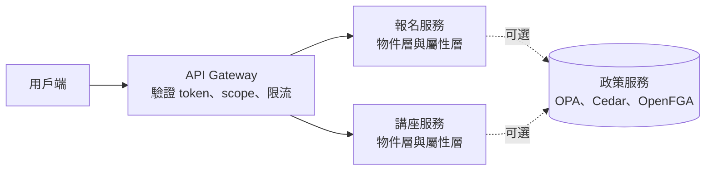

> **System Design 系列** Part 8-2｜上一篇：[身分驗證](/post/systemdesign/authentication-session-token-oidc/)｜下一篇：[BOLA 穿過 BFF 之後](/post/systemdesign/identity-propagation/)｜[系列地圖](/post/systemdesign/system-design-thinking/#系列地圖)

## 情境與問題

[上一篇](/post/systemdesign/authentication-session-token-oidc/)確認了「這個請求是誰送來的」。講座平台上線後，資安檢測回報了四個問題，每一個請求都帶著**合法的登入身分**：

1. 會員把網址裡的 `/v1/registrations/1001` 改成 `1002`，看到了別人的報名資料、電話與付款狀態
2. 會員直接呼叫 `GET /admin/lectures/42/registrations/export`，下載了整場講座的學員名單。前端沒有顯示這個按鈕，但 API 沒有檢查
3. 會員更新個人資料時，在 JSON 裡多送了 `"role": "ADMIN"`；報名時多送了 `"status": "CONFIRMED"`，跳過了付款
4. 講者後台的學員名單 API 回傳了學員的完整 email 與電話，前端只顯示姓名，但回應裡全部都有

這四個問題分別是 OWASP API Security Top 10（2023）的第 1、5、3 名，而且都不是驗證的問題：身分是對的，只是**沒有檢查這個身分能不能做這件事**。

## 最簡單的做法與它的極限

在 controller 上依角色檢查：

```java
@PreAuthorize("hasRole('MEMBER')")
@GetMapping("/v1/registrations/{id}")
public RegistrationView get(@PathVariable long id) {
    return registrationService.get(id);       // 任何會員都能查任何一筆
}
```

角色回答的是「這個人能做**哪一類**事」：會員能查報名。它沒有回答「這個人能對**哪一筆**資料做這件事」：會員只能查**自己的**報名。第 1 個問題就出在這裡。

另一種常見的做法是「前端只顯示有權限的按鈕」，這只是使用者介面，攻擊者直接呼叫 API，第 2 個問題就出在這裡。

## 核心機制

### 三層授權

| 層級 | 問題 | 例子 | 對應的 OWASP API 風險 |
|---|---|---|---|
| 功能層 | 能不能呼叫這個操作？ | 只有平台管理員能匯出名單 | API5 Broken Function Level Authorization（BFLA） |
| 物件層 | 能不能對**這一筆**資料執行這個操作？ | 會員只能看自己的報名；講者只能看自己講座的名單 | API1 Broken Object Level Authorization（BOLA） |
| 屬性層 | 能讀、能寫這筆資料的**哪些欄位**？ | 講者看得到學員的姓名，看不到電話；會員不能修改自己的角色與報名狀態 | API3 Broken Object Property Level Authorization（BOPLA） |

三層都要有。功能層通常最容易做（一條規則涵蓋一整組 API），物件層最容易漏，因為它需要知道**資料屬於誰**，這個資訊在資料庫裡，不在 token 裡。

### 授權模型

| 模型 | 規則的形式 | 講座平台的例子 | 適合 | 限制 |
|---|---|---|---|---|
| RBAC（角色） | 角色擁有權限，使用者擁有角色 | `PLATFORM_ADMIN` 可以匯出名單 | 功能層、組織內的職務 | 物件層要另外處理；需求一細，角色數量會爆炸（「台北區的講者助理」） |
| ABAC（屬性） | 依使用者、資源、環境的屬性判斷 | 企業管理員可以看 `tenant_id` 等於自己公司的報名；只能在上班時間匯出 | 規則依屬性組合、多租戶 | 規則分散難以檢視；「誰能存取這筆資料」很難反向查出 |
| ReBAC（關係） | 依實體之間的關係推導 | 講者 7 是講座 42 的 owner；講座 42 屬於企業 A；企業 A 的管理員可以看企業 A 的所有講座 | 共享、階層、委派（「把這場講座共同管理權給助理」） | 關係資料要另外維護並同步 |

ReBAC 的代表是 Google 的 Zanzibar：論文描述它以統一的關係資料模型服務 Google 的數百個服務，每秒處理超過一千萬次檢查，95 百分位延遲在 10 毫秒以內。開源的實作有 OpenFGA、SpiceDB；AWS 的 Cedar 則是一種可以同時表達 RBAC 與 ABAC 的政策語言。

實務上這三種常常混用：RBAC 管功能層，物件層用「擁有者」這種最簡單的關係，等到出現共享與階層的需求，再考慮專門的 ReBAC 系統。

### 授權檢查放在哪裡



- **Gateway 做粗粒度的檢查**：token 是否有效、scope 是否允許呼叫這一組 API、限流。它不知道報名 1002 屬於誰
- **每個服務自己做物件層與屬性層的檢查**：資料在服務裡，判斷也只能在服務裡做。只依賴 gateway 的檢查，攻擊者繞過 gateway（從內部網路直接呼叫）就沒有任何保護（[單體 vs 微服務篇](/post/systemdesign/monolith-vs-microservices/)）

決策邏輯可以嵌在服務裡，也可以集中到政策服務（PDP，policy decision point），服務只負責執行決策（PEP，policy enforcement point）。集中的好處是政策一致、可以統一稽核；代價是每次決策都要把需要的資料送過去（「報名 1002 的擁有者是誰」），或者把關係資料同步到政策服務。

**列表是最大的成本**：一頁 50 筆的列表，如果每一筆都遠端檢查一次、每次 2 毫秒，依序執行就是 100 毫秒。所以列表的授權通常不是「查出來再逐筆檢查」，而是**把授權條件放進查詢本身**，或者先向政策服務問「這個使用者能看哪些 ID」，再用這些 ID 查詢。

### 物件層：把授權條件放進查詢

```sql
-- 錯誤：先查出來，再檢查（或忘了檢查）
SELECT * FROM registration WHERE id = :id;

-- 正確：擁有權是查詢條件的一部分
SELECT * FROM registration WHERE id = :id AND member_id = :currentMemberId;
```

- **`currentMemberId` 只能來自驗證過的身分**，不能來自網址、查詢參數或請求內容。請求裡的 `memberId` 如果被拿來當查詢條件，攻擊者改一個數字就能存取別人的資料
- **查不到時回 404**，不回 403。403 等於告訴攻擊者「這筆資料存在，只是你不能看」，可以用來列舉
- **不可預測的 ID 不能取代授權**：UUID 讓攻擊者難以猜到 ID，但 ID 會出現在網址、日誌、分享連結裡（[分散式 ID 篇](/post/systemdesign/distributed-id/)）
- **每一條讀取路徑都要有相同的條件**：列表、搜尋（[全文搜尋篇](/post/systemdesign/full-text-search/)）、快取（[Cache 篇](/post/systemdesign/caching/)）、分頁游標（[Index 篇](/post/systemdesign/index-btree/)）、匯出、即時推播的訂閱（[即時更新篇](/post/systemdesign/realtime-updates/)）、檔案下載（[物件儲存篇](/post/systemdesign/object-storage/)）
- **多租戶**：企業客戶的資料每一列都帶 `tenant_id`，查詢一律加上從 token 取得的租戶條件。分片或路由到正確的資料庫，不代表授權（[Sharding 篇](/post/systemdesign/sharding/)）

### 屬性層：明確列出允許的欄位

- **輸入**：每個操作有自己的請求物件，只包含允許修改的欄位。把請求直接綁定到 entity，`role`、`status`、`price` 這些欄位就可能被一起寫入（mass assignment）
- **輸出**：依角色回傳不同的回應物件。「前端不顯示」不等於「沒有回傳」，回應的內容任何人都能在瀏覽器的開發者工具裡看到

### 授權資料的新鮮度

- 角色被撤銷後，[上一篇](/post/systemdesign/authentication-session-token-oidc/)的 access token 裡的 scope 與角色仍然有效到期滿。高風險的操作（匯出、退款、權限管理）要查詢目前的權限，而不是只看 token
- 權限檢查讀 replica，剛被撤銷的權限可能在複寫延遲期間仍然有效（[Replication 篇](/post/systemdesign/replication-lag/)）
- 權限的快取要有短的期限，或在權限變更時主動失效

### OWASP API Security Top 10（2023）對照

| 編號 | 風險 | 講座平台的例子 | 本系列的對應 |
|---|---|---|---|
| API1 | Broken Object Level Authorization | 改報名 ID 看別人的資料 | 本篇；微服務之間的傳遞見 [8-3](/post/systemdesign/identity-propagation/) |
| API2 | Broken Authentication | 撞庫、token 沒有驗證 `aud` | [身分驗證](/post/systemdesign/authentication-session-token-oidc/) |
| API3 | Broken Object Property Level Authorization | 送出 `"status": "CONFIRMED"`；回應包含學員電話 | 本篇 |
| API4 | Unrestricted Resource Consumption | `pageSize=1000000`、上傳 10 GB 的檔案、觸發大量寄信 | [Rate Limiting](/post/systemdesign/rate-limiting/)、[物件儲存](/post/systemdesign/object-storage/) |
| API5 | Broken Function Level Authorization | 會員呼叫管理員的匯出 API | 本篇 |
| API6 | Unrestricted Access to Sensitive Business Flows | 機器人在開放瞬間搶光名額、大量預留不付款 | [8-5 濫用防護](/post/systemdesign/abuse-prevention/)、[Saga 篇](/post/systemdesign/saga-outbox/) |
| API7 | Server Side Request Forgery | 講者填入的 webhook 網址指向內部服務 | 本篇 |
| API8 | Security Misconfiguration | Actuator 端點對外開放、CORS 允許任何來源、錯誤訊息包含 stack trace | [8-4](/post/systemdesign/encryption-secrets/)、[Observability](/post/systemdesign/observability/) |
| API9 | Improper Inventory Management | 舊版的 `/v1` API 沒有新的授權檢查，卻還在線上 | [REST、gRPC 與 GraphQL](/post/systemdesign/rest-grpc-graphql/) 的版本管理 |
| API10 | Unsafe Consumption of APIs | 完全信任金流或第三方 API 的回應 | [Timeout 與 Retry](/post/systemdesign/timeout-retry-backoff/)；對外部回應做驗證 |

前五名裡有三個是授權。

### SSRF：讓伺服器替攻擊者發出請求

講者可以設定一個 webhook 網址，有新的報名時，平台會呼叫這個網址通知講者自己的系統。攻擊者把網址設成：

- `http://169.254.169.254/latest/meta-data/iam/security-credentials/`：雲端主機的 metadata 服務，可能回傳主機的臨時憑證。AWS 的 IMDSv2 要求先用 `PUT` 取得 session token，並可以把回應的跳數限制為 1，能擋掉大部分只能發 `GET` 的 SSRF，但仍然要從應用程式這一層防範
- `http://payment.lectures.svc.cluster.local/v1/refunds`：內部服務的名稱（[Service Discovery 篇](/post/systemdesign/service-discovery/)），這些服務常假設「呼叫我的都是內部的程式」
- `http://localhost:8081/actuator/heapdump`：本機的管理端點

伺服器在內部網路裡，它能連到的地方，攻擊者透過它都能連到。防禦要分好幾層：

1. **限制網址的形式**：只允許 `https`、預設連接埠、沒有帳號密碼的網址
2. **解析網址並檢查所有 IP**：拒絕 loopback、私有網段、link-local（包含 `169.254.169.254`）、CGNAT、IPv6 的 unique local 等位址
3. **不跟隨重新導向**：攻擊者可以讓一個合法的外部網址回應 302，導向內部位址
4. **處理 DNS rebinding**：攻擊者的網域第一次解析到外部 IP 通過檢查，實際連線時再解析就變成內部 IP。檢查與連線使用同一次解析的結果，或交給下一層
5. **網路層的保護**：這類對外請求全部經過一個只能連到網際網路的 egress proxy，或者用網路政策禁止發出 webhook 的服務連到內部網段。這是最可靠的一層，因為它不依賴應用程式的每一個檢查都寫對
6. **限制資源**：短的逾時、回應大小上限、每個講者的呼叫頻率上限（[Timeout 與 Retry 篇](/post/systemdesign/timeout-retry-backoff/)）

## 方案比較

| 方案 | 適合 | 代價 |
|---|---|---|
| 嵌在程式裡的 RBAC 加擁有者條件 | 大部分的 CRUD 服務 | 規則分散在各服務；需要測試確保每個端點都有檢查 |
| 集中的政策引擎（OPA、Cedar） | 多個服務要共用一致的規則，需要集中稽核與審查政策 | 決策需要的資料要送進政策引擎；多一個要維運的元件與一跳延遲 |
| ReBAC 系統（OpenFGA、SpiceDB） | 共享、階層、委派複雜的產品（文件協作、組織與團隊） | 關係資料要與業務資料保持同步；列表查詢要另外設計 |
| 資料庫的 row-level security | 多租戶隔離，作為應用程式之外的第二道防線 | 依資料庫而定（PostgreSQL 支援，MySQL 沒有原生的機制）；連線池要正確設定每個連線的租戶 |

講座平台的選擇：功能層用 Spring Security 的角色與 scope；物件層把擁有者與租戶條件放進每一個查詢，講者對講座的權限用一個集中的檢查元件；暫時不導入 ReBAC 系統，等「共同管理講座」「企業內的部門權限」這類需求出現再評估。

## Java 落地

### 1. 預設拒絕，功能層用規則與註解

```java
@Configuration
@EnableWebSecurity
@EnableMethodSecurity
public class ApiSecurityConfig {

    @Bean
    SecurityFilterChain apiFilterChain(HttpSecurity http) throws Exception {
        http
                .authorizeHttpRequests(auth -> auth
                        .requestMatchers("/actuator/health/**").permitAll()
                        .requestMatchers("/admin/**").hasRole("PLATFORM_ADMIN")
                        .requestMatchers("/v1/**").authenticated()
                        .anyRequest().denyAll())                 // 沒有列出的路徑一律拒絕
                .oauth2ResourceServer(oauth2 -> oauth2.jwt(Customizer.withDefaults()));
        return http.build();
    }
}
```

- `anyRequest().denyAll()`：新增的端點如果忘了設定規則，結果是「無法存取」而不是「任何人都能存取」
- JWT 裡的角色要對應成 `ROLE_` 開頭的 authority，透過 `JwtAuthenticationConverter` 設定，這裡省略

### 2. 物件層：擁有者條件放在查詢裡

```java
/** 從驗證過的 JWT 取得目前的會員。member_id 是 IdP 加入 access token 的自訂聲明。 */
public record CurrentMember(long memberId, String tenantId) {

    public static CurrentMember from(Jwt jwt) {
        return new CurrentMember(((Number) jwt.getClaim("member_id")).longValue(), jwt.getClaimAsString("tenant_id"));
    }
}

public interface RegistrationRepository extends Repository<Registration, Long> {

    Optional<Registration> findByIdAndMemberId(long id, long memberId);
}

@RestController
@RequestMapping("/v1/registrations")
public class RegistrationController {

    private final RegistrationRepository registrations;

    public RegistrationController(RegistrationRepository registrations) {
        this.registrations = registrations;
    }

    @GetMapping("/{id}")
    public RegistrationView get(@PathVariable long id, @AuthenticationPrincipal Jwt jwt) {
        CurrentMember me = CurrentMember.from(jwt);
        return registrations.findByIdAndMemberId(id, me.memberId())
                .map(RegistrationView::from)
                // 不存在與不屬於你，回應完全相同
                .orElseThrow(() -> new ResponseStatusException(HttpStatus.NOT_FOUND));
    }
}
```

講者對講座的權限，集中在一個可以單獨測試的元件：

```java
@Component("lectureAuthz")
public class LectureAuthorization {

    private final JdbcClient jdbc;

    public LectureAuthorization(JdbcClient jdbc) {
        this.jdbc = jdbc;
    }

    public boolean isSpeakerOf(long lectureId, Authentication authentication) {
        if (!(authentication.getPrincipal() instanceof Jwt jwt)) {
            return false;
        }
        long memberId = CurrentMember.from(jwt).memberId();
        return jdbc.sql("SELECT COUNT(*) FROM lecture WHERE id = :id AND speaker_member_id = :memberId")
                .param("id", lectureId)
                .param("memberId", memberId)
                .query(Long.class)
                .single() > 0;
    }
}

@Service
public class AttendeeService {

    private final AttendeeRepository attendeeRepository;

    public AttendeeService(AttendeeRepository attendeeRepository) {
        this.attendeeRepository = attendeeRepository;
    }

    @PreAuthorize("@lectureAuthz.isSpeakerOf(#lectureId, authentication)")
    public List<AttendeeView> attendeesOf(long lectureId) {
        // 屬性層：講者版本的回應只有姓名與遮罩過的 email
        return attendeeRepository.findConfirmedByLectureId(lectureId).stream()
                .map(AttendeeView::forSpeaker)
                .toList();
    }
}
```

- 權限檢查放在 service 而不是 controller：同一個方法被 gRPC、訊息消費者或排程呼叫時，檢查一樣會執行
- `#lectureId` 依賴編譯時保留參數名稱（`-parameters`），Spring Boot 的建置外掛預設會加上
- 這裡檢查與讀取是兩次查詢。如果講座在兩次查詢之間轉移給別的講者，可能出現短暫的不一致；對講座這種很少轉移的資料可以接受

### 3. 屬性層：輸入與輸出都用明確的型別

```java
/** 只有這兩個欄位可以被會員修改；role、status 不在這裡，就不可能被寫入。 */
public record UpdateProfileRequest(
        @NotBlank @Size(max = 50) String displayName,
        @Pattern(regexp = "^09\\d{8}$") String mobile) {
}

public record AttendeeView(String displayName, String maskedEmail) {

    static AttendeeView forSpeaker(Attendee attendee) {
        return new AttendeeView(attendee.displayName(), mask(attendee.email()));
    }

    private static String mask(String email) {
        int at = email.indexOf('@');
        return at <= 1 ? "***" + email.substring(Math.max(at, 0)) : email.charAt(0) + "***" + email.substring(at);
    }
}
```

### 4. SSRF：webhook 網址的檢查

```java
@Component
public class WebhookTargetValidator {

    public URI validate(String raw) {
        URI uri = URI.create(raw);
        if (!"https".equals(uri.getScheme()) || uri.getHost() == null || uri.getRawUserInfo() != null
                || (uri.getPort() != -1 && uri.getPort() != 443)) {
            throw new InvalidWebhookException("只允許預設連接埠的 https 網址");
        }
        try {
            for (InetAddress address : InetAddress.getAllByName(uri.getHost())) {
                if (isInternal(address)) {
                    throw new InvalidWebhookException("網址不能指向內部位址");
                }
            }
        } catch (UnknownHostException e) {
            throw new InvalidWebhookException("無法解析網址");
        }
        return uri;
    }

    private static boolean isInternal(InetAddress address) {
        if (address.isAnyLocalAddress() || address.isLoopbackAddress() || address.isLinkLocalAddress()
                || address.isSiteLocalAddress() || address.isMulticastAddress()) {
            return true;                                   // 涵蓋 10/8、172.16/12、192.168/16、169.254/16 等
        }
        byte[] ip = address.getAddress();
        if (ip.length == 4) {
            return (ip[0] & 0xFF) == 100 && (ip[1] & 0xC0) == 64;   // 100.64.0.0/10（CGNAT）
        }
        return (ip[0] & 0xFE) == 0xFC;                     // fc00::/7（IPv6 unique local）
    }
}
```

- 這段檢查是第一層，不是全部：它無法防範 DNS rebinding（檢查之後、連線之前，網域被改成解析到內部位址）。真正送出 webhook 的請求要經過只能連到網際網路的 egress proxy，或在網路層禁止這個服務連到內部網段
- JDK 的 `HttpClient` 預設不跟隨重新導向（`Redirect.NEVER`），不要為了方便改掉
- 在儲存網址時與每次送出前都要檢查，因為網域解析的結果會變

> 以上程式碼依 Spring Boot 4.1 與 Spring Security 7.1 官方文件撰寫，沒有實際編譯與執行。

## 踩坑與 Gotchas

- **只在前端隱藏**：按鈕不見了，API 還在
- **授權寫在 controller**：新增的 gRPC 介面、訊息消費者、批次工作呼叫同一個 service，沒有任何檢查
- **批次與巢狀的請求只檢查了第一層**：GraphQL 的巢狀欄位、批次 API 的每一個 ID 都要各自檢查（[REST、gRPC 與 GraphQL 篇](/post/systemdesign/rest-grpc-graphql/)）
- **新端點沒有規則**：預設是 `authenticated()`，結果任何登入的人都能呼叫管理功能。預設應該是拒絕
- **PATCH 合併到 entity**：把請求的 JSON 合併到 entity 再儲存，攻擊者可以順便修改擁有者欄位
- **角色爆炸**：每個新需求都新增一個角色，最後沒有人知道誰有什麼權限。出現這個徵兆，代表規則其實是屬性或關係，該換模型了
- **管理員的代理登入沒有紀錄**：客服「以使用者身分登入」查問題，所有操作看起來都是使用者自己做的。代理登入要有獨立的身分標記與稽核紀錄
- **授權的測試只測了「能」**：每個端點都要有「別人的資料」「沒有角色」「別的租戶」的測試案例，確認回應是 404 或 403

### 攻擊情境

| 攻擊 | 怎麼發生 | 防禦 |
|---|---|---|
| 列舉 ID（BOLA） | 依序嘗試報名、訂單、檔案的 ID | 擁有者條件放進查詢；查不到一律 404；監控單一帳號的 404 比例 |
| 參數覆蓋身分 | 請求裡帶 `memberId`、`tenantId`，伺服器拿來當查詢條件 | 身分與租戶只從驗證過的 token 取得 |
| Mass assignment | 多送 `role`、`status`、`price` 欄位 | 每個操作有自己的請求型別 |
| 呼叫隱藏的管理 API | 從前端的 JavaScript 找出管理端點的路徑 | 功能層授權；管理介面與一般 API 分開部署或分開網域 |
| 繞過新版的檢查 | 呼叫還在線上的舊版 API、內部的除錯端點 | API 清冊；下線舊版本；內部端點不對外暴露 |
| 透過側門讀資料 | 搜尋結果的摘要、匯出檔、報表、自動完成、總筆數 | 每一條讀取路徑都套用相同的條件 |
| 跨租戶 | 企業 A 的管理員把網址裡的公司代碼改成企業 B | 租戶條件來自 token；可行時加上資料庫層的隔離作為第二道防線 |
| SSRF | Webhook、匯入網址、圖片網址指向 metadata 服務或內部服務 | 網址檢查、不跟隨重新導向、egress proxy、IMDSv2 |
| 權限撤銷後仍能操作 | 被移除的講者，token 到期前仍能下載名單 | 高風險操作查詢目前的權限；短期 token |

## 何時用／何時別用

- **一定要做**：三層授權在每個 API 都要有，這不是可以取捨的設計選項
- **用 RBAC**：功能層，以及權限只依職務決定的情況
- **用擁有者條件**：大部分的物件層需求，簡單、快、容易測試
- **用 ABAC 或政策引擎**：規則依屬性組合（租戶、地區、時間、資料等級），或多個服務需要一致、可稽核的政策
- **用 ReBAC**：出現共享、委派、多層組織的需求，而且「誰能看這筆資料」要能反向查詢
- **別過早導入**：只有「自己的資料只有自己能看」的系統，導入 Zanzibar 類的系統只會多一份要同步的資料與一個要維運的服務

## 參考資料

- OWASP API Security Top 10 2023：<https://owasp.org/API-Security/editions/2023/en/0x11-t10/>
- OWASP Cheat Sheet Series — Authorization、Server Side Request Forgery Prevention、Mass Assignment：<https://cheatsheetseries.owasp.org/>
- Ruoming Pang et al., "Zanzibar: Google's Consistent, Global Authorization System", *USENIX ATC*, 2019
- NIST SP 800-162, "Guide to Attribute Based Access Control (ABAC) Definition and Considerations"
- Ravi Sandhu, David Ferraiolo, Richard Kuhn, "The NIST Model for Role-Based Access Control: Towards a Unified Standard", 2000
- OpenFGA Documentation：<https://openfga.dev/docs>；Cedar Policy Language：<https://docs.cedarpolicy.com/>
- AWS Documentation — Use the Instance Metadata Service Version 2（IMDSv2）：<https://docs.aws.amazon.com/AWSEC2/latest/UserGuide/configuring-instance-metadata-service.html>
- Spring Security Reference — Authorize HTTP Requests、Method Security：<https://docs.spring.io/spring-security/reference/servlet/authorization/index.html>
- 互動圖解延伸：Dilum Sanjaya，System Design — an interactive course：<https://designed-to-scale.vercel.app/>
