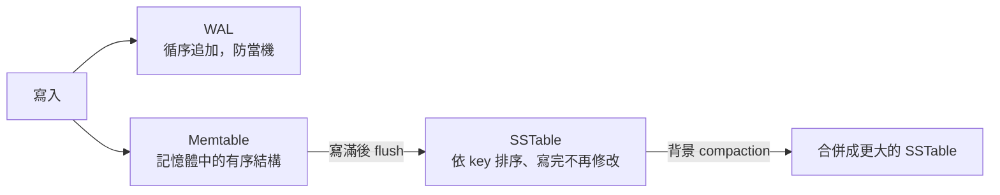
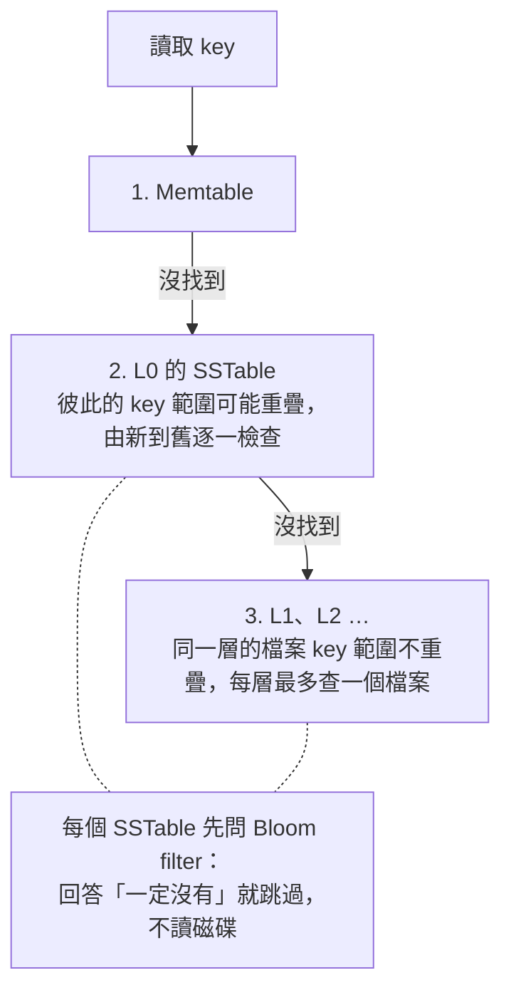

> **System Design 系列** Part 3-3｜上一篇：[Index 與 B+Tree](/post/systemdesign/index-btree/)｜下一篇：[交易與隔離等級](/post/systemdesign/transaction-isolation/)｜[系列地圖](/post/systemdesign/system-design-thinking/#系列地圖)

## 情境與問題

[SQL vs NoSQL 篇](/post/systemdesign/sql-vs-nosql/)把商品瀏覽紀錄放在 MySQL 分區表：每天 1 億筆、尖峰每秒約 5,800 筆，單機應付得來。當時也留了一句話：量成長 10 倍時要換方案。

現在 App 改版加入「為你推薦」，瀏覽事件成長到每天 10 億筆、尖峰每秒 6 萬筆。每筆仍然約 60 bytes：

<details>
<summary>計算程式（<code>java WriteNapkin.java</code>）</summary>

```java
public class WriteNapkin {
    public static void main(String[] args) {
        long perDay = 1_000_000_000L;            // 成長 10 倍後每天 10 億筆
        long peak = 60_000;                      // 尖峰每秒筆數
        int rowBytes = 60;
        int pageBytes = 16 * 1024;
        System.out.printf("每天資料量：%,.0f GB；保留 90 天：%,.1f TB%n",
                perDay * rowBytes / 1e9, perDay * rowBytes * 90 / 1e12);
        System.out.printf("尖峰的原始資料：%,.1f MB/s%n", peak * rowBytes / 1e6);
        System.out.printf("B+Tree 最壞情況（每筆落在不同頁面）：每秒 %,d 次隨機讀頁 + %,.0f MB/s 寫頁（未計 doublewrite）%n",
                peak, peak * (double) pageBytes / 1e6);
        for (int amp : new int[] {10, 30}) {
            System.out.printf("LSM 寫入放大 %d 倍：%,.0f MB/s，幾乎全是循序寫入%n", amp, peak * rowBytes * (double) amp / 1e6);
        }
    }
}
```

</details>

```text
每天資料量：60 GB；保留 90 天：5.4 TB
尖峰的原始資料：3.6 MB/s
B+Tree 最壞情況（每筆落在不同頁面）：每秒 60,000 次隨機讀頁 + 983 MB/s 寫頁（未計 doublewrite）
LSM 寫入放大 10 倍：36 MB/s，幾乎全是循序寫入
LSM 寫入放大 30 倍：108 MB/s，幾乎全是循序寫入
```

原始資料只有每秒 3.6 MB，問題出在 B+Tree 的寫入方式。這張表的主鍵是 `(member_id, viewed_at, product_id)`，同一秒的 6 萬筆分散在數十萬位會員各自的頁面上。頁面不在 buffer pool 時，每一筆都要先讀進一個 16 KB 的頁面、改幾十 bytes，之後再整頁寫回。buffer pool 會把同一頁的多次修改合併，實際不會這麼糟；但資料長到 TB 級、熱頁面裝不進記憶體後，就會越來越接近這個最壞情況。

改用遞增主鍵可以讓插入集中在樹的最右邊，可是「某位會員最近看過的商品」就得靠 `(member_id, viewed_at)` 的次要索引，而次要索引一樣是隨機插入，問題只是換了個地方（見 [Index 篇](/post/systemdesign/index-btree/)）。

另一類資料結構從根本上把寫入變成循序：**LSM-Tree**（Log-Structured Merge-Tree）。RocksDB、Cassandra、ScyllaDB、HBase 都屬於這個家族。這篇比較兩者在寫入、讀取、空間上的取捨。

## 最簡單的做法與它的極限

最快的寫入方式是**只往檔案尾端追加**，永遠不修改舊資料；讀取時靠記憶體裡的 hash 表記住每個 key 最新一筆在檔案中的位置。Riak 的儲存引擎 Bitcask 就是這個設計：

<details>
<summary>實作（<code>java AppendOnlyStore.java</code>）</summary>

```java
import java.io.IOException;
import java.nio.ByteBuffer;
import java.nio.channels.FileChannel;
import java.nio.charset.StandardCharsets;
import java.nio.file.Files;
import java.nio.file.Path;
import java.nio.file.StandardOpenOption;
import java.util.HashMap;
import java.util.Map;

/** 最簡單的「只追加」儲存：寫入一律接在檔案尾端，記憶體裡的 hash 表記住每個 key 最新一筆的位置。 */
public final class AppendOnlyStore implements AutoCloseable {

    private final FileChannel log;
    private final Map<String, Long> index = new HashMap<>();   // key -> 最新紀錄在檔案中的位置

    public AppendOnlyStore(Path file) throws IOException {
        log = FileChannel.open(file, StandardOpenOption.CREATE, StandardOpenOption.READ, StandardOpenOption.WRITE);
        long offset = 0;
        while (offset < log.size()) {                          // 重新開啟時：從頭重播整個檔案，重建索引
            Record record = readAt(offset);
            index.put(record.key(), offset);
            offset += record.sizeOnDisk();
        }
    }

    public void put(String key, String value) throws IOException {
        byte[] k = key.getBytes(StandardCharsets.UTF_8);
        byte[] v = value.getBytes(StandardCharsets.UTF_8);
        ByteBuffer buffer = ByteBuffer.allocate(8 + k.length + v.length)
                .putInt(k.length).putInt(v.length).put(k).put(v).flip();
        long offset = log.size();
        log.write(buffer, offset);                             // 永遠寫在尾端：循序寫入
        log.force(false);                                      // 確保落到儲存裝置，當機也不會遺失
        index.put(key, offset);                                // 舊的那筆還在檔案裡，只是不再被指到
    }

    public String get(String key) throws IOException {
        Long offset = index.get(key);
        return offset == null ? null : readAt(offset).value();
    }

    public long fileSize() throws IOException {
        return log.size();
    }

    private Record readAt(long offset) throws IOException {
        ByteBuffer header = ByteBuffer.allocate(8);
        log.read(header, offset);
        header.flip();
        int keyLength = header.getInt();
        int valueLength = header.getInt();
        ByteBuffer body = ByteBuffer.allocate(keyLength + valueLength);
        log.read(body, offset + 8);
        byte[] bytes = body.array();
        return new Record(new String(bytes, 0, keyLength, StandardCharsets.UTF_8),
                new String(bytes, keyLength, valueLength, StandardCharsets.UTF_8), 8 + keyLength + valueLength);
    }

    private record Record(String key, String value, int sizeOnDisk) {}

    @Override
    public void close() throws IOException {
        log.close();
    }

    public static void main(String[] args) throws IOException {
        Path file = Files.createTempDirectory("append-only-store").resolve("data.log");
        try (AppendOnlyStore store = new AppendOnlyStore(file)) {
            store.put("product:1", "price=100");
            store.put("product:2", "price=250");
            store.put("product:1", "price=80");                // 覆寫：追加一筆新的，舊的留在檔案裡
            System.out.println("寫入 3 次後檔案大小：" + store.fileSize() + " bytes");
        }
        try (AppendOnlyStore reopened = new AppendOnlyStore(file)) {   // 模擬程序重啟
            System.out.println("重啟後 product:1 = " + reopened.get("product:1"));
            System.out.println("重啟後 product:2 = " + reopened.get("product:2"));
            System.out.println("檔案中有 3 筆紀錄，其中 1 筆已過時，要靠 compaction 回收空間");
        }
    }
}
```

</details>

```text
寫入 3 次後檔案大小：77 bytes
重啟後 product:1 = price=80
重啟後 product:2 = price=250
檔案中有 3 筆紀錄，其中 1 筆已過時，要靠 compaction 回收空間
```

三次寫入共 77 bytes（26 + 26 + 25），覆寫 `product:1` 時舊的那筆仍在檔案裡。重啟後重播整個檔案，索引最後指向的是最新一筆，所以讀到 `price=80`。

優點很明顯：寫入是純循序 I/O，讀取只要一次定位。極限也很明顯：

1. **所有 key 都要放進記憶體**：hash 表必須完整常駐
2. **沒有範圍查詢**：hash 表沒有順序，「某位會員 11 月的瀏覽紀錄」只能掃整個檔案
3. **檔案無限長大**：舊版本永遠留著，必須切成多個區段，定期合併並丟掉過時的紀錄（compaction）
4. **重啟要重播整個檔案**：檔案越大，啟動越慢（Bitcask 另外存一份 hint file 來加速）

LSM-Tree 保留「只追加」的寫入方式，再讓檔案內容**依 key 排序**，一次解決前兩個問題。

## 核心機制

### 寫入路徑：先進記憶體，再整批循序寫出



1. **WAL**：先追加到 write-ahead log，確保當機不遺失
2. **Memtable**：寫進記憶體中的有序結構（常見的是 skip list）。寫入到這裡就完成了，**不需要讀取任何磁碟上的資料**
3. **Flush**：memtable 寫滿後轉成唯讀，依序整批寫成一個 **SSTable**（Sorted String Table）：依 key 排序、寫完就不再修改的檔案，附帶區塊索引與 Bloom filter。寫完後對應的 WAL 就可以丟棄
4. **Compaction**：背景持續把多個 SSTable 合併成新的 SSTable，同一個 key 只留最新版本，再刪除舊檔案

**更新就是寫一筆新版本，刪除就是寫一筆 tombstone（刪除標記）**。兩者都不碰舊資料，舊版本要等 compaction 才會真正消失。

### 讀取路徑：由新到舊找

以 RocksDB 的分層結構為例：



- **第一個找到的版本就是最新的**；找到的是 tombstone，就代表已刪除
- **Bloom filter 讓不存在的 key 幾乎不用讀磁碟**：它只會把「沒有」誤判成「可能有」，不會把「有」誤判成「沒有」。原理見 [Bloom Filter 篇](/post/systemdesign/bloom-filter-hyperloglog/)
- **範圍查詢比較吃虧**：Bloom filter 幫不上忙，必須同時打開所有可能涵蓋該範圍的 sorted run，邊讀邊合併
- **sorted run 越多，讀取越慢**：控制 sorted run 的數量，是 compaction 的主要工作

### Compaction：tiering 與 leveling

compaction 有兩大策略：

- **Tiering（size-tiered）**：等湊滿幾個大小相近的 sorted run，再一起合併成一個更大的。每筆資料被重寫的次數少，但同時存在的 sorted run 多
- **Leveling（leveled）**：L1 以後每一層只維持一個 sorted run，上一層的資料一下來就併進去。讀取要看的檔案少、空間浪費少，但下層既有的資料會隨著每次合併被反覆重寫

用模擬比較兩者：200 萬次寫入，落在 100 萬個不同的 key 上（後段大多是覆寫）；memtable 存 1 萬筆；tiering 每湊滿 4 個 run 合併一次；leveling 的 L0 最多 4 個 run，之後每層容量是上一層的 10 倍：

<details>
<summary>模擬程式（<code>java -Xmx2g CompactionSimulation.java</code>）</summary>

```java
import java.util.ArrayList;
import java.util.Arrays;
import java.util.List;
import java.util.Random;
import java.util.TreeSet;

/**
 * 簡化的 LSM compaction 模型：只計算筆數，不存真正的值。
 * 每個 sorted run 是一組排序好、不重複的 key；合併時同一個 key 只留最新的一筆。
 */
public class CompactionSimulation {

    static final int MEMTABLE_ENTRIES = 10_000;
    static final int OPERATIONS = 2_000_000;
    static final int DISTINCT_KEYS = 1_000_000;   // 後半段的寫入大多是覆寫既有的 key
    static final int RATIO = 4;                   // tiering：每層湊滿 4 個 run 就合併；leveling：L0 上限 4 個 run
    static final int LEVEL_GROWTH = 10;           // leveling：每一層容量是上一層的 10 倍

    interface Policy {
        void flush(long[] run);
        List<long[]> runs();
    }

    static long written;                          // 寫到「磁碟」的總筆數（flush + compaction）

    public static void main(String[] args) {
        run("Tiering（size-tiered）", new Tiering());
        run("Leveling（leveled）", new Leveling());
    }

    static void run(String name, Policy policy) {
        written = 0;
        Random random = new Random(42);
        TreeSet<Long> memtable = new TreeSet<>();
        TreeSet<Long> live = new TreeSet<>();
        long runSamples = 0;
        long runTotal = 0;
        int runMax = 0;
        for (int i = 0; i < OPERATIONS; i++) {
            long key = random.nextInt(DISTINCT_KEYS);
            memtable.add(key);
            live.add(key);
            if (memtable.size() == MEMTABLE_ENTRIES) {
                long[] run = memtable.stream().mapToLong(Long::longValue).toArray();
                written += run.length;                       // flush 本身寫一次
                policy.flush(run);
                memtable.clear();
                int runs = policy.runs().size();             // 一次點查詢最多要看幾個 run
                runSamples++;
                runTotal += runs;
                runMax = Math.max(runMax, runs);
            }
        }
        long stored = policy.runs().stream().mapToLong(r -> r.length).sum();
        System.out.printf("%-22s 寫入放大 %4.1f 倍｜sorted run 平均 %4.1f、最多 %2d 個｜結束時空間放大 %4.2f 倍%n",
                name, (double) written / OPERATIONS, (double) runTotal / runSamples, runMax,
                (double) stored / live.size());
    }

    static long[] merge(List<long[]> runs) {
        long[] all = runs.stream().flatMapToLong(Arrays::stream).sorted().distinct().toArray();
        written += all.length;                               // 合併的結果要整個重寫一次
        return all;
    }

    /** 同一層湊滿 RATIO 個 run 就合併成一個，往下一層放。 */
    static final class Tiering implements Policy {
        final List<List<long[]>> tiers = new ArrayList<>();

        public void flush(long[] run) {
            add(0, run);
        }

        void add(int tier, long[] run) {
            while (tiers.size() <= tier) {
                tiers.add(new ArrayList<>());
            }
            tiers.get(tier).add(run);
            if (tiers.get(tier).size() == RATIO) {
                long[] merged = merge(tiers.get(tier));
                tiers.get(tier).clear();
                add(tier + 1, merged);
            }
        }

        public List<long[]> runs() {
            return tiers.stream().flatMap(List::stream).toList();
        }
    }

    /** L0 放剛 flush 的 run；L1 以後每層只有一個 run，超過容量就整層併入下一層。 */
    static final class Leveling implements Policy {
        final List<long[]> level0 = new ArrayList<>();
        final List<long[]> levels = new ArrayList<>();       // levels.get(0) 是 L1

        public void flush(long[] run) {
            level0.add(run);
            if (level0.size() == RATIO) {
                List<long[]> inputs = new ArrayList<>(level0);
                if (!levels.isEmpty()) {
                    inputs.add(levels.get(0));
                }
                level0.clear();
                set(0, merge(inputs));
                cascade(0);
            }
        }

        void cascade(int level) {
            long capacity = (long) MEMTABLE_ENTRIES * RATIO * (long) Math.pow(LEVEL_GROWTH, level);
            if (levels.get(level).length > capacity) {
                List<long[]> inputs = new ArrayList<>(List.of(levels.get(level)));
                if (levels.size() > level + 1) {
                    inputs.add(levels.get(level + 1));
                }
                set(level, new long[0]);
                set(level + 1, merge(inputs));
                cascade(level + 1);
            }
        }

        void set(int level, long[] run) {
            while (levels.size() <= level) {
                levels.add(new long[0]);
            }
            levels.set(level, run);
        }

        public List<long[]> runs() {
            List<long[]> all = new ArrayList<>(level0);
            levels.stream().filter(r -> r.length > 0).forEach(all::add);
            return all;
        }
    }
}
```

</details>

```text
Tiering（size-tiered）   寫入放大  3.6 倍｜sorted run 平均  5.5、最多 11 個｜結束時空間放大 1.71 倍
Leveling（leveled）      寫入放大  6.4 倍｜sorted run 平均  3.6、最多  6 個｜結束時空間放大 1.26 倍
```

- **寫入放大**：每筆寫入最後總共被寫到磁碟幾次（flush 加上每次 compaction 的重寫，未計 WAL）。tiering 的資料大約每往下一層才重寫一次；leveling 每次上層資料併進來，下層原有的資料都得跟著重寫
- **sorted run 數量**：點查詢最壞要檢查幾個 run。tiering 平均 5.5 個、最多 11 個，而且隨合併時機大幅波動；leveling 穩定得多
- **空間放大**：磁碟上的筆數 ÷ 實際存活的 key 數。tiering 有更多過時版本還沒被合併掉

這是只算筆數的簡化模型（以整層為單位合併，沒有計算位元組與壓縮），只用來看方向。RocksDB 文件給的實務量級是：leveled 的寫入放大通常 10–30 倍，universal（RocksDB 對 tiering 的稱呼）2–10 倍。

### B+Tree 的寫入其實也有 WAL

常有人說「B+Tree 每次寫入都是隨機寫」，這不完全對。InnoDB 交易提交時，只需要把 redo log（循序追加）寫到磁碟；被修改的頁面留在 buffer pool，稍後才由背景寫回。寫回前還會先寫進 doublewrite buffer，避免寫到一半斷電造成頁面毀損。所以 B+Tree 的隨機寫是被延後、被合併過的。

問題出在資料量遠大於 buffer pool 的時候：每次修改都可能要先把頁面讀進來，被修改的頁面也來不及累積多次修改就得寫回去。情境中的最壞情況就是這樣來的。

### 三種放大的取捨

| | B+Tree（InnoDB） | LSM，leveling | LSM，tiering |
|---|---|---|---|
| 寫入放大 | 以頁面為單位：改幾十 bytes 也要寫回 16 KB 頁面，加上 redo log 與 doublewrite | 中到高 | 低 |
| 寫入的 I/O 模式 | 頁面散落各處，隨機寫 | 循序 | 循序 |
| 點查詢 | 樹高 3–4 層，上層幾乎都在記憶體 | 每層最多一個檔案，靠 Bloom filter 跳過 | 要檢查的 run 較多 |
| 範圍查詢 | 沿著葉節點串列循序讀 | 要合併多個 sorted run | 要合併的 run 更多 |
| 空間放大 | 頁面預留空間、分裂後的半滿頁面 | 低 | 高；合併最大的 run 時需要暫時的額外空間 |
| 刪除 | 先標記刪除，由背景 purge 回收 | 寫 tombstone，compaction 後才回收 | 同左，回收更慢 |
| 延遲穩定性 | 頁面分裂、大量 flush 時有尖峰 | compaction 搶 I/O；跟不上時會 write stall | compaction 流量起伏更大 |

讀取、寫入、空間三者無法同時最佳化，這個觀察稱為 **RUM conjecture**（Read、Update、Memory）。挑選儲存引擎，其實就是決定要犧牲哪一項。

## 方案比較

### 誰用哪一種

| 儲存引擎 | 結構 | 常見位置 |
|---|---|---|
| InnoDB（MySQL）、PostgreSQL | B+Tree（PostgreSQL 的 B-Tree 索引） | 一般 OLTP |
| RocksDB | LSM，嵌入式函式庫 | MyRocks（MySQL 儲存引擎）、Kafka Streams 的 state store、TiKV |
| Cassandra、ScyllaDB、HBase | LSM | 大量寫入的事件與時間序列 |

Java 開發者最常在不知不覺中碰到 LSM 的地方是 Kafka Streams：有狀態的運算（aggregate、join、windowing）預設存在本機的 RocksDB 裡。

### Cassandra 的 compaction 策略

| 策略 | 家族 | 適合 |
|---|---|---|
| `SizeTieredCompactionStrategy`（STCS） | tiering | 寫入為主；表沒有指定時的預設值 |
| `LeveledCompactionStrategy`（LCS） | leveling | 讀取為主、同一筆資料常被更新 |
| `TimeWindowCompactionStrategy`（TWCS） | 依時間視窗分組 | 時間序列、資料有 TTL |
| `UnifiedCompactionStrategy`（UCS） | 可在 tiering 與 leveling 之間調整 | Cassandra 5.0 起，文件建議多數新表使用 |

## Java 落地

### 1. 換資料庫之前

先確認便宜的優化都做過了：

- 批次寫入（`rewriteBatchedStatements`，見 [SQL vs NoSQL 篇](/post/systemdesign/sql-vs-nosql/)）
- 減少次要索引、避免隨機主鍵（見 [Index 篇](/post/systemdesign/index-btree/)）
- 依日期分區，過期資料用 `DROP PARTITION` 刪除
- 寫入前先在應用程式端聚合，例如同一位會員 1 分鐘內重複瀏覽同一個商品只記一次

這些都做了，napkin math 仍然顯示超出單機能力，才值得承擔多一套資料庫的維運成本。

### 2. 依查詢設計 table

```sql
CREATE TABLE product_view_event (
    member_id   bigint,
    view_month  text,          -- 'yyyyMM'，以台北時間計算
    viewed_at   timestamp,
    product_id  bigint,
    PRIMARY KEY ((member_id, view_month), viewed_at, product_id)
) WITH CLUSTERING ORDER BY (viewed_at DESC, product_id ASC)
  AND default_time_to_live = 7776000          -- 90 天
  AND compaction = {'class': 'TimeWindowCompactionStrategy',
                    'compaction_window_unit': 'DAYS',
                    'compaction_window_size': 3};
```

- **Partition key `(member_id, view_month)`**：同一位會員同一個月的紀錄放在同一個 partition，「最近看過的商品」只要讀一個 partition。加上月份是為了讓 partition 有上限：只用 `member_id` 的話，重度使用者的 partition 會無限長大
- **Clustering `viewed_at DESC`**：partition 內已經依時間由新到舊排好，`LIMIT 50` 從頭讀就好，不需要排序
- **`default_time_to_live`**：90 天後自動過期，不必寫 `DELETE`
- **TWCS，每 3 天一個視窗**：90 天 ÷ 3 天 = 30 個視窗，符合文件建議的 20–30 個。同一個視窗的資料最後會合併成一個 SSTable，整個視窗都過期後可以直接丟掉整個檔案，不用逐筆清理

partition key 的計算放在一個地方，寫入和查詢共用：

```java
import java.time.Duration;
import java.time.Instant;
import java.time.YearMonth;
import java.time.ZoneId;
import java.time.format.DateTimeFormatter;
import java.util.ArrayList;
import java.util.List;

/** 瀏覽紀錄的 partition key：每位會員每個月一個 partition，讓單一 partition 不會無限長大。 */
public final class ViewEventBuckets {

    private static final ZoneId ZONE = ZoneId.of("Asia/Taipei");
    private static final DateTimeFormatter MONTH = DateTimeFormatter.ofPattern("yyyyMM");

    private ViewEventBuckets() {
    }

    public static String monthOf(Instant viewedAt) {
        return YearMonth.from(viewedAt.atZone(ZONE)).format(MONTH);
    }

    /** 查詢 [from, to] 要讀哪些月份，由新到舊排列：先查最近的月份，湊滿筆數就可以停。 */
    public static List<String> monthsBetween(Instant from, Instant to) {
        YearMonth first = YearMonth.from(from.atZone(ZONE));
        List<String> months = new ArrayList<>();
        for (YearMonth m = YearMonth.from(to.atZone(ZONE)); !m.isBefore(first); m = m.minusMonths(1)) {
            months.add(m.format(MONTH));
        }
        return months;
    }

    public static void main(String[] args) {
        Instant now = Instant.parse("2026-11-22T05:00:00Z");
        System.out.println(monthOf(now));
        System.out.println(monthOf(Instant.parse("2026-11-30T17:30:00Z")));          // 台北時間已是 12/1
        System.out.println(monthsBetween(now.minus(Duration.ofDays(90)), now));
    }
}
```

```text
202611
202612
[202611, 202610, 202609, 202608]
```

第二行是時區陷阱：UTC 的 11 月 30 日 17:30 在台北已經是 12 月 1 日。寫入和查詢若各自用不同的時區算月份，資料就會「消失」。查詢時依 `monthsBetween` 的順序，每個月份執行一次：

```sql
SELECT product_id, viewed_at
FROM product_view_event
WHERE member_id = ? AND view_month = ?
LIMIT 50;
```

從最近的月份開始讀，湊滿 50 筆就停，大多數情況只需要查一個 partition。

### 3. 寫入：盲寫與冪等

Cassandra 的 `INSERT` 不會先檢查資料是否存在：主鍵不存在就新增，存在就覆寫（upsert）。寫入路徑完全不需要讀磁碟，這正是 LSM 寫得快的原因之一。

也因此，**同一個主鍵重送幾次結果都一樣**，網路逾時直接重試是安全的（冪等性在 Part 5 詳談）。前提是 `viewed_at` 必須是事件發生的時間，由 client 帶上來；如果用伺服器收到請求時的現在時間，重試就會產生主鍵不同的重複紀錄。

`INSERT ... IF NOT EXISTS` 會改走 Paxos，成本高得多，不該出現在高頻寫入路徑上。

## 踩坑與 Gotchas

- **壓測時間太短**：LSM 剛開始寫入時 compaction 還沒累積工作量，數字非常漂亮。要跑到 compaction 進入穩定狀態，才看得到真實的寫入能力
- **compaction 跟不上寫入**：L0 檔案數或待 compaction 的資料量超過門檻時，RocksDB 會先放慢、再完全停止寫入（write stall）。要監控 pending compaction，不能只看寫入延遲
- **磁碟空間沒留餘裕**：合併時新檔案寫完之前，舊檔案不能刪。RocksDB universal compaction 的 `max_size_amplification_percent` 預設 200，代表 100 bytes 的資料在 compaction 期間可能需要 300 bytes
- **把 Cassandra 當佇列用**：不斷新增再刪除，partition 裡堆滿 tombstone。讀取時掃過的 tombstone 要放在記憶體裡，超過 `tombstone_warn_threshold`（預設 1,000）會記警告，超過 `tombstone_failure_threshold`（預設 100,000）查詢直接失敗
- **為了清 tombstone 把 `gc_grace_seconds` 調得很低**：預設 10 天，是留給故障節點恢復、補上刪除操作的時間。調低又沒在期限內跑 repair，已刪除的資料可能從其他副本「復活」。文件的建議是：只有沒有明確刪除、全靠 TTL 過期的表，才比較適合調低
- **TWCS 遇到亂序寫入**：用 `USING TIMESTAMP` 補寫舊資料，或讀舊資料時觸發 read repair，都會讓新舊資料混進同一個 SSTable，舊視窗的檔案因此無法整個丟掉
- **用了 TWCS 卻沒設 TTL**：資料不會因為視窗過去就消失。Cassandra 5.0 有一個 guardrail（`zero_ttl_on_twcs_enabled`）就是針對「TWCS 但 `default_time_to_live` 為 0」的表
- **在 LSM 上做 read-modify-write**：像 `stock = stock - 1` 這種要先讀再寫的操作，失去了盲寫的優勢，還需要額外的並行控制。這類資料留在關聯式資料庫

### 資安相關

- **刪除不等於抹除**：LSM 的 `DELETE` 只是寫一筆 tombstone，舊值仍在 SSTable 裡，要等 compaction、而且超過 `gc_grace_seconds` 才會真正丟掉；B+Tree 的刪除也是先標記、再由背景 purge 回收空間，原本的位元組不保證被覆寫。再加上 WAL、binlog、snapshot 與備份，使用者要求刪除個資時，資料其實還散落在很多地方。常見的做法是 crypto-shredding：每位使用者的個資用各自的金鑰加密，刪除時銷毀金鑰，所有副本就一起變成無法解讀的密文（金鑰管理在 Part 8）
- **tombstone 可以被當成攻擊手段**：如果 API 允許使用者對一份清單無限次新增、移除，攻擊者重複操作就能在對應的 partition 堆出大量 tombstone。partition 是共享的（例如某個商品的留言列表），所有人都會讀不到；就算只是自己的 partition，大量 tombstone 也會讓處理查詢的節點承受 heap 壓力。對寫入做 rate limit（Part 8 濫用防護），並避免讓使用者操作直接對應到大量刪除
- **資料檔就是一般檔案**：SSTable、snapshot 和備份都直接存在磁碟上，拿到檔案就能用工具讀出內容。磁碟要加密，備份與 snapshot 的存取權限要和資料庫本身一樣嚴格

## 何時用／何時別用

- **B+Tree（關聯式資料庫）**：讀多寫少、需要交易與範圍查詢、資料常被原地更新、要求延遲穩定。絕大多數業務系統屬於這一類
- **LSM**：寫入量大且以新增為主（事件、日誌、時間序列、IoT）、資料量大到需要壓縮、寫入可以是不需要先讀的盲寫
- **別因為「寫入量大」就直接換**：先算 napkin math，並做完批次寫入、精簡索引、分區這些便宜的優化
- **LSM 別用在**：大量刪除或類似佇列的存取模式、需要 read-modify-write 與跨列交易的資料

## 參考資料

- Patrick O'Neil, Edward Cheng, Dieter Gawlick, Elizabeth O'Neil, "The Log-Structured Merge-Tree (LSM-Tree)", *Acta Informatica*, 1996
- Fay Chang et al., "Bigtable: A Distributed Storage System for Structured Data", OSDI 2006
- Justin Sheehy, David Smith, "Bitcask: A Log-Structured Hash Table for Fast Key/Value Data", Basho, 2010
- Manos Athanassoulis et al., "Designing Access Methods: The RUM Conjecture", EDBT 2016
- Niv Dayan, Stratos Idreos, "Dostoevsky: Better Space-Time Trade-Offs for LSM-Tree Based Key-Value Stores via Adaptive Removal of Superfluous Merging", SIGMOD 2018
- Martin Kleppmann, *Designing Data-Intensive Applications*, O'Reilly, 2017, Chapter 3
- RocksDB Wiki — Compaction、Universal Compaction、Write Stalls：<https://github.com/facebook/rocksdb/wiki>
- Apache Cassandra 5.0 Documentation — Compaction Overview、TWCS、UCS：<https://cassandra.apache.org/doc/5.0.8/cassandra/managing/operating/compaction/overview.html>
- Apache Cassandra 5.0 Documentation — cassandra.yaml（tombstone thresholds）：<https://cassandra.apache.org/doc/5.0.8/cassandra/managing/configuration/cass_yaml_file.html>
- MySQL 8.4 Reference Manual — Doublewrite Buffer：<https://dev.mysql.com/doc/refman/8.4/en/innodb-doublewrite-buffer.html>
- 互動圖解延伸：Dilum Sanjaya，System Design — an interactive course：<https://designed-to-scale.vercel.app/>
