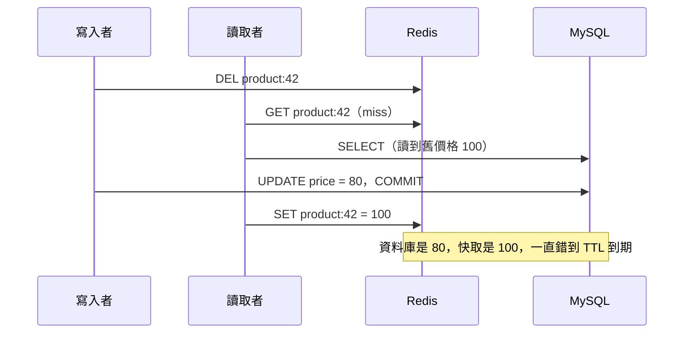
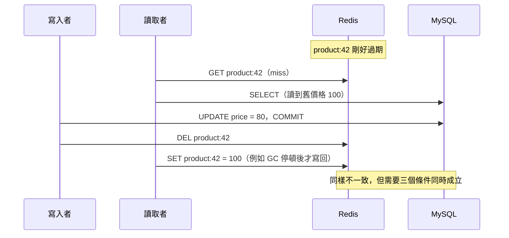
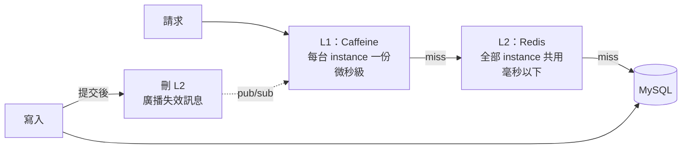

> **System Design 系列** Part 2-3｜上一篇：[Load Balancing 深入](/post/systemdesign/load-balancing/)｜下一篇：[CDN 與 HTTP 快取](/post/systemdesign/cdn/)｜[系列地圖](/post/systemdesign/system-design-thinking/#系列地圖)

## 情境與問題

商品詳情 API 在大促時有每秒 10,000 個請求，讀寫比大約 200:1。MySQL 主庫的 p99 從 20 ms 漲到 400 ms，你在前面加了一層 Redis：先查快取，查不到再查資料庫並寫回快取。資料庫的 QPS 立刻從 10,000 掉到 1,000，問題看似解決了。接下來幾週陸續發生：

1. 營運改了價格，部分使用者看到舊價格長達 30 分鐘
2. 最熱門的商品 key 過期的那一瞬間，3,000 個請求同時打到資料庫
3. 爬蟲用不存在的商品 ID 掃描，每個請求都查不到快取、直接打資料庫
4. 凌晨批次預熱的 20 萬個 key 在同一時間過期，資料庫被打掛；某次 Redis 重啟，情況更糟
5. 訂單查詢也比照辦理加了快取，結果使用者 A 看得到使用者 B 的訂單

快取讓讀取變快，代價是系統裡多了**第二份資料**。兩份資料之間的一致性、什麼時候失效、裝不下時丟掉誰、快取本身掛掉時會怎樣，全部都要設計。

## 最簡單的做法與它的極限

最簡單的快取是放在應用程式記憶體裡的 `Map` 或 Caffeine，存取只要幾十奈秒，沒有網路成本。極限有三個：

- **每台各存一份**：[無狀態服務](/post/systemdesign/scaling-stateless/)有 10 台，同一筆資料就有 10 份，更新時要通知每一台
- **容量受限於 JVM heap**：放太多會拉長 GC 停頓
- **重啟就清空**：部署後每台都要重新暖機

集中式快取（Redis）解決了這三點，代價是每次存取多一趟網路（同機房約 0.2–1 ms）、序列化成本，以及一個新的故障點。

### 先算值不值得快取

快取的效果取決於命中率 h：

```text
平均延遲  = h × 快取延遲 + (1 − h) × (快取延遲 + 資料庫延遲)
資料庫負載 = (1 − h) × 總 QPS
```

第二條公式說明了一件常被誤解的事：**要看的是未命中率，不是命中率**。以每秒 10,000 個請求來算：

| 命中率 | 打到資料庫的 QPS |
|---|---|
| 90% | 1,000 |
| 99% | 100 |
| 99.9% | 10 |

命中率從 90% 提升到 99%，看起來只多了 9 個百分點，資料庫負載卻少了 10 倍。反過來說，如果資料庫只撐得住 2,000 QPS，它就**完全依賴快取才能活著**：Redis 一掛或一重啟，10,000 QPS 直接壓到資料庫上。這時快取已經不是「加速器」，而是「承重牆」，它的可用性必須和資料庫一樣認真對待。

### 命中率取決於存取分佈

能達到多少命中率，取決於請求集中在少數熱門資料的程度。真實流量常近似 Zipf 分佈：第 k 熱門的資料被存取的機率與 1 ÷ k^α 成正比，α 越大越集中。假設有 100 萬個商品、每秒 10,000 個請求，只快取最熱門的前 N% 時：

<details>
<summary>計算程式（<code>java ZipfHitRatio.java</code>）</summary>

```java
public class ZipfHitRatio {

    static final int PRODUCTS = 1_000_000;
    static final int QPS = 10_000;

    public static void main(String[] args) {
        double[] percents = {0.1, 1, 5, 10, 20};
        for (double alpha : new double[] {1.0, 0.8}) {
            double[] cumulative = new double[PRODUCTS + 1];   // cumulative[k] = 前 k 熱門商品的權重總和
            for (int rank = 1; rank <= PRODUCTS; rank++) {
                cumulative[rank] = cumulative[rank - 1] + Math.pow(rank, -alpha);
            }
            System.out.printf("Zipf alpha = %.1f%n", alpha);
            for (double percent : percents) {
                int cached = (int) (PRODUCTS * percent / 100);
                double hitRatio = cumulative[cached] / cumulative[PRODUCTS];
                System.out.printf("  cache top %5.1f%% (%,9d keys)  hit %5.1f%%  DB %,6.0f QPS%n",
                        percent, cached, hitRatio * 100, QPS * (1 - hitRatio));
            }
        }
    }
}
```

</details>

```text
Zipf alpha = 1.0
  cache top   0.1% (    1,000 keys)  hit  52.0%  DB  4,799 QPS
  cache top   1.0% (   10,000 keys)  hit  68.0%  DB  3,200 QPS
  cache top   5.0% (   50,000 keys)  hit  79.2%  DB  2,081 QPS
  cache top  10.0% (  100,000 keys)  hit  84.0%  DB  1,600 QPS
  cache top  20.0% (  200,000 keys)  hit  88.8%  DB  1,118 QPS
Zipf alpha = 0.8
  cache top   0.1% (    1,000 keys)  hit  20.7%  DB  7,932 QPS
  cache top   1.0% (   10,000 keys)  hit  36.2%  DB  6,376 QPS
  cache top   5.0% (   50,000 keys)  hit  52.3%  DB  4,775 QPS
  cache top  10.0% (  100,000 keys)  hit  60.9%  DB  3,909 QPS
  cache top  20.0% (  200,000 keys)  hit  70.8%  DB  2,915 QPS
```

兩個觀察：

1. **報酬遞減非常明顯**：α = 1 時，只快取 0.1% 的商品就有 52% 命中率；但從 1% 加到 10%，容量多 10 倍，命中率只多 16 個百分點
2. **分佈越平坦，快取越沒用**：α = 0.8 時，快取 10% 的商品還不到 61%。Breslau 等人在 1999 年量測的 web proxy 流量，α 大約落在 0.64 到 0.83 之間

所以加快取之前，先從存取 log 估出熱門程度。如果流量很平均（例如後台報表、長尾搜尋），快取的效益可能撐不起它帶來的複雜度。（這裡假設快取永遠剛好存著最熱門的那批資料，是理想上限；真實的淘汰策略只能逼近它。）

## 核心機制

### 讀寫模式

| 模式 | 讀取 | 寫入 | 特點 |
|---|---|---|---|
| Cache-aside | 應用程式先查快取，miss 再查資料庫並回填 | 寫資料庫，再刪快取 | 最常見；快取掛掉時仍可直接讀資料庫 |
| Read-through | 應用程式只問快取，miss 由快取元件自己載入 | — | 載入邏輯集中；Caffeine `LoadingCache` 就是這種 |
| Write-through | — | 同步寫快取與資料庫 | 快取永遠有最新值，但每次寫入都多一步 |
| Write-behind | — | 先寫快取，非同步批次寫回資料庫 | 寫入最快；快取掛掉會遺失尚未寫回的資料 |
| Refresh-ahead | 快要過期時提前在背景重新載入 | — | 熱門資料不會出現 miss 尖峰；冷資料白白重載 |

以下以最常見的 cache-aside 為主。

### 寫入時：為什麼是「先更新資料庫，再刪快取」

寫入時處理快取有四種順序：先寫快取還是先寫資料庫、對快取做更新還是刪除。直覺上最自然的「先刪快取，再更新資料庫」，在併發時很容易出錯：



寫入者刪掉快取到交易提交之間的時間，通常有幾毫秒到幾十毫秒。只要這段時間內有讀取者 miss，就會把舊值寫回去。對熱門商品來說，這幾乎是必然會發生的事。

改成「先更新資料庫，再刪快取」，剩下的競態就罕見得多：



這需要三個條件同時成立：快取剛好 miss、讀取者在寫入提交前讀到舊值、讀取者的回寫又晚於寫入者的刪除。讀取者從「讀資料庫」到「寫快取」通常只有一兩毫秒，要剛好橫跨寫入者的「提交到刪除」，機率很低，但 GC 停頓或網路抖動時仍會發生。

為什麼是**刪除**快取，而不是把新值**寫進**快取？因為兩個寫入者的順序可能在快取這一層反轉：W1 寫資料庫 100、W2 寫資料庫 200、W2 寫快取 200、W1 寫快取 100，快取永遠停在舊值。刪除則沒有順序問題，下一次讀取自然會載入最新值。另外，很多被寫入的資料其實不常被讀，先算好放進快取也是浪費。

### 其他造成不一致的來源

| 來源 | 怎麼發生 | 對策 |
|---|---|---|
| 在交易內刪快取 | 刪了但還沒提交，讀取者從資料庫讀到舊值並回填 | **提交之後才刪**（Spring 的 `transactionAware()`、`@TransactionalEventListener`） |
| 讀 replica 回填 | 刪了，讀取者從還沒同步的 replica 讀到舊值 | miss 時讀主庫；或延遲幾百毫秒再刪一次（延遲雙刪） |
| 刪除失敗 | Redis 逾時，或程序在刪除前掛掉 | 重試；或訂閱資料庫的 binlog（CDC）來刪，不依賴應用程式（Part 7 Outbox） |
| 上一節的罕見競態 | 讀取者回寫晚於刪除 | TTL 封頂；lease；寫入時帶版本號，只接受較新的版本 |
| 多層快取 | 某台 instance 漏收失效通知 | 本機快取設較短的 TTL |

不管用哪些對策，**所有快取資料都要設 TTL**。TTL 是最後一道保險：它把任何不一致的持續時間封頂。

Facebook 在 *Scaling Memcache at Facebook* 裡用 **lease** 同時解決兩個問題。快取 miss 時，伺服器發給讀取者一個 lease token，回填時必須帶著它；如果這段期間有人刪除了這個 key，token 就會失效，過期的回填會被拒絕。同時，同一個 key 每 10 秒只發一個 token，其他讀取者只能稍等或讀稍舊的值，順便擋掉了下面要談的擊穿。

### 淘汰策略：裝不下時丟掉誰

| 策略 | 丟掉誰 | 弱點 |
|---|---|---|
| LRU | 最久沒被用到的 | 一次大範圍掃描（例如批次匯出）就能把熱門資料全部擠掉 |
| LFU | 使用次數最少的 | 過去很紅、現在已經沒人看的資料會賴著不走 |
| W-TinyLFU（Caffeine） | 用頻率估計決定新資料值不值得進來 | 實作複雜，但兼顧新熱點與抗掃描 |

Redis 的 `maxmemory-policy` **預設是 `noeviction`**：記憶體滿了不淘汰任何資料，而是讓寫入命令直接回錯。純當快取用的 Redis 應該改成 `allkeys-lfu` 或 `allkeys-lru`。`volatile-*` 系列只會淘汰有設 TTL 的 key，適合快取和持久資料混放的情況，但混放本身就值得重新考慮。Redis 的 LRU、LFU 都是抽樣近似（`maxmemory-samples` 預設 5），不是精確排序。

### 三種事故：穿透、擊穿、雪崩

| | 觸發條件 | 現象 | 主要對策 |
|---|---|---|---|
| **穿透** | 查詢**不存在**的資料 | 快取永遠 miss，每次都打資料庫 | 快取空結果（短 TTL）、Bloom filter、參數驗證、限流 |
| **擊穿** | **單一熱門** key 過期 | 瞬間大量請求同時重建同一筆資料 | single-flight、互斥重建、邏輯過期、提前重建 |
| **雪崩** | **大量** key 同時過期，或快取整個掛掉 | 資料庫被全面壓垮 | TTL 加隨機值、快取高可用、多層快取、資料庫端限流 |

**穿透**：快取空結果是最簡單的解法，但 TTL 要短，否則商品上架後還會被當成不存在。如果攻擊者能產生無限多種 ID，空結果反而會塞滿快取，這時改用 Bloom filter 在最前面判斷「這個 ID 一定不存在」（Part 3 詳談）。最便宜的防線其實是參數驗證：ID 格式不對、超出範圍的請求直接拒絕。

**擊穿**：熱門 key 過期的瞬間，所有請求都 miss，都去查資料庫，都去回填。對策是讓同一個 key 同時只有一個請求在重建，這個技巧叫 **single-flight**：

```java
public final class SingleFlight<K, V> {

    private final ConcurrentHashMap<K, CompletableFuture<V>> inFlight = new ConcurrentHashMap<>();

    public V execute(K key, Supplier<V> loader) {
        CompletableFuture<V> mine = new CompletableFuture<>();
        CompletableFuture<V> existing = inFlight.putIfAbsent(key, mine);
        if (existing != null) {
            return existing.join();          // 已經有人在載入同一個 key，直接等它的結果
        }
        try {
            V value = loader.get();
            mine.complete(value);
            return value;
        } catch (RuntimeException e) {
            mine.completeExceptionally(e);   // 等待中的執行緒會收到 CompletionException
            throw e;
        } finally {
            inFlight.remove(key, mine);      // 只移除自己放的那一個
        }
    }
}
```

讓 100 條執行緒同時查同一個 key，每次查詢模擬 200 ms：

```text
100 個併發請求，實際查詢資料庫 1 次
```

single-flight 只在單一 JVM 內有效，所以 20 台 instance 最多還是會有 20 個查詢打到資料庫。多數情況下這已經夠了，從幾千降到 20。要壓到只剩 1 個，就要用 Redis 的 `SET key value NX PX` 做跨機器的互斥，但這會多一趟網路，而且持有鎖的那台如果掛掉，其他人要等鎖過期（分散式鎖的細節在 Part 4）。

另一個方向是**根本不讓熱門 key 在請求路徑上過期**：

- **邏輯過期**：快取本身不設 TTL，而是在值裡存一個「到期時間」。讀到已到期的值時，照樣先回傳舊值，同時只讓一個執行緒在背景重建。代價是過期後的一小段時間會讀到舊資料
- **提前重建**：在真正過期之前，依機率提早重建。Vattani 等人提出的 XFetch 演算法用一行公式決定要不要提前：

```java
// expiresAtMs：到期時間；recomputeMs：上次重建花了多久；beta：越大越積極，預設 1
static boolean shouldRecomputeEarly(long nowMs, long expiresAtMs, long recomputeMs, double beta) {
    double random = 1 - ThreadLocalRandom.current().nextDouble();          // (0, 1]
    return nowMs - recomputeMs * beta * Math.log(random) >= expiresAtMs;
}
```

重建要 200 ms 時，模擬 100 萬次的結果（公式的解析解是 e^(−剩餘時間 ÷ 重建時間)）：

```text
剩 1000 ms：單一請求觸發提前重建  0.69%（公式  0.67%）
剩  600 ms：單一請求觸發提前重建  5.00%（公式  4.98%）
剩  400 ms：單一請求觸發提前重建 13.54%（公式 13.53%）
剩  200 ms：單一請求觸發提前重建 36.78%（公式 36.79%）
剩  100 ms：單一請求觸發提前重建 60.62%（公式 60.65%）
```

越接近到期、重建越慢，提前重建的機率就越高。熱門 key 每秒有上千個請求，幾乎一定會在到期前就被某個請求重建；冷門 key 很少被讀到，則不會浪費資源提前重建。實務上通常搭配 single-flight，避免好幾個請求同時「中籤」。Caffeine 的 `refreshAfterWrite` 是同樣的概念：時間到了不會立即過期，而是在下一次存取時回傳舊值，並在背景重新載入。

**雪崩**：

- **TTL 加隨機值**：同一批寫入的資料，TTL 在基準值上加減 10%，讓它們分散在一段時間內過期
- **快取高可用**：Redis 用 replica 加 Sentinel 或 Cluster，讓單一節點故障不會讓整個快取消失
- **資料庫端的保護**：快取全掛時，用限流或熔斷擋住超出資料庫能力的請求，寧可部分請求失敗，也不要整個資料庫被打垮（Part 6）
- **重啟後漸進放量**：Redis 重啟後是空的，先預熱熱門資料，或讓流量逐步回來

### 熱 key 與大 key

**熱 key**：Redis Cluster 依 key 決定資料放在哪個分片，所以一個極熱門的 key 永遠只落在一個節點上，叢集再大也分擔不了。Redis 執行命令是單執行緒，單一節點大約是每秒十萬級的簡單命令（依硬體與命令而定）。對策：

- 熱 key 加一層本機快取（下一節的多層快取）
- 把同一份資料複製成多個 key（`product:42#0` 到 `product:42#7`），讀取時隨機挑一個，寫入時全部刪除
- Redis 6 起支援 client-side caching：伺服器記住每個 client 讀過哪些 key，這些 key 變更時主動通知 client 失效

用 `redis-cli --hotkeys` 可以找出熱 key，但需要 `maxmemory-policy` 是 LFU 系列才有存取頻率可用。

**大 key**：單一值好幾 MB，或一個 hash、list 有上百萬個元素。讀取時佔滿網路頻寬；刪除時，`DEL` 要同步釋放大量記憶體，會卡住單執行緒的 Redis。刪除大 key 改用 `UNLINK`（非同步釋放），設計上則把大 key 拆小。用 `redis-cli --bigkeys` 可以找出大 key。

### 多層快取



L1 擋掉熱 key 對 Redis 的壓力，L2 讓所有 instance 共用載入結果。難處在 L1 的失效：資料改了，**每一台** instance 的 L1 都要清掉。用 Redis pub/sub 廣播失效訊息是最簡單的做法，但 pub/sub 是「最多送達一次」：某台 instance 剛好斷線重連，就會漏掉訊息。所以 L1 一定要設比較短的 TTL（例如 30 秒），當作漏收通知時的保險。

## 方案比較

### 寫入時處理快取的順序

| 順序 | 主要問題 | 評價 |
|---|---|---|
| 先寫快取，再寫資料庫 | 資料庫寫入失敗時，快取留著從未存在過的值 | 不建議 |
| 先寫資料庫，再寫快取 | 併發寫入時，快取的順序可能反轉 | 不建議 |
| 先刪快取，再寫資料庫 | 刪除到提交之間的讀取會回填舊值，機率高 | 不建議 |
| **先寫資料庫，提交後刪快取** | 罕見競態，靠 TTL 封頂 | **預設選擇** |

### 擊穿的對策

| 對策 | 擋住多少請求 | 會讀到舊資料嗎 | 成本 |
|---|---|---|---|
| Single-flight（JVM 內） | 每台最多 1 個 | 不會 | 低 |
| 分散式互斥（`SET NX`） | 全叢集 1 個 | 不會；其他人要等或失敗 | 多一趟網路，要處理鎖持有者掛掉 |
| 邏輯過期 | 全部 | 會，直到背景重建完成 | 要自己管理到期時間 |
| 提前重建（XFetch、`refreshAfterWrite`） | 大部分 | 不會或很短 | 偶爾多重建一次 |

### 快取放在哪裡

| | 本機（Caffeine） | 集中式（Redis） | 多層 |
|---|---|---|---|
| 延遲 | 奈秒到微秒 | 0.2–1 ms | 熱資料走 L1 |
| 一致性 | 每台各自一份，難同步 | 一份，最容易管理 | 要處理 L1 失效 |
| 容量 | 受限於 heap | 可獨立擴充 | 兩者都要規劃 |
| 適合 | 小量、極熱、可接受短暫不一致的資料（設定、分類樹） | 大多數情況 | 熱 key 壓垮 Redis 時 |

## Java 落地

### 1. Redis 端的設定

```text
maxmemory 4gb
maxmemory-policy allkeys-lfu
```

不設 `maxmemory-policy`，記憶體滿的那一刻，所有寫入快取的請求都會收到 `OOM command not allowed` 錯誤。

### 2. Spring Cache + Redis

以 Spring Boot 3.x、Spring Data Redis 3.2 以上為例：

```java
@Configuration
@EnableCaching
public class CacheConfig {

    @Bean
    public RedisCacheManager cacheManager(RedisConnectionFactory connectionFactory) {
        RedisCacheConfiguration product = RedisCacheConfiguration.defaultCacheConfig()
                .entryTtl(jittered(Duration.ofMinutes(30)))
                .serializeValuesWith(SerializationPair.fromSerializer(
                        new Jackson2JsonRedisSerializer<>(ProductView.class)));   // 預設是 Java Serialization

        return RedisCacheManager.builder(connectionFactory)
                .withCacheConfiguration("product", product)
                .transactionAware()     // put、evict 延到交易成功提交之後才執行
                .enableStatistics()     // 記錄命中與未命中次數，監控才看得到命中率
                .build();
    }

    // 每筆資料的 TTL 在基準值上隨機加減 10%，避免同一批寫入的 key 同時過期
    private static RedisCacheWriter.TtlFunction jittered(Duration base) {
        long spread = base.toMillis() / 10;
        return (key, value) -> base.plusMillis(ThreadLocalRandom.current().nextLong(-spread, spread + 1));
    }
}
```

```java
@Service
public class ProductQueryService {

    private final ProductRepository repository;

    public ProductQueryService(ProductRepository repository) {
        this.repository = repository;
    }

    @Cacheable(cacheNames = "product", key = "#id", sync = true)
    public ProductView findById(long id) {
        return repository.findView(id).orElse(null);   // 查無資料也會被快取，擋住重複查詢同一個不存在的 ID
    }

    @Transactional
    @CacheEvict(cacheNames = "product", key = "#id")
    public void changePrice(long id, BigDecimal price) {
        repository.updatePrice(id, price);
    }
}
```

幾個關鍵：

- **`transactionAware()`**：沒有它，`@CacheEvict` 有可能在交易提交前就刪除快取，正好落入上面「在交易內刪快取」的陷阱。開啟後，`evict` 會等交易成功提交才執行，交易回滾就不執行
- **`sync = true`**：讓同一個 key 只有一個執行緒在載入。javadoc 明說這只是給 cache provider 的提示，實際怎麼同步由實作決定，而且只在單一 JVM 內有效
- **空結果也會被快取**：`RedisCacheConfiguration` 預設允許快取 null（存成一個特殊標記），這擋住了穿透。但它和一般資料共用 30 分鐘的 TTL，所以**新增商品時也要清掉對應的 key**，否則新商品會被當成不存在
- **值的序列化**：預設是 Java Serialization，`ProductView` 改個欄位，舊的快取就讀不回來。改用指定型別的 `Jackson2JsonRedisSerializer`，不必在 JSON 裡夾帶型別資訊（Spring Data Redis 4 改用 Jackson 3，對應類別是 `JacksonJsonRedisSerializer`）

### 3. 自己控制的兩層快取

需要 L1 本機快取時，Spring Cache 的抽象就不夠用了，因為它不知道要通知其他 instance。以下直接操作 Caffeine 與 Redis：

```java
@Component
public class ProductCache {

    public static final String INVALIDATION_CHANNEL = "cache:product:invalidate";
    private static final String KEY_PREFIX = "product:";
    private static final Duration REDIS_TTL = Duration.ofMinutes(30);

    private final Cache<Long, ProductView> local = Caffeine.newBuilder()
            .maximumSize(10_000)
            .expireAfterWrite(Duration.ofSeconds(30))   // pub/sub 漏掉通知時的保險：最多舊 30 秒
            .build();

    private final RedisTemplate<String, ProductView> redis;
    private final StringRedisTemplate pubSub;
    private final ProductRepository repository;

    public ProductCache(RedisTemplate<String, ProductView> redis, StringRedisTemplate pubSub,
                        ProductRepository repository) {
        this.redis = redis;
        this.pubSub = pubSub;
        this.repository = repository;
    }

    public ProductView get(long id) {
        // L1 沒有才往下載入；同一個 key 同時只會有一個執行緒在載入，其他執行緒等它的結果
        return local.get(id, this::loadFromRedisOrDb);
    }

    private ProductView loadFromRedisOrDb(long id) {
        String key = KEY_PREFIX + id;
        ProductView cached = redis.opsForValue().get(key);                 // L2：Redis
        if (cached != null) {
            return cached;
        }
        ProductView fromDb = repository.findView(id).orElse(null);         // 資料來源
        if (fromDb != null) {
            redis.opsForValue().set(key, fromDb, withJitter(REDIS_TTL));
        }
        return fromDb;
    }

    /** 只能在交易提交之後呼叫。 */
    public void evict(long id) {
        redis.delete(KEY_PREFIX + id);
        local.invalidate(id);
        pubSub.convertAndSend(INVALIDATION_CHANNEL, String.valueOf(id));   // 通知其他 instance 清 L1
    }

    void evictLocal(long id) {
        local.invalidate(id);
    }

    private static Duration withJitter(Duration base) {
        long spread = base.toMillis() / 10;                                // 正負 10%
        return base.plusMillis(ThreadLocalRandom.current().nextLong(-spread, spread + 1));
    }
}
```

Caffeine 的 `get(key, mappingFunction)` 本身就保證同一個 key 只會載入一次，等於內建了 single-flight。注意 `ProductView` 是 record：L1 回傳的是同一個物件實例，如果它是可變的，呼叫端一改，快取裡的資料也跟著被改掉。

訂閱失效訊息，並讓 `RedisTemplate` 用指定型別的 JSON：

```java
@Configuration
public class CacheInvalidationConfig {

    @Bean
    public RedisTemplate<String, ProductView> productRedisTemplate(RedisConnectionFactory connectionFactory) {
        RedisTemplate<String, ProductView> template = new RedisTemplate<>();
        template.setConnectionFactory(connectionFactory);
        template.setKeySerializer(RedisSerializer.string());
        template.setValueSerializer(new Jackson2JsonRedisSerializer<>(ProductView.class));  // 指定型別，不靠猜
        return template;
    }

    @Bean
    public RedisMessageListenerContainer productInvalidationListener(RedisConnectionFactory connectionFactory,
                                                                     ProductCache productCache) {
        RedisMessageListenerContainer container = new RedisMessageListenerContainer();
        container.setConnectionFactory(connectionFactory);
        container.addMessageListener(
                (message, pattern) -> productCache.evictLocal(
                        Long.parseLong(new String(message.getBody(), StandardCharsets.UTF_8))),
                ChannelTopic.of(ProductCache.INVALIDATION_CHANNEL));
        return container;
    }
}
```

寫入端在交易提交後才失效：

```java
@Service
public class ProductService {

    private final ProductRepository repository;
    private final ApplicationEventPublisher events;

    public ProductService(ProductRepository repository, ApplicationEventPublisher events) {
        this.repository = repository;
        this.events = events;
    }

    @Transactional
    public void changePrice(long productId, BigDecimal newPrice) {
        repository.updatePrice(productId, newPrice);
        events.publishEvent(new ProductChanged(productId));   // 先登記，提交後才處理
    }
}

@Component
public class ProductCacheInvalidator {

    private final ProductCache productCache;

    public ProductCacheInvalidator(ProductCache productCache) {
        this.productCache = productCache;
    }

    @TransactionalEventListener   // 預設 phase = AFTER_COMMIT；交易回滾就不會執行
    public void on(ProductChanged event) {
        productCache.evict(event.productId());
    }
}
```

`@TransactionalEventListener` 有一個容易漏掉的行為：**如果發布事件時沒有進行中的交易，事件會被直接丟掉**，除非設定 `fallbackExecution = true`。哪天有人把 `@Transactional` 拿掉，快取就再也不會被清，而且不會有任何錯誤訊息。

## 踩坑與 Gotchas

- **在交易內刪快取**：`@CacheEvict` 沒開 `transactionAware()`，或手動在 `@Transactional` 方法中間刪除，提交前的讀取會把舊值回填
- **寫入時更新快取而不是刪除**：併發寫入的順序在快取層反轉，舊值卡到 TTL 到期
- **沒有設 TTL**：任何一次失效失敗，錯誤的資料就永遠留著
- **所有 key 同一個 TTL**：批次預熱的資料同時過期，造成雪崩
- **Redis 用預設的 `noeviction`**：記憶體滿了不是淘汰舊資料，而是寫入全部失敗
- **用 Java Serialization 存快取**：類別一改，舊快取全部讀不回來
- **`@Cacheable` 方法被同一個類別內部呼叫**：Spring 的快取靠 proxy 攔截，`this.findById()` 不會經過快取
- **以為 `sync = true` 是分散式鎖**：它只在單一 JVM 內有效
- **L1 快取存可變物件**：呼叫端修改回傳值，就等於修改了快取
- **大 key 用 `DEL` 刪除**：卡住整個 Redis，改用 `UNLINK`
- **把快取當成資料來源**：庫存、餘額這類需要強一致的資料，快取只能拿來顯示，扣減一律以資料庫為準

### 資安相關

- **快取命中就跳過授權，等於 BOLA**：訂單查詢原本靠 `WHERE id = ? AND member_id = ?` 確保只能查自己的訂單；加上 `@Cacheable(key = "#orderId")` 之後，A 查過的訂單被快取，B 用同一個 orderId 就直接從快取拿到 A 的資料，SQL 裡的擁有權條件根本沒有執行。原則是**快取資料，不快取授權結果**：授權檢查放在讀快取之後，或者把使用者身分放進 cache key。BOLA（Broken Object Level Authorization）是 OWASP API Security Top 10 2023 的第一名，Part 8 會專文討論
- **多租戶的 key 沒有帶 tenant**：`report:2026-11` 被兩個租戶共用，資料直接跨租戶外洩。key 一律以 tenant 開頭
- **Redis 沒有防護**：Redis 預設不啟用 TLS，而且常為了方便關掉 protected mode 或不設密碼。要放在內網、開 ACL 與 TLS。此外，快取如果用 Java Serialization，能寫入 Redis 的人就能塞進惡意的序列化資料，在應用程式反序列化時觸發 gadget chain；改用指定型別的 JSON，就沒有這個攻擊面
- **快取敏感資料**：token、個資放進快取，就多了一份要保護的副本。不得不放時，縮短 TTL，並在登出、權限變更時主動刪除

## 何時用／何時別用

- **適合快取**：讀多寫少、可以容忍短暫不一致、查詢或計算昂貴、存取集中在少數熱門資料
- **不適合快取**：需要強一致的資料（庫存扣減、帳戶餘額）、寫多讀少、存取分佈平坦（命中率注定偏低）、資料庫本身已經夠快（主鍵查詢不到 1 ms 而且 QPS 不高）
- **重新評估的時機**：命中率長期偏低（快取白佔記憶體）；資料庫已經靠快取才能存活（快取的高可用要升級到和資料庫同等級）；單一 Redis 節點的 CPU 或網路被熱 key 打滿（加 L1 或複製 key）

## 參考資料

- Rajesh Nishtala et al., "Scaling Memcache at Facebook", NSDI 2013
- Andrea Vattani, Flavio Chierichetti, Keegan Lowenstein, "Optimal Probabilistic Cache Stampede Prevention", VLDB 2015
- Gil Einziger, Roy Friedman, Ben Manes, "TinyLFU: A Highly Efficient Cache Admission Policy", *ACM Transactions on Storage*, 2017
- Lee Breslau et al., "Web Caching and Zipf-like Distributions: Evidence and Implications", INFOCOM 1999
- AWS Builders' Library — Caching challenges and strategies：<https://aws.amazon.com/builders-library/caching-challenges-and-strategies/>
- Redis — Key eviction：<https://redis.io/docs/latest/develop/reference/eviction/>
- Redis — Client-side caching：<https://redis.io/docs/latest/develop/reference/client-side-caching/>
- Spring Framework Reference — Cache Abstraction：<https://docs.spring.io/spring-framework/reference/integration/cache.html>
- Spring Data Redis Reference — Redis Cache：<https://docs.spring.io/spring-data/redis/reference/redis/redis-cache.html>
- Caffeine Wiki：<https://github.com/ben-manes/caffeine/wiki>
- OWASP API Security Top 10 2023 — API1 Broken Object Level Authorization：<https://owasp.org/API-Security/editions/2023/en/0xa1-broken-object-level-authorization/>
- 互動圖解延伸：Dilum Sanjaya，System Design — an interactive course：<https://designed-to-scale.vercel.app/>
