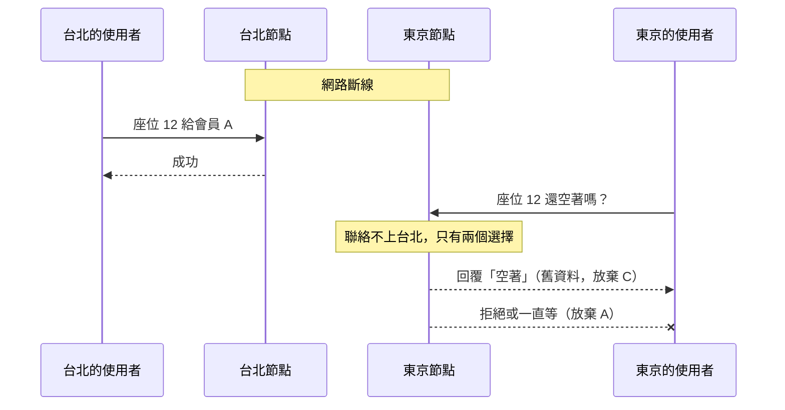

> **System Design 系列** Part 4-5｜上一篇：[分散式 ID](/post/systemdesign/distributed-id/)｜下一篇：[共識與 Raft](/post/systemdesign/consensus-raft/)｜[系列地圖](/post/systemdesign/system-design-thinking/#系列地圖)

## 情境與問題

講座平台拓展到日本，在東京開了第二個機房，資料在台北與東京之間複製。日本的使用者讀取變快了，台北機房整個故障時也還有東京可以接手。但團隊馬上遇到兩個問題：

1. **台北與東京之間的網路斷了**（光纖被挖斷、跨國線路壅塞），兩邊都還活著，只是彼此聯絡不上。這時東京的使用者報名同一個座位、修改個人簡介、回報觀看進度，系統要怎麼反應？
2. **網路正常的時候**，每次寫入要不要等另一個機房確認？等的話，每次寫入多 30 毫秒；不等的話，另一個機房可能讀到舊資料

## 最簡單的做法與它的極限

最常聽到的說法是「CAP 三選二：一致性、可用性、分割容忍，只能選兩個」，然後把資料庫分成 CA、CP、AP 三類。這個說法有兩個問題：

- **分割不是可以選擇不要的東西**：只要資料放在兩台以上透過網路連接的機器上，網路就可能斷。真正的選擇只在**發生分割的時候**才出現：要一致，還是要可用
- **沒有分割的時候也有取捨**：而且這個取捨每一個請求都要面對，就是上面的第 2 個問題。CAP 完全沒有談到它

## 核心機制

### CAP 實際上說的是什麼

CAP 定理（Gilbert 與 Lynch 在 2002 年證明）裡的三個詞有很精確的定義：

- **C（一致性）**指的是**線性一致**（linearizability）：所有操作看起來像是在某個時間點瞬間完成，而且一旦某次寫入完成，之後開始的任何讀取都會看到它或更新的值
- **A（可用性）**：每一個沒有故障的節點收到請求，最終都要回覆一個非錯誤的結果
- **P（分割容忍）**：節點之間的訊息可能遺失任意多個

證明很直觀：



東京節點不知道台北發生了什麼，它只能回覆可能過時的資料，或者不回覆。

兩個常被忽略的細節：

- CAP 的 C 是線性一致，非常嚴格。大部分的資料庫在預設設定下本來就不是線性一致的，例如 [Replication 篇](/post/systemdesign/replication-lag/)的非同步 replica。它們不是「選了 A」，而是兩者都沒有完整提供
- CAP 的 A 沒有時間限制，回覆要等 10 分鐘也算可用。實務上關心的是「在可接受的延遲內回覆」，這正是 PACELC 補上的部分

### PACELC

Daniel Abadi 在 2012 年提出 PACELC：

- **P**artition 時：在 **A**vailability 與 **C**onsistency 之間選擇
- **E**lse（沒有分割的時候）：在 **L**atency 與 **C**onsistency 之間選擇

要強一致，就要等多個副本確認，延遲就增加；要低延遲，就只等最近的副本，其他副本可能還沒更新。這個取捨每天都在發生，分割則一年也許只有幾次。

| 系統 | 分割時 | 平常 | 說明 |
|---|---|---|---|
| Dynamo、Cassandra（預設） | A | L | 每個查詢可以調整一致性等級 |
| Spanner | C | C | 少數派那一邊停止寫入；每次提交都要多數決 |
| MySQL 非同步複寫 + 自動切換 | A | L | 切換時可能遺失已確認的寫入 |

### 一致性模型的光譜

| 模型 | 保證 | 例子 |
|---|---|---|
| 線性一致 | 寫入完成後，所有人都看得到 | 座位、名額、帳戶餘額、唯一性檢查 |
| 因果一致 | 有因果關係的操作，所有人看到的順序都相同 | 先看到提問，才看到回覆 |
| Session 保證 | 同一個使用者 read-your-writes、monotonic reads | 個人簡介、自己的報名清單 |
| 最終一致 | 停止寫入後，所有副本最終會相同 | 觀看次數、按讚數、觀看進度 |

越往上越強，也越慢、越容易在分割時無法服務。設計時要逐項判斷**每一種資料**需要哪一層，而不是替整個系統選一個。

### Quorum：用數量換一致性

資料有 N 個副本。寫入時等 W 個副本確認，讀取時問 R 個副本、取版本最新的值。只要 **W + R > N**，讀取的副本與寫入確認的副本至少有一個重疊，讀取就一定看得到已確認的寫入。Cassandra 的 `QUORUM` 就是多數決（3 個副本中的 2 個），`LOCAL_QUORUM` 是本機房內的多數決。

### 實測：跨機房的 quorum

3 個副本，台北 2 台、東京 1 台，用戶端在台北。台北機房內單程約 0.7 毫秒，台北到東京約 16 毫秒。每個副本有 2% 的機率正在忙（GC、壓縮），寫入要多等 5 到 50 毫秒才生效。寫入完成後的 1 毫秒內，另一個用戶端讀同一筆資料：

<details>
<summary>模擬程式（<code>java QuorumSimulation.java</code>）</summary>

```java
import java.util.Arrays;
import java.util.Random;

/**
 * 3 個副本：台北 2 台、東京 1 台，用戶端在台北。寫入送給 3 台、等 W 台確認；讀取問 3 台、等最快的 R 台回覆，取版本最新的值。
 * 每個副本有 2% 的機率正在忙（GC、壓縮），寫入要多等 5 到 50 ms 才套用，套用之後才回覆確認。
 * 寫入完成後 0 到 1 毫秒內，另一個用戶端讀同一筆資料。
 */
public class QuorumSimulation {

    static final int TRIALS = 200_000;
    static final Random RANDOM = new Random(42);

    /** 單程延遲（毫秒）：台北機房內約 0.7 ms，台北到東京約 16 ms。 */
    static double oneWay(int replica) {
        double jitter = Math.exp(0.5 * RANDOM.nextGaussian());
        return replica < 2 ? 0.3 + 0.4 * jitter : 15 + jitter;
    }

    public static void main(String[] args) {
        int[][] levels = {{1, 1}, {2, 1}, {1, 2}, {2, 2}, {3, 1}, {1, 3}};
        System.out.println("W R  W+R>N  過時讀取   寫入 p50/p99 ms   讀取 p50/p99 ms");
        for (int[] level : levels) {
            run(level[0], level[1], new boolean[] {true, true, true}, true);
        }
        System.out.println("\n台北一台故障（只剩台北一台與東京）：");
        for (int[] level : levels) {
            run(level[0], level[1], new boolean[] {true, false, true}, false);
        }
        System.out.println("\n台北與東京之間斷線（只剩台北兩台）：");
        for (int[] level : levels) {
            run(level[0], level[1], new boolean[] {true, true, false}, false);
        }
    }

    static void run(int w, int r, boolean[] reachable, boolean showStale) {
        int up = 0;
        for (boolean b : reachable) {
            up += b ? 1 : 0;
        }
        if (w > up || r > up) {
            System.out.printf("%d %d  %-5s  %s%n", w, r, w + r > 3 ? "是" : "否",
                    (w > up ? "寫入失敗" : "") + (w > up && r > up ? "、" : "") + (r > up ? "讀取失敗" : ""));
            return;
        }
        double[] writeLatency = new double[TRIALS];
        double[] readLatency = new double[TRIALS];
        long stale = 0;
        for (int t = 0; t < TRIALS; t++) {
            double[] applied = new double[3];                       // 寫入在各副本生效的時間
            double[] ack = new double[3];
            for (int i = 0; i < 3; i++) {
                double busy = RANDOM.nextDouble() < 0.02 ? 5 + RANDOM.nextDouble() * 45 : 0;
                applied[i] = reachable[i] ? oneWay(i) + busy : Double.POSITIVE_INFINITY;
                ack[i] = applied[i] + (reachable[i] ? oneWay(i) : 0);
            }
            double writeDone = kth(ack, w);
            double readAt = writeDone + RANDOM.nextDouble();
            double[] response = new double[3];
            boolean[] fresh = new boolean[3];
            for (int i = 0; i < 3; i++) {
                double requestArrives = readAt + (reachable[i] ? oneWay(i) : Double.POSITIVE_INFINITY);
                fresh[i] = requestArrives >= applied[i];
                response[i] = requestArrives + (reachable[i] ? oneWay(i) : 0);
            }
            double readDone = kth(response, r);
            boolean anyFresh = false;
            for (int i = 0; i < 3; i++) {
                anyFresh |= response[i] <= readDone && fresh[i];   // 只看在讀取完成前回覆的 R 台
            }
            stale += anyFresh ? 0 : 1;
            writeLatency[t] = writeDone;
            readLatency[t] = readDone - readAt;
        }
        Arrays.sort(writeLatency);
        Arrays.sort(readLatency);
        System.out.printf("%d %d  %-5s  %s  %6.1f / %6.1f   %6.1f / %6.1f%n", w, r, w + r > 3 ? "是" : "否",
                showStale ? String.format("%7.2f%%", 100.0 * stale / TRIALS) : "        ",
                writeLatency[TRIALS / 2], writeLatency[TRIALS * 99 / 100],
                readLatency[TRIALS / 2], readLatency[TRIALS * 99 / 100]);
    }

    static double kth(double[] values, int k) {
        double[] sorted = values.clone();
        Arrays.sort(sorted);
        return sorted[k - 1];
    }
}
```

</details>

```text
W R  W+R>N  過時讀取   寫入 p50/p99 ms   讀取 p50/p99 ms
1 1  否         2.03%     1.3 /    2.0      1.3 /    2.0
2 1  否         0.75%     1.6 /   32.0      1.3 /    1.9
1 2  否         0.00%     1.3 /    2.0      1.6 /    2.8
2 2  是         0.00%     1.6 /   32.0      1.6 /    2.8
3 1  是         0.00%    32.2 /   59.4      1.3 /    1.9
1 3  是         0.00%     1.3 /    2.0     32.1 /   35.0

台北一台故障（只剩台北一台與東京）：
1 1  否                   1.5 /   28.9      1.4 /    2.6
2 1  否                  32.1 /   58.4      1.4 /    2.6
1 2  否                   1.5 /   28.3     32.1 /   35.0
2 2  是                  32.2 /   60.0     32.1 /   35.0
3 1  是      寫入失敗
1 3  是      讀取失敗

台北與東京之間斷線（只剩台北兩台）：
1 1  否                   1.3 /    2.0      1.3 /    1.9
2 1  否                   1.6 /   40.0      1.3 /    2.0
1 2  否                   1.3 /    2.0      1.6 /    2.8
2 2  是                   1.6 /   39.8      1.6 /    2.8
3 1  是      寫入失敗
1 3  是      讀取失敗
```

- **W=1、R=1 最快，但 2% 的讀取看到舊資料**：讀取剛好問到那台還在忙的副本
- **W=2、R=2（相當於 `QUORUM`）沒有讀到舊資料，平常也幾乎和 W=1 一樣快**：台北的兩台就能湊成多數。但寫入的 p99 變成 32 毫秒：台北有一台在忙時，第二個確認只能等東京
- **W=3 或 R=3**：每次都要等東京，延遲固定 30 毫秒以上
- **台北一台故障時**，W=2、R=2 仍然一致、仍然可用，但每次都要等東京，延遲從 1.6 毫秒變成 32 毫秒。這就是 PACELC 的「E」：系統沒有分割，只是少了一台，延遲與一致性的取捨就浮現了
- **台北與東京斷線時**，台北這一邊的 W=2、R=2 完全不受影響，因為多數副本都在台北；需要 3 台的組合全部失敗。反過來，東京那一邊只有 1 台，湊不成多數，W=2 或 R=2 的請求都會失敗。**CP 的意思不是整個系統停擺，而是少數派那一邊停止服務**

W=1、R=2 的過時比例是 0，只是這個拓撲下的巧合：寫入的第一個確認總是來自台北，而 R=2 正好問了台北兩台。W + R 沒有大於 N，就沒有保證。

注意 W + R > N 也不等於線性一致：兩個寫入同時進行、寫入只在部分副本成功後就逾時，都可能讓不同的讀取看到不同的結果。需要線性一致時，Cassandra 要用 lightweight transaction（Paxos）。

## 方案比較

講座平台的每一種資料，各自選擇：

| 資料 | 分割時 | 平常 | 做法 |
|---|---|---|---|
| 座位、名額 | C：少數派拒絕報名 | C：等多數決 | Cassandra LWT 搭配 `SERIAL`，或只在主要機房的 MySQL primary 上扣名額 |
| 權限、帳號狀態 | C：寧可拒絕 | C | 主要機房的 primary |
| 個人簡介 | A：各自接受修改，事後合併 | 本機房多數決 | `LOCAL_QUORUM` |
| 觀看進度 | A | L：只問一台 | `LOCAL_ONE`，最後寫入者勝出 |
| 按讚數、觀看次數 | A | L | 各機房各自計數，定期加總（CRDT 計數器） |

## Java 落地

Keyspace 的複製設定和模擬相同，台北 2 份、東京 1 份：

```sql
CREATE KEYSPACE learning WITH replication =
    {'class': 'NetworkTopologyStrategy', 'taipei': 2, 'tokyo': 1};

CREATE TABLE learning.lecture_progress (member_id uuid, lecture_id bigint, seconds int,
                                        PRIMARY KEY (member_id, lecture_id));
CREATE TABLE learning.member_bio (member_id uuid PRIMARY KEY, bio text);
CREATE TABLE learning.seat_claim (lecture_id bigint, seat_no int, member_id uuid,
                                  PRIMARY KEY (lecture_id, seat_no));
```

Apache Cassandra Java driver 的預設負載平衡策略只連本機房，建立 session 時要指定：

```java
CqlSession session = CqlSession.builder()
        .withLocalDatacenter("taipei")
        .withKeyspace("learning")
        .build();
```

同一個 session，依資料的性質在每個查詢上設定一致性等級：

```java
package cap;

import com.datastax.oss.driver.api.core.CqlSession;
import com.datastax.oss.driver.api.core.DefaultConsistencyLevel;
import com.datastax.oss.driver.api.core.cql.Row;
import com.datastax.oss.driver.api.core.cql.SimpleStatement;
import java.util.Optional;
import java.util.UUID;

/** 同一個叢集、同一個 driver，依資料的性質選擇不同的一致性等級。 */
public class LearningRepository {

    private final CqlSession session;

    public LearningRepository(CqlSession session) {
        this.session = session;
    }

    /** 觀看進度：只問本機房一台。偶爾讀到幾秒前的進度無所謂，重要的是快、而且斷線時也寫得進去。 */
    public void saveProgress(UUID memberId, long lectureId, int seconds) {
        session.execute(SimpleStatement.newInstance(
                        "UPDATE lecture_progress SET seconds = ? WHERE member_id = ? AND lecture_id = ?",
                        seconds, memberId, lectureId)
                .setConsistencyLevel(DefaultConsistencyLevel.LOCAL_ONE));
    }

    /** 個人簡介：本機房多數決寫、多數決讀，同一個機房內讀得到自己剛寫的資料。 */
    public void updateBio(UUID memberId, String bio) {
        session.execute(SimpleStatement.newInstance(
                        "UPDATE member_bio SET bio = ? WHERE member_id = ?", bio, memberId)
                .setConsistencyLevel(DefaultConsistencyLevel.LOCAL_QUORUM));
    }

    public Optional<String> findBio(UUID memberId) {
        Row row = session.execute(SimpleStatement.newInstance(
                        "SELECT bio FROM member_bio WHERE member_id = ?", memberId)
                .setConsistencyLevel(DefaultConsistencyLevel.LOCAL_QUORUM)).one();
        return Optional.ofNullable(row).map(r -> r.getString("bio"));
    }

    /** 座位：跨機房的 Paxos（SERIAL）。斷線時少數派那一邊會失敗，而不是把同一個座位賣給兩個人。 */
    public boolean claimSeat(long lectureId, int seatNo, UUID memberId) {
        return session.execute(SimpleStatement.newInstance(
                        "INSERT INTO seat_claim (lecture_id, seat_no, member_id) VALUES (?, ?, ?) IF NOT EXISTS",
                        lectureId, seatNo, memberId)
                .setConsistencyLevel(DefaultConsistencyLevel.QUORUM)
                .setSerialConsistencyLevel(DefaultConsistencyLevel.SERIAL)).wasApplied();
    }
}
```

> 這段程式碼已對 java-driver-core 4.19.4 編譯，但沒有連線到實際的 Cassandra 叢集；一致性等級的語意依 Cassandra 5.0 文件。

- `claimSeat` 的 `SERIAL` 是跨機房的 Paxos，需要全部副本的多數（3 台中的 2 台）。斷線時台北仍然可以報名，東京則會失敗
- 常設的一致性等級可以寫在 driver 設定的 execution profile 裡（`basic.request.consistency`），查詢只要指定 profile 名稱

## 踩坑與 Gotchas

- **用 `LOCAL_SERIAL` 搶座位**：它只在本機房內跑 Paxos。台北與東京各自用 `LOCAL_SERIAL` 搶同一個座位，兩邊都可能成功，之後依時間戳合併，其中一筆被悄悄覆蓋
- **LWT 逾時不代表失敗**：寫入逾時時（`WriteTimeoutException`，寫入類型為 `CAS`），Paxos 可能已經完成。要用 `SERIAL` 重新讀取，確認座位到底是誰的。所有跨網路的寫入，逾時的結果都是「不知道」，重試要是冪等的
- **多機房用 `QUORUM` 而不是 `LOCAL_QUORUM`**：`QUORUM` 計算的是所有機房的副本，有時要等另一個機房，延遲忽高忽低
- **最後寫入者勝出（LWW）與時鐘誤差**：兩台機器的時鐘差 50 毫秒，晚 30 毫秒送出的修改反而帶著比較早的時間戳，被先送出的那一筆覆蓋。需要保留所有修改時，用版本向量或 CRDT
- **宣稱自己是「CA」的系統**：通常代表它在分割時的行為沒有被明確設計過，要問清楚斷線時到底會怎樣
- **只在平常測試**：分割時的行為要實際演練，用防火牆規則切斷機房之間的連線，觀察每一種功能的反應

### 資安相關

- **用戶端控制的時間戳**：CQL 可以用 `USING TIMESTAMP` 指定寫入的時間戳。如果這個值來自用戶端，攻擊者送出一個很遠的未來時間，他的寫入就永遠不會被覆蓋，管理員也改不掉。時間戳一律由伺服器決定
- **權限的撤銷要選 C**：管理員在台北停用一個帳號，東京在斷線期間不知道，帳號在東京仍然可以使用。權限、帳號狀態、token 撤銷這類資料，分割時要 **fail closed**：聯絡不上主要機房，就拒絕敏感操作，而不是用本地可能過時的資料放行
- **跨機房重複兌換**：優惠券「是否已使用」放在最終一致的資料庫裡，攻擊者在斷線期間分別向台北與東京兌換，兩邊都成功。這類資料要用線性一致的儲存，或規定每個使用者只能在自己的主要機房兌換
- **分割期間的稽核紀錄**：兩邊在斷線期間各自接受操作，事後合併時，稽核紀錄要能完整保留兩邊的事件，不能因為最後寫入者勝出而遺失

## 何時用／何時別用

- **選 C**：錢、名額、唯一性、權限，寧可暫時拒絕也不能出錯的資料
- **選 A**：計數、進度、偏好設定、可以事後合併的資料
- **選 L**：讀多、可以接受短暫過時、使用者對延遲敏感
- **別把整個系統貼上一個標籤**：同一個系統裡，不同的資料應該有不同的選擇

## 參考資料

- Eric Brewer, "Towards Robust Distributed Systems", *PODC* keynote, 2000
- Seth Gilbert, Nancy Lynch, "Brewer's Conjecture and the Feasibility of Consistent, Available, Partition-Tolerant Web Services", *ACM SIGACT News*, 2002
- Eric Brewer, "CAP Twelve Years Later: How the 'Rules' Have Changed", *IEEE Computer*, 2012
- Daniel Abadi, "Consistency Tradeoffs in Modern Distributed Database System Design", *IEEE Computer*, 2012
- Maurice Herlihy, Jeannette Wing, "Linearizability: A Correctness Condition for Concurrent Objects", *ACM TOPLAS*, 1990
- Martin Kleppmann, "A Critique of the CAP Theorem", arXiv:1509.05393, 2015
- Apache Cassandra 5.0 — Dynamo（Tunable Consistency）：<https://cassandra.apache.org/doc/5.0.8/cassandra/architecture/dynamo.html>
- Apache Cassandra 5.0 — Guarantees（Lightweight transactions）：<https://cassandra.apache.org/doc/5.0.8/cassandra/architecture/guarantees.html>
- Apache Cassandra Java Driver — Configuration：<https://github.com/apache/cassandra-java-driver/blob/trunk/manual/core/configuration/README.md>
- 互動圖解延伸：Dilum Sanjaya，System Design — an interactive course：<https://designed-to-scale.vercel.app/>
