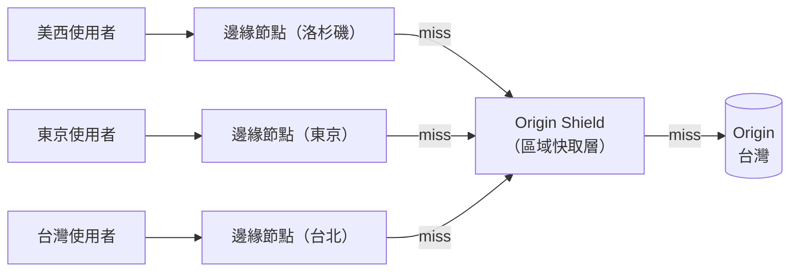
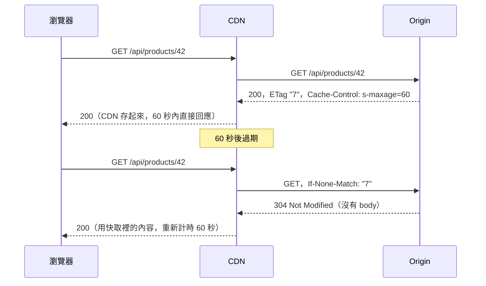
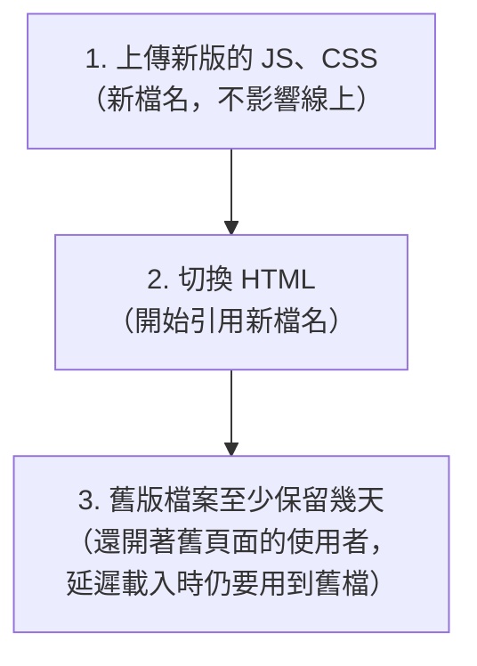

> **System Design 系列** Part 2-4｜上一篇：[Cache 深入](/post/systemdesign/caching/)｜下一篇：[SQL vs NoSQL](/post/systemdesign/sql-vs-nosql/)｜[系列地圖](/post/systemdesign/system-design-thinking/#系列地圖)

## 情境與問題

電商網站的 origin 在台灣，開始做海外市場後，陸續收到這些回報：

1. 美西使用者打開首頁要 3 秒以上，台灣只要 0.8 秒
2. 大促期間，[Napkin Math](/post/systemdesign/napkin-math/) 估出的尖峰圖片頻寬 2.4 Gbps 真的出現了，origin 的網路卡和雲端流量費一起爆表
3. 每次部署後，總有一小群使用者看到白畫面，主控台顯示 JavaScript 載入失敗
4. 最嚴重的一次：為了降低 origin 負載，把 `/api/**` 都設成可快取，結果使用者 A 打開「我的訂單」，看到的是使用者 B 的訂單

前兩個是**距離和頻寬**的問題，CDN 正是為此而生。後兩個是**快取語意**的問題：哪些東西可以被誰快取、快取多久、怎麼更新。這篇兩者都談。

## 最簡單的做法與它的極限

最簡單的做法是讓 origin 直接提供所有檔案，再用 `Cache-Control` 讓瀏覽器快取。極限在於：

- **距離無法被優化掉**：[Part 1](/post/systemdesign/request-lifecycle/) 算過，台北到美西的 RTT 約 130–160 ms。TCP、TLS 握手和第一個請求至少要 3 個 RTT，第一個 byte 就要將近 0.5 秒
- **每個使用者第一次造訪都要從 origin 拿**：瀏覽器快取只對「同一個使用者的第二次造訪」有效，大促湧入的新使用者全部打到 origin
- **頻寬集中在一個點**：2.4 Gbps 全部從 origin 送出，再加上 DDoS 時的攻擊流量，單一機房很難扛

## 核心機制

### CDN 怎麼運作



1. **導向最近的節點**：透過 DNS 或 Anycast，讓使用者連到地理上最近的邊緣節點（PoP）
2. **邊緣快取**：命中就直接回應，完全不經過 origin
3. **Origin Shield**：所有邊緣節點 miss 時，先問同一個區域快取層，而不是各自打 origin。沒有這一層時，一個新檔案上線，全球幾百個節點各自 miss，origin 會收到幾百個請求
4. **請求合併（request collapsing）**：同一個檔案同時有很多請求 miss 時，節點只送一個請求給上游，其他請求等它的結果。這就是 [Cache 篇](/post/systemdesign/caching/)的 single-flight，只是發生在 CDN

**頻寬的帳**：假設以 byte 計算的命中率是 95%，2.4 Gbps 的圖片流量只剩 2.4 × 5% = 120 Mbps 會打到 origin。和 Cache 篇一樣，要看的是**未命中率**：命中率從 95% 提升到 99%，origin 頻寬再降 5 倍。

**就算內容不能快取，CDN 也能加速**。使用者和邊緣節點握手（RTT 約 10 ms），邊緣節點和 origin 之間則維持一條已經建好、持續重用的連線。以美西使用者打一支不能快取的 API 來估算：

| | 直接連 origin | 經過 CDN |
|---|---|---|
| TCP + TLS 1.3 握手 | 2 × 150 = 300 ms | 2 × 10 = 20 ms |
| 送出請求、收到回應 | 150 ms | 10 +（邊緣到 origin 的重用連線）150 = 160 ms |
| 第一個 byte 大約 | 450 ms | 180 ms |

（不含 DNS 與伺服器處理時間，RTT 為量級估算。）

### HTTP 快取語意：新鮮、過期與重新驗證

RFC 9111 定義了所有 HTTP 快取（瀏覽器、CDN、反向代理）共用的規則。核心概念只有兩個：

- **新鮮（fresh）**：回應的年齡還沒超過新鮮期限，可以直接使用，不必問 origin。新鮮期限的優先順序是：`s-maxage`（只限共享快取）> `max-age` > `Expires` > 啟發式估算
- **過期（stale）**：超過新鮮期限後，原則上要先向 origin **重新驗證**才能使用

重新驗證靠條件式請求：快取帶上它手上版本的 `ETag`，origin 判斷內容沒變，就只回一個沒有 body 的 `304 Not Modified`。



304 省下的是頻寬和 origin 產生回應內容的成本，但**省不掉一次往返**。所以真正要快，還是要靠足夠長的新鮮期限。

### Cache-Control 指令

| 指令 | 意思 | 常見誤解 |
|---|---|---|
| `max-age=N` | N 秒內是新鮮的 | — |
| `s-maxage=N` | 只對共享快取（CDN、代理）生效，優先於 `max-age` | — |
| `public` | 共享快取可以儲存，即使請求帶有 `Authorization` | — |
| `private` | 只能存在使用者自己的瀏覽器 | 以為能防止瀏覽器快取 |
| `no-cache` | **可以存**，但每次使用前都要先向 origin 驗證 | 以為是「不要快取」 |
| `no-store` | 任何快取都不准存 | — |
| `must-revalidate` | 過期後一定要驗證，不准直接拿舊的用 | — |
| `immutable`（RFC 8246） | 新鮮期間內內容絕對不會變，使用者按重新整理也不用驗證 | — |
| `stale-while-revalidate=N`（RFC 5861） | 過期後 N 秒內，可以先回舊的，同時在背景更新 | — |
| `stale-if-error=N`（RFC 5861） | origin 出錯時，過期 N 秒內的舊資料仍可使用 | — |

`stale-while-revalidate` 對應 Cache 篇的「邏輯過期」，`stale-if-error` 則讓 CDN 在 origin 短暫故障時繼續提供服務，兩者在 CDN 層就做到了 Cache 篇要自己寫程式才能做到的事。實際支援程度依 CDN 而定，要查各家文件。

### Cache key：什麼算「同一個東西」

CDN 預設用「主機名稱 + 路徑 + query string」當 cache key。兩個請求的 key 一樣，就會拿到同一份快取。設計上要注意：

- **無關的 query 參數**：`?utm_source=fb` 和 `?utm_source=line` 會被當成兩個不同的物件，命中率被切碎。在 CDN 設定中只保留真正影響內容的參數
- **`Vary` header**：`Vary: Accept-Encoding` 表示壓縮方式不同就分開存，這是合理的。`Vary: User-Agent` 或 `Vary: Cookie` 則幾乎等於每個使用者各存一份，命中率趨近於零
- **沒放進 key、卻會影響回應內容的輸入**：這是 cache poisoning 的根源，見後面的資安段落

### 版本化：讓快取永遠不必清除

快取最難的不是「存起來」，而是「改了之後怎麼讓大家拿到新的」。最可靠的做法是**讓內容和網址綁在一起**：

| 資源 | 網址 | Cache-Control |
|---|---|---|
| JS、CSS、圖片 | 檔名含內容雜湊：`app.3f9a1c.js` | `public, max-age=31536000, immutable` |
| HTML 入口 | 固定：`/index.html` | `no-cache`（每次驗證，沒變就 304） |

內容一改，雜湊就變，網址就變。舊網址的快取永遠正確，新網址從來沒被快取過，**根本不需要清除快取**。HTML 是唯一的固定入口，每次都驗證，部署後使用者下一次載入就會拿到引用新檔案的 HTML。

情境 3 的白畫面，是部署順序錯了：



先切 HTML 再上傳資源，使用者會拿到引用不存在檔案的 HTML；部署時把舊檔刪掉，還開著舊分頁的使用者，在單頁應用切換頁面、延遲載入程式碼時就會失敗。

### 清除快取（purge）只是緊急手段

CDN 都提供 purge API，但不該當成日常部署流程的一環：

- 全球節點生效需要時間，從幾秒到幾分鐘不等，而且常有頻率或數量限制
- **清不掉瀏覽器的快取**：已經被使用者瀏覽器存起來、`max-age` 還沒到的內容，CDN 完全管不到

所以 purge 只用在「內容有錯必須立刻下架」的緊急情況，日常更新靠版本化網址和合理的 TTL。

### API 也能放 CDN：微快取

公開、不分使用者的熱門 API（商品詳情、排行榜、活動頁資料）也可以讓 CDN 快取，只是 TTL 很短。假設某支 API 每秒有 10,000 個請求：

```text
Cache-Control: public, max-age=0, s-maxage=1, stale-while-revalidate=5
```

- 瀏覽器不快取（`max-age=0`），每次都問 CDN
- CDN 快取 1 秒。搭配 origin shield 和請求合併，origin 每秒大約只收到 1 個請求，而不是 10,000 個
- 資料最多舊約 1 秒（加上 `stale-while-revalidate` 的背景更新時間）

只要業務能接受 1 秒的延遲，這是投資報酬率極高的做法。秒殺的庫存數字、即時排行榜都可以這樣處理，真正扣庫存的寫入請求則不經過快取。

## 方案比較

### 更新快取內容的方式

| 方式 | 生效速度 | 能更新瀏覽器的快取嗎 | 適合 |
|---|---|---|---|
| 等 TTL 過期 | 慢，最多一個 TTL | 能（過期後自然更新） | 可以容忍延遲的內容 |
| Purge | 幾秒到幾分鐘 | 不能 | 緊急下架 |
| 版本化網址 | 立即（新網址） | 能（新網址不在快取裡） | 靜態資源，**預設做法** |
| 短 TTL + 重新驗證 | 一個短 TTL | 能 | HTML 入口、微快取的 API |

### Push 與 Pull

| | Pull（拉取） | Push（推送） |
|---|---|---|
| 做法 | 節點 miss 時才回 origin 拿 | 事先把檔案上傳到 CDN |
| 優點 | 設定簡單，只會存真正有人要的東西 | 第一個請求就命中，origin 可以完全不對外 |
| 缺點 | 每個節點的第一個請求要回 origin | 要自己管理上傳與刪除 |
| 適合 | 絕大多數網站 | 大型檔案發佈（安裝檔、遊戲更新包） |

實務上常見的折衷是：把靜態資源放在物件儲存（S3 等）當 origin，CDN 用 pull 模式從它拿。物件儲存本身就能承受大量讀取，又不必管理伺服器。

### 各層快取能存什麼

| 層 | 誰共用 | 能存個人化內容嗎 | 控制方式 |
|---|---|---|---|
| 瀏覽器 | 單一使用者 | 能（`private`） | `Cache-Control` |
| CDN | 所有使用者 | **不能** | `Cache-Control`、`s-maxage`、CDN 設定 |
| 反向代理（Nginx） | 所有使用者 | 不能 | 同上 |
| 應用程式快取（Redis） | 所有 instance | 能，但 key 要含使用者身分 | 程式碼 |

## Java 落地

### 1. 靜態資源

現代前端多半由打包工具（例如 Vite）產生帶雜湊的檔名，直接部署到物件儲存加 CDN，Spring Boot 只負責 API。如果是由 Spring Boot 伺服器渲染頁面（Thymeleaf），可以讓 Spring 幫靜態資源加上內容雜湊：

```yaml
spring:
  web:
    resources:
      chain:
        strategy:
          content:
            enabled: true
            paths: "/**"           # /css/app.css 會變成 /css/app-2a2d595e6ed9.css
      cache:
        cachecontrol:
          max-age: 365d
          cache-public: true
```

Thymeleaf 和 FreeMarker 會自動把模板裡的資源連結改寫成帶雜湊的版本（透過 `ResourceUrlEncodingFilter`）。Spring Boot 4.1 的 `cachecontrol` 屬性沒有 `immutable`，需要時要自己在 `WebMvcConfigurer` 設定。

### 2. 公開 API：Cache-Control 加 ETag

```java
@RestController
@RequestMapping("/api/products")
public class ProductController {

    private final ProductDetailQuery productQuery;

    public ProductController(ProductDetailQuery productQuery) {
        this.productQuery = productQuery;
    }

    @GetMapping("/{id}")
    public ResponseEntity<ProductDetail> detail(@PathVariable long id) {
        ProductDetail product = productQuery.findDetail(id);
        if (product == null) {
            return ResponseEntity.notFound().build();
        }
        return ResponseEntity.ok()
                .cacheControl(CacheControl.maxAge(Duration.ofSeconds(10))   // 瀏覽器：10 秒
                        .sMaxAge(Duration.ofSeconds(60))                   // CDN：60 秒
                        .staleWhileRevalidate(Duration.ofSeconds(30))
                        .staleIfError(Duration.ofHours(1))
                        .cachePublic())
                .eTag(String.valueOf(product.version()))                   // 沒加引號會自動補上
                .body(product);
    }
}
```

實際產生的 header：

```text
Cache-Control: max-age=10, public, s-maxage=60, stale-if-error=3600, stale-while-revalidate=30
ETag: "7"
```

ETag 用資料的版本號（例如 JPA 的 `@Version` 欄位），而不是把回應內容算雜湊。這樣每一台 instance 對同一筆資料都會算出同一個 ETag，CDN 不管回哪一台 origin 驗證，結果都一致。`ResponseEntity` 帶了 ETag 時，Spring MVC 會自動比對請求的 `If-None-Match`，相同就回 304。

上面的寫法仍然會先把整筆資料查出來。如果產生回應的成本很高（例如報表），可以先只查版本號，沒變就直接回 304：

```java
@GetMapping("/api/stores/{id}/sales-report")
public ResponseEntity<SalesReport> report(@PathVariable long id, WebRequest request) {
    String eTag = String.valueOf(reportQuery.currentVersion(id));   // 只查版本號，很便宜
    if (request.checkNotModified(eTag)) {
        return null;                                                // 已經設好 304，不必產生報表
    }
    return ResponseEntity.ok().eTag(eTag).body(reportQuery.build(id));
}
```

Spring 也有 `ShallowEtagHeaderFilter`，它把整個回應內容算成雜湊當 ETag。它省得了頻寬，省不了伺服器的運算，因為回應還是要完整產生一次才能算雜湊。

### 3. 個人化 API：明確禁止快取

```java
@GetMapping("/api/me/orders")
public ResponseEntity<List<OrderSummary>> myOrders(Principal principal) {
    return ResponseEntity.ok()
            .cacheControl(CacheControl.noStore())   // 個人資料：任何一層都不准存
            .body(orderQuery.findByMember(Long.parseLong(principal.getName())));
}
```

Spring Security 預設會在每個回應加上 `Cache-Control: no-cache, no-store, max-age=0, must-revalidate`，但**只要應用程式自己設了 `Cache-Control`，它就不再覆蓋**。這是為了讓靜態資源可以被快取而設計的。換句話說，情境 4 正是這樣發生的：有人為了效能，在攔截器裡幫整個 `/api/**` 設了 `public, max-age=60`，Spring Security 的保護就跟著消失了。

另外有個 API 陷阱：`noCache()` 是 static 方法，`CacheControl.empty().cachePrivate().noCache()` 會產生一個全新的物件，前面的 `private` 就不見了，輸出只剩 `no-cache`。要寫成 `CacheControl.noCache().cachePrivate()`，輸出才是 `no-cache, private`。編譯器開 `-Xlint:static` 會對前者發出警告。

### 4. 確認 CDN 有沒有命中

用 `curl -sI <網址>` 看回應 header：

| Header | 意義 |
|---|---|
| `Age` | 這份回應在快取裡待了幾秒；沒有或一直是 0，通常代表沒命中 |
| `X-Cache` | CloudFront 會標示 `Hit from cloudfront`、`Miss from cloudfront` 或 `RefreshHit from cloudfront`（過期後驗證成功） |
| `cf-cache-status` | Cloudflare 的命中狀態，例如 `HIT`、`MISS`、`EXPIRED` |
| `Cache-Control`、`ETag` | 確認 origin 送出的指令是否符合預期 |

## 踩坑與 Gotchas

- **把 `no-cache` 當成「不要快取」**：它的意思是「可以存，但每次都要驗證」。真的不准存要用 `no-store`
- **沒有 `Cache-Control` 不代表不會被快取**：RFC 9111 允許快取依 `Last-Modified` 自行估算新鮮期限（常見做法是距上次修改時間的 10%）；CDN 也有自己的預設 TTL，例如 CloudFront 的 CachingOptimized 政策在 origin 沒有指定時預設快取 24 小時。每個回應都應該明確宣告
- **HTML 設了長 `max-age`**：部署後使用者繼續拿著舊 HTML，永遠引用舊資源。HTML 一律 `no-cache`
- **部署時刪掉舊版資源**：還開著舊分頁的使用者，延遲載入時就失敗
- **把 purge 放進部署流程**：生效慢、有數量限制，而且清不掉瀏覽器快取
- **錯誤回應被快取**：CDN 預設也會短暫快取錯誤（CloudFront 預設 4xx、5xx 快取 10 秒）。origin 抖動 1 秒，使用者可能看到 10 秒的錯誤；檔案還沒上傳完就被請求，404 也會被快取
- **`Vary: User-Agent`、`Vary: Cookie`**：命中率趨近於零
- **CORS 回應沒有 `Vary: Origin`**：`Access-Control-Allow-Origin` 會依請求來源動態產生，A 網域拿到的版本被快取後，B 網域的請求就會因為來源不符而被瀏覽器擋下
- **ETag 依 instance 而異**：不同台算出不同 ETag，304 永遠不會成立

### 資安相關

- **Web cache deception**：CDN 設定成「所有 `.css` 結尾的路徑都快取」，而 origin 對 `/account/profile/x.css` 仍然回傳個人資料頁。攻擊者誘使受害者點這個網址，個人頁就以 CSS 的名義被 CDN 快取，攻擊者再請求同一個網址就拿到受害者的資料。防禦：快取與否只依 origin 的 `Cache-Control` 決定，不要依副檔名；個人頁一律 `no-store`；origin 對不認得的路徑回 404。Spring MVC 5.3 起預設關閉副檔名比對、6.0 起關閉結尾斜線比對，也有助於減少這類「一個處理器回應太多種路徑」的情況
- **Cache poisoning**：origin 用某個沒放進 cache key 的 header 產生回應內容，例如用 `X-Forwarded-Host` 組出 script 的絕對網址。攻擊者送一個帶惡意 host 的請求，這份被汙染的回應就被快取起來，發給所有使用者。防禦：產生內容只用固定設定的網域，不信任請求帶來的 host；凡是會影響回應的輸入都要放進 cache key。[Load Balancing 篇](/post/systemdesign/load-balancing/)提到的 `server.forward-headers-strategy` 會讓應用程式採信 `X-Forwarded-Host`，所以 CDN 和 LB 必須覆寫掉 client 自己帶的這類 header
- **個人化回應被快取**：所有需要登入的 API 都要明確送出 `private` 或 `no-store`，不要依賴 CDN 的預設行為。CDN 端也設定成：請求帶 `Authorization` 或 session cookie 時不快取
- **Origin 被直接打**：origin 的 IP 一旦外洩，攻擊者就能繞過 CDN 的快取、WAF 和限流，直接打垮 origin。origin 只允許 CDN 的來源（例如 CloudFront 的 managed prefix list），S3 則用 Origin Access Control 只開放給 CDN 讀取
- **付費或私人內容**：用 CDN 的 signed URL 或 signed cookie，設定短效期，而不是靠網址難以猜測

## 何時用／何時別用

- **適合用 CDN**：使用者分佈在多個地區、靜態資源或圖片影片占大部分頻寬、需要吸收大流量或 DDoS、有公開且熱門的 API 可以微快取
- **效益有限**：只在單一地區使用的內部系統、幾乎全部是個人化內容的服務（仍可受惠於邊緣終止 TLS，但快取幫不上忙）、要求每次都拿到最新資料的 API
- **重新評估的時機**：CDN 命中率偏低（檢查 cache key 與 `Vary`）；origin 的對外流量費用持續上升；遠端地區的延遲指標明顯落後

## 參考資料

- RFC 9111, HTTP Caching：<https://www.rfc-editor.org/rfc/rfc9111>
- RFC 9110, HTTP Semantics（Conditional Requests、ETag）：<https://www.rfc-editor.org/rfc/rfc9110>
- RFC 8246, HTTP Immutable Responses：<https://www.rfc-editor.org/rfc/rfc8246>
- RFC 5861, HTTP Cache-Control Extensions for Stale Content：<https://www.rfc-editor.org/rfc/rfc5861>
- MDN — HTTP caching：<https://developer.mozilla.org/en-US/docs/Web/HTTP/Guides/Caching>
- Spring Framework Reference — HTTP Caching：<https://docs.spring.io/spring-framework/reference/web/webmvc/mvc-caching.html>
- Spring Boot Reference — Static Content：<https://docs.spring.io/spring-boot/reference/web/servlet.html>
- Spring Security Reference — Security HTTP Response Headers：<https://docs.spring.io/spring-security/reference/features/exploits/headers.html>
- Amazon CloudFront Developer Guide：<https://docs.aws.amazon.com/AmazonCloudFront/latest/DeveloperGuide/>
- Omer Gil, "Web Cache Deception Attack", Black Hat USA 2017
- James Kettle, "Practical Web Cache Poisoning", PortSwigger Research, 2018：<https://portswigger.net/research/practical-web-cache-poisoning>
- 互動圖解延伸：Dilum Sanjaya，System Design — an interactive course：<https://designed-to-scale.vercel.app/>
