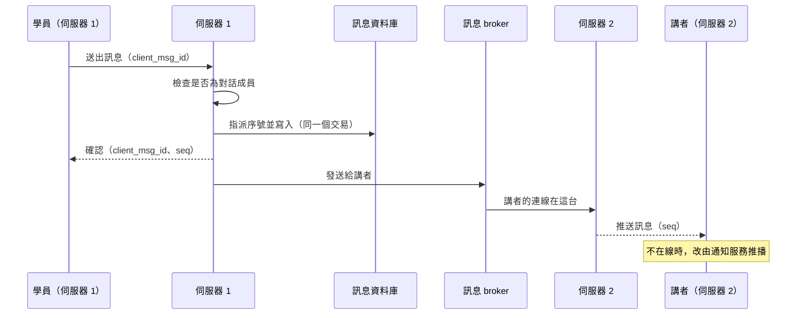

> **System Design 系列** Part 9-3｜上一篇：[News Feed](/post/systemdesign/news-feed/)｜下一篇：[秒殺搶票](/post/systemdesign/flash-sale-ticketing/)｜[系列地圖](/post/systemdesign/system-design-thinking/#系列地圖)

## 情境與問題

講座平台要加入兩種聊天：

1. **私訊與小群組**：學員和講者一對一，或講者和助教的小群組。訊息不能遺失、順序要正確，換一台裝置也要看得到完整的歷史，離線時收到推播
2. **直播聊天室**：熱門講座直播時，5 萬名觀眾在同一個聊天室裡留言。觀眾想看到的是「大家正在說什麼」，而不是每一則訊息

[即時更新篇](/post/systemdesign/realtime-updates/)處理了「把伺服器的變化推給瀏覽器」：WebSocket、跨伺服器的扇出、合併更新、慢的用戶端。這一題要再往下處理**訊息本身**：怎麼排序、怎麼不重複、怎麼在離線後補齊。

**規模估算**

| 項目 | 估算 |
|---|---|
| 私訊 | 日活躍 200 萬，其中 10% 使用私訊、每人每天 20 則 → 每天 400 萬則，平均每秒約 46 則，尖峰約 500 則 |
| 私訊的儲存 | 每則約 300 位元組（內容、對話 ID、序號、時間）→ 每天約 1.2 GB，每年約 440 GB |
| 直播聊天室 | 5 萬名觀眾，尖峰每秒 200 則留言 |
| 直播聊天室若逐則推送 | 200 則 × 5 萬人 = 每秒 1,000 萬次投遞 |

私訊的量不大，難的是**正確性**；直播聊天室的量極大，難的是**扇出**。兩者應該用不同的設計。

## 最簡單的做法與它的極限

訊息寫入一張表，用 `created_at` 排序；WebSocket 收到訊息就廣播給對話裡所有在線的人。

- **時間戳不能決定順序**：兩台伺服器的時鐘差了幾十毫秒，後送出的訊息可能排在前面；同一毫秒的兩則訊息沒有確定的順序
- **重送造成重複**：手機在捷運上送出訊息，網路斷了沒收到確認，重新連線後再送一次，對方看到兩則一樣的訊息
- **離線的訊息不見了**：只推給在線的連線，離線的裝置重新連線時，不知道自己漏了哪些
- **直播聊天室**：每秒 1,000 萬次投遞，沒有任何一組伺服器的網路頻寬撐得住，而且沒有人能在一秒內讀完 200 則留言

## 核心機制

### 每個對話一個遞增序號

順序的唯一依據是**伺服器在每個對話內指派的遞增序號**（`seq`）：

- 同一個對話的訊息，序號由同一個地方依序指派，所以順序是確定的
- 不同對話之間不需要全域的順序，所以不需要全域的序號產生器（[分散式 ID 篇](/post/systemdesign/distributed-id/)）
- 序號是連續的，用戶端看到 `seq` 從 41 跳到 43，就知道漏了 42

指派序號的方式：對話表的 `last_seq` 欄位以條件式更新遞增。這會讓同一個對話的寫入排隊經過同一列的鎖（[交易與隔離等級篇](/post/systemdesign/transaction-isolation/)），但一個私訊對話每秒不會有幾則訊息，完全不是瓶頸。直播聊天室每秒 200 則就不適合這樣做，後面另外處理。

### 用戶端訊息 ID：重送不會重複

用戶端在送出前為每則訊息產生一個 UUID（`client_msg_id`），伺服器以 `(conversation_id, client_msg_id)` 建立唯一鍵：

- 第一次送達：寫入、指派序號、回覆 `{client_msg_id, seq}`
- 重送：唯一鍵衝突，直接回覆第一次指派的序號，不產生新的訊息

這就是[冪等性篇](/post/systemdesign/idempotency-key/)的 Idempotency Key，只是放在 WebSocket 訊息裡。用戶端在收到確認之前，把訊息顯示為「傳送中」，收到確認後依序號放到正確的位置。

### 離線同步與未讀數

每台裝置記住每個對話**已經收到的最大序號**。重新連線時：

1. 取得對話清單，每個對話帶著目前的 `last_seq`
2. 對 `last_seq` 大於本機紀錄的對話，請求 `after=本機的序號` 之後的訊息

未讀數不需要為每則訊息記錄「誰讀了」：每位成員在每個對話只記一個 `last_read_seq`，**未讀數 = 對話的 `last_seq` − 成員的 `last_read_seq`**。已讀回條也是同一個欄位：對方的 `last_read_seq` 大於等於某則訊息的序號，就代表已讀。

### 投遞：使用者連在哪一台伺服器

在線的使用者可能連在任何一台 WebSocket 伺服器上，而且同一個人可能同時開著手機和電腦。投遞的流程：



- **先寫入、再確認、再投遞**：確認代表訊息已經持久化，即使投遞失敗，對方重新連線時也能同步到
- **跨伺服器的路由**：可以自己維護「使用者 → 伺服器」的對照表，或者使用 STOMP broker relay（例如 RabbitMQ 的 STOMP 外掛），由 broker 負責把訊息送到使用者實際連線的那台伺服器
- **投遞是 at-least-once**：重新連線的同步可能和即時推送重疊，用戶端以序號去重
- **離線推播**：對方沒有任何在線的連線時，交給通知服務（[通知系統](/post/systemdesign/notification-system/)）

### 直播聊天室：不是每個人都要收到每一則

5 萬人的聊天室是另一種產品：

- **訊息不需要全域的嚴格順序**，也不需要每則都送到每個人。觀眾看到的是「最近的留言在捲動」
- **每台伺服器批次推送**：每台 WebSocket 伺服器每 250 毫秒把這段時間的留言打包成一個 frame，推給自己的觀眾；留言太多時只取樣其中一部分（例如每批最多 5 則，優先顯示講者、助教與付費會員的留言）
- **扇出的估算**：5 萬人 × 每秒 4 個 frame = 每秒 20 萬個 frame，每個 frame 約 1 KB，合計約 200 MB/s，分散到 10 台伺服器，每台約 20 MB/s。和逐則推送的每秒 1,000 萬次相比，少了兩個數量級
- **寫入的路徑**：留言先送到聊天室的 Redis Pub/Sub 頻道，每台伺服器訂閱它並在本機批次處理（即時更新篇的跨伺服器扇出）。留言另外非同步寫入儲存，用於重播與審核，不在推送的關鍵路徑上
- **慢速模式與審核**：每位觀眾每 3 秒最多一則，連結與關鍵字過濾，講者可以禁言

### 儲存

- 私訊以 `(conversation_id, seq)` 為主鍵，同一個對話的訊息在磁碟上相鄰，「取得某個序號之後的訊息」是一次範圍讀取
- 依 `conversation_id` 分片（[Sharding 篇](/post/systemdesign/sharding/)），一個對話的所有訊息在同一個分片，序號的指派也在同一個分片內完成
- 寫多讀少、依時間追加，也適合 LSM-Tree 類的資料庫（[B-Tree vs LSM-Tree 篇](/post/systemdesign/btree-vs-lsm/)）；直播聊天室的訊息量大，分區鍵要加上時間區間（例如 `(room_id, 小時)`），避免單一分區無限成長

### 端對端加密

端對端加密讓伺服器無法讀取訊息內容，但代價是：無法做內容審核與檢舉、無法在伺服器端搜尋、多裝置同步與金鑰管理變得複雜。講座平台的私訊需要處理騷擾檢舉，直播聊天室需要即時審核，所以選擇**傳輸加密加上儲存加密**，並在隱私權政策中說明平台可以存取訊息的條件。這是產品決策，不是技術上的預設值。

## 方案比較

| 決策 | 私訊 | 直播聊天室 |
|---|---|---|
| 順序 | 每個對話的遞增序號 | 每台伺服器收到的順序即可 |
| 投遞 | 每則都送到，at-least-once，用序號去重 | 每 250 毫秒批次推送，必要時取樣 |
| 遺失 | 不允許，先持久化再確認 | 可以接受少量遺失 |
| 儲存 | 依對話分片，永久保存（依保存政策） | 非同步寫入，只用於重播與審核 |
| 離線 | 重新連線時依序號同步；離線推播 | 不補；重新進入時只顯示最近的留言 |

## Java 落地

### 1. 資料表

```sql
CREATE TABLE conversation (
    id        BIGINT PRIMARY KEY,
    last_seq  BIGINT NOT NULL DEFAULT 0
);

CREATE TABLE conversation_member (
    conversation_id BIGINT NOT NULL,
    member_id       BIGINT NOT NULL,
    last_read_seq   BIGINT NOT NULL DEFAULT 0,
    PRIMARY KEY (conversation_id, member_id),
    KEY idx_member (member_id)
);

CREATE TABLE message (
    conversation_id BIGINT       NOT NULL,
    seq             BIGINT       NOT NULL,
    client_msg_id   BINARY(16)   NOT NULL,
    sender_id       BIGINT       NOT NULL,
    body            VARCHAR(4000) NOT NULL,
    created_at      TIMESTAMP(3) NOT NULL DEFAULT CURRENT_TIMESTAMP(3),
    PRIMARY KEY (conversation_id, seq),
    UNIQUE KEY uk_client_msg (conversation_id, client_msg_id)
);
```

### 2. 送出訊息：成員檢查、去重、指派序號

```java
@Service
public class MessageService {

    private final JdbcClient jdbc;
    private final ApplicationEventPublisher events;

    public MessageService(JdbcClient jdbc, ApplicationEventPublisher events) {
        this.jdbc = jdbc;
        this.events = events;
    }

    @Transactional
    public SendAck send(long conversationId, long senderId, UUID clientMsgId, String body) {
        boolean member = jdbc.sql("SELECT COUNT(*) FROM conversation_member WHERE conversation_id = :c AND member_id = :m")
                .param("c", conversationId).param("m", senderId)
                .query(Long.class).single() > 0;
        if (!member) {
            throw new AccessDeniedException("不是對話成員");
        }
        // 重送：直接回覆第一次的序號
        Optional<Long> existing = jdbc.sql("SELECT seq FROM message WHERE conversation_id = :c AND client_msg_id = :id")
                .param("c", conversationId).param("id", toBytes(clientMsgId))
                .query(Long.class).optional();
        if (existing.isPresent()) {
            return new SendAck(clientMsgId, existing.get());
        }
        // 鎖住對話列並遞增序號；同一個對話的寫入在這裡排隊
        jdbc.sql("UPDATE conversation SET last_seq = LAST_INSERT_ID(last_seq + 1) WHERE id = :c")
                .param("c", conversationId).update();
        long seq = jdbc.sql("SELECT LAST_INSERT_ID()").query(Long.class).single();
        jdbc.sql("""
                        INSERT INTO message (conversation_id, seq, client_msg_id, sender_id, body)
                        VALUES (:c, :seq, :id, :sender, :body)
                        """)
                .param("c", conversationId).param("seq", seq).param("id", toBytes(clientMsgId))
                .param("sender", senderId).param("body", body)
                .update();
        events.publishEvent(new MessageStored(conversationId, seq, senderId, body));   // 提交之後才投遞
        return new SendAck(clientMsgId, seq);
    }

    private static byte[] toBytes(UUID id) {
        return ByteBuffer.allocate(16).putLong(id.getMostSignificantBits()).putLong(id.getLeastSignificantBits()).array();
    }
}
```

- `LAST_INSERT_ID(expr)` 是 MySQL 的慣用法：更新的同時把新值記在這條連線上，下一個 `SELECT LAST_INSERT_ID()` 取得的就是剛剛遞增的值，不會被其他連線影響
- 重送的檢查在取得序號之前。兩個重送同時到達的極端情況下，第二個會在 `INSERT` 時撞上唯一鍵而回滾，這時重新查詢一次即可（這裡省略）
- 寫入失敗時整個交易回滾，序號也一起回滾，不會出現序號的空洞

### 3. 提交後投遞，跨伺服器由 broker 路由

```java
@Configuration
@EnableWebSocketMessageBroker
public class ChatBrokerConfig implements WebSocketMessageBrokerConfigurer {

    @Override
    public void configureMessageBroker(MessageBrokerRegistry config) {
        config.enableStompBrokerRelay("/topic", "/queue")
                .setRelayHost("rabbitmq.chat.internal")
                .setRelayPort(61613);
        config.setApplicationDestinationPrefixes("/app");
        // 使用者連在別台伺服器時，把無法在本機解析的訊息廣播出去，讓其他伺服器嘗試
        config.setUserDestinationBroadcast("/topic/unresolved-user-destination");
        config.setUserRegistryBroadcast("/topic/simp-user-registry");
    }

    @Override
    public void registerStompEndpoints(StompEndpointRegistry registry) {
        registry.addEndpoint("/ws").setAllowedOrigins("https://lectures.example.com");
    }
}

@Component
public class MessageDispatcher {

    private final SimpMessagingTemplate messaging;
    private final ConversationMembers members;
    private final OfflinePush offlinePush;

    public MessageDispatcher(SimpMessagingTemplate messaging, ConversationMembers members, OfflinePush offlinePush) {
        this.messaging = messaging;
        this.members = members;
        this.offlinePush = offlinePush;
    }

    @TransactionalEventListener(phase = TransactionPhase.AFTER_COMMIT)
    public void dispatch(MessageStored message) {
        for (String recipient : members.otherMembers(message.conversationId(), message.senderId())) {
            messaging.convertAndSendToUser(recipient, "/queue/messages", MessagePush.from(message));
            offlinePush.ifNoActiveSession(recipient, message);       // 沒有在線的連線時才推播
        }
    }
}
```

- `@TransactionalEventListener(AFTER_COMMIT)`：交易提交後才投遞，不會推送一則最後回滾的訊息。程序在提交後、投遞前當機，訊息仍然在資料庫裡，對方重新連線時會同步到
- 連線、訂閱與每則訊息的授權沿用[即時更新篇](/post/systemdesign/realtime-updates/)的做法：`/app/**` 的訊息要求登入，`/user/**` 之外的私人目的地拒絕訂閱，最後 `anyMessage().denyAll()`

### 4. 同步 API

```java
@GetMapping("/v1/conversations/{id}/messages")
public List<MessageView> after(@PathVariable long id, @RequestParam long afterSeq,
                               @AuthenticationPrincipal Jwt jwt) {
    long me = CurrentMember.from(jwt).memberId();
    boolean member = jdbc.sql("SELECT COUNT(*) FROM conversation_member WHERE conversation_id = :id AND member_id = :me")
            .param("id", id).param("me", me)
            .query(Long.class).single() > 0;
    if (!member) {
        throw new ResponseStatusException(HttpStatus.NOT_FOUND);       // 不是 403：不透露這個對話是否存在
    }
    return jdbc.sql("""
                    SELECT m.seq, m.sender_id, m.body, m.created_at
                      FROM message m
                      JOIN conversation_member cm ON cm.conversation_id = m.conversation_id AND cm.member_id = :me
                     WHERE m.conversation_id = :id AND m.seq > :after
                     ORDER BY m.seq
                     LIMIT 200
                    """)
            .param("me", me).param("id", id).param("after", afterSeq)
            .query(MessageView.class)
            .list();
}
```

不是成員就回 404，和[授權篇](/post/systemdesign/authorization-owasp-api-top10/)「404 而不是 403」的原則一致；查詢裡仍然保留成員條件，作為第二道防線。一次最多 200 則，用戶端依最後一則的序號繼續。

> 以上程式碼依 Spring Boot 4.1、Spring Framework 7（WebSocket／STOMP）與 MySQL 8.4 官方文件撰寫，沒有實際編譯與執行。`ConversationMembers`、`OfflinePush` 是示意的元件。

## 踩坑與 Gotchas

- **用時間戳排序**：時鐘不一致與同一毫秒，讓順序不確定
- **沒有用戶端訊息 ID**：網路不穩時，重送的訊息出現兩次
- **先推送、再寫入**：推送成功、寫入失敗，對方看過的訊息在重新整理後消失
- **每則訊息記錄每個人的已讀狀態**：群組越大，寫入量越大。用每人每個對話一個 `last_read_seq`
- **直播聊天室沿用私訊的設計**：序號的列鎖與逐則推送，在每秒 200 則與 5 萬人時崩潰
- **離線推播送給所有裝置**：使用者正在電腦上看著對話，手機還一直跳出通知。只在沒有活躍連線時推播，或依最近的活動判斷
- **大量重新連線**：伺服器重啟時，上萬個用戶端同時重新連線並同步，要有帶抖動的重連退避（[Timeout 與 Retry 篇](/post/systemdesign/timeout-retry-backoff/)）

### 威脅模型

| STRIDE | 威脅 | 講座平台的情境 | 防禦 |
|---|---|---|---|
| Spoofing 冒充 | 以別人的身分傳訊息；跨站 WebSocket 劫持 | 訊息裡的 `senderId` 由用戶端提供；惡意網站在受害者的瀏覽器裡建立 WebSocket 連線 | 發送者取自連線的身分；檢查 `Origin`（[即時更新篇](/post/systemdesign/realtime-updates/)） |
| Tampering 竄改 | 修改別人的訊息；偽造序號 | 編輯 API 只檢查登入；用戶端送來的序號或時間被直接採用 | 物件層授權；序號與時間只由伺服器指派 |
| Repudiation 否認 | 騷擾者否認傳過訊息 | 檢舉時訊息已被傳送者刪除 | 「為所有人刪除」只隱藏顯示，伺服器端依政策保留一段時間；審核動作的稽核紀錄 |
| Information disclosure 洩漏 | 讀取不屬於自己的對話；推播內容出現在鎖定畫面 | 改對話 ID 讀取別人的私訊；講者手機的鎖定畫面顯示學員的私訊內容 | 成員條件放在每個查詢與訂閱裡；推播預設只顯示「你有新訊息」，可以讓使用者選擇是否顯示內容 |
| Denial of service 阻斷 | 訊息洪水、超大訊息、大量連線 | 在直播聊天室刷頻；一則 10 MB 的訊息；大量開啟 WebSocket 連線 | 慢速模式與每人速率限制；訊息大小上限；每個帳號與每個 IP 的連線數上限（[8-5](/post/systemdesign/abuse-prevention/)） |
| Elevation of privilege 提權 | 訊息裡的 XSS；惡意附件；連結預覽的 SSRF | 聊天內容以 HTML 顯示；附件是惡意程式 | 一律當純文字跳脫；附件掃描並以短期的 presigned URL 下載（[物件儲存篇](/post/systemdesign/object-storage/)）；預覽套用 SSRF 防護 |

## 何時用／何時別用

- **自建**：聊天是產品的核心，需要和既有的帳號、權限、審核流程深度整合
- **使用現成的服務**：聊天只是附加功能。訊息的順序、同步、推播、審核、多裝置，每一項都比看起來的複雜
- **把私訊和大型聊天室分開設計**：兩者的正確性要求與規模完全不同，共用一套設計會讓兩邊都做不好
- **重新評估的時機**：單一對話的寫入頻率高到序號的列鎖成為瓶頸時，改由單一處理者（例如依對話 ID 分區的 Kafka 消費者）指派序號

## 參考資料

- RFC 6455, "The WebSocket Protocol"
- STOMP Protocol Specification, Version 1.2：<https://stomp.github.io/stomp-specification-1.2.html>
- Spring Framework Reference — WebSocket：STOMP、User Destinations（Multi-Application Server）、External Broker：<https://docs.spring.io/spring-framework/reference/web/websocket/stomp.html>
- MySQL 8.4 Reference Manual — Information Functions：`LAST_INSERT_ID(expr)`：<https://dev.mysql.com/doc/refman/8.4/en/information-functions.html>
- Martin Kleppmann, *Designing Data-Intensive Applications*, O'Reilly, 2017, Chapter 9 "Ordering Guarantees"
- 互動圖解延伸：Dilum Sanjaya，System Design — an interactive course：<https://designed-to-scale.vercel.app/>
