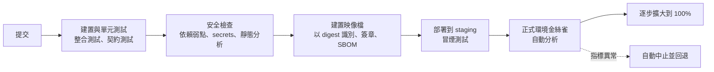

> **System Design 系列** Part 10-2｜上一篇：[大規模系統的測試](/post/systemdesign/testing-at-scale/)｜[系列地圖](/post/systemdesign/system-design-thinking/#系列地圖)

## 情境與問題

講座平台的 30 個服務每天部署十幾次。上一季和部署有關的事故：

1. **部署時刪了欄位**：新版本不再使用 `registration.member_id`，同一次部署的 migration 把欄位刪掉。滾動更新的過程中，還在執行的舊版本開始大量報錯
2. **無法回滾**：發現問題要回到上一版，但 migration 已經把資料轉換成新格式，舊版本讀不懂
3. **秒殺期間部署**：一次例行部署剛好在開賣前 5 分鐘，重新啟動的實例還在暖機，開賣的流量就進來了
4. **CI 的金鑰外洩**：CI 平台上存著一把長期有效的雲端存取金鑰，一個被入侵的第三方 CI 套件把它印到建置日誌裡

```diagram
title: 部署不是一瞬間的事
row: OLD 舊版本 | DB 資料庫 | NEW 新版本
row: CI CI 平台 | . | U 開賣流量
step: 部署時刪了欄位
  新版本不再使用 registration.member_id，同一次部署的 migration 把欄位刪掉。滾動更新的過程中，還在執行的舊版本開始大量報錯。
NEW -> DB: 刪掉 member_id
OLD -> DB: 讀 member_id [danger]
note OLD: 大量報錯 [danger]
step: 無法回滾
  發現問題要回到上一版，但 migration 已經把資料轉換成新格式，舊版本讀不懂。
OLD -> DB: 回滾後讀不懂 [danger]
note DB: 已轉成新格式 [danger]
step: 開賣前 5 分鐘部署
  一次例行部署剛好在開賣前 5 分鐘，重新啟動的實例還在暖機，開賣的流量就進來了。
U => NEW: 開賣流量 [danger]
note NEW: 重啟中，還在暖機 [danger]
step: CI 的金鑰外洩
  CI 平台上存著一把長期有效的雲端存取金鑰，一個被入侵的第三方 CI 套件把它印到建置日誌裡。
CI -> NEW: 部署
note CI: 長期金鑰印進日誌 [danger]
```

前三起的共同原因是：**部署不是一瞬間的事**。在滾動更新、金絲雀、回滾的過程中，新舊版本會同時在線上，同時讀寫同一個資料庫、同一個快取、同一個 topic。第四起則提醒我們：pipeline 本身就是能夠修改正式環境的系統，要以同等級的安全性看待。

## 最簡單的做法與它的極限

CI 測試通過之後，直接對正式環境的所有實例滾動更新，有問題再手動回滾：

- **影響範圍是 100%**：一個只在真實流量下出現的錯誤，同時影響所有使用者
- **靠人發現**：要等告警或客訴才知道有問題，這段時間持續造成損害
- **回滾比損害慢**：手動判斷、手動回滾，十幾分鐘就過去了；如果資料表已經變更，回滾甚至不可能
- **沒有考慮共存**：每次部署都假設「舊版本瞬間消失」，但實際上它們會共存幾分鐘到幾小時

## 核心機制

### Pipeline：建置一次，逐環境推進



- **建置一次**：同一個映像檔（以內容的 digest 識別，不是以可以被移動的 tag）從 staging 一路推進到正式環境。每個環境重新建置一次，就無法保證測試過的和上線的是同一個東西
- **設定在部署時注入**：環境之間的差異只有設定與 secrets，不在映像檔裡（[加密與 Secrets 篇](/post/systemdesign/encryption-secrets/)）
- **快速回饋**：提交到「測試結果」最好在 10 分鐘以內。慢的測試（負載測試、完整的安全掃描）放在每日或發布前，不擋每一次提交
- **每個階段都是一道關卡**：失敗就停，不靠人記得去看

### 部署與發布分開

- **部署**：新的程式碼在伺服器上執行
- **發布**：使用者看到新的功能

用**功能開關**把兩者分開：新功能的程式碼可以隨時部署，但預設關閉；之後再對內部員工、1% 的會員、全部會員逐步開啟。出問題時，關閉開關比回滾部署快得多，而且不影響同一次部署裡的其他修改。

功能開關的代價是程式碼裡的分支。每個開關都要有負責人與移除日期，全面開啟之後就把舊的分支刪掉，否則幾年後會有數百個沒有人敢動的開關。

### 部署策略

| 策略 | 做法 | 停機 | 回退速度 | 額外資源 | 新舊版本共存 |
|---|---|---|---|---|---|
| 重建（recreate） | 停掉全部舊版本，再啟動新版本 | 有 | 慢（要重新部署） | 無 | 不共存 |
| 滾動（rolling） | 逐批替換實例 | 無 | 中（再滾動一次） | 少量 | 共存，期間長短取決於批次 |
| 藍綠（blue-green） | 新版本完整部署在另一組環境，一次切換流量 | 無 | 快（切回去） | 兩倍 | 切換的瞬間；資料庫是共用的 |
| 金絲雀（canary） | 新版本先接一小部分流量，依指標逐步擴大 | 無 | 快（流量切回） | 少量 | 共存，而且刻意延長 |

講座平台的預設選擇是**金絲雀加上自動分析**：問題只影響一小部分流量，而且由機器判斷是否繼續。藍綠部署的回退最快，但兩倍的資源與共用資料庫的問題，讓它比較適合少數無法分批的系統。

注意藍綠部署並沒有避開共存的問題：兩組環境共用同一個資料庫，資料表的變更仍然要同時相容於藍、綠兩個版本。

### 新舊版本共存：expand–contract

事故 1 和 2 的解法是把一個不相容的變更，拆成**多次各自相容的部署**。以「把 `member_id` 改名為 `attendee_id`」為例：

| 階段 | 資料表 | 程式碼 | 這一步可以回退嗎 |
|---|---|---|---|
| 1. 擴充 | 新增 `attendee_id`，可為 NULL | 不變 | 可以，舊程式碼不知道新欄位 |
| 2. 雙寫 | — | 寫入兩個欄位，讀取仍然用 `member_id` | 可以，舊版本仍然讀寫 `member_id` |
| 3. 回填 | 分批把舊資料的 `member_id` 複製到 `attendee_id` | — | 可以 |
| 4. 讀新欄位 | — | 讀取改用 `attendee_id`，仍然雙寫 | 可以，回到階段 2 的版本 |
| 5. 停止寫舊欄位 | — | 只寫 `attendee_id` | 可以回到階段 4；更早的版本會讀到過時的 `member_id` |
| 6. 收縮 | 刪除 `member_id` | — | 不可以，所以放在最後，並且等前面的版本穩定一段時間 |

每一步都是一次獨立的部署，任何兩個相鄰版本同時在線上都不會出錯。這也適用於 API 與事件的欄位（[大規模系統的測試](/post/systemdesign/testing-at-scale/)的契約測試），以及**快取裡的資料**：新版本寫進 Redis 的物件多了一個欄位，舊版本讀取時如果因為不認得的欄位而失敗，滾動更新期間就會出現大量的快取讀取錯誤（[Cache 篇](/post/systemdesign/caching/)）。

大型資料表的結構變更還要注意鎖：MySQL 8.0.29 之後，新增與刪除欄位可以用 `ALGORITHM=INSTANT` 只修改中繼資料；需要重建資料表的變更（例如改變欄位型別），在數億列的資料表上要使用 gh-ost 這類線上變更工具，避免長時間的鎖與複寫延遲（[Replication 篇](/post/systemdesign/replication-lag/)）。

### 金絲雀與自動分析

金絲雀的每一步：

1. 新版本接 5% 的流量，等待一段時間（bake time）
2. 比較新版本與穩定版本的指標：錯誤率、p99 延遲、飽和度，以及**業務指標**（報名成功率、付款成功率）
3. 指標正常就擴大到 25%、50%、100%；任何一步異常就自動把流量切回穩定版本

幾個細節決定了金絲雀是否有效：

- **等待時間要夠長**：流量少的服務，5 分鐘可能只有幾十個請求，統計上看不出差異。等待時間依流量決定，或者以合成流量補足
- **和穩定版本比較，不是和固定的門檻比較**：晚上 8 點的錯誤率本來就比較高，固定的門檻會在尖峰時誤判，在離峰時漏判
- **同一位使用者固定在同一個版本**：否則使用者在新舊版本之間來回切換，前端與後端的版本不一致
- **實例的上下線要乾淨**：新實例通過 readiness 檢查才接流量；舊實例先從負載平衡器移除、處理完進行中的請求再結束。Spring Boot 4.1 的內嵌伺服器預設啟用 graceful shutdown，Kubernetes 還需要 preStop 的等待，處理移除與停止之間的時間差（[服務發現篇](/post/systemdesign/service-discovery/)）

### 回退與向前修正

- **預設回退**：發現問題時，先回到上一個已知良好的版本，再調查原因。前提是每一次部署都可以回退，這就是 expand–contract 要保證的
- **向前修正**：回退本身有風險時（例如資料已經以新格式寫入），改為快速部署修正版。這要求 pipeline 從提交到上線夠快
- **最快的回退是功能開關**：幾秒鐘就生效，不需要重新部署

### 部署的時機與節奏

- **凍結期**：大型活動（萬人講座開賣、年度課程上架）前後的一段時間，只允許緊急修正（事故 3）
- **錯誤預算**：服務的 SLO 錯誤預算用完時，暫停功能發布，只部署可靠性的修正（[可觀測性篇](/post/systemdesign/observability/)）
- **量測**：DORA 的四個關鍵指標：部署頻率、變更的前置時間、變更失敗率、失敗部署的恢復時間。目標不是「少部署以求穩定」，研究顯示頻繁、小批次的部署與穩定性是正相關的

## 方案比較

| 決策 | 選擇 | 放棄的替代方案與原因 |
|---|---|---|
| 產出物 | 建置一次，以 digest 推進 | 每個環境重新建置：測試過的和上線的不一定相同 |
| 部署策略 | 金絲雀 + 自動分析 | 一次滾動到 100%：影響範圍大、靠人發現 |
| 發布 | 功能開關 | 部署即發布：回退功能必須回退整個部署 |
| 資料表變更 | expand–contract，多次部署 | 一次完成：滾動更新期間舊版本報錯，而且無法回退 |
| 部署到叢集 | GitOps：pipeline 更新設定 repo，叢集內的代理程式拉取 | pipeline 直接持有叢集的管理權限：CI 被入侵等於叢集被入侵 |
| CI 的雲端權限 | OIDC 換取短期憑證 | 長期金鑰存在 CI：外洩後長期有效（事故 4） |

## Java 落地

### 1. expand–contract 的 migration 與雙寫

```sql
-- V42__add_attendee_id.sql（階段 1：只修改中繼資料，不重建資料表）
ALTER TABLE registration ADD COLUMN attendee_id BIGINT NULL, ALGORITHM=INSTANT;

-- V43__index_attendee_id.sql（線上建立索引；大型資料表改用線上變更工具）
CREATE INDEX idx_registration_attendee ON registration (event_id, attendee_id);
```

```java
@Repository
public class RegistrationWriter {

    private final JdbcClient jdbc;

    public RegistrationWriter(JdbcClient jdbc) {
        this.jdbc = jdbc;
    }

    // 階段 2 到 4：兩個欄位都寫，舊版本與新版本讀到的資料一致
    public void insert(long eventId, long attendeeId) {
        jdbc.sql("""
                        INSERT INTO registration (event_id, member_id, attendee_id)
                        VALUES (:eventId, :attendeeId, :attendeeId)
                        """)
                .param("eventId", eventId)
                .param("attendeeId", attendeeId)
                .update();
    }
}
```

```java
// 階段 3：分批回填，每批一個小交易，避免長交易與複寫延遲
@Component
public class AttendeeIdBackfill {

    private static final int BATCH = 2_000;
    private final JdbcClient jdbc;

    public AttendeeIdBackfill(JdbcClient jdbc) {
        this.jdbc = jdbc;
    }

    public void run() throws InterruptedException {
        long lastId = 0;
        while (true) {
            List<Long> ids = jdbc.sql("SELECT id FROM registration WHERE id > :last ORDER BY id LIMIT :batch")
                    .param("last", lastId).param("batch", BATCH)
                    .query(Long.class).list();
            if (ids.isEmpty()) {
                return;
            }
            long maxId = ids.getLast();
            jdbc.sql("""
                            UPDATE registration SET attendee_id = member_id
                             WHERE id > :last AND id <= :max AND attendee_id IS NULL
                            """)
                    .param("last", lastId).param("max", maxId)
                    .update();
            lastId = maxId;
            Thread.sleep(50);                       // 留時間給 replica 追上；依複寫延遲動態調整更好
        }
    }
}
```

- 以 keyset 切分批次（`id > :last`），不用 `OFFSET`（[批次與串流篇](/post/systemdesign/batch-vs-stream/)）
- `attendee_id IS NULL` 讓回填可以重跑：中斷後從頭再跑一次，已經回填的列不會被重複更新
- 雙寫的程式在回填開始之前就已經上線，所以回填期間新增的資料不會漏掉

### 2. 功能開關：穩定的百分比分流

```java
@Component
public class FeatureFlags {

    private final FlagStore store;               // 開關的設定，例如存在資料庫並快取幾秒鐘

    public FeatureFlags(FlagStore store) {
        this.store = store;
    }

    public boolean isEnabled(String flag, long memberId) {
        FlagConfig config = store.get(flag);
        if (config == null || config.killSwitch()) {
            return false;                        // 不存在或被緊急關閉：走舊的路徑
        }
        if (config.allowList().contains(memberId)) {
            return true;                         // 內部員工、測試帳號
        }
        // 同一位會員對同一個開關永遠落在同一個桶，不會在新舊行為之間來回切換
        return bucketOf(flag + ":" + memberId) < config.rolloutPercent();
    }

    private static int bucketOf(String key) {
        try {
            byte[] digest = MessageDigest.getInstance("SHA-256").digest(key.getBytes(StandardCharsets.UTF_8));
            return Math.floorMod(ByteBuffer.wrap(digest).getInt(), 100);     // 取前 4 個位元組
        } catch (NoSuchAlgorithmException e) {
            throw new IllegalStateException(e);                              // Java 平台規定一定要支援 SHA-256
        }
    }
}
```

- 雜湊值包含開關名稱，不同開關的 5% 不會總是同一批會員
- 用 SHA-256 而不是 `String.hashCode()`：兩者都穩定，但 `hashCode()` 的混合效果差，ID 連續的會員會落在相鄰的桶，不同開關選到的會員也只是互相平移。SHA-256 的輸出均勻，而且 Java 平台規定每個實作都必須支援
- 開關的變更要有稽核紀錄：誰在什麼時間把哪個開關改成多少

### 3. 金絲雀與自動分析（Argo Rollouts）

```yaml
apiVersion: argoproj.io/v1alpha1
kind: Rollout
metadata:
  name: registration-api
spec:
  # selector、template 與 Deployment 相同，這裡省略
  strategy:
    canary:
      analysis:
        templates:
          - templateName: success-rate
        startingStep: 1                 # 第一次切流量之後開始背景分析
        args:
          - name: service-name
            value: registration-api
      steps:
        - setWeight: 5
        - pause: {duration: 10m}
        - setWeight: 25
        - pause: {duration: 10m}
        - setWeight: 50
        - pause: {duration: 10m}
---
apiVersion: argoproj.io/v1alpha1
kind: AnalysisTemplate
metadata:
  name: success-rate
spec:
  args:
    - name: service-name
  metrics:
    - name: success-rate
      interval: 1m
      successCondition: result[0] >= 0.99
      failureLimit: 2                   # 失敗超過兩次就中止，流量回到穩定版本
      provider:
        prometheus:
          address: http://prometheus.monitoring:9090
          query: |
            sum(rate(http_server_requests_seconds_count{app="{{args.service-name}}",outcome!="SERVER_ERROR"}[2m]))
            /
            sum(rate(http_server_requests_seconds_count{app="{{args.service-name}}"}[2m]))
```

- 背景分析在金絲雀的整個過程中持續執行；任何時候失敗，Rollout 都會中止並把金絲雀的權重設回 0
- `http_server_requests_seconds_count` 是 Micrometer 的 HTTP 伺服器指標在 Prometheus 中的名稱，`app` 標籤假設由抓取設定從 Pod 的標籤加上
- 這個範例看的是整體的成功率；更精確的做法是分別查詢金絲雀與穩定版本的 Pod，比較兩者的差異，並加上 p99 延遲與業務指標

### 4. CI：OIDC 短期憑證與鎖定的依賴

```yaml
# .github/workflows/build.yml
name: build
on:
  push:
    branches: [main]

permissions:
  contents: read
  id-token: write                       # 以 OIDC 換取雲端的短期憑證，CI 不存放任何長期金鑰

jobs:
  build:
    runs-on: ubuntu-latest
    outputs:
      digest: ${{ steps.push.outputs.digest }}
    steps:
      - uses: actions/checkout@v5
      - uses: actions/setup-java@v5
        with:
          distribution: temurin
          java-version: '21'
      - run: ./mvnw -B verify            # 單元、整合（Testcontainers）、契約、授權回歸測試
      - uses: aws-actions/configure-aws-credentials@v4
        with:
          role-to-assume: arn:aws:iam::123456789012:role/ci-push-image
          aws-region: ap-northeast-1
      - uses: aws-actions/amazon-ecr-login@v2   # 用剛取得的短期憑證登入映像檔倉庫
      - id: push
        uses: docker/build-push-action@v6
        with:
          push: true
          tags: 123456789012.dkr.ecr.ap-northeast-1.amazonaws.com/registration-api:${{ github.sha }}
      # 之後的步驟：對 steps.push.outputs.digest 簽章、產生 SBOM，
      # 再把 digest 寫進 GitOps 設定 repo 的 staging 目錄，由叢集內的 Argo CD 拉取
```

- 第三方 action 用 tag 引用，但由 `.github/workflows/actions.lock` 鎖定到確切的 commit（以 `gh actions-lock` 產生）。lockfile 也涵蓋遞移的依賴，並在執行時驗證來源 repository；reusable workflow 不在 lockfile 的範圍內，要以完整的 commit SHA 引用
- 雲端的 IAM 角色只信任這個 repository、這個分支發出的 OIDC token，權限只有推送映像檔，不能部署
- 部署到正式環境由 GitOps 的設定 repo 控制，合併需要審核；pipeline 本身沒有叢集的權限

> 以上程式碼依 Spring Boot 4.1、MySQL 8.4（`ALGORITHM=INSTANT`）、Argo Rollouts 1.10 與 GitHub Actions 官方文件撰寫，沒有實際編譯與執行。`FlagStore`、`FlagConfig` 是示意的元件；workflow 中的帳號、角色與映像檔路徑都是範例值。

## 踩坑與 Gotchas

- **在同一次部署裡刪除舊版本還在用的欄位**：滾動更新期間舊版本報錯
- **不可逆的 migration 和程式碼一起上線**：回退變成不可能
- **快取與訊息的格式不相容**：新版本寫進去的資料，舊版本讀不懂
- **每個環境重新建置**：staging 測過的映像檔不是正式環境跑的那一個
- **用可移動的 tag 部署**：`latest` 或 `v1` 被重新指向之後，同一個部署設定跑出不同的程式碼
- **金絲雀的等待時間太短、流量太少**：統計上不顯著，問題直接擴大到 100%
- **和固定門檻比較**：尖峰時誤判、離峰時漏判
- **功能開關沒有移除日期**：舊的分支永遠留在程式碼裡，組合爆炸，沒有人知道哪些開關還在用
- **在大型活動前部署**：凍結期要寫進行事曆，而且由 pipeline 強制，而不是靠記憶

### 資安相關

Pipeline 能把任意程式碼送上正式環境，所以它本身就是攻擊目標：

| 攻擊 | 怎麼發生 | 防禦 |
|---|---|---|
| CI 的長期金鑰被竊 | 金鑰存在 CI 的變數裡，被惡意的建置步驟讀出（事故 4） | OIDC 換取短期憑證，角色只信任特定 repository 與分支，權限最小化 |
| 第三方 action 被竄改 | 攻擊者取得 action repository 的權限，把既有的 tag 指向惡意的 commit。2025 年 3 月的 `tj-actions/changed-files` 事件（CVE-2025-30066）就是這樣把大量 repository 的 secrets 印到建置日誌裡 | workflow 依賴的 lockfile，或以完整的 commit SHA 引用；限制允許使用的 actions |
| 不受信任的程式碼在有權限的環境執行 | `pull_request_target` 這類以目標 repository 權限執行的觸發條件，checkout 並執行了 fork 送來的程式碼 | 處理外部貢獻的 workflow 不使用 secrets、不執行 PR 的程式碼；需要時分成兩個 workflow |
| 惡意或被竄改的依賴套件 | 相依的函式庫被植入後門；內部套件名稱被搶先註冊在公開的套件庫（dependency confusion）；2024 年的 xz-utils 後門（CVE-2024-3094）則是維護者層級的長期滲透 | 透過內部的套件代理取得依賴並固定版本；依賴弱點掃描；SBOM 記錄每個映像檔包含了什麼 |
| 映像檔被替換 | 攻擊者推送同名的 tag 到映像檔倉庫 | 以 digest 部署；對映像檔簽章（例如 Sigstore），叢集只允許執行驗證過簽章與來源證明（SLSA provenance）的映像檔 |
| 繞過審核直接上線 | 開發者的帳號被盜，直接推送到主分支或手動觸發正式環境的部署 | 分支保護與必要的審核；正式環境的部署需要另一個人核准；部署紀錄寫入稽核日誌 |
| Secrets 外洩到日誌或映像檔 | 建置步驟印出環境變數；設定檔被打包進映像檔 | secrets 只在執行時由平台注入（[加密與 Secrets 篇](/post/systemdesign/encryption-secrets/)）；日誌遮罩；映像檔掃描 |

## 何時用／何時別用

- **滾動部署**：服務少、流量不大、團隊剛開始建立 pipeline 時的起點
- **金絲雀加上自動分析**：流量足以在短時間內看出統計差異，而且一次錯誤部署的代價高
- **藍綠部署**：需要瞬間切換與瞬間回退，而且負擔得起兩倍資源的系統
- **功能開關**：發布的時機與部署的時機不同，或者需要逐步對使用者開放時；不要用它來取代程式碼的清理
- **expand–contract**：任何會讓相鄰兩個版本不相容的變更，包含資料表、API、事件、快取格式
- **別過早引入**：GitOps、自動分析、簽章驗證都是要維運的系統。一個人維護的小專案，簡單的腳本加上可以回退的部署就夠了；當服務數量、部署頻率與團隊規模成長，再逐項加入

## 參考資料

- Jez Humble, David Farley, *Continuous Delivery*, Addison-Wesley, 2010
- Danilo Sato, "ParallelChange"：<https://martinfowler.com/bliki/ParallelChange.html>
- Pete Hodgson, "Feature Toggles (aka Feature Flags)"：<https://martinfowler.com/articles/feature-toggles.html>
- Argo Rollouts Documentation — Canary、Analysis & Progressive Delivery：<https://argoproj.github.io/argo-rollouts/>
- GitHub Docs — OpenID Connect、Secure use reference、Workflow dependency lockfiles：<https://docs.github.com/en/actions>
- Spring Boot Reference — Graceful Shutdown、Kubernetes Probes：<https://docs.spring.io/spring-boot/reference/>
- MySQL 8.4 Reference Manual — Online DDL Operations：<https://dev.mysql.com/doc/refman/8.4/en/innodb-online-ddl-operations.html>
- SLSA — Supply-chain Levels for Software Artifacts：<https://slsa.dev/>
- DORA — Four key metrics：<https://dora.dev/>
- 互動圖解延伸：Dilum Sanjaya，System Design — an interactive course：<https://designed-to-scale.vercel.app/>
