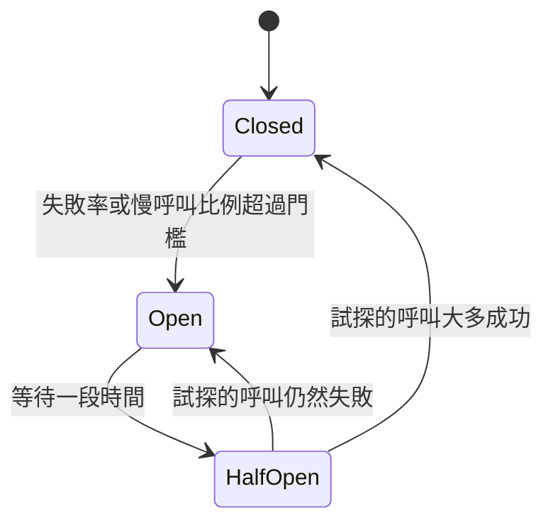
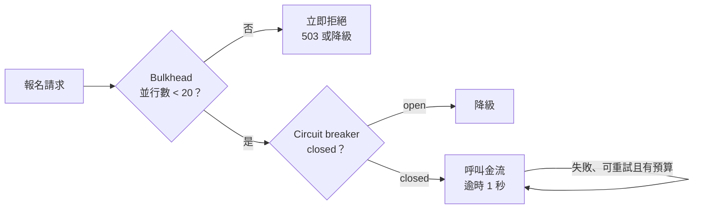

> **System Design 系列** Part 6-3｜上一篇：[Timeout、Retry、Backoff 與 Jitter](/post/systemdesign/timeout-retry-backoff/)｜下一篇：[Rate Limiting](/post/systemdesign/rate-limiting/)｜[系列地圖](/post/systemdesign/system-design-thinking/#系列地圖)

## 情境與問題

[上一篇](/post/systemdesign/timeout-retry-backoff/)替金流呼叫加上了 1 秒的逾時、有預算的重試。金流服務再次故障時，報名服務不再卡死了，但還有兩個問題：

1. **每個請求都要等滿 1 秒才失敗**。金流已經壞了 5 分鐘，報名服務仍然對每一個請求送出呼叫、等 1 秒、得到逾時。使用者每次都等 1 秒才看到錯誤，金流服務也持續收到請求，沒有喘息的機會
2. **慢的金流拖累了不相關的功能**。平常金流回應 50 毫秒，每秒 200 個報名請求，同時在等待金流的請求大約 200 × 0.05 = 10 個（[Little's Law](/post/systemdesign/latency-throughput/)）。金流變慢到 1 秒逾時，同時在等待的請求變成 200 個。它們佔住了執行緒、連到下游的連線、記憶體，查詢講座、登入這些完全不需要金流的功能也跟著變慢

```diagram
title: 金流壞掉或變慢時的報名服務
row: U 使用者 | REG 報名服務 | PAY 金流服務
step: 每個請求都等滿 1 秒
  金流已經壞了 5 分鐘，報名服務仍然對每一個請求送出呼叫、等 1 秒、得到逾時。使用者每次都等 1 秒才看到錯誤，金流也持續收到請求，沒有喘息的機會。
REG => PAY: 每個請求照樣呼叫 [danger]
note PAY: 已經壞了 5 分鐘 [danger]
note U: 等 1 秒才看到錯誤 [danger]
step: 平常：同時只有 10 個在等
  平常金流回應 50 毫秒，每秒 200 個報名請求，同時在等待金流的請求大約 200 × 0.05 = 10 個。
U => REG: 每秒 200 個報名
REG -> PAY: 50 毫秒 [ok]
note REG: 同時等待約 10 個 [ok]
step: 變慢到 1 秒：200 個在等
  金流變慢到 1 秒才逾時，同時在等待的請求變成 200 個，它們佔住了執行緒、連到下游的連線和記憶體。
REG => PAY: 1 秒才逾時 [danger]
note REG: 同時等待 200 個 [danger]
step: 不相關的功能也變慢
  查詢講座、登入這些完全不需要金流的功能，因為資源被佔住，也跟著變慢。
U -> REG: 查詢講座、登入 [danger]
note REG: 資源被金流的請求佔住 [danger]
note U: 也跟著變慢 [danger]
```

第一個問題由 **circuit breaker**（斷路器）解決：下游已知故障時，不要再呼叫它，直接失敗。第二個問題由 **bulkhead**（艙壁）解決：每個下游只能用掉有限的資源，一個下游出事，不會淹沒整艘船。

## 最簡單的做法與它的極限

- **手動開關**：金流故障時，工程師改設定關掉付款功能。反應要幾分鐘，而且要有人在半夜被叫起來；恢復時也要記得打開
- **加大執行緒池或改用虛擬執行緒**：虛擬執行緒讓「執行緒不夠」不再是瓶頸，但瓶頸只是往下移：200 個同時等待的請求仍然佔著連線、記憶體與上游的耐心。沒有上限的並行，等於把所有資源都押在最慢的那個下游上

## 核心機制

### Circuit breaker 的三個狀態



- **Closed**（關閉，電流通過）：正常呼叫，同時統計最近一段時間的結果
- **Open**（打開，電流切斷）：失敗率超過門檻，之後的呼叫**不送出**，直接拋出例外。失敗只要幾微秒，而不是等 1 秒逾時
- **Half-open**（半開）：等待一段時間後，放少量的呼叫過去試探。成功就回到 closed，失敗就再打開

斷路器同時保護兩邊：呼叫端不再浪費資源等待注定失敗的呼叫；下游少了大量請求，才有機會恢復。

### 統計什麼、統計多久

**滑動視窗**決定「最近」是多久：

- 依次數：最近 100 次呼叫
- 依時間：最近 10 秒內的所有呼叫。流量變化大的服務比較適合，因為「100 次」在尖峰是半秒，在離峰可能是半小時

**最少呼叫數**：視窗內呼叫太少時不做判斷。半夜只有 3 次呼叫、其中 2 次失敗，失敗率 67%，但這不代表下游壞了。

**慢呼叫也算故障**：下游沒有回錯誤，只是每個請求都花 900 毫秒，對呼叫端來說和故障一樣糟，甚至更糟，因為它佔用資源的時間更長。慢呼叫的門檻要比讀取逾時短，才能在逾時之前就察覺。

**只有下游的問題才算失敗**：連線錯誤、逾時、5xx 是下游的問題；400、404、422 是請求本身的問題，代表下游正常運作。把 4xx 算成失敗，一個傳錯參數的用戶端就能打開斷路器，讓所有人都無法付款（見資安相關）。

### 降級：斷路器打開之後做什麼

斷路器只負責「快速失敗」，失敗之後怎麼辦，要依功能的重要性決定：

| 功能 | 下游故障時的降級 |
|---|---|
| 個人化推薦 | 改顯示熱門講座清單（事先快取） |
| 剩餘名額 | 顯示快取的數字並標示「約」，報名時再以資料庫為準 |
| 付款 | 報名先成立為「待付款」，保留名額 15 分鐘，請使用者稍後完成付款 |
| 寄確認信 | 放進佇列，稍後再寄（[Message Queue 篇](/post/systemdesign/message-queue/)） |
| 權限檢查、詐欺偵測 | **不降級為放行**，直接拒絕（見資安相關） |

降級的方案要比原本的呼叫更便宜、更可靠，而且**不能依賴同一個故障的元件**。推薦服務故障時改去查資料庫做即時推薦，可能把故障擴散到資料庫。

### Bulkhead：限制每個下游能用掉的資源

船艙用隔板分成多個艙室，一個艙室進水，其他艙室不受影響。軟體的 bulkhead 是同一個概念：**每個下游有自己的資源上限**。

| 形式 | 做法 | 適合 |
|---|---|---|
| 並行數上限（semaphore） | 同時呼叫某個下游的數量有上限，超過就立即拒絕 | 大部分情況，特別是使用虛擬執行緒時 |
| 獨立的執行緒池 | 每個下游有自己的執行緒池 | 需要把呼叫和請求執行緒分開時 |
| 獨立的連線池 | 報表查詢用另一個資料庫連線池 | 慢查詢不會借光線上交易的連線 |
| 獨立的部署 | 後台、批次、對外 API 分開部署 | 一類流量暴增不影響另一類 |

上限用 Little's Law 估算：金流在尖峰每秒 200 個呼叫、p99 延遲 80 毫秒，同時在等待的呼叫約 200 × 0.08 = 16 個，上限設 20。金流變慢時，最多只有 20 個請求在等它；第 21 個請求立即被拒絕，不會佔用任何資源。查詢講座、登入完全不受影響。

**超過上限時要拒絕，不要排隊等待**。讓請求排隊等待名額，只是把「等金流」變成「等名額」，資源一樣被佔住。

### 組合起來



逾時與重試（上一篇）、circuit breaker、bulkhead 解決不同的問題，通常一起使用。重試要放在斷路器的外層，而且**不要重試「斷路器已打開」的例外**，否則斷路器打開後，重試迴圈仍然在空轉。

## 方案比較

| 機制 | 解決 | 不解決 |
|---|---|---|
| 逾時 | 單次呼叫不會無限等待 | 故障期間每個請求仍要等到逾時 |
| 重試 | 暫時性的失敗 | 持續的故障；用錯了會放大負載 |
| Circuit breaker | 持續故障時快速失敗，讓下游恢復 | 下游只是變慢、還沒超過門檻時的資源佔用 |
| Bulkhead | 一個下游的問題不擴散到其他功能 | 這個下游本身的故障 |
| 降級 | 故障時仍提供部分功能 | 需要事先設計，而且要測試 |
| Rate limiting（[下一篇](/post/systemdesign/rate-limiting/)） | 保護自己不被過多的請求壓垮 | 下游的故障 |

## Java 落地

這裡用 Resilience4j 不依賴框架的核心 API（`resilience4j-circuitbreaker`），以及 Spring Framework 7 內建的 `@ConcurrencyLimit`。Resilience4j 也有 Spring Boot 的整合模組，可以用設定檔與註解設定，但要確認它支援的 Spring Boot 版本。

### 1. 斷路器的設定

```java
@Configuration
public class CircuitBreakerSetup {

    @Bean
    CircuitBreakerRegistry circuitBreakerRegistry() {
        CircuitBreakerConfig downstream = CircuitBreakerConfig.custom()
                .slidingWindowType(CircuitBreakerConfig.SlidingWindowType.TIME_BASED)
                .slidingWindowSize(10)                                  // 統計最近 10 秒
                .minimumNumberOfCalls(20)                               // 呼叫太少時不判斷
                .failureRateThreshold(50)
                .slowCallDurationThreshold(Duration.ofMillis(800))      // 比讀取逾時 1 秒短
                .slowCallRateThreshold(50)
                .waitDurationInOpenState(Duration.ofSeconds(10))
                .permittedNumberOfCallsInHalfOpenState(5)
                .recordException(CircuitBreakerSetup::isDownstreamFailure)
                .build();
        return CircuitBreakerRegistry.of(downstream);
    }

    @Bean
    MeterBinder circuitBreakerMetrics(CircuitBreakerRegistry registry) {
        return TaggedCircuitBreakerMetrics.ofCircuitBreakerRegistry(registry);   // 狀態與失敗率輸出到 Micrometer
    }

    /** 只有下游本身的問題才算失敗。其他例外不算失敗，代表下游有正常回應。 */
    static boolean isDownstreamFailure(Throwable e) {
        if (e instanceof ResourceAccessException) {                             // 連線失敗、逾時
            return true;
        }
        return e instanceof RestClientResponseException response && response.getStatusCode().is5xxServerError();
    }
}
```

Resilience4j 的預設值是依次數統計最近 100 次、至少 100 次呼叫、失敗率 50%、打開後等 60 秒、慢呼叫的門檻 60 秒。慢呼叫的門檻預設 60 秒幾乎等於沒有作用，要依下游的延遲調整。

### 2. 不重要的功能：降級

```java
@Component
public class RecommendationClient {

    private static final Logger log = LoggerFactory.getLogger(RecommendationClient.class);

    private final RestClient restClient;
    private final CircuitBreaker circuitBreaker;
    private final PopularLectureCache popularLectures;

    public RecommendationClient(RestClient.Builder builder, CircuitBreakerRegistry registry,
                                PopularLectureCache popularLectures) {
        this.restClient = builder.baseUrl("https://recommendation.internal.example.com").build();
        this.circuitBreaker = registry.circuitBreaker("recommendation");
        this.popularLectures = popularLectures;
        this.circuitBreaker.getEventPublisher().onStateTransition(event ->
                log.warn("circuit breaker {}: {}", event.getCircuitBreakerName(), event.getStateTransition()));
    }

    public List<LectureCard> forMember(long memberId) {
        try {
            return circuitBreaker.executeSupplier(() -> restClient.get()
                    .uri("/v1/members/{id}/recommendations", memberId)
                    .retrieve()
                    .body(new ParameterizedTypeReference<List<LectureCard>>() {}));
        } catch (CallNotPermittedException | RestClientException e) {
            // 降級為所有人共用的熱門清單：不依賴推薦服務，也不會混到別人的個人化結果
            return popularLectures.top(10);
        }
    }
}
```

### 3. 重要的功能：bulkhead 加斷路器，快速失敗

```java
@Component
public class PaymentGateway {

    private final RestClient restClient;
    private final CircuitBreaker circuitBreaker;

    public PaymentGateway(RestClient.Builder builder, CircuitBreakerRegistry registry) {
        this.restClient = builder.baseUrl("https://payments.internal.example.com").build();
        this.circuitBreaker = registry.circuitBreaker("payment");
    }

    // 同時最多 20 個呼叫，超過立即拋出 InvocationRejectedException（需要 @EnableResilientMethods）
    @ConcurrencyLimit(limit = 20, policy = ConcurrencyLimit.ThrottlePolicy.REJECT)
    public ChargeResult charge(ChargeRequest request, String idempotencyKey) {
        return circuitBreaker.executeSupplier(() -> restClient.post()
                .uri("/v1/charges")
                .header("Idempotency-Key", idempotencyKey)
                .body(request)
                .retrieve()
                .body(ChargeResult.class));
    }
}
```

- `@ConcurrencyLimit` 的預設行為是**等待**名額，`REJECT` 從 Spring Framework 7.0.3 起才支援。bulkhead 要的是快速失敗，所以明確指定
- `@ConcurrencyLimit` 包在外層，斷路器在內層：斷路器打開時，呼叫在幾微秒內就失敗並歸還名額

報名服務收到這兩種例外時，依前面的降級表，把報名建立為「待付款」：

```java
@Service
public class CheckoutService {

    private final PaymentGateway payments;
    private final RegistrationService registrations;

    public CheckoutService(PaymentGateway payments, RegistrationService registrations) {
        this.payments = payments;
        this.registrations = registrations;
    }

    public CheckoutResult checkout(long registrationId, ChargeRequest charge, String idempotencyKey) {
        try {
            ChargeResult result = payments.charge(charge, idempotencyKey);
            registrations.markPaid(registrationId, result.chargeId());
            return CheckoutResult.paid(registrationId);
        } catch (CallNotPermittedException | InvocationRejectedException unavailable) {
            // 確定沒有送出扣款：保留名額，請使用者稍後付款
            registrations.holdForPayment(registrationId, Duration.ofMinutes(15));
            return CheckoutResult.pendingPayment(registrationId);
        }
    }
}
```

只有在**確定請求沒有送出**時（斷路器拒絕、bulkhead 拒絕），才能安心地當成「沒有扣款」。如果是讀取逾時，扣款可能已經成功，要用同一個 Idempotency Key 查詢或重送，而不是直接當成失敗。

> 以上程式碼依 Resilience4j 2.4 與 Spring Framework 7 官方文件撰寫，沒有實際編譯與執行。

## 踩坑與 Gotchas

- **最少呼叫數太小**：低流量時，幾次偶發的失敗就讓斷路器打開，然後在 open 與 half-open 之間來回跳
- **整個服務共用一個斷路器**：金流服務只有退款 API 壞了，卻連付款也一起被擋。依端點或功能分開
- **把 4xx 算成失敗**：用戶端的錯誤讓斷路器打開
- **降級從來沒測試過**：降級的程式碼只在故障時執行，平常沒人跑過，故障那天才發現它也是壞的。可以定期強制打開斷路器演練
- **降級去呼叫另一個昂貴的依賴**：故障從一個服務擴散到另一個
- **bulkhead 讓請求排隊**：`@ConcurrencyLimit` 預設是等待，達不到隔離的效果
- **上限依平均延遲估算**：要用尖峰流量與 p99 延遲估算，否則正常的尖峰就被拒絕
- **斷路器的狀態放進 liveness probe**：下游故障時，每一台都被判定為不健康而重啟，問題沒有解決，反而讓自己也停擺（[Load Balancing 篇](/post/systemdesign/load-balancing/)的健康檢查）
- **每台伺服器各自判斷**：每台都有自己的斷路器，20 台各自送出 half-open 的試探呼叫。通常這是可以接受的，但要知道下游會同時收到 20 × 5 個試探
- **斷路器打開時沒有告警**：降級讓使用者幾乎沒感覺，但一個功能其實已經停擺。狀態變化要記錄並告警

### 資安相關

- **攻擊者可以打開你的斷路器**：如果某些輸入會讓下游回 500（例如特殊字元觸發下游的 bug、超大的查詢條件），攻擊者只要重複送這些請求，就能讓失敗率超過門檻，斷路器為**所有使用者**打開。對策：只統計下游健康相關的失敗；請求先在自己這一端驗證，不把明顯無效的輸入送到下游；依租戶或使用者分開統計重要的斷路器
- **安全相關的依賴不能降級為放行**：授權服務、詐欺偵測、速率限制服務故障時，「斷路器打開就跳過檢查」等於讓攻擊者只要先打掛這些服務，就能繞過防護。這些依賴的降級一律是拒絕（fail closed），或改為人工審核
- **降級的快取資料也要遵守權限**：降級時回傳快取的資料，快取的 key 必須包含使用者或權限範圍。用共用的 key 快取個人化的回應，降級時可能把 A 的資料回給 B
- **錯誤訊息不要洩漏內部結構**：回應「推薦服務 recommendation.internal 的斷路器已打開」等於告訴攻擊者內部服務的名稱與狀態。對外只回傳一般的 503 與重試時間
- **昂貴的端點要有自己的 bulkhead**：匯出報表、全文搜尋這類昂貴的端點，如果和一般 API 共用資源，攻擊者只要大量呼叫它們就能拖垮整個服務。替它們設定獨立而且較小的並行數上限
- **後台與對外流量分開**：對外 API 被大量請求淹沒時，維運人員仍然要能登入後台處理事故。後台用獨立的部署或資源池

## 何時用／何時別用

- **用 circuit breaker**：呼叫外部服務或其他團隊的服務，下游可能長時間故障，而且有合理的降級方案或快速失敗比等待更好
- **用 bulkhead**：一個服務依賴多個下游，或同時有便宜與昂貴的端點，特別是使用虛擬執行緒、執行緒數不再是天然上限的時候
- **別用**：呼叫同一個程序內的程式碼；只有一個依賴而且沒有降級方案時，斷路器的價值有限（仍然可以快速失敗，但要評估增加的複雜度）；資料庫這類本來就有連線池上限的資源，先調好連線池與逾時

## 參考資料

- Michael T. Nygard, *Release It! Design and Deploy Production-Ready Software*, 2nd Edition, Pragmatic Bookshelf, 2018（Circuit Breaker、Bulkhead 等穩定性模式）
- Martin Fowler, "CircuitBreaker", 2014：<https://martinfowler.com/bliki/CircuitBreaker.html>
- Resilience4j Documentation — CircuitBreaker：<https://resilience4j.readme.io/docs/circuitbreaker>
- Spring Framework Reference — Resilience Features（`@ConcurrencyLimit`）：<https://docs.spring.io/spring-framework/reference/core/resilience.html>
- AWS Builders' Library — Using load shedding to avoid overload：<https://aws.amazon.com/builders-library/using-load-shedding-to-avoid-overload/>
- Google, *Site Reliability Engineering*, Chapter 22 "Addressing Cascading Failures"：<https://sre.google/sre-book/addressing-cascading-failures/>
- 互動圖解延伸：Dilum Sanjaya，System Design — an interactive course：<https://designed-to-scale.vercel.app/>
