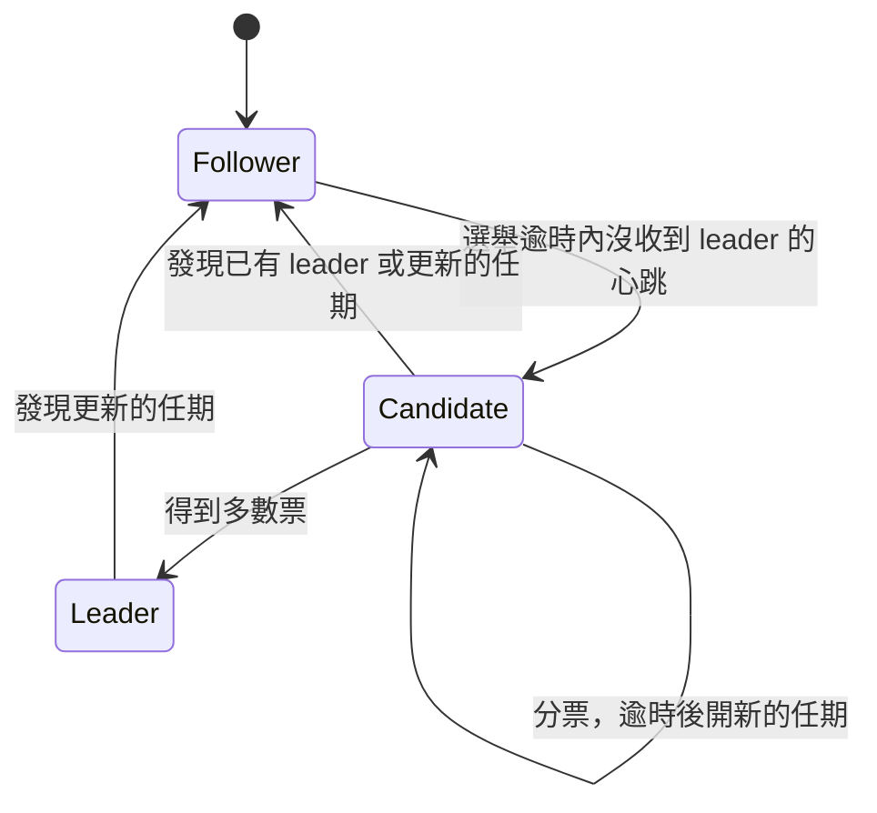
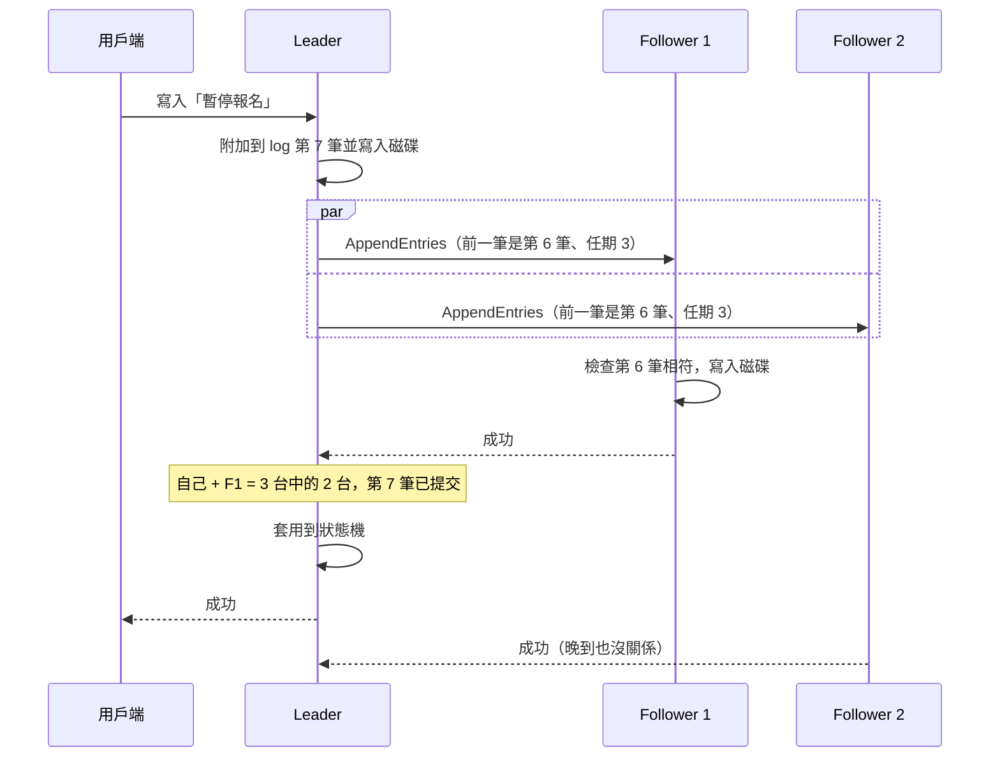

> **System Design 系列** Part 4-6｜上一篇：[CAP 與 PACELC](/post/systemdesign/cap-pacelc/)｜下一篇：[分散式鎖與 Fencing Token](/post/systemdesign/distributed-lock/)｜[系列地圖](/post/systemdesign/system-design-thinking/#系列地圖)

## 情境與問題

講座平台有三個問題，看起來不相關：

1. **排程只能跑一份**：每分鐘寄出「講座即將開始」通知的排程，部署了 3 個實例，三個都跑就會寄三封
2. **主資料庫切換**：MySQL primary 當機，要把某一台 replica 升為新的 primary。誰來決定？如果網路分割，兩邊各自選出一台 primary，就會 split brain
3. **設定要一致**：「暫停報名」的開關改了之後，所有實例都要看到同一個值，不能有的實例還在接受報名

```diagram
title: 三個看起來不相關的問題
row: A1 實例 1 | A2 實例 2 | A3 實例 3
row: R1 Replica 1 | P Primary | R2 Replica 2
step: 排程只能跑一份
  每分鐘寄出「講座即將開始」通知的排程部署了 3 個實例，三個都跑，同一位學員就收到三封。
note A1: 寄通知
note A2: 也寄通知 [danger]
note A3: 也寄通知 [danger]
step: 主資料庫當機
  MySQL primary 當機了，要把某一台 replica 升為新的 primary。誰來決定？
note P: 當機 [danger]
note R1: 我升級？
note R2: 還是我升級？
step: 網路分割，兩個 primary
  如果網路剛好分割，兩邊各自選出一台 primary，兩邊都接受寫入，資料就分岔了。這叫 split brain。
A1 -> R1: 寫入 [danger]
A3 -> R2: 寫入 [danger]
note R1: 我是 primary [danger]
note R2: 我也是 primary [danger]
step: 設定要一致
  「暫停報名」的開關改了之後，所有實例都要看到同一個值，不能有的實例還在接受報名。
note A1: 暫停報名：是
note A2: 暫停報名：是
note A3: 暫停報名：否 [danger]
step: 同一個問題
  三個問題的本質相同：一群機器，在部分機器當機、網路會延遲或中斷時，對同一個值達成一致。
note A1: 誰來跑？
note A2: 現在的值是什麼？
note P: 誰是 primary？
```

三個問題的本質相同：**一群機器，在部分機器當機、網路會延遲或中斷的情況下，對同一個值達成一致**。這就是共識（consensus）。

## 最簡單的做法與它的極限

- **指定一台協調者**：由單一的 Redis 或資料庫的一列決定誰是 leader。協調者當機，就沒有人能被選出；協調者如果用非同步複寫做備援，切換時可能遺失「誰是 leader」的紀錄，又出現兩個 leader
- **互相發心跳，聯絡不上就自己接手**：網路分割時兩邊都聯絡不上對方，兩邊都接手，正是 split brain
- **兩階段提交（2PC）**：它解決的是「所有參與者一起提交或一起放棄」，不是共識。協調者在第二階段前當機，參與者只能一直等

這些做法共同的缺陷是：**沒有一個機制保證「同時只有一方能做決定」**。共識演算法用多數決提供這個保證。

## 核心機制

### 多數決：為什麼是 2f + 1

任意兩個多數派一定至少有一台重疊。只要每個決定都要多數同意，兩個互相矛盾的決定就不可能同時成立：其中重疊的那一台不會同意兩次。

| 節點數 | 多數 | 可容忍的故障數 |
|---|---|---|
| 1 | 1 | 0 |
| 2 | 2 | 0 |
| 3 | 2 | 1 |
| 4 | 3 | 1 |
| 5 | 3 | 2 |
| 6 | 4 | 2 |
| 7 | 4 | 3 |

要容忍 f 台故障，需要 2f + 1 台。偶數台沒有好處：4 台和 3 台都只能容忍 1 台故障，卻多了一台要等確認、多一台可能故障。實務上用 3 台或 5 台。

注意這裡的「故障」指當機或聯絡不上，不包含**說謊**的節點。Raft、Paxos 都假設節點不會惡意送出錯誤的訊息（見資安相關）。

### Replicated state machine

Raft 解決的是：讓每台機器有一份相同的**指令 log**。每台機器從同一個初始狀態開始，依相同順序執行相同的指令，就會得到相同的狀態。共識的對象是「log 的第 N 筆是什麼」。

Raft 把問題拆成三部分：選出 leader、由 leader 複製 log、保證安全性。

### 角色與任期



- **任期（term）**是一個只增不減的整數，每個任期最多只有一個 leader。任期就是 Raft 的邏輯時鐘：任何節點收到帶著更大任期的訊息，就更新自己的任期，如果自己是 leader 或 candidate，立刻退回 follower
- **Leader** 處理所有寫入，並定期送出心跳
- **Follower** 被動接收 leader 的 log 與心跳

### Leader 選舉

1. Follower 在**選舉逾時**內沒收到心跳，就把任期加 1、成為 candidate、投自己一票，並向其他節點送出 RequestVote
2. 每個節點在每個任期**只投一票**，先到先得，而且只投給 log **至少和自己一樣新**的 candidate：先比最後一筆的任期，任期相同再比長度。這條限制是安全性的關鍵，後面會說明
3. 得到多數票就成為 leader，立刻送出心跳，讓其他 candidate 退回 follower
4. 沒有人得到多數票（分票），就等逾時後開新的任期重選

每個節點的選舉逾時是**在一個範圍內隨機選的**。如果逾時固定，leader 當機後所有 follower 幾乎同時逾時、同時參選、互相分票，下一輪又同時逾時，可能一直選不出來。隨機化讓通常只有一台先逾時，它在其他節點逾時之前就收齊選票。

逾時的設定要滿足：**廣播時間 ≪ 選舉逾時 ≪ 平均故障間隔**。逾時太短，網路稍有延遲就誤判 leader 當機，leader 頻繁更換；太長，leader 真的當機時要等很久才換人，期間無法寫入。etcd 的預設值是心跳 100 毫秒、選舉逾時 1,000 毫秒，官方建議心跳設為成員之間 RTT 的 0.5 到 1.5 倍、選舉逾時至少是 RTT 的 10 倍，而且所有成員的設定要相同。

### Log 複製



- 每筆 log 記錄任期、位置與指令
- Leader 送出新的 log 時，附上**前一筆的位置與任期**。Follower 的前一筆對不上就拒絕，leader 往前退一筆再試，直到找到雙方一致的位置，然後用 leader 的內容覆蓋 follower 之後的部分。因此只要兩份 log 在某個位置的任期相同，那個位置之前的內容就完全相同
- 一筆 log 存到**多數節點的磁碟**上，就是**已提交**（committed），leader 才套用到狀態機並回覆用戶端。Follower 從之後的訊息得知提交的位置，各自套用

每次寫入至少要等：leader 寫入磁碟、送到 follower、follower 寫入磁碟、回覆。所以共識系統對磁碟的寫入延遲非常敏感。

### 安全性：為什麼已提交的資料不會被覆蓋

**選舉限制**保證新的 leader 一定擁有所有已提交的 log：已提交的 log 存在多數節點上，當選需要多數票，兩個多數派至少重疊一台；那一台擁有這筆 log，只會投給 log 至少和它一樣新的 candidate。

但還有一個不直觀的細節：**leader 不能只因為舊任期的一筆 log 已經複製到多數節點，就認定它已提交**。用 5 台機器 S1 到 S5 的例子說明，表格是每台 log 第 2 筆的內容與任期：

| 步驟 | 發生的事 | S1 | S2 | S3 | S4 | S5 |
|---|---|---|---|---|---|---|
| 1 | 任期 2：S1 是 leader，寫入 X，只送到 S2 就當機 | X(2) | X(2) | | | |
| 2 | 任期 3：S5 得到 S3、S4、S5 的票當選，在本地寫入 Y，還沒送出就當機 | X(2) | X(2) | | | Y(3) |
| 3 | 任期 4：S1 重啟，得到 S1、S2、S3 的票當選，把 X 補送到 S3 | X(2) | X(2) | X(2) | | Y(3) |

第 3 步之後，X 已經在 3 台上，是多數。**如果 S1 這時就認定 X 已提交**並回覆用戶端，接著當機：

| 步驟 | 發生的事 | S1 | S2 | S3 | S4 | S5 |
|---|---|---|---|---|---|---|
| 4 | 任期 5：S5 重啟。它最後一筆的任期是 3，比 S2、S3（2）和 S4（1）都新，得到多數票當選，用 Y 覆蓋其他節點的第 2 筆 | Y(3) | Y(3) | Y(3) | Y(3) | Y(3) |

已經回覆成功的 X 消失了。Raft 的規則是：**leader 只用「複製到多數節點」來提交自己任期的 log**。S1 在任期 4 要先寫入一筆任期 4 的 log（例如一筆空指令），等它複製到多數節點，這一筆和它之前的 X 才一起提交。之後多數節點的最後一筆是任期 4，S5（任期 3）就不可能再當選。

這也是新的 leader 上任時會先寫一筆空指令的原因。etcd 的 Raft 實作中，新 leader 在提交自己任期的第一筆 log 之前，會暫緩處理需要確認一致性的讀取請求。

### 讀取也要確認

直接讀 leader 的本地狀態不一定是最新的：一個被網路分割隔離的舊 leader，並不知道另一邊已經選出新的 leader 並接受了新的寫入，它還會自認是 leader，回覆舊資料。

| 做法 | 怎麼做 | 代價 |
|---|---|---|
| 讀取也寫進 log | 讀取當成一筆 log，提交後才回覆 | 每次讀取都要寫磁碟，最慢 |
| ReadIndex | Leader 記下目前的提交位置，向多數節點確認自己仍是 leader，等狀態機套用到該位置後讀取本地資料 | 每次讀取多一輪網路往返，不寫磁碟 |
| Lease read | Leader 在租約期間內假設自己仍是 leader，直接讀取本地資料 | 最快，但**依賴所有機器的時鐘**誤差有上限 |
| Follower read | Follower 向 leader 取得 ReadIndex，等自己套用到該位置後讀取本地資料 | 分散 leader 的讀取負擔 |

etcd 的讀取預設是 linearizable，要經過 Raft 確認；也可以指定 **serializable**，只讀連線的那一台的本地資料，延遲低、失去 quorum 時仍可回覆，但可能是舊的。這就是 [PACELC](/post/systemdesign/cap-pacelc/) 的取捨落在單一 API 參數上。

### 成員變更

從 3 台擴充到 5 台時，如果每台在不同時間點切換設定，可能出現「舊設定的多數」和「新設定的多數」互不重疊，兩邊各自選出 leader。Raft 的解法是一次只增減一台（任意相鄰兩種設定的多數一定重疊），或使用聯合共識（joint consensus）過渡。

etcd 在 3.4 之後支援 **learner**：新成員先以不投票的身分加入、追上 leader 的 log，再升級為投票成員。如果新成員直接以投票身分加入，在它追上之前，叢集的多數門檻已經提高，卻多了一台拖慢提交的成員。etcd 的 `--strict-reconfig-check` 預設開啟，會拒絕會讓叢集失去 quorum 的成員變更。

### 被隔離的節點回來時

一台 follower 被網路隔離，收不到心跳，就會一直逾時、一直把任期加 1。網路恢復後，它帶著很大的任期回來，讓正常運作的 leader 看到更大的任期而退位，引發一次不必要的選舉。

- **PreVote**：參選之前先詢問其他節點「如果我參選，你會投給我嗎」，這一步不增加任期。其他節點最近還收得到 leader 的心跳，就拒絕。etcd 3.5 起 `--pre-vote` 預設開啟
- **CheckQuorum**：leader 在一個選舉逾時內沒有收到多數節點的回應，就主動退位。被隔離在少數派的舊 leader 不會一直以為自己是 leader。etcd 的 Raft 程式庫提供這個選項

### 理論的界線

FLP 定理（1985）證明：在訊息延遲沒有上限的非同步系統中，只要有一台可能當機，就沒有確定性的演算法能**保證**一定在有限時間內達成共識。Raft 的取捨是：**安全性永遠成立**（不會有兩個不同的值被提交在同一個位置），**進度則依賴時間假設**（網路延遲夠穩定時才選得出 leader）。網路非常不穩定時，Raft 會選不出 leader、停止寫入，但不會寫錯。

## 方案比較

### 共識演算法

| 演算法 | 使用者 | 特色 |
|---|---|---|
| Raft | etcd、Consul、Kafka（KRaft）、TiKV、CockroachDB | 為了容易理解而設計，強勢 leader，實作與文件最多 |
| Multi-Paxos | Google Chubby、Spanner | 最早被證明正確的方案，變形很多，各家實作差異大 |
| ZAB | ZooKeeper | 和 Raft 相似的強勢 leader 設計 |
| Paxos 變形 | MySQL Group Replication | 內建在資料庫的複寫裡 |

TiKV、CockroachDB 這類分散式資料庫把資料切成許多區段，**每個區段各自是一個 Raft group**（multi-Raft），用 [Sharding](/post/systemdesign/sharding/) 突破單一 leader 的寫入上限。

### 用現成的服務，不要自己實作

Raft 的論文很好讀，但正確實作要處理磁碟寫入失敗、快照、成員變更、各種訊息重排與重送的組合，這些都很難測試。應用程式需要共識時，用 etcd、ZooKeeper 或 Consul；只需要「排程只跑一份」，而且已經有資料庫時，用資料庫的一列當鎖（例如 ShedLock）通常就夠了，下一篇會比較兩者。

### 叢集的大小與擺放

| 配置 | 可容忍 | 寫入延遲 |
|---|---|---|
| 3 台，同一個可用區 | 1 台故障 | 最低，但可用區故障時全部失效 |
| 3 台，3 個可用區各 1 台 | 1 台或 1 個可用區故障 | 每次寫入要等另一個可用區 |
| 5 台，3 個可用區 2/2/1 | 2 台或 1 個可用區故障 | 同上，多數派可以由兩個可用區湊成 |
| 跨區域 | 1 個區域故障 | 每次寫入至少要等一次跨區域往返 |

寫入延遲取決於「leader 到第 (多數 - 1) 近的 follower」的往返時間，再加上磁碟寫入。

## Java 落地

### 1. 讓排程只在 leader 執行

etcd 內建選舉 API：每個實例取得一個有 TTL 的 lease，用這個 lease 參選；當選的實例持續續約，停止續約（當機、斷線、長時間 GC）時 lease 到期，leadership 自動轉給下一個參選者。

```java
import static java.nio.charset.StandardCharsets.UTF_8;

import io.etcd.jetcd.ByteSequence;
import io.etcd.jetcd.Client;
import io.etcd.jetcd.election.LeaderKey;
import io.etcd.jetcd.lease.LeaseKeepAliveResponse;
import io.etcd.jetcd.support.CloseableClient;
import io.grpc.stub.StreamObserver;
import java.util.Optional;
import java.util.concurrent.CountDownLatch;
import java.util.concurrent.ExecutionException;

/** 每個實例都參選，只有當選的那一個回傳 leadership。 */
public class EtcdLeadership implements AutoCloseable {

    private static final long LEASE_TTL_SECONDS = 10;

    private final Client client;
    private final ByteSequence election;
    private final ByteSequence instanceId;
    private final Thread campaigner;
    private volatile LeaderKey leadership;                  // null 表示目前不是 leader

    public EtcdLeadership(Client client, String electionName, String instanceId) {
        this.client = client;
        this.election = ByteSequence.from(electionName, UTF_8);
        this.instanceId = ByteSequence.from(instanceId, UTF_8);
        this.campaigner = Thread.ofVirtual().name("campaign-" + electionName).start(this::campaignForever);
    }

    public Optional<LeaderKey> current() {
        return Optional.ofNullable(leadership);
    }

    private void campaignForever() {
        while (!Thread.currentThread().isInterrupted()) {
            try {
                campaignOnce();
            } catch (InterruptedException e) {
                Thread.currentThread().interrupt();
            } catch (ExecutionException e) {
                pause();                                    // 連不上 etcd，稍後重新參選
            }
        }
    }

    private void campaignOnce() throws InterruptedException, ExecutionException {
        long leaseId = client.getLeaseClient().grant(LEASE_TTL_SECONDS).get().getID();
        CountDownLatch lost = new CountDownLatch(1);
        CloseableClient keepAlive = client.getLeaseClient().keepAlive(leaseId, signalOnFailure(lost));
        try {
            // 阻塞到當選為止，等待期間 lease 持續續約
            leadership = client.getElectionClient().campaign(election, leaseId, instanceId).get().getLeader();
            lost.await();                                   // 續約出錯或串流結束，一律當作失去 leadership
        } finally {
            leadership = null;
            keepAlive.close();
            client.getLeaseClient().revoke(leaseId);        // 讓其他實例立刻接手，不必等 TTL 到期
        }
    }

    private static StreamObserver<LeaseKeepAliveResponse> signalOnFailure(CountDownLatch lost) {
        return new StreamObserver<>() {
            @Override
            public void onNext(LeaseKeepAliveResponse response) {
            }

            @Override
            public void onError(Throwable error) {
                lost.countDown();
            }

            @Override
            public void onCompleted() {
                lost.countDown();
            }
        };
    }

    private static void pause() {
        try {
            Thread.sleep(1_000);
        } catch (InterruptedException e) {
            Thread.currentThread().interrupt();
        }
    }

    @Override
    public void close() {
        campaigner.interrupt();
    }
}
```

排程每次執行前檢查 leadership，並把 leader key 的 revision 傳下去：

```java
@Component
public class LectureReminderJob {

    private final EtcdLeadership leadership;
    private final ReminderService reminderService;

    public LectureReminderJob(EtcdLeadership leadership, ReminderService reminderService) {
        this.leadership = leadership;
        this.reminderService = reminderService;
    }

    @Scheduled(fixedDelay = 60_000)
    public void run() {
        leadership.current().ifPresent(key -> reminderService.sendUpcoming(key.getRevision()));
    }
}
```

- 續約串流出錯不一定代表 lease 已經失效（jetcd 會自動重新建立串流），這裡一律當作失去 leadership、重新參選。寧可短暫沒有 leader，也不要兩個實例都以為自己是 leader
- `getRevision()` 是 leader key 在 etcd 裡建立時的 revision。etcd 的 revision 全域遞增，後當選的 leader 的 revision 一定比較大。下一篇會用它當 fencing token

### 2. 依用途選擇讀取的一致性

```java
KV kv = client.getKVClient();
ByteSequence key = ByteSequence.from("/config/registration-paused", UTF_8);

// 預設是 linearizable：經過 Raft 確認，一定讀到最新的值；叢集失去 quorum 時會失敗
GetResponse latest = kv.get(key).get();

// serializable：只讀連線的那一台的本地資料，可能是舊的；失去 quorum 時仍然可以回覆
GetResponse local = kv.get(key, GetOption.builder().withSerializable(true).build()).get();
```

「暫停報名」這種要立刻生效的開關，用 linearizable 讀取；介面的顯示設定這類晚幾秒生效也無妨的資料，用 serializable 讀取，etcd 部分故障時仍然讀得到。

> 以上程式碼依 jetcd 0.8.8 的 API 與 etcd 官方文件撰寫，沒有連線到實際的 etcd 執行。

## 踩坑與 Gotchas

- **Leader election 不等於互斥**：實例 A 檢查完 leadership 之後進入長時間的 GC，lease 到期，實例 B 當選並開始寄信；A 醒來後繼續寄完它那一批。檢查與執行之間永遠有時間差。下游要能拒絕舊 leader 的操作（fencing token），或讓操作冪等（例如寄送紀錄加上唯一索引），下一篇詳談
- **偶數個節點**：4 台和 3 台的容錯能力相同，只多了延遲與故障點
- **磁碟太慢**：etcd 每次寫入都要寫磁碟。磁碟寫入延遲高時，leader 來不及送出心跳，follower 逾時發起選舉，leader 頻繁更換。官方強烈建議用 SSD，並監控 `etcd_disk_wal_fsync_duration_seconds` 與 `etcd_disk_backend_commit_duration_seconds`
- **跨區域部署沿用預設逾時**：RTT 數十到數百毫秒時，1 秒的選舉逾時太短，網路稍有波動就重新選舉。依 RTT 調整，所有成員的設定要相同
- **把 etcd 當資料庫**：etcd 預設的儲存上限是 2 GB，官方建議不超過 8 GB。它適合放少量、需要強一致的協調資料，不適合放業務資料
- **一次加入多台新成員**：新成員追上 log 之前不該投票。用 learner 加入，追上之後再升級，一次一台
- **永久失去多數節點**：5 台中有 3 台的磁碟毀損，叢集再也無法達成共識，只能從快照重建。定期備份快照，並演練還原
- **寫入逾時不代表失敗**：用戶端逾時時，那筆寫入可能已經提交。重試要是冪等的

### 資安相關

- **Raft 不防惡意節點**：Raft 只容忍當機與網路問題，假設每個節點都誠實。一台被入侵的成員可以送出極大的任期、不斷干擾選舉；當選之後可以寫入任意 log，其他節點照單全收。成員之間的通訊要用 mTLS（etcd 的 `--peer-client-cert-auth`），只有持有叢集 CA 簽發憑證的機器才能加入。需要對抗惡意參與者的場景（例如跨組織的帳本），要用 PBFT 這類拜占庭容錯協定，容忍 f 個惡意節點需要 3f + 1 台
- **etcd 存的是整個系統的鑰匙**：Kubernetes 把所有狀態、包括 Secrets 都存在 etcd。用戶端連線也要驗證憑證（`--client-cert-auth`），啟用 RBAC（`etcdctl auth enable`），2379、2380 埠不要對外開放
- **選舉的 key 也要授權**：任何能寫入選舉 key 前綴的用戶端，都可以參選搶走 leadership，或刪除目前 leader 的 key 讓 leadership 轉移。用 RBAC 把選舉前綴的寫入權限只給需要的服務帳號
- **快照與備份是完整的資料副本**：etcd 的快照包含所有資料。Kubernetes 沒有啟用 Secrets 的靜態加密時，快照裡的 Secrets 只是 base64 編碼。備份檔要加密、限制存取，存放位置的權限和 etcd 本身一樣嚴格
- **分割期間要 fail closed**：失去 quorum 時，linearizable 讀取會失敗。權限、帳號狀態這類資料不要因此改用 serializable 讀取繼續放行（[CAP 與 PACELC 篇](/post/systemdesign/cap-pacelc/)）

## 何時用／何時別用

- **用共識服務**：leader election、主資料庫切換、設定與服務註冊、分散式鎖的基礎，也就是少量、出錯代價很高、需要強一致的協調資料
- **別用**：大量的業務資料、高吞吐量的寫入（每筆寫入都要經過 leader 與多數節點的磁碟）
- **別自己實作 Raft**：除非你在開發資料庫或協調服務本身
- **先考慮更簡單的做法**：只需要排程只跑一份，而且已經有資料庫時，資料庫的鎖通常就夠了

## 參考資料

- Diego Ongaro, John Ousterhout, "In Search of an Understandable Consensus Algorithm (Extended Version)", USENIX ATC 2014：<https://raft.github.io/raft.pdf>
- Diego Ongaro, "Consensus: Bridging Theory and Practice", Ph.D. dissertation, Stanford University, 2014
- The Raft Consensus Algorithm：<https://raft.github.io/>
- Leslie Lamport, "Paxos Made Simple", *ACM SIGACT News*, 2001
- Michael J. Fischer, Nancy A. Lynch, Michael S. Paterson, "Impossibility of Distributed Consensus with One Faulty Process", *Journal of the ACM*, 1985
- etcd-io/raft README（ReadIndex 與 lease read）：<https://github.com/etcd-io/raft>
- etcd Documentation — API guarantees：<https://etcd.io/docs/v3.8/learning/api_guarantees/>
- etcd Documentation — Tuning：<https://etcd.io/docs/v3.8/tuning/>
- etcd Documentation — Runtime reconfiguration（learner）：<https://etcd.io/docs/v3.8/op-guide/runtime-configuration/>
- etcd Documentation — Configuration options：<https://etcd.io/docs/v3.8/op-guide/configuration/>
- etcd Documentation — Hardware recommendations：<https://etcd.io/docs/v3.8/op-guide/hardware/>
- etcd Documentation — Transport security model：<https://etcd.io/docs/v3.8/op-guide/security/>
- etcd Documentation — Concurrency API reference（Election）：<https://etcd.io/docs/v3.8/dev-guide/api_concurrency_reference_v3/>
- jetcd：<https://github.com/etcd-io/jetcd>
- 互動圖解延伸：Dilum Sanjaya，System Design — an interactive course：<https://designed-to-scale.vercel.app/>
