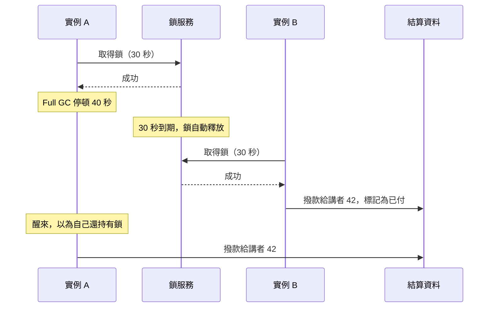
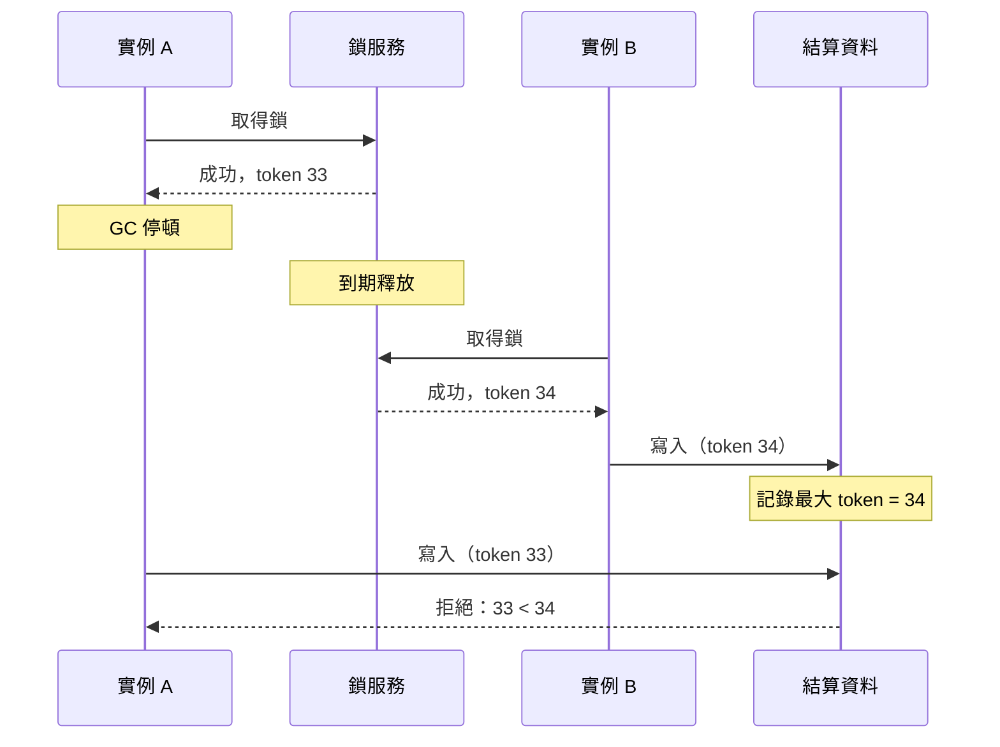

> **System Design 系列** Part 4-7｜上一篇：[共識與 Raft](/post/systemdesign/consensus-raft/)｜下一篇：[REST、gRPC 與 GraphQL](/post/systemdesign/rest-grpc-graphql/)｜[系列地圖](/post/systemdesign/system-design-thinking/#系列地圖)

## 情境與問題

講座平台每天凌晨 3 點把前一天的報名費結算給講者：彙總金額、呼叫銀行的撥款 API、寫入結算紀錄。服務部署了 3 個實例，要求是：

1. **同一時間只有一台在結算**
2. **做到一半的那台當機或卡住，別台要能接手**，不能等人工處理
3. **同一筆款項絕對不能撥兩次**

第 1、2 點是一般的分散式鎖。第 3 點才是難處：這篇會說明，**光靠鎖做不到第 3 點**。

## 最簡單的做法與它的極限

- **`synchronized`、`ReentrantLock`**：只鎖得住同一個 JVM（[Stateless 擴展篇](/post/systemdesign/scaling-stateless/)）
- **資料庫 `SELECT ... FOR UPDATE` 鎖住一列，整個結算都在這個交易裡**：互斥沒問題，持有者當機時連線斷開，鎖也自動釋放。但交易要開好幾分鐘，期間佔住一條連線、累積 undo log，還在交易裡呼叫外部 API。撥款成功之後交易如果回滾，資料庫就不知道錢已經撥出去了
- **Redis `SET lock 1 NX`，結束時 `DEL`**：持有者當機，鎖永遠不會被釋放

最後一個問題的標準解法是讓鎖**自動過期**（租約，lease）。但自動過期正是後面所有問題的來源。

## 核心機制

### 鎖要提供什麼

| 性質 | 意義 | 怎麼做到 |
|---|---|---|
| 互斥 | 同一時間只有一個持有者 | 原子的「不存在才建立」 |
| 不會永遠卡住 | 持有者當機，鎖最終會被釋放 | 租約到期自動釋放 |
| 容錯 | 鎖服務本身的一台機器故障，鎖不會遺失 | 複寫或共識 |

前兩點互相衝突：既然鎖會在持有者不知情的情況下過期，「我持有鎖」這件事就可能在任何時刻變成假的。

### 停頓：持有者不知道自己已經失去鎖



造成停頓的原因很多：GC 的 stop-the-world、虛擬機被搬移或 CPU 被搶走、記憶體被 swap 出去、封包卡在網路的佇列裡、系統時間跳動。

直覺的修法是「寫入前再檢查一次是不是還持有鎖」，但沒有用：**停頓可以發生在檢查之後、寫入之前**。只要「檢查」和「寫入」是兩個步驟，中間就有空隙。

Redisson 這類函式庫的 watchdog 會在持有者還活著時自動延長租約，避免工作做太久導致鎖過期。但 watchdog 也是同一個 JVM 裡的執行緒，**GC 停頓時它也一起停住**，無法解決這個問題。

### 效率鎖與正確性鎖

Martin Kleppmann 把分散式鎖的用途分成兩種：

- **效率**：避免重複做同一件事。偶爾兩台同時執行，只是浪費資源。例如 [Cache 篇](/post/systemdesign/caching/)裡避免多台同時重建同一個快取
- **正確性**：兩台同時執行就會產生錯誤的資料。例如撥款、扣庫存

效率鎖用簡單的 Redis 鎖就夠了。正確性鎖不能只靠鎖本身，**被保護的資源要能拒絕過期持有者的操作**。

### Fencing token

每次取得鎖時，鎖服務同時發出一個**單調遞增的號碼**。持有者每次操作資源都帶上這個號碼，資源記錄看過的最大號碼，拒絕比它小的：



這個保護不依賴時間：不管 A 停頓多久，它的 token 都比之後任何持有者小。條件是：

- **Token 必須和取得鎖一起原子地發出**，而且隨著每次取得鎖嚴格遞增
- **資源本身要能檢查 token**。資料庫可以，用條件式更新就能做到；大部分外部 API 不行，要改用冪等鍵（見 Java 落地）

Token 的來源：etcd 的 revision（[共識與 Raft 篇](/post/systemdesign/consensus-raft/)的 leader key revision）、ZooKeeper 的 zxid 或順序節點的編號，或 Redisson 的 fenced lock。Google 的 Chubby 很早就提供了相同概念的 sequencer。

### Redis 鎖

單一 Redis 的正確寫法：

```text
SET lock:settlement <隨機值> NX PX 30000
```

- `NX`：不存在才建立；`PX 30000`：30 秒後自動過期
- **值必須是每次取得鎖都不同的隨機值**。釋放時只刪除「值還是自己的」那把鎖，否則 A 停頓醒來後，會把 B 的鎖刪掉
- 釋放要用比對後刪除：Redis 8.4 起可以用 `DELEX key IFEQ <隨機值>`，之前的版本用 Lua script 讓比對與刪除成為一個原子操作

```lua
if redis.call("get", KEYS[1]) == ARGV[1] then
    return redis.call("del", KEYS[1])
else
    return 0
end
```

單一 Redis 的問題在於容錯：Redis 的複寫是非同步的。主節點寫入鎖之後、還沒複寫到 replica 就當機，replica 被升為新的主節點，上面沒有這把鎖，另一個用戶端就能再取得一次。

### Redlock 與它的爭議

Redis 官方文件提出的 Redlock 用 N 個（例如 5 個）**彼此獨立**的 Redis 主節點：用戶端依序向所有節點取得鎖，只有在多數節點（至少 3 個）成功、而且花費的時間小於鎖的有效時間時，才算取得；有效時間要扣掉取得鎖花掉的時間。

Kleppmann 在 2016 年的文章指出兩個問題：

- **它依賴時間假設**：網路延遲、程序停頓、時鐘誤差都要有上限。上面的 GC 停頓情境對 Redlock 一樣成立
- **它不產生 fencing token**：沒有遞增的號碼，資源無從判斷操作來自哪個持有者

Redis 作者 Salvatore Sanfilippo 隨後發文回應，認為時間假設在實務上合理。這場爭論的實務結論是：Redlock 多了 5 個獨立節點的維運成本，卻仍然需要 fencing 才能保證正確性。**效率鎖用單一 Redis 就夠；正確性要靠 fencing 與冪等，Redlock 很少值得**。

### 其他實作

- **資料庫的租約表**（例如 ShedLock）：一個以鎖名稱為主鍵的表，記錄 `lock_until`。取得鎖是一個條件式的 `UPDATE` 或 `INSERT`，持久性與資料庫相同。建議使用資料庫的時鐘，避免應用伺服器之間的時鐘誤差
- **資料庫的 advisory lock**：MySQL 的 `GET_LOCK()`、PostgreSQL 的 `pg_advisory_lock()`。鎖綁在資料庫連線上，連線斷開就釋放；但搭配連線池時，持有鎖的連線可能被還回池子給別人用
- **etcd、ZooKeeper**：鎖建立在共識之上，鎖服務本身的節點故障不會讓鎖遺失，並且有天然的 fencing token。代價是多維運一套服務

## 方案比較

| 實作 | 鎖服務故障時 | Fencing token | 依賴 | 適合 |
|---|---|---|---|---|
| 單一 Redis（`SET NX PX`） | failover 可能遺失鎖 | 無 | Redis | 效率鎖 |
| Redisson `RLock` | 同上，watchdog 自動續約 | 無 | Redis | 效率鎖 |
| Redisson `RFencedLock` | 同上 | 有，但存在 Redis 裡 | Redis | 搭配資源端檢查 |
| Redlock | 多數節點存活即可 | 無 | 5 個獨立 Redis、時間假設 | 很少值得 |
| 資料庫租約表（ShedLock） | 與資料庫相同 | 無 | 資料庫時鐘 | 排程只跑一份 |
| 資料庫 advisory lock | 連線斷開即釋放 | 無 | 同一條連線 | 同一個資料庫內的短暫互斥 |
| etcd、ZooKeeper | 多數節點存活即可 | 有（revision、zxid） | 共識服務 | 正確性鎖 |

## Java 落地

### 1. 排程只跑一份：ShedLock

結算排程只需要「不要同時跑兩份」，已經有 MySQL，就用 ShedLock：

```sql
CREATE TABLE shedlock (
    name       VARCHAR(64)  NOT NULL,
    lock_until TIMESTAMP(3) NOT NULL,
    locked_at  TIMESTAMP(3) NOT NULL DEFAULT CURRENT_TIMESTAMP(3),
    locked_by  VARCHAR(255) NOT NULL,
    PRIMARY KEY (name)
);
```

```java
@Configuration
@EnableScheduling
@EnableSchedulerLock(defaultLockAtMostFor = "PT30M")
public class SchedulingConfig {

    @Bean
    public LockProvider lockProvider(DataSource dataSource) {
        return new JdbcTemplateLockProvider(JdbcTemplateLockProvider.Configuration.builder()
                .withJdbcTemplate(new JdbcTemplate(dataSource))
                .usingDbTime()                              // 用資料庫的時鐘，不受應用伺服器時鐘誤差影響
                .build());
    }
}
```

```java
@Scheduled(cron = "0 0 3 * * *")
@SchedulerLock(name = "speaker-settlement", lockAtMostFor = "PT30M", lockAtLeastFor = "PT1M")
public void settleYesterday() {
    settlementService.settle(LocalDate.now().minusDays(1));
}
```

- `lockAtMostFor`：持有者當機時，最多 30 分鐘後鎖自動釋放。要比結算正常執行的最長時間長，否則結算還沒做完，鎖就過期，另一台開始重做
- `lockAtLeastFor`：就算 1 秒就做完，也持有至少 1 分鐘，避免各台時鐘略有差異時，另一台在同一個排程時間點又跑一次

ShedLock 是效率鎖：它沒有 fencing token。結算超過 30 分鐘、或持有者停頓超過 30 分鐘，仍然可能兩台同時在做。所以撥款本身還需要下面兩層保護。

### 2. 資源端檢查 fencing token

結算紀錄加上 `fence_token` 欄位：

```sql
CREATE TABLE speaker_settlement (
    speaker_id  BIGINT        NOT NULL,
    settle_date DATE          NOT NULL,
    amount      DECIMAL(12,2) NOT NULL,
    status      VARCHAR(16)   NOT NULL,                -- PENDING、PAYING、PAID
    fence_token BIGINT        NOT NULL DEFAULT 0,
    payout_id   VARCHAR(64),
    PRIMARY KEY (speaker_id, settle_date)
);
```

用 Redisson 的 fenced lock 取得 token，每一筆撥款都先用 token 認領，寫回結果時再確認一次：

```java
@Service
public class SettlementService {

    private final RedissonClient redisson;
    private final JdbcClient jdbc;
    private final PayoutGateway payoutGateway;

    public SettlementService(RedissonClient redisson, JdbcClient jdbc, PayoutGateway payoutGateway) {
        this.redisson = redisson;
        this.jdbc = jdbc;
        this.payoutGateway = payoutGateway;
    }

    public void settle(LocalDate date) throws InterruptedException {
        RFencedLock lock = redisson.getFencedLock("lock:speaker-settlement:" + date);
        Long token = lock.tryLockAndGetToken(0, 30, TimeUnit.MINUTES);    // 不等待，30 分鐘後自動釋放
        if (token == null) {
            return;                                                     // 別台正在做
        }
        try {
            for (Settlement s : findUnpaid(date)) {
                payOnce(s, token);
            }
        } finally {
            lock.unlock();
        }
    }

    private void payOnce(Settlement s, long token) {
        // 1. 用 token 認領：已付款、或已被 token 更大的持有者認領的，都會失敗
        int claimed = jdbc.sql("""
                        UPDATE speaker_settlement
                           SET fence_token = :token, status = 'PAYING'
                         WHERE speaker_id = :speakerId AND settle_date = :date
                           AND status IN ('PENDING', 'PAYING') AND fence_token <= :token
                        """)
                .param("token", token)
                .param("speakerId", s.speakerId())
                .param("date", s.settleDate())
                .update();
        if (claimed == 0) {
            return;
        }

        // 2. 撥款 API 不認得 fencing token，用固定的冪等鍵：同一筆結算不管呼叫幾次，只會撥一次
        String idempotencyKey = "settlement:" + s.speakerId() + ":" + s.settleDate();
        PayoutResult result = payoutGateway.pay(s.speakerId(), s.amount(), idempotencyKey);

        // 3. 寫回結果時再檢查一次 token
        jdbc.sql("""
                        UPDATE speaker_settlement
                           SET status = 'PAID', payout_id = :payoutId
                         WHERE speaker_id = :speakerId AND settle_date = :date AND fence_token = :token
                        """)
                .param("payoutId", result.payoutId())
                .param("speakerId", s.speakerId())
                .param("date", s.settleDate())
                .param("token", token)
                .update();
    }

    private List<Settlement> findUnpaid(LocalDate date) {
        return jdbc.sql("""
                        SELECT speaker_id AS speakerId, settle_date AS settleDate, amount
                          FROM speaker_settlement
                         WHERE settle_date = :date AND status IN ('PENDING', 'PAYING')
                        """)
                .param("date", date)
                .query(Settlement.class)
                .list();
    }
}
```

三層各自擋住不同的情況：

| 情況 | 擋住它的 |
|---|---|
| 兩台同時開始結算 | 鎖（效率） |
| A 停頓後醒來，B 已經接手並認領過 | `fence_token <= :token` 的認領失敗 |
| A 在認領之後、撥款之前停頓，B 接手重新認領並撥款，A 醒來後也撥款 | 撥款 API 的冪等鍵：兩次呼叫是同一個鍵，銀行端只撥一次 |
| 持有者在撥款之後、寫回之前當機 | 狀態停在 `PAYING`，下一次結算重新認領並用同一個冪等鍵撥款，拿回同一筆結果 |

真正保證「不會撥兩次」的是冪等鍵，fencing token 保護的是資料庫裡的狀態不會被過期的持有者改寫。鎖只負責讓多數情況下不做重複的工作。

> 以上程式碼依 Redisson 4.0、ShedLock 與 Spring Framework 官方文件撰寫，沒有實際編譯與執行。`PayoutGateway` 代表銀行或金流商的 API，冪等鍵的傳遞方式依各家規格。

## 踩坑與 Gotchas

- **鎖在交易提交之前就釋放**：在 `@Transactional` 方法裡取得鎖、在 `finally` 釋放，釋放發生在方法結束時，交易卻是在方法返回之後才由 proxy 提交。這中間另一台取得鎖，讀到的還是舊資料，又做了一次。鎖要包在交易外面：先取得鎖，再呼叫有交易的方法
- **刪掉別人的鎖**：釋放時直接 `DEL`，會刪掉停頓期間別人取得的鎖。一定要比對值
- **租約太短**：工作還沒做完鎖就過期。`lockAtMostFor`、`leaseTime` 要大於工作正常執行的最長時間，並監控實際執行時間
- **以為 watchdog 解決了停頓**：GC 停頓時 watchdog 也停住
- **跨執行緒釋放**：Redisson 的 `RLock` 和 Java 的 `Lock` 一樣，只有取得鎖的執行緒能釋放，其他執行緒釋放會丟出 `IllegalMonitorStateException`。用 `CompletableFuture` 或在不同的 virtual thread 上接續處理時要注意
- **Redis failover 後 token 倒退**：`RFencedLock` 的 token 存在 Redis 裡。非同步複寫在 failover 時可能遺失最近的遞增，新發出的 token 可能和舊的重複。對金流這種正確性要求，資源端的冪等鍵不能省；要更強的保證，token 改由 etcd 或資料庫發出
- **鎖的粒度太粗**：一把全域鎖讓所有講者的結算排隊。依資源切分，例如每天一把、每位講者一把
- **大量用戶端同時搶鎖**：每個用戶端都不停重試，Redis 被輪詢打滿。設定等待時間與退避，或改用佇列
- **能用資料庫約束就別用鎖**：扣名額用條件式更新（[交易隔離篇](/post/systemdesign/transaction-isolation/)），防重複用唯一索引。這些在資料庫內就是原子的，沒有租約過期的問題

### 資安相關

- **鎖的 key 來自使用者輸入**：`lock:course:{courseId}` 的 `courseId` 直接取自請求，攻擊者可以對別人的資源取得鎖，讓正常的操作一直拿不到鎖。取得鎖之前先做授權檢查，key 只用伺服器端驗證過的 ID 組成
- **用鎖做阻斷服務**：攻擊者大量觸發「取得鎖、執行很久」的操作，每把鎖都持有到租約上限，正常使用者全部排隊。限制每個使用者同時持有的鎖數量，並搭配速率限制（[Part 8 的濫用防護](/post/systemdesign/abuse-prevention/)）
- **Redis 本身的存取控制**：能連上 Redis 的人可以直接刪除任何一把鎖。啟用 ACL，讓每個服務只能存取自己前綴的 key，連線使用 TLS，不要對外開放
- **冪等鍵的範圍**：冪等鍵如果只用使用者可控制的字串組成，攻擊者可以搶先用別人的鍵送出請求，讓對方真正的請求被當成重複而略過。冪等鍵要包含伺服器端決定的資訊（例如結算的主鍵），而且只在同一個帳戶的範圍內比對
- **Fencing 是縱深防禦**：鎖服務被誤用或設定錯誤時，資源端的 token 檢查與冪等鍵仍然能擋住重複的寫入與撥款

## 何時用／何時別用

- **效率鎖**（單一 Redis、ShedLock）：避免重複計算、排程只跑一份，偶爾重複執行也無妨的工作
- **正確性**：先用資料庫的條件式更新與唯一索引；必須用鎖時，加上 fencing token，外部呼叫加上冪等鍵
- **別用分散式鎖**：保護單一資料列的更新（交給資料庫）、跨多個服務的長流程（用 Saga 或狀態機，[Part 7](/post/systemdesign/saga-outbox/)）、當作工作佇列

## 參考資料

- Martin Kleppmann, "How to do distributed locking", 2016：<https://martin.kleppmann.com/2016/02/08/how-to-do-distributed-locking.html>
- Salvatore Sanfilippo, "Is Redlock safe?", 2016：<http://antirez.com/news/101>
- Martin Kleppmann, *Designing Data-Intensive Applications*, O'Reilly, 2017, Chapter 8
- Mike Burrows, "The Chubby lock service for loosely-coupled distributed systems", OSDI 2006
- Redis Documentation — Distributed Locks with Redis：<https://redis.io/docs/latest/develop/clients/patterns/distributed-locks/>
- Redis Documentation — SET：<https://redis.io/docs/latest/commands/set/>
- Redisson — Locks and synchronizers：<https://github.com/redisson/redisson/blob/redisson-4.0.0/docs/data-and-services/locks-and-synchronizers.md>
- ShedLock：<https://github.com/lukas-krecan/shedlock>
- Spring Framework Reference — JdbcClient：<https://docs.spring.io/spring-framework/reference/data-access/jdbc/core.html>
- 互動圖解延伸：Dilum Sanjaya，System Design — an interactive course：<https://designed-to-scale.vercel.app/>
