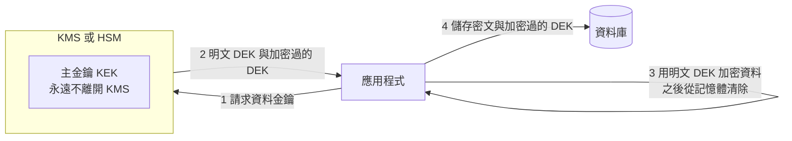

> **System Design 系列** Part 8-4｜上一篇：[BOLA 穿過 BFF 之後](/post/systemdesign/identity-propagation/)｜下一篇：[濫用防護](/post/systemdesign/abuse-prevention/)｜[系列地圖](/post/systemdesign/system-design-thinking/#系列地圖)

## 情境與問題

講座平台保存了這些資料：

| 資料 | 敏感度 | 外洩的後果 |
|---|---|---|
| 講座標題、時間、講者姓名 | 公開 | 無 |
| 會員的 email、電話、報名紀錄 | 個資 | 通知主管機關與當事人、罰款、信任受損 |
| 講者的銀行帳號、稅籍資料 | 高度敏感 | 被拿去詐騙；被竄改則撥款進了別人的帳戶 |
| 資料庫密碼、金流 API key、IdP 的 client secret、簽章金鑰 | secrets | 攻擊者取得系統本身的權限 |

資安檢測提出的問題是：「你們有加密嗎？」大部分團隊的回答是「有，HTTPS 和資料庫的磁碟加密都開了」。但接下來的問題才是重點：

- 攻擊者透過 SQL injection 把 `speaker_bank_account` 整張表倒出來，看到的是明文還是密文？
- 一份資料庫備份被複製到了測試環境，誰能讀？
- 前員工的筆電裡有一份 `application-prod.yml`，裡面有什麼？

## 最簡單的做法與它的極限

- **HTTPS 到負載平衡器**：瀏覽器到負載平衡器之間加密了，負載平衡器到應用程式、應用程式到資料庫與 Redis 之間仍然是明文（[Load Balancing 篇](/post/systemdesign/load-balancing/)）
- **資料庫的磁碟加密**：只防「儲存媒體或快照被拿走」。資料庫運作時會透明地解密，所以任何能登入資料庫的帳號、任何 SQL injection、任何 `mysqldump` 看到的都是明文
- **密碼寫在 `application.yml` 或環境變數**：設定檔進了 Git，就永遠留在歷史紀錄裡；環境變數會出現在 crash dump、子程序、除錯端點與 CI 的日誌裡

## 核心機制

### 每一層加密擋得住什麼

加密能保護資料的範圍，取決於**誰拿得到解密的金鑰**。

| 加密的層級 | 金鑰在誰手上 | 擋得住 | 擋不住 |
|---|---|---|---|
| 傳輸加密（TLS） | 連線的兩端 | 網路上的竊聽與竄改 | 任何一端被入侵 |
| 儲存層加密（磁碟、RDS 的 at-rest 加密、TDE） | 儲存系統或資料庫 | 硬碟、快照、備份檔被複製（前提是複製者拿不到金鑰） | 能查詢資料庫的人：DBA、被盜的應用程式帳號、SQL injection |
| 應用層欄位加密 | 應用程式（透過 KMS） | 資料庫被整個倒出來、DBA、備份 | 應用程式本身被入侵（它能解密） |

儲存層加密幾乎沒有成本，應該全部開啟；但它不是「資料庫外洩時資料仍然安全」的答案。只有**最高敏感度**的少數欄位，才值得付出應用層加密的代價。

### 傳輸加密

- **全程加密**：瀏覽器到負載平衡器、負載平衡器到服務、服務之間（[mTLS](/post/systemdesign/identity-propagation/)）、服務到資料庫、Redis、Kafka，每一段都使用 TLS
- **驗證對方的身分**：連資料庫時只開啟加密、不驗證伺服器憑證，中間人仍然可以攔截。MySQL Connector/J 要用 `sslMode=VERIFY_IDENTITY`，而不是 `REQUIRED`
- **只允許 TLS 1.2 以上**，並使用 HSTS 防止降級到 HTTP
- **憑證自動化**：公開信任的憑證效期正在分階段縮短，到 2029 年只剩 47 天，人工續約已經不可行（[網頁憑證信任](/post/security/web-certificate-trust/)）

### 信封加密：金鑰不離開 KMS

應用層加密最難的不是演算法，而是**金鑰放在哪裡**。把 AES 金鑰寫在設定檔裡，和資料一起外洩的機率很高，加密就沒有意義了。

**信封加密**（envelope encryption）把金鑰分成兩層：



- **主金鑰**（KEK）存在 KMS 或 HSM 裡，永遠不會以明文離開。應用程式只能請 KMS 用它加密或解密小量的資料
- **資料金鑰**（DEK）由 KMS 產生，應用程式用它加密資料。加密過的 DEK 和密文存在一起，明文的 DEK 用完就從記憶體清除
- 解密時，應用程式把加密過的 DEK 送給 KMS 解開，再用它解密資料

這樣的好處是：

- 資料庫被整個倒出來，攻擊者只有密文與加密過的 DEK，沒有 KMS 的權限就無法解密
- 每次解密都經過 KMS，**誰在什麼時間解密了什麼**都有稽核紀錄，權限也由 IAM 控制
- 輪替主金鑰時，只需要重新加密 DEK（很小），不需要重新加密所有資料

代價是每次解密都要呼叫 KMS，增加幾毫秒的延遲，而且 KMS 有每秒請求數的配額。講者的銀行帳號只有在每月撥款時才讀取：5,000 位講者就是 5,000 次解密，完全沒問題。但如果要加密的是每個請求都會讀的欄位，就需要在記憶體中短暫快取 DEK，或改用每個租戶一把 DEK，在安全性與成本之間取捨。

### 用 AEAD，並把密文綁定到它的位置

加密演算法使用**有驗證的加密**（AEAD），例如 AES-256-GCM：它同時保證機密性與完整性，密文被修改了，解密就會失敗。

GCM 有兩個要注意的地方：

- **nonce 不能重複**：同一把金鑰用了兩次同樣的 nonce，攻擊者就能推算出明文的關係，甚至偽造密文。使用隨機的 96 位元 nonce 時，NIST SP 800-38D 限制同一把金鑰最多加密 2³² 次。粗略估算：一把金鑰每秒加密 1,000 筆，2³² ≈ 43 億次，大約 50 天就到上限。所以高頻率的加密要定期更換 DEK，或者每筆資料、每個租戶使用不同的 DEK
- **綁定位置**：AEAD 可以附帶不加密、但會被驗證的**附加資料**（AAD）。如果不綁定，一個能寫入資料庫的攻擊者，可以把**他自己**的銀行帳號密文複製到講者 B 的那一列，下一次撥款就把 B 的錢匯給攻擊者，而且解密完全正常。把表名、欄位與講者 ID 放進 AAD（KMS 的對應機制是 encryption context），密文被移到別的列，解密就會失敗

### 加密之後怎麼查詢

加密過的欄位不能用 `LIKE`、範圍查詢或一般的索引。需要「這個統一編號是否已經註冊」這種**等值查詢**時，可以另外存一個**盲索引**（blind index）：用另一把金鑰計算 HMAC-SHA256，存在獨立的欄位並建立唯一索引。

盲索引會洩漏「兩筆資料的值是否相同」，以及值的分布（例如很多人用同一家銀行）。所以只對真的需要查詢的欄位建立，而且 HMAC 的金鑰要和加密的金鑰分開。

### 不需要還原的資料，不要加密

| 資料 | 需要還原原始值嗎 | 做法 |
|---|---|---|
| 使用者的密碼 | 不需要，只要比對 | 慢速的密碼雜湊（[身分驗證篇](/post/systemdesign/authentication-session-token-oidc/)） |
| 你發給客戶的 API key | 不需要，只要比對 | 高熵的隨機值，只存 SHA-256；只在建立時顯示一次 |
| 講者的銀行帳號 | 需要，撥款時要用 | 應用層加密 |
| 信用卡號 | 不應該經手 | 使用金流的付款頁面與 token，卡號不進入你的系統 |

最安全的資料是你沒有存的資料。卡號交給金流處理，可以大幅縮小 PCI DSS 的適用範圍。

### 金鑰輪替與加密抹除

- **主金鑰輪替**：KMS 可以自動輪替主金鑰並保留舊版本供解密，應用程式不需要修改。但這**不會**重新加密既有的資料，如果目的是「舊金鑰外洩後，舊資料也不能被解開」，就要另外重新加密
- **密文要記錄金鑰版本**：密文的格式裡帶著金鑰的識別，新舊金鑰才能並存，輪替可以逐步進行
- **加密抹除**（crypto-shredding）：刪除一個租戶的 DEK，所有用它加密的資料（包括備份、replica、LSM-Tree 裡還沒被 compaction 的舊版本）就同時變成無法解讀的密文（[B-Tree vs LSM-Tree 篇](/post/systemdesign/btree-vs-lsm/)）
- **金鑰遺失等於資料遺失**：KMS 的金鑰刪除有等待期（AWS KMS 為 7 到 30 天），這段時間可以取消。刪除金鑰之前，確認沒有任何資料仍然依賴它

### Secrets 管理

Secrets 是讓系統取得權限的憑證：資料庫密碼、第三方 API key、OAuth client secret、簽章金鑰、TLS 私鑰。

**不能放的地方**：

- Git，包括私有的 repo。即使刪除，仍然留在歷史紀錄與每一份 clone 裡
- 容器映像檔。映像檔的每一層都可以被解開
- 環境變數。會出現在 crash dump、子程序、除錯端點、CI 的日誌
- 日誌與錯誤訊息

**該放的地方與做法**：

- **Secrets 管理服務**：AWS Secrets Manager、HashiCorp Vault，或 Kubernetes Secret 搭配 etcd 的 at-rest 加密。Kubernetes Secret 預設只是 base64 編碼、以未加密的形式存在 etcd，要另外開啟加密，並用 RBAC 限制誰能讀取
- **以檔案形式掛載**，而不是環境變數；應用程式只讀取自己需要的那幾個
- **短期的動態憑證**：Vault 這類系統可以為每個應用程式實例產生有期限的資料庫帳號，期限到了自動撤銷。外洩的憑證只在很短的時間內有效
- **最好的 secret 是不需要 secret**：在雲端上用工作負載身分（例如 EKS Pod Identity）取得短期的雲端權限，而不是長期有效的 access key；資料庫支援 IAM 驗證時，用它取代固定的密碼；服務之間用 mTLS（[8-3](/post/systemdesign/identity-propagation/)）

**輪替**：

- 輪替要能在**不停機**的情況下進行：同時存在兩組有效的憑證（新的生效、舊的再撤銷），或者資料庫採用兩個輪流更換的帳號
- 連線池只在建立新連線時使用密碼，已經建立的連線不受影響。HikariCP 可以在執行期間透過 `HikariConfigMXBean` 更新密碼（[HikariCP 調校](/post/database/hikaricp-tuning/)）

**外洩之後**：先**輪替**，再清理。從 Git 歷史裡刪除只是減少擴散，那個 secret 必須視為已經外洩。CI 加上 secret 掃描，在 push 時就擋下。

## 方案比較

| 方案 | 適合 | 代價 |
|---|---|---|
| 只有傳輸加密與儲存層加密 | 大部分的資料，包括一般個資 | 資料庫帳號外洩時，資料就是明文 |
| 應用層欄位加密（信封加密） | 少數高敏感度、很少被查詢的欄位 | 無法用資料庫查詢與排序；KMS 的延遲與配額；程式更複雜 |
| 資料庫的欄位加密功能 | 想把加密交給資料庫處理 | 金鑰通常也由資料庫管理，DBA 與資料庫帳號仍然能解密 |
| Tokenization（交給第三方保存） | 信用卡號等有專門服務處理的資料 | 依賴第三方；查詢原始值要呼叫外部服務 |

講座平台的選擇：

- **全部資料**：傳輸加密到每一段，資料庫、Redis、Kafka、物件儲存都開啟儲存層加密，使用由自己管理權限的 KMS 金鑰
- **講者的銀行帳號與稅籍資料**：應用層信封加密，AAD 綁定講者 ID；稅籍資料另外有盲索引，用於檢查重複註冊
- **會員的 email 與電話**：不做應用層加密。登入、通知、客服查詢都要用到，加密的代價太高；改以存取控制、日誌遮蔽與稽核保護
- **信用卡**：不經手，使用金流的付款頁面
- **Secrets**：存放在 secrets 管理服務並以檔案掛載；雲端權限使用工作負載身分；資料庫密碼每 30 天自動輪替

## Java 落地

### 1. 信封加密：講者的銀行帳號

```java
public record EncryptedValue(byte[] wrappedKey, byte[] nonce, byte[] ciphertext) {
}

@Component
public class BankAccountCipher {

    private static final int NONCE_BYTES = 12;
    private static final int TAG_BITS = 128;

    private final KmsClient kms;
    private final String keyId;
    private final SecureRandom random = new SecureRandom();

    public BankAccountCipher(KmsClient kms, @Value("${lectures.crypto.bank-account-key-id}") String keyId) {
        this.kms = kms;
        this.keyId = keyId;
    }

    public EncryptedValue encrypt(long speakerId, String accountNumber) {
        GenerateDataKeyResponse dataKey = kms.generateDataKey(GenerateDataKeyRequest.builder()
                .keyId(keyId)
                .keySpec(DataKeySpec.AES_256)
                .encryptionContext(context(speakerId))          // KMS 端的綁定，同時寫進 CloudTrail 稽核紀錄
                .build());
        byte[] key = dataKey.plaintext().asByteArray();
        try {
            byte[] nonce = new byte[NONCE_BYTES];
            random.nextBytes(nonce);
            Cipher cipher = Cipher.getInstance("AES/GCM/NoPadding");
            cipher.init(Cipher.ENCRYPT_MODE, new SecretKeySpec(key, "AES"), new GCMParameterSpec(TAG_BITS, nonce));
            cipher.updateAAD(aad(speakerId));                   // 應用程式端的綁定：密文搬到別的講者就無法解密
            byte[] ciphertext = cipher.doFinal(accountNumber.getBytes(StandardCharsets.UTF_8));
            return new EncryptedValue(dataKey.ciphertextBlob().asByteArray(), nonce, ciphertext);
        } catch (GeneralSecurityException e) {
            throw new IllegalStateException("加密失敗", e);
        } finally {
            Arrays.fill(key, (byte) 0);
        }
    }

    public String decrypt(long speakerId, EncryptedValue value) {
        byte[] key = kms.decrypt(DecryptRequest.builder()
                        .keyId(keyId)
                        .ciphertextBlob(SdkBytes.fromByteArray(value.wrappedKey()))
                        .encryptionContext(context(speakerId))
                        .build())
                .plaintext().asByteArray();
        try {
            Cipher cipher = Cipher.getInstance("AES/GCM/NoPadding");
            cipher.init(Cipher.DECRYPT_MODE, new SecretKeySpec(key, "AES"), new GCMParameterSpec(TAG_BITS, value.nonce()));
            cipher.updateAAD(aad(speakerId));
            return new String(cipher.doFinal(value.ciphertext()), StandardCharsets.UTF_8);
        } catch (AEADBadTagException e) {
            throw new TamperedDataException("講者 " + speakerId + " 的銀行帳號密文驗證失敗");   // 告警：可能被竄改或搬移
        } catch (GeneralSecurityException e) {
            throw new IllegalStateException("解密失敗", e);
        } finally {
            Arrays.fill(key, (byte) 0);
        }
    }

    private static Map<String, String> context(long speakerId) {
        return Map.of("table", "speaker_bank_account", "speakerId", Long.toString(speakerId));
    }

    private static byte[] aad(long speakerId) {
        return ("speaker_bank_account:account_number:" + speakerId).getBytes(StandardCharsets.UTF_8);
    }
}
```

- 每筆資料一把 DEK：寫入與讀取各呼叫一次 KMS，適合讀取頻率低的欄位，也不會碰到 GCM 的次數上限
- 驗證失敗（`AEADBadTagException`）不是一般的錯誤，代表密文被修改或搬移，要觸發告警
- 應用程式的 IAM 權限只允許對這把 KMS 金鑰執行 `GenerateDataKey` 與 `Decrypt`；只有撥款服務有 `Decrypt` 權限，講者後台只能寫入、只能看遮罩後的末四碼
- Java 的 `String` 無法從記憶體清除，所以明文在記憶體裡的時間無法完全控制；這裡清除的是金鑰

### 2. 盲索引：檢查統一編號是否重複

```java
@Component
public class TaxIdBlindIndex {

    private final SecretKeySpec hmacKey;

    // 金鑰以 Base64 存在 secrets 管理服務，與加密用的 KMS 金鑰分開
    public TaxIdBlindIndex(@Value("${lectures.crypto.tax-id-index-key}") String base64Key) {
        this.hmacKey = new SecretKeySpec(Base64.getDecoder().decode(base64Key), "HmacSHA256");
    }

    public byte[] of(String taxId) {
        try {
            Mac mac = Mac.getInstance("HmacSHA256");
            mac.init(hmacKey);
            return mac.doFinal(taxId.strip().getBytes(StandardCharsets.UTF_8));   // 先正規化，否則同一個值算出不同結果
        } catch (GeneralSecurityException e) {
            throw new IllegalStateException(e);
        }
    }
}
```

```sql
ALTER TABLE speaker_tax_profile
    ADD COLUMN tax_id_index BINARY(32) NOT NULL,
    ADD UNIQUE KEY uk_tax_id_index (tax_id_index);
```

### 3. Secrets：以檔案掛載、不出現在任何端點

```yaml
spring:
  config:
    import: "optional:configtree:/etc/secrets/"      # /etc/secrets/db/password 會成為 db.password
  datasource:
    url: jdbc:mysql://lectures-db.internal:3306/lectures?sslMode=VERIFY_IDENTITY
    username: ${db.username}
    password: ${db.password}
  data:
    redis:
      ssl:
        enabled: true

management:
  endpoint:
    env:
      show-values: never                            # 預設就會遮蔽，明確寫出避免被改成 always
```

- `/etc/secrets/` 由 secrets 管理服務的 Kubernetes 整合（例如 Secrets Store CSI Driver）或 Kubernetes Secret 掛載，應用程式不需要知道 secrets 存在哪裡
- 不要對外開放 `heapdump` 與 `env` 端點：heap dump 裡有記憶體中的所有 secrets 與個資（[Observability 篇](/post/systemdesign/observability/)）

> 以上程式碼依 Spring Boot 4.1、AWS SDK for Java 2.x 與 Java 標準函式庫（JCA）的官方文件撰寫，沒有實際編譯與執行。

## 踩坑與 Gotchas

- **金鑰和資料放在一起**：AES 金鑰寫在同一個應用程式的設定檔，或存在同一個資料庫，外洩時一起外洩
- **自己發明加密格式**：用 ECB 模式、自己組合加密與 HMAC、重複使用 nonce。使用 AEAD 與成熟的函式庫
- **「有開 at-rest 加密」就以為資料庫外洩也安全**：見前面的表格
- **以為主金鑰輪替會重新加密資料**：它只換掉之後的加密，舊資料仍然用舊版本解密
- **加密之後才發現要查詢**：欄位加密前，先確認所有讀取這個欄位的查詢與報表
- **Kubernetes Secret 被當成加密**：base64 只是編碼；能讀取 Secret 的 RBAC 權限等於能讀取明文
- **Secrets 出現在 CI 的日誌**：建置腳本 `echo` 了環境變數，或者測試失敗時印出整份設定
- **輪替造成停機**：只有一組憑證，換掉的那一刻，所有還沒拿到新密碼的實例都無法建立連線
- **刪除了還在使用的金鑰**：所有依賴它的資料永久無法解密

### 攻擊情境

| 攻擊 | 怎麼發生 | 防禦 |
|---|---|---|
| 內部網路竊聽 | 負載平衡器之後、服務到資料庫的明文流量被擷取 | 每一段都使用 TLS，並驗證對方的憑證 |
| 中間人 | 資料庫連線只開啟加密、不驗證伺服器憑證 | `VERIFY_IDENTITY` 這類完整驗證的模式 |
| SQL injection 倒出整張表 | 攻擊者以應用程式的資料庫帳號讀取所有資料 | 高敏感度欄位應用層加密；解密權限只給需要的服務 |
| 備份外流 | 備份被複製到權限較鬆的環境 | 備份使用 KMS 金鑰加密，金鑰的權限與備份的權限分開管理 |
| 密文搬移 | 有資料庫寫入權限的人，把自己的密文複製到別人的那一列 | AAD 與 encryption context 綁定資料的位置 |
| Git 裡的密碼 | 設定檔或測試程式被 commit，repo 被公開或被複製 | Secret 掃描；secrets 不放在 repo；外洩後立即輪替 |
| 除錯端點洩漏 | `/actuator/env`、`/actuator/heapdump` 對外開放 | 只開放必要的端點；管理埠不對外 |
| 雲端存取金鑰外洩 | 長期有效的 access key 出現在筆電、CI 或映像檔 | 工作負載身分與短期憑證，不發長期金鑰 |
| 濫用解密權限 | 有權限的內部人員或被入侵的服務大量解密 | KMS 稽核紀錄；監控解密次數的異常 |

## 何時用／何時別用

- **一定要做**：每一段都使用傳輸加密、所有儲存都開啟儲存層加密、secrets 不進 Git 與映像檔
- **用應用層加密**：資料外洩的後果嚴重、讀取頻率低、不需要用資料庫查詢的少數欄位
- **用 tokenization**：有專門服務可以代管的資料，例如信用卡
- **別加密**：需要被查詢、排序、全文搜尋的欄位，硬要加密只會產生更多的盲索引與明文快取；改用存取控制、遮蔽與稽核
- **重新評估的時機**：法規或客戶合約要求特定資料加密、資料外洩事件之後、或者 KMS 的成本與延遲開始影響主要的請求路徑

## 參考資料

- RFC 8446, "The Transport Layer Security (TLS) Protocol Version 1.3"
- NIST SP 800-38D, "Recommendation for Block Cipher Modes of Operation: Galois/Counter Mode (GCM) and GMAC"
- NIST SP 800-57 Part 1 Rev. 5, "Recommendation for Key Management"
- OWASP Cheat Sheet Series — Cryptographic Storage、Secrets Management：<https://cheatsheetseries.owasp.org/>
- AWS Key Management Service Developer Guide — Envelope encryption、Encryption context、Rotating keys、Deleting keys：<https://docs.aws.amazon.com/kms/latest/developerguide/>
- Kubernetes Documentation — Good practices for Kubernetes Secrets、Encrypting Confidential Data at Rest：<https://kubernetes.io/docs/concepts/security/secrets-good-practices/>
- Spring Boot Reference — External Configuration（Configuration Trees）、Actuator Endpoints（Sanitize Sensitive Values）：<https://docs.spring.io/spring-boot/reference/>
- PCI Security Standards Council, PCI DSS v4.0.1
- 互動圖解延伸：Dilum Sanjaya，System Design — an interactive course：<https://designed-to-scale.vercel.app/>
