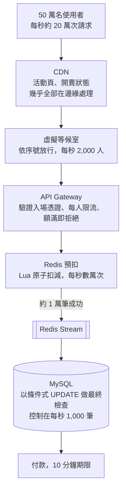

> **System Design 系列** Part 9-4｜上一篇：[聊天系統](/post/systemdesign/chat-system/)｜下一篇：[通知系統](/post/systemdesign/notification-system/)｜[系列地圖](/post/systemdesign/system-design-thinking/#系列地圖)

## 情境與問題

[系列導讀](/post/systemdesign/system-design-thinking/)的報名系統：3,000 個名額、尖峰每秒 800 次寫入，一個條件式 `UPDATE` 加上本機的額滿旗標就夠了，導讀也列出了規模更大時的方案 C（Redis 預扣）與方案 D（排隊等候室）。這一題就是那個「更大的規模」：

平台請到一位超人氣講者，舉辦一場萬人講座。

- 名額 1 萬個，每人限購 1 張
- 開賣前有 50 萬人在頁面上等待，開賣後幾秒內，大部分的人都會按下按鈕
- 不能超賣；搶到的人要在 10 分鐘內付款，逾時釋出名額
- 開賣的過程不能影響平台的其他功能

**規模估算**

| 項目 | 估算 |
|---|---|
| 開賣瞬間的請求 | 50 萬人在 5 秒內按下按鈕 → 每秒約 10 萬次，加上重新整理與重試，估每秒 20 萬次 |
| 真正會成功的寫入 | 1 萬次 |
| 導讀方案 A 的上限 | 熱點列的條件式 `UPDATE` 約每秒 1,000 次 |
| 請求數與上限的差距 | 200 倍 |

**50 萬次嘗試裡，只有 1 萬次會成功**。設計的核心不是讓資料庫承受每秒 20 萬次寫入，而是**在每一層盡早拒絕註定失敗的請求**，讓真正到達資料庫的只剩下那 1 萬次。

## 最簡單的做法與它的極限

直接沿用導讀的方案 A，加開應用伺服器：

- 應用伺服器可以水平擴充，但所有請求最後都在**同一列**排隊等鎖。每秒 20 萬次請求打到資料庫，連線池瞬間耗盡（[HikariCP 調校](/post/database/hikaricp-tuning/)），等鎖的請求逾時，使用者重試，負載再加倍
- 資料庫被拖垮之後，平台上**所有功能**都無法使用，不只是這場講座
- 自動擴充來不及：從偵測到流量上升到新的實例可以服務，需要幾十秒到幾分鐘，秒殺在幾秒內就結束了（[無狀態服務篇](/post/systemdesign/scaling-stateless/)）

## 核心機制

### 漏斗：每一層擋掉多少



| 層 | 每秒進入 | 每秒放行 | 擋掉的方式 |
|---|---|---|---|
| CDN | 20 萬 | 個位數（快取未命中） | 活動頁與「目前放行到第幾號」都是可快取的靜態回應 |
| 虛擬等候室 | 50 萬人排隊 | 2,000 人 | 依序號放行，放行速率由後端的能力決定 |
| Redis 預扣 | 2,000 | 名額用完前約 2,000，用完後 0 | 額滿後立即拒絕；每人限購 |
| 資料庫 | 約 1 萬筆（總量） | 依消費速度，每秒 1,000 筆 | 條件式 `UPDATE` 做最終檢查 |

### 開賣前：所有東西都在 CDN

- 活動頁是靜態的，倒數計時以**伺服器時間**為準（頁面載入時取得伺服器時間並計算偏移），不能相信使用者的本機時鐘
- 「是否已開賣、目前放行到第幾號、是否已額滿」是一個很小的 JSON，CDN 快取 1 秒（`s-maxage=1`，[CDN 篇](/post/systemdesign/cdn/)）。50 萬個用戶端每 5 秒輪詢一次，每秒 10 萬次請求，origin 每秒只收到「每個 CDN 節點一次」
- 這個端點的快取鍵要忽略查詢參數，否則攻擊者加上 `?x=隨機數` 就能讓每個請求都穿透到 origin

### 虛擬等候室：用序號控制放行

[Rate Limiting 篇](/post/systemdesign/rate-limiting/)提過等候室是保護使用者體驗與公平性的做法。這裡把它做成**幾乎無狀態**的設計：

1. 開賣前進入頁面的使用者，取得一張**排隊券**：一個簽章過的 token，內容是使用者 ID、活動 ID、以及一個序號
2. 開賣前就在等待的人，序號是**隨機打亂**的：提早一小時進來和提早一秒進來的人機會相同，機器人的速度優勢在這一步消失（[濫用防護篇](/post/systemdesign/abuse-prevention/)）；開賣後才進來的人，依到達順序排在後面
3. 放行控制器每秒把「目前放行到第幾號」往前推 2,000，寫進 CDN 快取的那個狀態 JSON
4. 用戶端看到自己的序號已經被放行，拿排隊券換一張**入場憑證**：短期（例如 2 分鐘）、只能使用一次、綁定使用者與活動

序號的檢查只需要驗證簽章並比較數字，不需要查詢任何共享狀態。等候室的伺服器可以任意擴充，放行速率則完全由後端決定。

放行速率 2,000 人／秒的依據：每個被放行的人大約會在幾秒內送出一次購票請求，Redis 預扣每秒可以處理數萬次，所以 2,000 留了很大的餘裕；真正的限制是後面的付款流程與資料庫的消化速度。

### Redis 預扣：只負責擋，不負責記帳

入場憑證通過後，購票請求在 Redis 執行一段 Lua script，原子地完成：

- 這個人是否已經買過（每人限購）
- 庫存是否大於 0
- 扣減庫存、記錄買家、把「預約成功」寫進 Redis Stream

三件事在同一段 script 裡，不會被其他請求插入，所以不需要分散式鎖（[分散式鎖篇](/post/systemdesign/distributed-lock/)）。名額用完之後，每個請求在 Redis 裡讀一次庫存就被拒絕，成本極低；Gateway 也在本機記住「已額滿」，連 Redis 都不需要碰。

但 **Redis 不是記帳的地方**。Redis 的複寫是非同步的：primary 確認了扣減，還沒複寫到 replica 就當機，故障轉移之後，這幾筆扣減就消失了，庫存回到比較高的數字，接著可能多賣出幾張（[Replication 篇](/post/systemdesign/replication-lag/)、[備援與故障轉移篇](/post/systemdesign/redundancy-failover-dr/)）。所以：

- Redis 是**過濾器**：它讓 50 萬次嘗試變成大約 1 萬次
- MySQL 是**權威**：建立訂單時，仍然用導讀的條件式 `UPDATE ... WHERE remaining > 0` 做最後的檢查。Redis 多放進來的那幾筆，在這裡被擋下，使用者收到「很抱歉，名額已滿」

這和導讀的額滿旗標是同一個原則：**快取層只做最佳化，正確性在資料庫**。

### 非同步落庫：資料庫只處理約 1 萬筆

Redis Stream 的消費者以每秒約 1,000 筆的速度建立訂單：1 萬筆約 10 秒處理完。這正好落在導讀估算的熱點列上限之內，所以**不需要名額分桶**，也不需要更換資料庫。這就是漏斗的效果：上游擋得夠多，下游的簡單做法就夠用。

訂單建立是冪等的：`(event_id, member_id)` 是唯一鍵，同一則 Stream 訊息被處理兩次，第二次撞上唯一鍵而略過（[冪等性篇](/post/systemdesign/idempotency-key/)）。處理完成才確認（ACK），消費者當機時，未確認的訊息會留在 pending 清單裡，由其他消費者接手。

用戶端送出購票請求後，立刻收到「處理中」，再透過輪詢或 SSE 取得結果（[即時更新篇](/post/systemdesign/realtime-updates/)）。

### 付款與釋出

搶到名額之後的流程就是 [Saga 篇](/post/systemdesign/saga-outbox/)的結帳：

- 訂單狀態為「待付款」，期限 10 分鐘
- 逾時未付款：取消訂單、資料庫的名額加回 1、Redis 的庫存加回 1 並移除買家紀錄
- Redis 的加回要冪等：同一筆訂單的釋出只能執行一次，否則庫存會被加多。用 `SET NX` 記錄「這筆訂單已釋出」，和加回庫存放在同一段 Lua script 裡

釋出的名額不需要即時回到搶票的人潮中。比較好的做法是累積一段時間後，在公告的時間再開放一次，或者分配給候補名單，避免使用者為了等釋出的名額而不斷重新整理。

### 開賣前的準備

- **預先擴充**：根據估算，開賣前 30 分鐘就把等候室、Gateway、Redis 擴充到位，不依賴自動擴充
- **隔離**：這場活動使用獨立的 Redis 與獨立的服務實例，故障或過載不影響平台的其他功能（[Circuit Breaker 與 Bulkhead 篇](/post/systemdesign/circuit-breaker-bulkhead/)）
- **壓力測試**：用接近真實的流量模式測試整條路徑，特別是 CDN 的快取鍵與等候室的放行
- **降級預案**：Redis 故障時，等候室**暫停放行**，而不是讓流量直接打到資料庫

## 方案比較

| 方案 | 適合的規模 | 代價 |
|---|---|---|
| A. 條件式 UPDATE + 額滿旗標（導讀） | 每秒數百到一千次 | 熱點列是上限 |
| B. 資料庫名額分桶 | 每秒數千次 | 總數要加總；尾端名額分布不均 |
| C. Redis 預扣 + 非同步落庫 | 每秒數萬次 | 多兩個元件；Redis 與資料庫的一致性要靠最終檢查與對帳 |
| D. 虛擬等候室 | 任何規模，後端負載完全可控 | 使用者要等待；需要設計排隊的體驗 |
| 抽籤（[濫用防護篇](/post/systemdesign/abuse-prevention/)） | 任何規模，負載分散到整個登記期 | 不是「先搶先贏」，需要業務單位同意 |

講座平台的選擇：**D + C + A**。等候室控制進入的速率，Redis 擋掉註定失敗的請求，資料庫用最簡單的條件式 `UPDATE` 保證不超賣。如果業務可以接受，抽籤是更簡單、更公平的替代方案。

## Java 落地

### 1. 入場憑證：簽發與驗證

```java
@Component
public class AdmissionTokens {

    private final JwtEncoder encoder;
    private final JwtDecoder decoder;

    public AdmissionTokens(@Value("${flashsale.admission-key}") String base64Key) {
        SecretKey key = new SecretKeySpec(Base64.getDecoder().decode(base64Key), "HmacSHA256");
        OctetSequenceKey jwk = new OctetSequenceKey.Builder(key).build();
        JWKSource<SecurityContext> jwkSource = (selector, context) -> selector.select(new JWKSet(jwk));
        this.encoder = new NimbusJwtEncoder(jwkSource);
        this.decoder = NimbusJwtDecoder.withSecretKey(key).build();
    }

    /** 排隊券的序號已被放行時，換發一張 2 分鐘、只能使用一次的入場憑證。 */
    public String issue(long memberId, long eventId) {
        Instant now = Instant.now();
        JwtClaimsSet claims = JwtClaimsSet.builder()
                .subject(Long.toString(memberId))
                .audience(List.of("flashsale:" + eventId))
                .id(UUID.randomUUID().toString())                      // jti：用來防止重複使用
                .issuedAt(now)
                .expiresAt(now.plus(Duration.ofMinutes(2)))
                .build();
        JwsHeader header = JwsHeader.with(MacAlgorithm.HS256).build();
        return encoder.encode(JwtEncoderParameters.from(header, claims)).getTokenValue();
    }

    public Jwt verify(String token, long memberId, long eventId) {
        Jwt jwt = decoder.decode(token);                               // 驗證簽章與期限
        if (!jwt.getSubject().equals(Long.toString(memberId)) || !jwt.getAudience().contains("flashsale:" + eventId)) {
            throw new AccessDeniedException("入場憑證不屬於這個使用者或活動");
        }
        return jwt;
    }
}
```

- 憑證綁定使用者（與登入的身分比對）與活動，被轉讓或拿到別的活動都無效
- 「只能使用一次」在 Redis 預扣的 script 裡以 `jti` 檢查，見下一段
- HMAC 金鑰只有等候室與 Gateway 持有，依[加密篇](/post/systemdesign/encryption-secrets/)的方式管理

### 2. Redis 預扣

```java
@Component
public class SeatReservation {

    // KEYS[1] 庫存、KEYS[2] 買家集合、KEYS[3] 這張入場憑證的使用紀錄、KEYS[4] 預約串流
    // ARGV[1] 會員 ID、ARGV[2] 憑證剩餘秒數
    private static final RedisScript<Long> RESERVE = RedisScript.of("""
            if redis.call('SET', KEYS[3], '1', 'NX', 'EX', ARGV[2]) == false then
              return -2
            end
            if redis.call('SISMEMBER', KEYS[2], ARGV[1]) == 1 then
              return -1
            end
            local stock = tonumber(redis.call('GET', KEYS[1]) or '0')
            if stock <= 0 then
              return 0
            end
            redis.call('DECR', KEYS[1])
            redis.call('SADD', KEYS[2], ARGV[1])
            redis.call('XADD', KEYS[4], '*', 'member', ARGV[1])
            return 1
            """, Long.class);

    private final StringRedisTemplate redis;

    public SeatReservation(StringRedisTemplate redis) {
        this.redis = redis;
    }

    public ReserveResult reserve(long eventId, long memberId, Jwt admission) {
        String tag = "{flashsale:" + eventId + "}";        // hash tag：所有 key 在 Redis Cluster 的同一個 slot
        long ttl = Math.max(1, Duration.between(Instant.now(), admission.getExpiresAt()).toSeconds());
        Long code = redis.execute(RESERVE,
                List.of(tag + ":stock", tag + ":buyers", tag + ":admission:" + admission.getId(), tag + ":reservations"),
                Long.toString(memberId), Long.toString(ttl));
        return switch (code.intValue()) {
            case 1 -> ReserveResult.RESERVED;
            case 0 -> ReserveResult.SOLD_OUT;
            case -1 -> ReserveResult.ALREADY_RESERVED;
            default -> ReserveResult.ADMISSION_USED;
        };
    }
}
```

- script 存取的每一個 key 都要從 KEYS 傳入，不能在 script 裡自己組出 key 名稱；在 Redis Cluster 上，這些 key 還必須位於同一個 slot，所以都帶著 `{flashsale:42}` 的 hash tag。這也代表一場活動的所有操作都在同一個節點上，這個節點要能承受放行速率；目前每秒 2,000 次，遠低於上限
- 開賣前把庫存寫入 `stock`，並和資料庫的名額核對一次
- `SOLD_OUT` 時，Gateway 在本機記住這場活動已額滿，之後的請求不再呼叫 Redis

### 3. 非同步落庫：資料庫做最後的檢查

```java
@Component
public class ReservationConsumer {

    private final StringRedisTemplate redis;
    private final OrderCreator orders;
    private final Rejections rejections;
    private final long eventId;

    public ReservationConsumer(StringRedisTemplate redis, OrderCreator orders, Rejections rejections,
                               @Value("${flashsale.event-id}") long eventId) {
        this.redis = redis;
        this.orders = orders;
        this.rejections = rejections;
        this.eventId = eventId;
    }

    @Scheduled(fixedDelay = 10)
    public void poll() {
        String stream = "{flashsale:" + eventId + "}:reservations";
        List<MapRecord<String, Object, Object>> records = redis.opsForStream().read(
                Consumer.from("order-writers", ConsumerName.current()),
                StreamReadOptions.empty().count(100).block(Duration.ofSeconds(1)),
                StreamOffset.create(stream, ReadOffset.lastConsumed()));
        for (MapRecord<String, Object, Object> record : records) {
            long memberId = Long.parseLong((String) record.getValue().get("member"));
            try {
                orders.createOrReject(eventId, memberId);     // 冪等
            } catch (SoldOutAtDatabaseException e) {
                rejections.notifyNotSecured(eventId, memberId);   // 通知未搶到、移除 Redis 的買家紀錄，不加回庫存
            }
            // 其他例外（例如資料庫暫時無法連線）會跳出迴圈、不 ACK，訊息留在 pending 清單裡稍後重試
            redis.opsForStream().acknowledge("order-writers", record);
        }
    }
}

@Service
public class OrderCreator {

    private final JdbcClient jdbc;

    public OrderCreator(JdbcClient jdbc) {
        this.jdbc = jdbc;
    }

    @Transactional
    public void createOrReject(long eventId, long memberId) {
        try {
            jdbc.sql("""
                            INSERT INTO ticket_order (event_id, member_id, status, pay_deadline)
                            VALUES (:e, :m, 'PENDING_PAYMENT', NOW(3) + INTERVAL 10 MINUTE)
                            """)
                    .param("e", eventId).param("m", memberId).update();
        } catch (DuplicateKeyException e) {
            return;                                             // 重複處理同一則訊息
        }
        int updated = jdbc.sql("UPDATE event SET remaining = remaining - 1 WHERE id = :e AND remaining > 0")
                .param("e", eventId).update();
        if (updated == 0) {
            // Redis 多放進來的請求（例如故障轉移遺失了扣減），在這裡被擋下
            throw new SoldOutAtDatabaseException(eventId, memberId);
        }
    }
}
```

- `INSERT` 在前、熱點列的 `UPDATE` 在後，持鎖時間最短（導讀的 LLD 決策）
- `SoldOutAtDatabaseException` 讓交易回滾，消費者接住它、通知使用者未搶到，並把 Redis 的買家紀錄移除；**不要**把 Redis 的庫存加回去，因為資料庫已經確認沒有名額了
- consumer group 要在開賣前建立（`XGROUP CREATE`），消費者的名稱要固定，重新啟動後才能接手自己 pending 清單裡的訊息
- 消費者的數量與批次大小決定了寫入資料庫的速度，這是保護資料庫的最後一個閥門

> 以上程式碼依 Spring Boot 4.1、Spring Security 7.1 與 Spring Data Redis 4.1 官方文件撰寫，沒有實際編譯與執行。`ConsumerName`、`Rejections`、`SoldOutAtDatabaseException` 是示意的元件。

## 踩坑與 Gotchas

- **把 Redis 當作權威**：故障轉移遺失的扣減會造成超賣。資料庫要有最終檢查，活動結束後再對帳一次
- **Lua script 的 key 不在同一個 slot**：在 Redis Cluster 上直接失敗。用 hash tag
- **CDN 的快取鍵包含查詢參數**：攻擊者加上隨機參數，所有請求穿透到 origin
- **依賴使用者的本機時間**：改了電腦時間就能提早看到「開賣」按鈕。按鈕只是介面，真正的開賣由伺服器判斷
- **依賴自動擴充**：秒殺在擴充完成之前就結束了
- **用戶端無限重試**：每次失敗就立刻重送，負載倍增。回應裡帶著建議的重試時間，用戶端以帶抖動的退避重試（[Timeout 與 Retry 篇](/post/systemdesign/timeout-retry-backoff/)）
- **釋出名額時直接加回 Redis**：釋出不冪等，庫存被加多
- **和其他功能共用資源**：秒殺把共用的 Redis 或資料庫連線池用光，整個平台一起停擺

### 威脅模型

| STRIDE | 威脅 | 講座平台的情境 | 防禦 |
|---|---|---|---|
| Spoofing 冒充 | 用大量帳號排隊；轉讓入場憑證 | 黃牛註冊上千個帳號提高搶到的機率；把入場憑證賣給別人 | 以驗證過的手機或實名去重（[8-5](/post/systemdesign/abuse-prevention/)）；憑證綁定使用者 |
| Tampering 竄改 | 竄改排隊券的序號 | 把序號改成 1 | 排隊券與入場憑證都有簽章，伺服器只相信簽章過的內容 |
| Repudiation 否認 | 公平性的爭議 | 使用者質疑「我很早就在排隊卻沒搶到」 | 保存排隊券的簽發時間、序號、放行與預扣的紀錄 |
| Information disclosure 洩漏 | 剩餘名額與放行進度被用來調整攻擊策略 | 機器人依剩餘名額決定何時大量送出 | 只顯示粗略的狀態（「熱賣中」「已額滿」）；這不是主要的防線 |
| Denial of service 阻斷 | 開賣瞬間的流量；繞過 CDN；直接呼叫預扣 API | 隨機查詢參數穿透快取；不經過等候室直接呼叫購票 API | 快取鍵正規化；Gateway 只接受帶有效入場憑證的請求；入場憑證只能使用一次 |
| Elevation of privilege 提權 | 管理功能被濫用 | 內部人員修改庫存或為特定帳號保留名額 | 庫存調整需要 MFA 與雙人覆核，所有調整寫入稽核紀錄 |

## 何時用／何時別用

- **用導讀的方案 A**：尖峰在每秒一千次以內，這是大多數活動的情況
- **加上等候室**：流量遠超後端的能力，或者需要公平的排隊體驗
- **加上 Redis 預扣**：等候室放行之後，每秒的購票請求仍然超過資料庫熱點列的上限
- **考慮抽籤**：業務可以接受，而且想從根本上消除速度競賽與黃牛問題
- **別一開始就做**：等候室、預扣、非同步落庫、對帳，每一個都是要維運的元件。先估算，確定需要再做

## 參考資料

- Redis Documentation — Scripting with Lua、Cluster specification（hash tags）、Streams：<https://redis.io/docs/latest/>
- Spring Data Redis Reference — Scripting、Redis Streams：<https://docs.spring.io/spring-data/redis/reference/>
- Spring Security Reference — OAuth 2.0 Resource Server JWT（`NimbusJwtDecoder`）、JWT encoding（`NimbusJwtEncoder`）：<https://docs.spring.io/spring-security/reference/>
- AWS Solutions — Virtual Waiting Room on AWS：<https://aws.amazon.com/solutions/implementations/virtual-waiting-room-on-aws/>
- 互動圖解延伸：Dilum Sanjaya，System Design — an interactive course：<https://designed-to-scale.vercel.app/>
