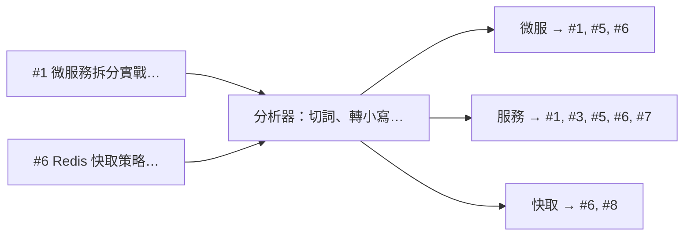

> **System Design 系列** Part 3-7｜上一篇：[Bloom Filter 與 HyperLogLog](/post/systemdesign/bloom-filter-hyperloglog/)｜下一篇：[Geohash 與地理索引](/post/systemdesign/geohash/)｜[系列地圖](/post/systemdesign/system-design-thinking/#系列地圖)

## 情境與問題

講座平台累積了 20 萬場講座，每場有標題、講者、摘要與標籤。搜尋框的需求是：

1. 輸入「微服務」找出相關講座，最相關的排前面
2. 可以輸入多個詞，例如「資料庫 交易」
3. 可以再依分類、日期篩選
4. 未公開的講座（草稿、內部場次）不能出現在搜尋結果裡

目前的實作是 `WHERE title LIKE '%微服務%' OR summary LIKE '%微服務%'`。[Index 篇](/post/systemdesign/index-btree/)提過，開頭是萬用字元的 `LIKE` 用不到索引。摘要平均 1 KB，每次搜尋就要比對 20 萬列、約 200 MB 的文字；尖峰每秒 50 次搜尋，等於每秒掃描 10 GB。

```diagram
title: 用 LIKE 做講座搜尋
row: U 使用者 | APP 講座搜尋 | DB MySQL
step: 搜尋框的需求
  20 萬場講座，每場有標題、講者、摘要與標籤。使用者輸入「微服務」，要找出相關講座、最相關的排前面，還能輸入多個詞、依分類和日期篩選，未公開的講座不能出現。
U -> APP: 微服務
note APP: 相關的排前面 [ok]
step: LIKE 用不到索引
  目前的實作是 title LIKE '%微服務%' OR summary LIKE '%微服務%'。開頭是萬用字元的 LIKE 用不到索引。
APP -> DB: LIKE '%微服務%'
note DB: 開頭是萬用字元，用不到索引 [danger]
step: 每次掃 200 MB
  摘要平均 1 KB，每次搜尋都要比對 20 萬列、約 200 MB 的文字。
APP => DB: 比對 20 萬列
note DB: 每次掃約 200 MB [danger]
step: 尖峰每秒掃 10 GB
  尖峰每秒 50 次搜尋，等於每秒掃描 10 GB。而且 LIKE 沒有排序依據：標題裡出現「微服務」和摘要最後順帶一提，對它來說一樣。
U => APP: 每秒 50 次搜尋
APP => DB: 每秒掃 10 GB [danger]
note APP: 無法依相關度排序 [danger]
```

## 最簡單的做法與它的極限

`LIKE` 的問題不只是慢：

- **沒有排序依據**：標題裡出現「微服務」和摘要最後順帶一提，對 `LIKE` 來說一樣
- **詞序固定**：`'%資料庫%交易%'` 找不到「交易與資料庫」
- **不懂語言**：大小寫、全形半形、同義詞都要自己處理

全文搜尋要先換一個方向來組織資料。

## 核心機制

### 倒排索引：從「文件有哪些詞」到「詞在哪些文件」

一般的資料表是「文件 → 內容」。倒排索引反過來，先把每份文件切成詞（term），再為每個詞記錄它出現在哪些文件、出現幾次、在哪些位置，這份清單叫 **posting list**：



查詢時只要查出每個詞的 posting list；多個詞都要出現時，取它們的交集。posting list 依文件編號排好序，交集可以像合併排序一樣一次走完，再加上跳躍指標（skip list）跳過不可能相交的區段。

### 分析器

文件與查詢都要經過同一套**分析器**（analyzer），切出來的詞才對得上：

1. **字元過濾**：去掉 HTML 標籤、全形轉半形
2. **斷詞**（tokenizer）：把文字切成詞
3. **詞過濾**（token filter）：轉小寫、去掉停用詞、詞幹還原（running → run）、同義詞

英文用空白和標點就能斷詞，中文沒有空白，是最難的一步。常見兩種做法：

| | Bigram（每兩個字一組） | 字典斷詞（IK、jieba、smartcn 等） |
|---|---|---|
| 做法 | 「微服務」→「微服」「服務」 | 依字典切成「微服務」 |
| 新詞、品牌名 | 不會漏 | 字典沒有就切錯 |
| 雜訊 | 多，見下面的實測 | 少 |
| 索引大小 | 大 | 小 |

### 實作一個倒排索引

用 8 份講座資料、bigram 斷詞、BM25 排序，實作一個最小的搜尋引擎：

<details>
<summary>實作（<code>java MiniSearchEngine.java</code>）</summary>

```java
import java.util.ArrayList;
import java.util.Comparator;
import java.util.HashMap;
import java.util.List;
import java.util.Locale;
import java.util.Map;
import java.util.TreeMap;

/** 最小的倒排索引：中文切成 bigram、英文轉小寫，記錄每個詞出現在哪些文件的哪些位置，用 BM25 排序。 */
public class MiniSearchEngine {

    static final double K1 = 1.2;                                   // Lucene / Elasticsearch 的預設值
    static final double B = 0.75;

    record Token(String term, int position) {}

    // term -> (docId -> 出現的位置)；TreeMap 讓 posting list 依 docId 排序
    final Map<String, TreeMap<Integer, List<Integer>>> index = new HashMap<>();
    final Map<Integer, Integer> docLength = new HashMap<>();
    final Map<Integer, String> titles = new HashMap<>();

    static List<Token> analyze(String text) {
        List<Token> tokens = new ArrayList<>();
        StringBuilder run = new StringBuilder();
        boolean cjk = false;
        for (int i = 0; i <= text.length(); i++) {
            char c = i < text.length() ? text.charAt(i) : ' ';
            boolean isCjk = Character.UnicodeScript.of(c) == Character.UnicodeScript.HAN;
            boolean isWord = Character.isLetterOrDigit(c) && !isCjk;
            if (run.length() > 0 && (!(isCjk || isWord) || isCjk != cjk)) {
                emit(run.toString(), cjk, tokens);
                run.setLength(0);
            }
            if (isCjk || isWord) {
                run.append(c);
                cjk = isCjk;
            }
        }
        return tokens;
    }

    static void emit(String run, boolean cjk, List<Token> tokens) {
        if (!cjk) {
            tokens.add(new Token(run.toLowerCase(Locale.ROOT), tokens.size()));
        } else if (run.length() == 1) {
            tokens.add(new Token(run, tokens.size()));
        } else {
            for (int i = 0; i + 2 <= run.length(); i++) {          // 「微服務」→「微服」「服務」
                tokens.add(new Token(run.substring(i, i + 2), tokens.size()));
            }
        }
    }

    void add(int docId, String title, String body) {
        titles.put(docId, title);
        List<Token> tokens = analyze(title + "。" + body);
        docLength.put(docId, tokens.size());
        for (Token t : tokens) {
            index.computeIfAbsent(t.term(), k -> new TreeMap<>())
                    .computeIfAbsent(docId, k -> new ArrayList<>()).add(t.position());
        }
    }

    /** 每個查詢詞的所有 bigram 都要出現；phrase = true 時還要求 bigram 的位置相鄰。 */
    List<String> search(String query, boolean phrase) {
        List<List<Token>> words = new ArrayList<>();
        for (String word : query.trim().split("\\s+")) {
            words.add(analyze(word));
        }
        Map<Integer, Double> scores = new HashMap<>();
        int n = docLength.size();
        double avgLength = docLength.values().stream().mapToInt(Integer::intValue).average().orElse(1);
        candidates:
        for (int docId : docLength.keySet()) {
            for (List<Token> word : words) {
                if (!contains(docId, word, phrase)) {
                    continue candidates;
                }
            }
            double score = 0;
            for (List<Token> word : words) {
                for (Token t : word) {
                    TreeMap<Integer, List<Integer>> postings = index.get(t.term());
                    int tf = postings.get(docId).size();
                    double idf = Math.log(1 + (n - postings.size() + 0.5) / (postings.size() + 0.5));
                    score += idf * tf * (K1 + 1) / (tf + K1 * (1 - B + B * docLength.get(docId) / avgLength));
                }
            }
            scores.put(docId, score);
        }
        return scores.entrySet().stream()
                .sorted(Map.Entry.<Integer, Double>comparingByValue(Comparator.reverseOrder()))
                .map(e -> String.format("%5.2f  #%d %s", e.getValue(), e.getKey(), titles.get(e.getKey())))
                .toList();
    }

    boolean contains(int docId, List<Token> word, boolean phrase) {
        for (Token t : word) {
            TreeMap<Integer, List<Integer>> postings = index.get(t.term());
            if (postings == null || !postings.containsKey(docId)) {
                return false;
            }
        }
        if (!phrase || word.size() == 1) {
            return true;
        }
        for (int start : index.get(word.get(0).term()).get(docId)) {
            boolean adjacent = true;
            for (int i = 1; i < word.size() && adjacent; i++) {
                adjacent = index.get(word.get(i).term()).get(docId).contains(start + i);
            }
            if (adjacent) {
                return true;
            }
        }
        return false;
    }

    public static void main(String[] args) {
        MiniSearchEngine engine = new MiniSearchEngine();
        engine.add(1, "微服務拆分實戰", "以報名系統為例，說明如何依業務能力拆分微服務，以及服務之間的資料一致性。");
        engine.add(2, "資料庫交易與隔離等級", "從 MVCC 到 lost update，說明資料庫交易在並行環境下的行為。");
        engine.add(3, "Kafka 事件驅動入門", "用 Kafka 串接訂單與通知服務，處理重複投遞與訊息順序。");
        engine.add(4, "資料庫索引設計", "B+Tree、複合索引與最左前綴，避免資料庫全表掃描。");
        engine.add(5, "API 設計規範", "稍微服從團隊既有的規範，就能讓服務的 API 更一致。");
        engine.add(6, "Redis 快取策略", "快取穿透、擊穿與雪崩，以及微服務架構下的多層快取。");
        engine.add(7, "分散式交易與 Saga", "跨服務的交易無法用單一資料庫完成，改用 Saga 與補償。");
        engine.add(8, "前端效能優化", "圖片延遲載入與 CDN 快取設定。");

        int postings = engine.index.values().stream().mapToInt(Map::size).sum();
        System.out.printf("8 份文件、%d 個不同的詞、%d 筆 posting%n", engine.index.size(), postings);
        System.out.println("「服務」的 posting list：" + engine.index.get("服務").keySet());
        System.out.println("「微服務」切成：" + analyze("微服務").stream().map(Token::term).toList());

        System.out.println("\n搜尋「微服務」，只要求兩個 bigram 都出現：");
        engine.search("微服務", false).forEach(r -> System.out.println("  " + r));
        System.out.println("搜尋「微服務」，要求 bigram 位置相鄰（phrase）：");
        engine.search("微服務", true).forEach(r -> System.out.println("  " + r));
        System.out.println("搜尋「資料庫 交易」：");
        engine.search("資料庫 交易", true).forEach(r -> System.out.println("  " + r));
        System.out.println("搜尋「KAFKA」：");
        engine.search("KAFKA", true).forEach(r -> System.out.println("  " + r));
    }
}
```

</details>

```text
8 份文件、162 個不同的詞、182 筆 posting
「服務」的 posting list：[1, 3, 5, 6, 7]
「微服務」切成：[微服, 服務]

搜尋「微服務」，只要求兩個 bigram 都出現：
   1.86  #1 微服務拆分實戰
   1.51  #5 API 設計規範
   1.49  #6 Redis 快取策略
搜尋「微服務」，要求 bigram 位置相鄰（phrase）：
   1.86  #1 微服務拆分實戰
   1.49  #6 Redis 快取策略
搜尋「資料庫 交易」：
   3.84  #2 資料庫交易與隔離等級
   3.40  #7 分散式交易與 Saga
搜尋「KAFKA」：
   2.44  #3 Kafka 事件驅動入門
```

- **bigram 的雜訊**：#5 的內容是「**稍微服**從團隊既有的規範，就能讓**服務**的 API 更一致」，「微服」和「服務」都出現了，所以被當成「微服務」的搜尋結果，甚至排在真正相關的 #6 前面
- **位置資訊解決這個問題**：要求「微服」和「服務」的位置相鄰（phrase query），#5 就被排除了。代價是索引要多存每個詞的位置
- **多個詞的搜尋**：「資料庫 交易」要求兩個詞都出現，#4 只有「資料庫」，不會出現在結果裡
- **大小寫**：英文在分析時轉成小寫，「KAFKA」也找得到「Kafka」

### 相關性排序：BM25

找出符合的文件之後，要決定誰排前面。Lucene 與 Elasticsearch 預設用 BM25，它對每個查詢詞算出一個分數再加總：

score = IDF × tf × (k1 + 1) ÷ (tf + k1 × (1 − b + b × 文件長度 ÷ 平均文件長度))

- **IDF**：越少文件包含的詞越有鑑別力。「服務」出現在 5 份文件裡，分數就比只出現在 1 份文件的「kafka」低
- **tf 與 k1**：詞在文件中出現越多次分數越高，但會飽和，出現 10 次不會是出現 1 次的 10 倍。k1 預設 1.2
- **長度與 b**：同樣出現一次，在短文件裡比在長文件裡更重要。b 預設 0.75

實測中「資料庫 交易」的 #2 排在 #7 前面：兩份文件的「交易」都出現兩次，但「資料庫」在 #2 出現兩次、在 #7 只出現一次。

### 索引的更新：segment 與 near real-time

Lucene 的索引由許多**寫完就不再修改的 segment** 組成，新文件寫進新的 segment，背景再把小 segment 合併成大的；刪除則是先做標記，合併時才真正清掉。這和 [B-Tree vs LSM 篇](/post/systemdesign/btree-vs-lsm/)的 LSM-Tree 是同一個思路。

新文件要等 refresh 之後才搜尋得到。Elasticsearch 預設每秒 refresh 一次，所以它是 **near real-time**：剛寫入的資料，可能一秒內還搜不到。

### 分散式搜尋與深分頁

Elasticsearch 的一個索引會切成多個 shard。搜尋時每個 shard 各自找出前 `from + size` 筆，再由協調節點合併排序。要第 500 頁（每頁 20 筆），每個 shard 都得準備前 10,020 筆。所以 Elasticsearch 預設不允許 `from + size` 超過 10,000（`index.max_result_window`），深分頁要改用 `search_after`，它和 [Index 篇](/post/systemdesign/index-btree/)的 keyset 分頁是同一個概念：記住上一頁最後一筆的排序值，從那裡繼續。

## 方案比較

### 用什麼做搜尋

| | `LIKE` | MySQL `FULLTEXT`（ngram parser） | Elasticsearch／OpenSearch |
|---|---|---|---|
| 中文 | 字串比對 | bigram 斷詞 | bigram 或字典斷詞外掛 |
| 相關性排序 | 無 | 有 | BM25，可調整欄位權重 |
| 篩選與統計（facet） | 一般 SQL | 一般 SQL | 原生支援，速度快 |
| 規模 | 小 | 中（數十萬到數百萬筆） | 大，可水平擴展 |
| 和業務資料的一致性 | 同一個交易 | 同一個交易 | 最終一致，需要同步機制 |
| 維運成本 | 無 | 無 | 多一套叢集 |

PostgreSQL 內建的全文搜尋不會切中文，需要 zhparser、pg_bigm 這類擴充。

### Elasticsearch 的資料同步

搜尋索引是**衍生資料**，資料庫才是唯一的資料來源，這和 [CQRS](/post/architecture/cqrs/) 的讀取模型是同一個概念。常見的同步方式：

| 方式 | 做法 | 問題 |
|---|---|---|
| 雙寫 | 應用程式寫完資料庫，再寫 Elasticsearch | 第二步失敗時兩邊不一致，而且沒有人知道 |
| Outbox | 和業務資料同一個交易寫入事件表，再由背景程序送到索引（見 [Outbox Pattern](/post/architecture/outbox-pattern/)） | 多一張表、一個背景程序 |
| CDC | 讀取資料庫的 binlog，把變更送到索引 | 多一套 CDC 元件 |
| 定期全量重建 | 建新索引、灌資料，再用 alias 切換 | 只適合能接受延遲的資料 |

實務上常把 outbox 或 CDC 的即時同步，與定期全量重建一起使用：即時同步處理日常變更，全量重建修正累積的不一致，也用在 mapping 或分析器變更的時候。

## Java 落地

### 1. 先用 MySQL FULLTEXT

20 萬場講座還在 MySQL 的能力範圍內，不需要一開始就多維運一套 Elasticsearch：

```sql
ALTER TABLE lecture
    ADD FULLTEXT INDEX ft_lecture (title, summary) WITH PARSER ngram;
```

ngram parser 預設每兩個字切一次（`ngram_token_size = 2`），和前面的 bigram 一樣。查詢模式的差別很重要：

- **Natural language mode**：查詢詞也切成 bigram，再取**聯集**。「微服務」會變成「含有微服**或**服務」，雜訊很多
- **Boolean mode**：查詢詞轉成 bigram 的**片語搜尋**，要求位置相鄰，相當於前面實測的 phrase query

所以用 boolean mode，但使用者輸入不能直接放進去：

```java
package search;

import java.util.Arrays;
import java.util.List;
import java.util.stream.Collectors;
import org.springframework.jdbc.core.simple.JdbcClient;

public class LectureSearchRepository {

    private static final int MAX_TERMS = 5;
    private static final int MAX_LIMIT = 50;

    private final JdbcClient jdbc;

    public LectureSearchRepository(JdbcClient jdbc) {
        this.jdbc = jdbc;
    }

    public record Hit(long id, String title, double score) {}

    /** 可見性條件和搜尋條件放在同一個查詢裡，搜尋結果永遠不會包含未公開的講座。 */
    public List<Hit> search(String userInput, int limit) {
        String query = toBooleanQuery(userInput);
        if (query.isEmpty()) {
            return List.of();
        }
        return jdbc.sql("""
                SELECT id, title, MATCH(title, summary) AGAINST (:q IN BOOLEAN MODE) AS score
                  FROM lecture
                 WHERE MATCH(title, summary) AGAINST (:q IN BOOLEAN MODE)
                   AND visibility = 'PUBLIC'
                 ORDER BY score DESC, id DESC
                 LIMIT :limit
                """)
                .param("q", query)
                .param("limit", Math.min(limit, MAX_LIMIT))
                .query(Hit.class)
                .list();
    }

    /** 使用者輸入只當成文字：移除 boolean mode 的運算子，每個詞都必須出現，最多 5 個詞。 */
    static String toBooleanQuery(String userInput) {
        return Arrays.stream(userInput.replaceAll("[+\\-<>()~*\"@]", " ").trim().split("\\s+"))
                .filter(term -> !term.isBlank())
                .limit(MAX_TERMS)
                .map(term -> "+\"" + term + "\"")
                .collect(Collectors.joining(" "));
    }
}
```

`toBooleanQuery` 的實際效果：

```text
微服務                          -> +"微服務"
資料庫 交易                       -> +"資料庫" +"交易"
+微服務 -kafka                  -> +"微服務" +"kafka"
"交易" (隔離) <等級> ~mvcc* @3     -> +"交易" +"隔離" +"等級" +"mvcc" +"3"
a b c d e f g                -> +"a" +"b" +"c" +"d" +"e"
```

使用者打的 `+`、`-`、`*`、`~` 等 boolean mode 運算子都被移除，每個詞都包成必須出現的片語；`-kafka` 這種「排除」語意也一併被拿掉，換來的是查詢行為完全可預期。詞數與筆數都有上限。

### 2. 改用 Elasticsearch 時

資料量或功能需求超出 MySQL 時（例如需要 facet 統計、自動完成），索引的 mapping 指定中文分析器，`visibility` 用 `keyword` 型別做精確篩選：

```json
PUT /lectures-v2
{
  "mappings": {
    "properties": {
      "title":      { "type": "text", "analyzer": "cjk" },
      "summary":    { "type": "text", "analyzer": "cjk" },
      "visibility": { "type": "keyword" },
      "startsAt":   { "type": "date" }
    }
  }
}
```

`cjk` 是 Elasticsearch 內建的分析器，用的就是 bigram。查詢時把使用者輸入放在 `multi_match` 裡，欄位由伺服器決定，可見性放在 `filter`：

```json
GET /lectures/_search
{
  "query": {
    "bool": {
      "must":   { "multi_match": { "query": "微服務", "fields": ["title^3", "summary"], "type": "phrase" } },
      "filter": { "term": { "visibility": "PUBLIC" } }
    }
  },
  "size": 20
}
```

`title^3` 讓標題的權重是摘要的三倍。`filter` 裡的條件不參與計分，結果還能被快取。

應用程式一律透過 alias（`lectures`）存取索引。要改 mapping 或分析器時，建立新索引 `lectures-v2`、灌完資料，再一次切換 alias：

```json
POST /_aliases
{
  "actions": [
    { "remove": { "index": "lectures-v1", "alias": "lectures" } },
    { "add":    { "index": "lectures-v2", "alias": "lectures" } }
  ]
}
```

同一個請求裡的 alias 操作是原子的，搜尋不會在切換途中失敗。

## 踩坑與 Gotchas

- **建索引與查詢用了不同的分析器**：切出來的詞對不上，明明存在的文件就是搜不到
- **bigram 沒有搭配位置**：「稍微服從」也會被當成「微服務」
- **字典斷詞漏掉新詞**：新的技術名詞、品牌名沒進字典就切錯，要有更新字典的流程
- **寫入後立刻搜尋**：near real-time 代表可能一秒內還搜不到。「新增後跳轉到搜尋頁」這種流程要直接從資料庫讀
- **改了同義詞或停用詞卻沒有重建索引**：建索引時套用的分析器變了，舊文件的詞不會自動更新
- **以為欄位型別可以直接修改**：Elasticsearch 已存在欄位的型別不能改，只能建新索引再 reindex，所以一開始就要用 alias
- **深分頁用 `from` + `size`**：超過 10,000 筆會被拒絕，改用 `search_after`
- **雙寫**：資料庫與索引早晚會不一致
- **把 Elasticsearch 當主資料庫**：它沒有跨文件的交易，叢集出問題時，要能從資料庫重建

### 資安相關

- **搜尋是另一條讀取路徑，授權要跟著過去**：資料庫的 API 有檢查權限，但索引裡如果也有草稿和內部講座，搜尋結果、摘要的高亮片段、自動完成的建議，甚至「共找到 N 筆」的總數，都會洩漏它們的存在。可見性與租戶條件要放進**查詢本身**；查完再在應用程式裡過濾，分頁筆數與總數仍然會洩漏。這是 BOLA 的另一種形態（[Part 8](/post/systemdesign/authorization-owasp-api-top10/)）
- **查詢語法注入**：Elasticsearch 的 `query_string` 允許使用者在輸入中指定欄位（例如 `internal_note:*`）、使用萬用字元與正規表示式，等於把查詢語言開放給外部。官方文件也不建議把它用在搜尋框；改用 `match` 或 `simple_query_string`，欄位由伺服器決定。MySQL 的 boolean mode 同理，運算子要先移除
- **昂貴的查詢就是 DoS**：開頭是萬用字元、正規表示式、極大的 `size`、極深的分頁、上百個詞的查詢，都能讓叢集忙到無法服務其他人。限制詞數、筆數與分頁深度，並設定查詢逾時
- **刪除要同步到索引**：資料庫刪掉了，索引裡還在，搜尋就會繼續回傳已刪除的個資；被刪除的文件在 segment 合併前仍留在磁碟上，snapshot 裡也有。刪除流程要涵蓋索引，原因和 [B-Tree vs LSM 篇](/post/systemdesign/btree-vs-lsm/)的「刪除不等於抹除」相同。叢集本身也要開啟驗證、不能暴露在網路上（見 [SQL vs NoSQL 篇](/post/systemdesign/sql-vs-nosql/)）

## 何時用／何時別用

- **MySQL `FULLTEXT`**：數十萬到數百萬筆、需要和業務資料強一致、不想多維運一套系統
- **Elasticsearch／OpenSearch**：資料量大、需要 facet 統計與自動完成、複雜的相關性調整、日誌搜尋
- **別用**：精確查找（用一般的 B+Tree 索引就好）、把搜尋引擎當成唯一的資料來源

## 參考資料

- Justin Zobel, Alistair Moffat, "Inverted Files for Text Search Engines", *ACM Computing Surveys*, 2006
- Stephen Robertson, Hugo Zaragoza, "The Probabilistic Relevance Framework: BM25 and Beyond", *Foundations and Trends in Information Retrieval*, 2009
- Christopher D. Manning, Prabhakar Raghavan, Hinrich Schütze, *Introduction to Information Retrieval*, Cambridge University Press, 2008
- MySQL 8.4 Reference Manual — ngram Full-Text Parser：<https://dev.mysql.com/doc/refman/8.4/en/fulltext-search-ngram.html>
- MySQL 8.4 Reference Manual — Boolean Full-Text Searches：<https://dev.mysql.com/doc/refman/8.4/en/fulltext-boolean.html>
- Elasticsearch Reference — Similarity settings（BM25）：<https://www.elastic.co/docs/reference/elasticsearch/index-settings/similarity>
- Elasticsearch Reference — Paginate search results：<https://www.elastic.co/docs/reference/elasticsearch/rest-apis/paginate-search-results>
- Elasticsearch Reference — Query string query：<https://www.elastic.co/docs/reference/query-languages/query-dsl/query-dsl-query-string-query>
- Elasticsearch Reference — CJK bigram token filter：<https://www.elastic.co/docs/reference/text-analysis/analysis-cjk-bigram-tokenfilter>
- 互動圖解延伸：Dilum Sanjaya，System Design — an interactive course：<https://designed-to-scale.vercel.app/>
