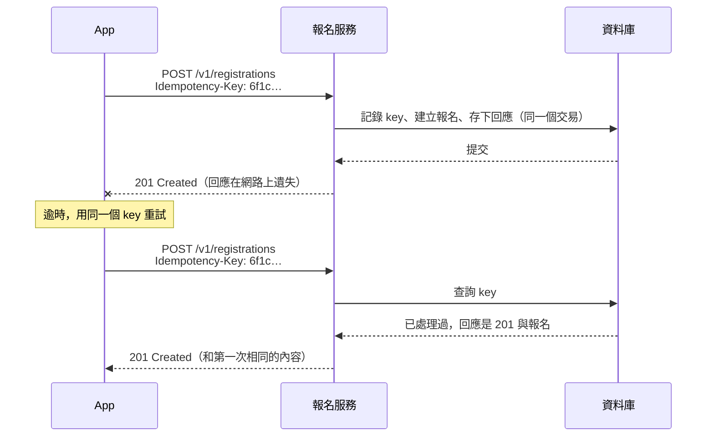

> **System Design 系列** Part 5-4｜上一篇：[Pub/Sub 與投遞語意](/post/systemdesign/pubsub-delivery-semantics/)｜下一篇：[即時更新](/post/systemdesign/realtime-updates/)｜[系列地圖](/post/systemdesign/system-design-thinking/#系列地圖)

## 情境與問題

使用者在捷運上按下「報名並付款」。請求送到伺服器，報名成功、款項扣了，但回應在回程的網路上遺失了。App 等了 10 秒沒有回應，顯示「網路錯誤，請重試」。使用者再按一次。

伺服器收到的第二個請求和第一個一模一樣。如果它照常處理，使用者就**被扣了兩次錢**。

這不是罕見的情況。網路逾時之後，用戶端**無法分辨**請求是「沒送到」、「送到了但處理失敗」，還是「處理成功但回應遺失」。重試在每一層都會發生：

- 使用者重按按鈕
- App 或前端的 HTTP 用戶端自動重試
- API gateway、service mesh 的重試設定
- 服務之間呼叫的重試（Part 6 的 Timeout 與 Retry）
- Message queue 的重新投遞（[Message Queue 篇](/post/systemdesign/message-queue/)）

前一篇已經說明，訊息系統的「exactly-once」實際上是「at-least-once + 冪等處理」。API 也一樣：**要讓重試安全，操作本身必須是冪等的**。

## 最簡單的做法與它的極限

- **前端在送出後停用按鈕**：擋得住連點，擋不住逾時後的重試、App 被關掉重開、網路層的自動重試
- **資料庫唯一鍵**：在 `(lecture_id, member_id)` 加上唯一索引，同一個會員不能報名同一場講座兩次。這在報名上很有效，但有兩個限制：
  - 重試的請求會收到「已經報名過」的錯誤，而第一次其實成功了。用戶端要特別處理這個錯誤，才知道「其實是成功的」
  - 不是每個操作都有天然的唯一鍵。加購講義可以買兩份、儲值可以儲兩次，「內容相同」不代表「是同一個操作」

## 核心機制

### 什麼是冪等

一個操作執行一次和執行多次，對系統狀態的**效果相同**，就是冪等的。注意是效果，不是回應：第二次刪除同一筆資料可能回 404，但資料的狀態沒有差別。

HTTP 規格定義了方法的語意：GET、HEAD、PUT、DELETE 是冪等的，POST 不是，PATCH 不一定（[REST、gRPC 與 GraphQL 篇](/post/systemdesign/rest-grpc-graphql/)）。這是語意上的承諾，實作也要遵守：一個會「每呼叫一次就加 1」的 PUT，違反了規格。

### 讓操作天生冪等

在加上 Idempotency Key 之前，先看操作本身能不能設計成冪等的：

| 做法 | 例子 | 冪等嗎 |
|---|---|---|
| 設定為某個值 | `UPDATE registration SET status = 'CANCELLED'` | 是 |
| 增減某個值 | `UPDATE lecture SET remaining = remaining - 1` | 否 |
| 帶上預期版本的條件式更新 | `... SET status = 'PAID', version = 8 WHERE id = ? AND version = 7` | 是，重試時版本已經不符，不會再更新一次 |
| 用戶端決定資源的 ID | `PUT /v1/registrations/{用戶端產生的 UUID}` | 是，第二次只是覆寫同一筆 |
| 天然的唯一鍵 | `(lecture_id, member_id)` 唯一索引 | 重複的寫入會被擋下 |

能這樣設計就不需要額外的機制。但「建立一筆付款」「加購一份講義」這類操作，天生就不是冪等的，這時要用 Idempotency Key。

### Idempotency Key

用戶端為**每一個邏輯上的操作**產生一個唯一的 key（例如 UUIDv4），放在 `Idempotency-Key` header 送出。**重試時沿用同一個 key**。伺服器記住每個 key 的處理結果，同一個 key 再來時，直接回傳上次的結果，不再執行一次。



IETF 的 httpapi 工作小組有一份 `Idempotency-Key` header 的草案（draft-07，2025 年 10 月），目前還不是 RFC，但很多金流與雲端服務的 API 早已採用相同的做法。草案把 header 的值定義成 Structured Field 的字串，要加雙引號（`Idempotency-Key: "6f1c…"`），不少既有 API 則接受不加引號的值；選一種寫進 API 文件即可，本文的範例用不加引號的 UUID。草案建議的錯誤回應：

| 情況 | 回應 |
|---|---|
| 需要 key 的操作沒有帶 key | 400 |
| 同一個 key 配上不同的請求內容 | 422 |
| 同一個 key 的前一個請求還在處理中 | 409 |

### 設計時要決定的事

**Key 的範圍**：key 只在同一個使用者、同一個操作的範圍內有意義。資料表的主鍵是 `(使用者 ID, key)`，而不是只有 key。原因見資安相關。

**請求指紋**：記下第一次請求內容的雜湊。同一個 key 配上不同的內容，代表用戶端的 bug（例如把 key 存在全域變數，每個操作都用同一個），要回 422，而不是回傳另一個操作的結果。

**並行的重複請求**：使用者連點兩下，兩個帶著同一個 key 的請求幾乎同時到達。如果兩者都先查詢「這個 key 存在嗎」，都得到「不存在」，就會都執行。解法是讓資料庫的唯一鍵當裁判：

- **操作只涉及本地資料庫**時，把「寫入 key」「執行業務邏輯」「存下回應」放在**同一個交易**裡，而且先寫入 key。第二個請求寫入同一個 key 時，會等待第一個交易結束：第一個提交了，第二個得到唯一鍵衝突，改為讀取已存的回應；第一個回滾了，第二個就正常執行。不需要「處理中」的狀態，當機時也不會留下半套的紀錄
- **操作要呼叫外部服務**（例如金流）時，不能把外部呼叫放在資料庫交易裡等待。改成兩段：先提交一筆「處理中」的 key，再呼叫外部服務，最後更新為「完成」並存下回應。處理中的 key 被重試時回 409。當機會讓 key 卡在處理中，要有一個復原程序：用同一個衍生的 key 向金流查詢或重送（金流端也要冪等），再把結果補上

**要記住哪些結果**：

- **成功的結果**：一定要記住
- **業務上的失敗**（例如名額已滿）：可以記住，讓重試得到一致的答案；也可以不記住，讓重試重新判斷。要明確選一種，並寫進 API 文件
- **5xx 與暫時性錯誤**：不要記住。否則一次資料庫連線逾時，就讓這個 key 永遠失敗。放在同一個交易裡的設計天然滿足這點：交易回滾，key 也不會留下

**保存期限**：key 不能永遠保存。保存期限要比用戶端可能重試的最長時間更長（例如 24 小時），並寫進 API 文件。過期之後用同一個 key 送出，會被當成新的操作。

### 一路傳下去

報名服務呼叫金流時，也可能逾時重試，所以冪等要**每一層都做到**。報名服務不要直接把使用者的 key 轉給金流，而是衍生出新的 key，例如 `{會員 ID}:{使用者的 key}:charge`。這樣同一個使用者操作重試時，送給金流的 key 相同；不同的操作，或同一個操作裡不同的外部呼叫，key 則不同。

訊息的消費者也是同一個概念，只是 key 換成事件 ID（[Pub/Sub 篇](/post/systemdesign/pubsub-delivery-semantics/)的去重表）。

## 方案比較

| 做法 | 優點 | 限制 | 適合 |
|---|---|---|---|
| 天然唯一鍵 | 簡單，資料庫保證 | 重試得到錯誤而不是原本的結果；不是每個操作都有天然鍵 | 一個人只能做一次的操作 |
| 條件式更新（版本號） | 不需要額外的表 | 只適用於更新既有資料 | 狀態轉換、編輯 |
| 用戶端產生 ID + PUT | 符合 HTTP 語意，天生冪等 | 用戶端要能產生 ID，API 設計要配合 | 建立資源 |
| Idempotency Key 表（與業務資料同一個資料庫） | 通用，回傳一致的結果，和業務資料一起提交 | 多一張表、要清理 | 付款、加購這類天生不冪等的建立操作 |
| Idempotency Key 存在 Redis | 快，TTL 自動清理 | 和資料庫不在同一個交易：業務提交後、寫入 Redis 前當機，重試會再執行一次 | 業務本身已經有其他保護、只是為了減少重複工作 |

## Java 落地

### 1. 資料表

```sql
CREATE TABLE idempotency_record (
    owner_id        BIGINT       NOT NULL,
    idem_key        VARCHAR(64)  NOT NULL,
    request_hash    CHAR(64)     NOT NULL,
    response_status INT,
    response_body   JSON,
    created_at      TIMESTAMP(3) NOT NULL DEFAULT CURRENT_TIMESTAMP(3),
    PRIMARY KEY (owner_id, idem_key),
    KEY idx_created_at (created_at)
);
```

### 2. 儲存 key 與回應

```java
@Repository
public class IdempotencyStore {

    private final JdbcClient jdbc;

    public IdempotencyStore(JdbcClient jdbc) {
        this.jdbc = jdbc;
    }

    /** 搶下這個 key。同一個 key 的並行請求會在這裡等前一個交易結束；key 已存在時回傳 false。 */
    public boolean tryClaim(long ownerId, String key, String requestHash) {
        try {
            jdbc.sql("""
                            INSERT INTO idempotency_record (owner_id, idem_key, request_hash)
                            VALUES (:ownerId, :key, :hash)
                            """)
                    .param("ownerId", ownerId)
                    .param("key", key)
                    .param("hash", requestHash)
                    .update();
            return true;
        } catch (DuplicateKeyException e) {
            return false;
        }
    }

    public void complete(long ownerId, String key, StoredResponse response) {
        jdbc.sql("""
                        UPDATE idempotency_record
                           SET response_status = :status, response_body = :body
                         WHERE owner_id = :ownerId AND idem_key = :key
                        """)
                .param("status", response.status())
                .param("body", response.body())
                .param("ownerId", ownerId)
                .param("key", key)
                .update();
    }

    public Optional<IdempotencyRecord> find(long ownerId, String key) {
        return jdbc.sql("""
                        SELECT request_hash AS requestHash, response_status AS responseStatus,
                               response_body AS responseBody
                          FROM idempotency_record
                         WHERE owner_id = :ownerId AND idem_key = :key
                        """)
                .param("ownerId", ownerId)
                .param("key", key)
                .query(IdempotencyRecord.class)
                .optional();
    }
}

public record StoredResponse(int status, String body) {}

public record IdempotencyRecord(String requestHash, int responseStatus, String responseBody) {

    public StoredResponse response() {
        return new StoredResponse(responseStatus, responseBody);
    }
}
```

### 3. 在同一個交易裡完成

```java
@Service
public class IdempotentRegistrationService {

    private static final String OPERATION = "POST /v1/registrations";

    private final IdempotencyStore store;
    private final RegistrationService registrations;
    private final TransactionTemplate transactions;
    private final ObjectMapper objectMapper;

    public IdempotentRegistrationService(IdempotencyStore store, RegistrationService registrations,
                                         TransactionTemplate transactions, ObjectMapper objectMapper) {
        this.store = store;
        this.registrations = registrations;
        this.transactions = transactions;
        this.objectMapper = objectMapper;
    }

    public StoredResponse register(long memberId, String key, RegistrationRequest request) {
        String requestHash = fingerprint(request);
        try {
            return transactions.execute(status -> {
                if (!store.tryClaim(memberId, key, requestHash)) {
                    throw new KeyAlreadyUsedException();
                }
                Registration registration = registrations.register(request.lectureId(), memberId, request.ticketType());
                StoredResponse response = new StoredResponse(201,
                        objectMapper.writeValueAsString(RegistrationView.from(registration)));
                store.complete(memberId, key, response);
                return response;
            });
        } catch (KeyAlreadyUsedException e) {
            IdempotencyRecord existing = store.find(memberId, key).orElseThrow();
            if (!existing.requestHash().equals(requestHash)) {
                throw new IdempotencyKeyMismatchException();     // 對應 422
            }
            return existing.response();
        }
    }

    /** 用明確的欄位組成指紋，不要對整個 JSON 字串做雜湊：欄位順序或空白不同就會誤判。 */
    private static String fingerprint(RegistrationRequest request) {
        String canonical = OPERATION + "|" + request.lectureId() + "|" + request.ticketType();
        try {
            byte[] digest = MessageDigest.getInstance("SHA-256").digest(canonical.getBytes(StandardCharsets.UTF_8));
            return HexFormat.of().formatHex(digest);
        } catch (NoSuchAlgorithmException e) {
            throw new IllegalStateException(e);
        }
    }

    private static final class KeyAlreadyUsedException extends RuntimeException {
    }
}
```

- 先 `tryClaim` 再執行業務邏輯：並行的重複請求在 `INSERT` 等待，不會兩個都執行
- **只在 `tryClaim` 周圍處理唯一鍵衝突**。`registrations.register` 也可能因為 `(lecture_id, member_id)` 的唯一索引丟出 `DuplicateKeyException`，那代表「這個會員用另一個 key 報名過了」，是不同的情況，不能當成「這個 key 已經處理過」
- 業務例外（例如名額已滿）會讓整個交易回滾，key 也不會留下，重試會重新判斷。這裡選擇不記住業務上的失敗
- `KeyAlreadyUsedException` 在交易內丟出，交易回滾後才在交易外查詢已存的紀錄：PostgreSQL 的交易在語句出錯後就不能再執行任何查詢，交易外的查詢也一定看得到另一個交易已提交的紀錄
- Spring Boot 4 使用 Jackson 3，`writeValueAsString` 丟出的是 unchecked 例外，可以直接寫在 lambda 裡；Jackson 2 的 `JsonProcessingException` 是 checked 例外，要另外包裝

### 4. Controller 與清理

```java
private static final Pattern VALID_KEY = Pattern.compile("[0-9a-fA-F-]{36}");    // 只接受 UUID 格式

@PostMapping("/v1/registrations")
public ResponseEntity<String> register(@AuthenticationPrincipal Member member,
                                       @RequestHeader("Idempotency-Key") String key,
                                       @Valid @RequestBody RegistrationRequest request) {
    if (!VALID_KEY.matcher(key).matches()) {
        return ResponseEntity.badRequest().build();
    }
    StoredResponse response = service.register(member.id(), key, request);
    return ResponseEntity.status(response.status())
            .contentType(MediaType.APPLICATION_JSON)
            .body(response.body());
}
```

```java
@Scheduled(cron = "0 */10 * * * *")
public void purgeExpiredKeys() {
    int deleted;
    do {                                                        // 分批刪除，避免一次鎖住大量資料列
        deleted = jdbc.sql("""
                        DELETE FROM idempotency_record
                         WHERE created_at < NOW(3) - INTERVAL 24 HOUR
                         LIMIT 5000
                        """)
                .update();
    } while (deleted == 5000);
}
```

### 5. 用戶端：一個操作一個 key

```java
String idempotencyKey = UUID.randomUUID().toString();           // 在使用者按下按鈕時產生，重試時沿用
RegistrationView view = retryWithBackoff(() -> restClient.post()     // retryWithBackoff 代表任何有上限的重試機制（Part 6）
        .uri("/v1/registrations")
        .header("Idempotency-Key", idempotencyKey)
        .body(request)
        .retrieve()
        .body(RegistrationView.class));
```

> 以上程式碼依 Spring Framework 與 Spring Boot 官方文件撰寫，沒有實際編譯與執行。SQL 以 MySQL 為例。

## 踩坑與 Gotchas

- **每次重試都產生新的 key**：key 在重試的迴圈裡產生，等於沒有冪等。key 要在「使用者決定做這件事」時產生一次
- **先查詢再寫入**：「查不到 key 就執行」在並行請求下會兩個都執行。要讓唯一鍵或鎖來決定誰先
- **Key 存在 Redis、業務資料存在資料庫**：兩者不在同一個交易，當機時會不一致。業務在資料庫，key 就放同一個資料庫
- **記住了 5xx**：一次暫時性錯誤被永久記住，這個 key 之後永遠失敗
- **保存期限比重試期間短**：App 離線一天後重送，key 已經被清掉，操作被執行第二次
- **同一個 key 用在不同的 API**：指紋或主鍵裡要包含操作的種類
- **用內容去重**：「同一個人一分鐘內送出相同內容就當重複」會擋掉合法的重複購買。重複與否由用戶端的 key 決定，不由內容猜測
- **反向代理或 service mesh 自動重試 POST**：確認重試設定只針對冪等的方法，或只對有 Idempotency Key 的請求重試
- **混淆不同的唯一鍵衝突**：idempotency 表的衝突和業務表的衝突意義完全不同，要分開處理

### 資安相關

- **Key 的範圍必須綁定使用者**：如果 key 是全域唯一的，攻擊者拿到（或猜到）別人的 key，用它送出請求，就會收到別人上次的回應，裡面可能有姓名、付款資訊；或者搶先用掉別人的 key，讓對方的真實請求被當成重複或收到 422。主鍵要包含已驗證的使用者 ID，查詢時一律帶上
- **Key 要不可預測**：用 UUIDv4 這類隨機值，不要用遞增數字或時間戳（[分散式 ID 篇](/post/systemdesign/distributed-id/)的資安相關）
- **限制 key 的格式與數量**：不限制長度與格式，攻擊者可以塞入超長字串或大量不同的 key 撐爆資料表。驗證格式、限制長度，並對建立操作做速率限制
- **存下的回應也是敏感資料**：回應內容和業務資料一樣需要存取控制與保存期限，不要把整份回應寫進 log
- **冪等不是防重放**：攻擊者截取到一個請求，換一個新的 key 重送，伺服器會當成新的操作。防重放靠的是身分驗證、短效的 token 與 CSRF 防護，不是 Idempotency Key
- **指紋檢查擋住 key 的濫用**：沒有指紋檢查時，同一個 key 配上不同的內容會直接拿到第一次的成功結果，用戶端可能誤以為第二個操作也成功了

## 何時用／何時別用

- **用 Idempotency Key**：建立付款、訂單、加購這類天生不冪等、重複執行代價高的 POST；呼叫外部的金流與第三方 API 時，也帶上它們支援的冪等 key
- **先用更簡單的做法**：有天然唯一鍵就用唯一鍵；狀態轉換用條件式更新；能讓用戶端決定 ID 就用 PUT
- **不需要**：GET 等本來就冪等的讀取操作；重複執行完全無害的操作

## 參考資料

- RFC 9110, "HTTP Semantics", Section 9.2.2 Idempotent Methods：<https://www.rfc-editor.org/rfc/rfc9110#section-9.2.2>
- IETF draft-ietf-httpapi-idempotency-key-header-07, "The Idempotency-Key HTTP Header Field", October 2025：<https://datatracker.ietf.org/doc/draft-ietf-httpapi-idempotency-key-header/>
- Pat Helland, "Idempotence Is Not a Medical Condition", *ACM Queue*, 2012
- Brandur Leach, "Implementing Stripe-like Idempotency Keys in Postgres", 2017：<https://brandur.org/idempotency-keys>
- Stripe API Reference — Idempotent requests：<https://docs.stripe.com/api/idempotent_requests>
- Spring Framework Reference — Programmatic Transaction Management：<https://docs.spring.io/spring-framework/reference/data-access/transaction/programmatic.html>
- 互動圖解延伸：Dilum Sanjaya，System Design — an interactive course：<https://designed-to-scale.vercel.app/>
