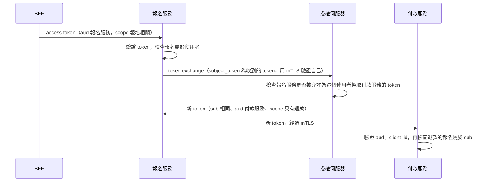

> **System Design 系列** Part 8-3｜上一篇：[授權模型與 OWASP API Top 10](/post/systemdesign/authorization-owasp-api-top10/)｜下一篇：[傳輸與資料加密及 Secrets 管理](/post/systemdesign/encryption-secrets/)｜[系列地圖](/post/systemdesign/system-design-thinking/#系列地圖)

## 情境與問題

講座平台的請求路徑現在是這樣：

```text
瀏覽器 → BFF → 報名服務 → 付款服務
                       ↘ 通知服務
```

BFF 確認了使用者已登入；報名服務依[上一篇](/post/systemdesign/authorization-owasp-api-top10/)的做法，檢查了「這筆報名屬於你」。接著報名服務呼叫付款服務退款。付款服務收到請求時，要回答兩個問題：

1. **呼叫我的是哪個服務？** 是報名服務，還是被入侵的推薦服務，或是一個在內部網路裡的攻擊者？
2. **它代表哪個使用者？** 這筆退款是不是那個使用者自己的？

```diagram
title: 付款服務該相信誰？
row: B 瀏覽器 | BFF BFF | REG 報名服務
row: . | ATK 內部網路的攻擊者 | PAY 付款服務
step: 外面那一層都檢查了
  BFF 確認了使用者已登入；報名服務檢查了「這筆報名屬於你」。
B -> BFF: 已登入
BFF -> REG: 使用者的請求
note REG: 這筆報名屬於你 [ok]
step: 報名服務呼叫付款服務
  報名服務呼叫付款服務退款。付款服務要回答兩個問題：呼叫我的是哪個服務？它代表哪個使用者？
REG -> PAY: 退款
note PAY: 誰在呼叫？代表誰？
step: 內部網路來的就相信
  如果付款服務的答案是「請求來自內部網路，所以一定是報名服務，而報名服務一定檢查過了」……
REG -> PAY: 退款
note PAY: 內部來的，就相信 [danger]
step: 從內部繞過去
  內部網路裡任何一台機器被入侵，攻擊者就能直接呼叫退款 API，退任何一筆款。外面那一層的授權檢查再完整，BOLA 也會從內部繞過去。
ATK => PAY: 直接呼叫退款 [danger]
note PAY: 退了任何一筆款 [danger]
```

如果付款服務的答案是「請求來自內部網路，所以一定是報名服務，而報名服務一定檢查過了」，那麼只要內部網路裡任何一台機器被入侵，攻擊者就能直接呼叫 `POST /v1/refunds`，退任何一筆款。外面那一層的授權檢查再完整，BOLA 也會從內部繞過去。

## 最簡單的做法與它的極限

**相信內部網路**：防火牆擋住外部，內部服務之間不驗證身分。

- 攻擊者只要進入內部網路的任何一個點（一個有漏洞的服務、一台被釣魚的員工電腦、[SSRF](/post/systemdesign/authorization-owasp-api-top10/)），就能呼叫所有內部 API。這就是橫向移動

**Gateway 驗證 token 之後，加上 `X-User-Id` 標頭往下傳**：

- 下游服務看到 `X-User-Id: 123` 就相信。但任何能連到下游服務的程式，都能自己加上這個標頭，假冒任何使用者

**把使用者的 access token 原封不動往下傳**：

- 下游可以驗證簽章，比標頭好。但這個 token 的 `aud` 必須同時包含報名、付款、通知等所有服務，scope 也要涵蓋整條呼叫鏈需要的所有權限
- 任何一個收到 token 的下游服務被入侵，攻擊者就拿到一個能呼叫所有服務的 token，有效期限內都能重複使用
- 內部服務的權限模型和外部 token 的格式綁在一起

## 核心機制

### 兩種身分都要有

| 身分 | 回答的問題 | 怎麼證明 |
|---|---|---|
| 工作負載身分（workload identity） | 呼叫我的是哪個服務？ | mTLS 憑證、client credentials 取得的 token、Kubernetes 的 service account token |
| 使用者情境（subject） | 這個呼叫代表哪個使用者、在做哪一件事？ | 交換過的 token、Transaction Token |

只有工作負載身分，付款服務知道「是報名服務在呼叫」，但不知道使用者是誰，只能相信報名服務；只有使用者情境，付款服務知道使用者是誰，但無法確認傳遞這個情境的是可信任的服務。

### 工作負載身分：mTLS 與 SPIFFE

一般的 TLS 只有伺服器出示憑證；**mTLS** 讓用戶端也出示憑證，雙方都能驗證對方的身分（憑證與信任鏈的基礎見 [網頁憑證信任](/post/security/web-certificate-trust/)）。

服務的身分要寫在憑證裡。**SPIFFE** 定義了一種統一的格式：`spiffe://lectures.example.com/ns/lectures/sa/registration`，放在憑證的 SAN（URI 類型）。SPIRE、Istio 這類系統負責：

- 確認一個工作負載真的是它聲稱的服務（依 Kubernetes 的 namespace 與 service account、雲端主機的身分等）
- 簽發**短期**的憑證（常見是一小時左右），並自動輪替

短期憑證讓「撤銷」變得不重要：憑證洩漏後，最多一小時就失效，不需要依賴 CRL 或 OCSP。

有了工作負載身分，付款服務可以設定政策：只接受報名服務與結帳協調者的呼叫。推薦服務被入侵，連 TLS 交握都過不了，或者在授權檢查時被拒絕。

### 使用者情境怎麼往下傳

| 做法 | 下游拿到什麼 | 優點 | 問題 |
|---|---|---|---|
| 傳遞原始的 access token | 外部發的 token，`aud` 涵蓋所有服務 | 不需要額外的元件 | token 權限太大；任何一個下游被入侵都能拿去重複使用 |
| 標頭 + mTLS | `X-User-Id`，但只接受特定工作負載送來的 | 簡單、沒有額外延遲 | 被允許的那個上游服務一旦被入侵，可以假冒任何使用者 |
| Token exchange（RFC 8693） | 每一跳換一個新 token：`aud` 只有下一個服務、scope 縮小 | 已經是標準；每個 token 的權限最小 | 每一跳都要呼叫授權伺服器（可以快取） |
| Transaction Token（IETF draft） | 在入口換一次、整條呼叫鏈不變的內部 token | 只換一次；包含交易的情境 | 仍是 draft；需要一個簽發服務 |

### Token exchange：每一跳都縮小權限



- 新 token 的 `sub` 仍然是使用者，`aud` 只有付款服務，scope 只有這一跳需要的權限。付款服務被入侵，拿到的 token 也不能拿去呼叫其他服務
- 授權伺服器可以設定政策：只有報名服務能換取付款服務的 token。新 token 裡的 `client_id`（RFC 9068）記錄了是哪個 client 換的；RFC 8693 的 `act` 聲明可以進一步記錄完整的代理鏈
- 代價是每一跳都多一次呼叫授權伺服器。粗略估算：開放報名的尖峰每秒約 800 個報名請求，每個都要換一次付款服務的 token，授權伺服器就多了每秒 800 次 token exchange，每次增加 5 到 20 毫秒的延遲。換到的 token 可以依（使用者、目標服務）快取到過期前，但報名這種「每個使用者只做一次」的操作，快取的命中率很低

### Transaction Token（IETF draft）

IETF OAuth 工作小組的 **Transaction Tokens**（draft-ietf-oauth-transaction-tokens-11，2026 年 7 月 30 日，仍是工作小組草案，尚未成為 RFC，內容可能變動）處理的正是這個情境：

- 外部請求進入信任域（trust domain）的入口時，入口把外部的 access token 交給 **Transaction Token Service（TTS）**，換成一個 **Txn-Token**。換取時使用 RFC 8693 token exchange，`requested_token_type` 是 `urn:ietf:params:oauth:token-type:txn_token`
- Txn-Token 是簽章過的 JWT，`typ` 標頭為 `txntoken+jwt`。聲明包括：交易的唯一 ID（`txn`）、使用者（`sub`）、信任域（`aud`）、這筆交易的目的（`scope`）、不可變的交易情境（`tctx`，例如「退款、報名 1002」）、請求的環境（`rctx`，例如來源 IP）、以及請求這個 token 的工作負載（`req_wl`）
- 草案要求它是**短期**的（分鐘以下），透過 `Txn-Token` 這個 HTTP 標頭傳遞，**不使用** `Authorization` 標頭，因為那個標頭留給服務之間的驗證。每個服務收到後驗證簽章、`aud` 與期限，往下呼叫時**原封不動**地帶上
- 草案明確規定 Txn-Token **不能當作 OAuth access token 使用**，也不能拿來證明工作負載自己的身分：它描述的是「這筆交易」，工作負載身分仍然靠 mTLS 之類的機制。需要替換 Txn-Token 時，只能縮小、不能擴大權限，`txn`、`sub`、`aud` 都不能改

和 token exchange 相比，Txn-Token 只在入口換一次，不論呼叫鏈多深；代價是 token 在整條鏈上權限相同，而且它不能防重放，只能靠短期限與 `txn` 去重。在它成為 RFC 之前，可以把它當作設計參考：**入口換一次、內部傳遞不可變的交易情境、工作負載身分另外證明**。

### Confused deputy：每個服務都要自己檢查

報名服務為了能退款，被授予「呼叫付款服務退款」的權限。如果付款服務只檢查「呼叫的是報名服務」，報名服務就是一個擁有退款權限的**代理人**：

- 報名服務的某個新入口（客服工具、批次工作）忘了做擁有權檢查，就能被利用來退別人的款
- 報名服務被入侵，攻擊者用它的身分退任何一筆款

這就是 **confused deputy**：一個權限大的服務，被誘導替權限小的使用者做了他自己無權做的事。解法是讓付款服務**同時檢查兩種身分**：呼叫的是報名服務（工作負載），而且退款的報名屬於這個 token 的 `sub`（使用者情境）。上游已經檢查過，下游仍然要檢查，因為下游不能假設所有上游的所有入口都正確。

### 非同步的訊息

[Saga](/post/systemdesign/saga-outbox/) 與 [Pub/Sub](/post/systemdesign/pubsub-delivery-semantics/) 的訊息也有同樣的問題：

- **生產者的身分**：broker 用 mTLS 或 SASL 驗證生產者，並以 ACL 限制誰能寫入哪個 topic。`payment-results` 只有付款服務能寫
- **訊息裡的使用者**：訊息內容的 `memberId` 是**資料**，不是憑證。消費者依訊息的語意處理（「這筆報名已付款」），不能把它當成「這個使用者授權我做任何事」
- **不要把 access token 放進訊息**：訊息可能在 token 過期很久之後才被處理，而且會被保存、重播、出現在 DLQ 與日誌裡

### 零信任

這些做法合起來，就是 NIST SP 800-207 所說的**零信任架構**：不因為請求來自內部網路就信任它；每個請求都驗證身分、依最小權限授權；信任是針對每一次存取決定的，而不是依網路的位置。

## 方案比較

| 方案 | 適合 | 代價 |
|---|---|---|
| 內部網路信任 | 只有單體、或者完全沒有敏感操作的內部工具 | 一個點被入侵，全部失守 |
| mTLS + 原始 token 往下傳 | 服務少、呼叫鏈短、所有服務都屬於同一個團隊 | 下游被入侵時，token 可以拿去呼叫所有服務 |
| mTLS + token exchange | 有高敏感度的下游（付款、個資），呼叫鏈不深 | 每一跳的延遲與授權伺服器的負載 |
| mTLS + 入口換一次的內部 token（Txn-Token 的做法） | 服務多、呼叫鏈深 | 需要簽發服務；Txn-Token 標準尚未定案 |
| Service mesh 負責 mTLS | 服務數量多，希望憑證與政策統一管理 | 控制平面的維運（[Service Discovery 篇](/post/systemdesign/service-discovery/)） |

講座平台的選擇：

- **工作負載身分**：內部 CA 簽發短期憑證，所有服務之間使用 mTLS。服務數量還不多，先不導入 service mesh
- **使用者情境**：BFF 到報名服務使用使用者的 access token；報名服務呼叫付款服務時用 token exchange 換一個 `aud` 只有付款服務的 token。通知服務只需要「寄給誰」，用一般的服務身分（client credentials）呼叫，不需要使用者的 token
- **付款服務**：同時檢查呼叫者的 `client_id` 與退款的擁有權

## Java 落地

### 1. 服務之間的 mTLS

```yaml
# 付款服務：只接受出示內部 CA 簽發憑證的連線
server:
  ssl:
    bundle: payment-server
    client-auth: need

spring:
  ssl:
    bundle:
      pem:
        payment-server:
          reload-on-update: true                       # 憑證每小時輪替，檔案更新時自動重新載入
          keystore:
            certificate: "file:/var/run/certs/tls.crt"
            private-key: "file:/var/run/certs/tls.key"
          truststore:
            certificate: "file:/var/run/certs/internal-ca.crt"
```

```yaml
# 報名服務：呼叫付款服務時出示自己的憑證
spring:
  ssl:
    bundle:
      pem:
        registration-client:
          reload-on-update: true
          keystore:
            certificate: "file:/var/run/certs/tls.crt"
            private-key: "file:/var/run/certs/tls.key"
          truststore:
            certificate: "file:/var/run/certs/internal-ca.crt"
  http:
    serviceclient:
      payment:
        base-url: https://payment.lectures.svc.cluster.local
        ssl:
          bundle: registration-client
```

- 憑證檔案由 cert-manager、SPIRE 之類的元件寫入並定期更新，應用程式只負責讀取。Spring Boot 的 SSL bundle 重新載入支援 Tomcat 與 Netty 的伺服器端；用戶端的連線是否使用新憑證，依所用的 HTTP client 實作而定，要實際確認
- 私鑰只存在容器的記憶體檔案系統，不放進映像檔或設定庫（[8-4](/post/systemdesign/encryption-secrets/)）

### 2. 報名服務：用 token exchange 換取付款服務的 token

```yaml
spring:
  security:
    oauth2:
      resourceserver:
        jwt:
          issuer-uri: https://id.lectures.example.com/realms/lectures
          audiences: registration-api
      client:
        registration:
          payment-on-behalf:
            client-id: registration-service
            client-secret: ${idp.registration-service.client-secret}   # 由 configtree 從掛載的 secrets 檔案讀取（8-4）
            authorization-grant-type: urn:ietf:params:oauth:grant-type:token-exchange
            scope: payments.refund
        provider:
          payment-on-behalf:
            token-uri: https://id.lectures.example.com/realms/lectures/protocol/openid-connect/token
```

```java
@Configuration
public class PaymentClientConfig {

    @Bean
    OAuth2AuthorizedClientManager authorizedClientManager(ClientRegistrationRepository registrations,
                                                          OAuth2AuthorizedClientRepository authorizedClients) {
        OAuth2AuthorizedClientProvider provider = OAuth2AuthorizedClientProviderBuilder.builder()
                .provider(new TokenExchangeOAuth2AuthorizedClientProvider())   // 以目前請求的 JWT 當 subject token
                .clientCredentials()                                           // 給通知服務這類不需要使用者情境的呼叫
                .build();
        DefaultOAuth2AuthorizedClientManager manager =
                new DefaultOAuth2AuthorizedClientManager(registrations, authorizedClients);
        manager.setAuthorizedClientProvider(provider);
        return manager;
    }

    /** 讓 HTTP service client 依 @ClientRegistrationId 自動取得並帶上 token。 */
    @Bean
    OAuth2RestClientHttpServiceGroupConfigurer securityConfigurer(OAuth2AuthorizedClientManager manager) {
        return OAuth2RestClientHttpServiceGroupConfigurer.from(manager);
    }
}

@HttpExchange("/v1/refunds")
public interface PaymentApi {

    @PostExchange
    @ClientRegistrationId("payment-on-behalf")
    RefundResult refund(@RequestHeader("Idempotency-Key") String idempotencyKey, @RequestBody RefundRequest request);
}

@Configuration
@ImportHttpServices(group = "payment", types = PaymentApi.class)   // 套用 spring.http.serviceclient.payment 的網址與 SSL bundle
public class PaymentApiConfig {
}
```

- `TokenExchangeOAuth2AuthorizedClientProvider` 預設從目前的 `JwtAuthenticationToken` 取得 subject token，也就是報名服務收到的使用者 token
- 指定目標服務（`audience` 或 `resource` 參數）的方式依授權伺服器而定，可能需要在 token 請求加入額外的參數
- 換到的 token 會依使用者保存在 `OAuth2AuthorizedClientService`。Spring Boot 預設的實作存在記憶體、沒有上限，使用者很多時要換成有上限與過期機制的儲存
- client 驗證這裡用 client secret 簡化；配合上一段的 mTLS，可以改用 RFC 8705 的 mTLS client 驗證，不需要共享的密鑰

### 3. 付款服務：檢查工作負載，也檢查使用者

```java
@Configuration
@EnableWebSecurity
public class PaymentSecurityConfig {

    private static final Set<String> ALLOWED_CALLERS = Set.of("registration-service", "checkout-saga");

    @Bean
    JwtDecoder jwtDecoder(@Value("${spring.security.oauth2.resourceserver.jwt.issuer-uri}") String issuer) {
        NimbusJwtDecoder decoder = JwtDecoders.fromIssuerLocation(issuer);
        OAuth2TokenValidator<Jwt> audience = new JwtClaimValidator<List<String>>(JwtClaimNames.AUD,
                aud -> aud != null && aud.contains("payment-api"));
        // 只接受允許的服務換來的 token：使用者自己的 token 不能直接呼叫付款服務
        OAuth2TokenValidator<Jwt> caller = new JwtClaimValidator<String>("client_id",
                clientId -> clientId != null && ALLOWED_CALLERS.contains(clientId));
        decoder.setJwtValidator(new DelegatingOAuth2TokenValidator<>(
                JwtValidators.createDefaultWithIssuer(issuer), audience, caller));
        return decoder;
    }
}

@Service
public class RefundService {

    private final JdbcClient jdbc;

    public RefundService(JdbcClient jdbc) {
        this.jdbc = jdbc;
    }

    @PreAuthorize("hasAuthority('SCOPE_payments.refund')")
    @Transactional
    public RefundResult refund(RefundCommand command, Jwt onBehalfOf) {
        // 使用者情境：這筆付款必須屬於 token 的 sub，不能只相信上游檢查過
        Payment payment = jdbc.sql("SELECT * FROM payment WHERE id = :id AND member_sub = :sub FOR UPDATE")
                .param("id", command.paymentId())
                .param("sub", onBehalfOf.getSubject())
                .query(Payment.class)
                .optional()
                .orElseThrow(() -> new ResponseStatusException(HttpStatus.NOT_FOUND));
        if (command.amount().compareTo(payment.refundableAmount()) > 0) {
            throw new ResponseStatusException(HttpStatusCode.valueOf(422), "退款金額超過可退金額");
        }
        // ... 依 Idempotency-Key 去重後送出退款（冪等性篇）
        return RefundResult.accepted(payment.id(), command.amount());
    }
}
```

- `client_id` 的驗證把「誰能呼叫付款服務」放在 token 驗證這一層：沒有經過 token exchange 的使用者 token，`client_id` 是 BFF，直接被拒絕
- `JwtClaimValidator` 對不存在的聲明會收到 `null`，要先檢查，因為 `Set.of(...)` 建立的集合對 `contains(null)` 會拋出例外
- 擁有權檢查與[冪等性篇](/post/systemdesign/idempotency-key/)的去重都在付款服務自己的交易裡完成

> 以上設定與程式碼依 Spring Boot 4.1 與 Spring Security 7.1 官方文件撰寫，沒有實際編譯與執行。Transaction Token 依 draft-ietf-oauth-transaction-tokens-11（2026-07-30）撰寫，草案內容可能變動。

## 踩坑與 Gotchas

- **只做了 mTLS，沒有授權**：mTLS 證明了「是內部 CA 簽發的某個服務」，如果付款服務接受任何有效憑證，被入侵的推薦服務一樣能呼叫。驗證身分之後，還要依身分授權
- **mTLS 在 ingress 終止**：TLS 在負載平衡器終止後，到服務的那一段是明文，服務看不到用戶端的憑證，只能相信負載平衡器轉送的標頭（[Load Balancing 篇](/post/systemdesign/load-balancing/)）
- **憑證輪替沒有生效**：憑證檔案更新了，應用程式還在用記憶體裡的舊憑證，到期那一刻所有服務之間的呼叫一起失敗。監控憑證的剩餘有效期限
- **token exchange 的快取沒有上限**：依使用者快取的 token 讓記憶體持續成長
- **把 token 寫進日誌**：Txn-Token 草案明確規定完整的 token 不能原樣寫入日誌，所有種類的 token 都一樣（[Observability 篇](/post/systemdesign/observability/)）
- **非同步訊息帶著 access token**：消費時 token 早已過期，或者被保存在 broker 與 DLQ 裡
- **服務帳號的權限太大**：報名服務用 client credentials 取得的服務 token，可以對任何使用者退款。凡是代表使用者的操作，都應該使用帶有使用者情境的 token

### 攻擊情境

| 攻擊 | 怎麼發生 | 防禦 |
|---|---|---|
| 橫向移動 | 入侵推薦服務後，直接呼叫內部的付款 API | mTLS 加上依工作負載身分的授權；NetworkPolicy（[Service Discovery 篇](/post/systemdesign/service-discovery/)） |
| 假冒使用者 | 在內部請求加上 `X-User-Id`，假冒任何使用者 | 使用者情境用簽章過的 token 傳遞，不用純文字的標頭 |
| Token 重複使用 | 下游服務被入侵，拿到上游傳來的 token，拿去呼叫其他服務 | 每一跳用 token exchange 縮小 `aud` 與 scope |
| Confused deputy | 透過權限大的服務，替使用者做他無權做的事 | 下游同時檢查工作負載與使用者情境，自己做擁有權檢查 |
| 偽造訊息 | 對 `payment-results` 寫入假的「付款成功」 | Broker 驗證生產者，topic ACL 限制寫入者（[Saga 篇](/post/systemdesign/saga-outbox/)） |
| 竊取工作負載憑證 | 從映像檔、日誌或磁碟取得服務的私鑰 | 短期憑證自動輪替；私鑰只存在記憶體檔案系統；依工作負載的實際屬性簽發（SPIFFE） |
| 從外部直接呼叫內部服務 | 內部服務的連接埠或 Ingress 設定錯誤，暴露到網際網路 | 內部服務要求 mTLS，沒有內部憑證無法完成交握 |

## 何時用／何時別用

- **一定要做**：內部服務的呼叫要驗證工作負載身分，並依身分授權。「在內網」不是理由
- **用 token exchange**：下游處理金流、個資等高敏感度的操作，而且呼叫鏈不深
- **用入口換一次的內部 token**：服務多、呼叫鏈深，每一跳都換 token 的延遲與負載不可接受。Transaction Token 標準化之前，可以參考它的設計，但要知道自己是在實作一個尚未定案的規格
- **用服務自己的身分（client credentials）**：操作本身不代表任何使用者，例如排程、對帳、寄送系統通知
- **別過度設計**：只有兩三個服務、同一個團隊維護、沒有高敏感度操作時，mTLS 加上原始 token 往下傳就足夠；先把每個服務的物件層授權做好

## 參考資料

- RFC 8693, "OAuth 2.0 Token Exchange"
- RFC 9068, "JSON Web Token (JWT) Profile for OAuth 2.0 Access Tokens"
- RFC 8705, "OAuth 2.0 Mutual-TLS Client Authentication and Certificate-Bound Access Tokens"
- A. Tulshibagwale, G. Fletcher, P. Kasselman, "Transaction Tokens", draft-ietf-oauth-transaction-tokens-11, 2026-07-30（Internet-Draft，工作中）：<https://datatracker.ietf.org/doc/draft-ietf-oauth-transaction-tokens/>
- NIST SP 800-207, "Zero Trust Architecture", 2020
- SPIFFE — Secure Production Identity Framework for Everyone：<https://spiffe.io/docs/latest/spiffe-about/overview/>
- Norm Hardy, "The Confused Deputy (or why capabilities might have been invented)", *ACM SIGOPS Operating Systems Review*, 1988
- Spring Boot Reference — SSL（SSL Bundles、Reloading）：<https://docs.spring.io/spring-boot/reference/features/ssl.html>
- Spring Security Reference — OAuth 2.0 Client Authorization Grants（Token Exchange）、Resource Server JWT：<https://docs.spring.io/spring-security/reference/servlet/oauth2/index.html>
- 互動圖解延伸：Dilum Sanjaya，System Design — an interactive course：<https://designed-to-scale.vercel.app/>
