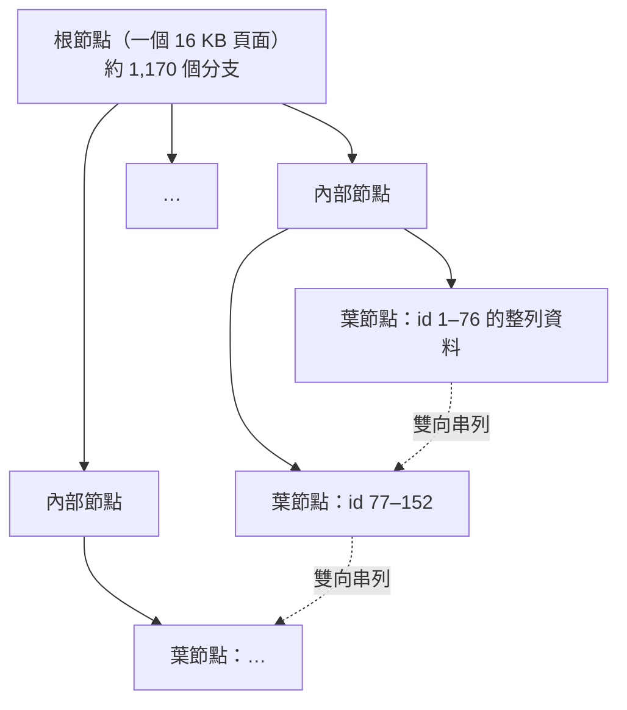

> **System Design 系列** Part 3-2｜上一篇：[SQL vs NoSQL](/post/systemdesign/sql-vs-nosql/)｜下一篇：[B-Tree vs LSM-Tree](/post/systemdesign/btree-vs-lsm/)｜[系列地圖](/post/systemdesign/system-design-thinking/#系列地圖)

## 情境與問題

會員中心的「我的訂單」API 背後是一張 5,000 萬筆的 `purchase_order` 表，每列約 200 bytes，資料本身約 10 GB。上線後陸續出現：

1. 查某位會員最近 20 筆訂單要 8 秒
2. 加了 `member_id` 的索引後變快了，但「某位會員已付款的訂單，依時間排序」還是慢
3. 後台的 `WHERE DATE(created_at) = '2026-11-11'` 不管怎麼加索引都沒用
4. 客服用手機號碼查會員，`WHERE phone = 0912345678` 每次都掃整張表
5. 為了加速，有人一口氣加了 12 個索引，結果大促時寫入變慢、replica 延遲飆高
6. 第 5,000 頁的分頁要 3 秒

六個問題都和索引有關，但原因各不相同。要能判斷，得先知道索引在磁碟上長什麼樣子。

## 最簡單的做法與它的極限

沒有索引時，資料庫只能**全表掃描**：讀完 5,000 萬列，逐一檢查條件。成本和資料量成正比，資料多 10 倍就慢 10 倍；同時有 10 個這種查詢，就是 10 倍的 I/O。

資料若依某個欄位排好序，就能用二分搜尋：log₂(5,000 萬) ≈ 26 次比較。但排序好的陣列插入很貴，而且只能依一種順序排。改用二元搜尋樹可以兼顧插入，但樹高約 26 層，如果每一層都在磁碟上的不同位置，一次查詢就是 26 次隨機讀取。磁碟（就算是 SSD）的隨機讀取比記憶體慢上百倍以上，26 次太多了。

資料庫需要的是一種**又矮又胖**的樹：每個節點剛好是一個磁碟頁面，一次讀取就能拿到上千個分支。這就是 B+Tree。

## 核心機制

### B+Tree：為磁碟頁面設計的樹



- **每個節點就是一個頁面**：InnoDB 預設 16 KB。內部節點只存「鍵 + 指向子節點的指標」，所以一頁能放上千個分支
- **資料只放在葉節點**，而且葉節點之間用串列相連。範圍查詢（`BETWEEN`、`ORDER BY ... LIMIT`）找到起點後，沿著串列往下讀就好

一棵 B+Tree 能裝多少資料？假設主鍵是 `BIGINT`，內部節點每個分支約 14 bytes：

<details>
<summary>計算程式（<code>java BPlusTreeCapacity.java</code>）</summary>

```java
public class BPlusTreeCapacity {

    static final int PAGE_BYTES = 16 * 1024;           // InnoDB 預設 page 大小
    static final double LEAF_FILL = 15.0 / 16;         // 循序寫入時，葉節點約留 1/16 空間

    public static void main(String[] args) {
        int internalEntryBytes = 8 + 6;                 // BIGINT 主鍵 + 指向子節點的指標（估計值）
        long fanout = PAGE_BYTES / internalEntryBytes;
        System.out.printf("內部節點每頁約 %,d 個分支%n", fanout);

        for (int rowBytes : new int[] {200, 1000}) {
            long rowsPerLeaf = (long) (PAGE_BYTES * LEAF_FILL / rowBytes);
            System.out.printf("%n每列 %,d bytes，每個葉節點約 %d 列%n", rowBytes, rowsPerLeaf);
            for (int height = 1; height <= 4; height++) {
                double rows = Math.pow(fanout, height - 1) * rowsPerLeaf;
                System.out.printf("  高度 %d：最多約 %,.0f 列%n", height, rows);
            }
        }
    }
}
```

</details>

```text
內部節點每頁約 1,170 個分支

每列 200 bytes，每個葉節點約 76 列
  高度 1：最多約 76 列
  高度 2：最多約 88,920 列
  高度 3：最多約 104,036,400 列
  高度 4：最多約 121,722,588,000 列

每列 1,000 bytes，每個葉節點約 15 列
  高度 1：最多約 15 列
  高度 2：最多約 17,550 列
  高度 3：最多約 20,533,500 列
  高度 4：最多約 24,024,195,000 列
```

（忽略了頁面標頭等額外開銷，是量級估算。）

**三層就能裝下約一億列**。而且根節點和內部節點加起來只有一千多個頁面（約 20 MB），幾乎一定常駐在 InnoDB 的 buffer pool 裡。所以用主鍵查一筆資料，實際的磁碟讀取通常只有最後那一個葉節點，甚至連它也在記憶體裡。這就是「用主鍵查詢很快」的物理原因。

從表中也看得出：**每列越寬，同樣的樹高能裝的列數越少**。把大欄位（長文字、JSON）拆到另一張表，能讓主表的樹更矮、每頁裝更多列。

### 聚簇索引與次要索引

InnoDB 的**整張表就是一棵以主鍵排序的 B+Tree**（聚簇索引），葉節點存的是整列資料。其他索引（次要索引）是另外的 B+Tree，葉節點存的是「索引欄位 + 主鍵值」，而不是資料本身：


所以透過次要索引查詢，要**走兩棵樹**：先在次要索引找到主鍵，再回主鍵索引拿整列（俗稱「回表」）。如果查詢需要的欄位全部都在次要索引裡，就不必回表，這叫**覆蓋索引**，`EXPLAIN` 的 Extra 欄會顯示 `Using index`。

這個結構帶來三個重要的推論：

1. **主鍵越寬，所有索引都越大**：每個次要索引的每一筆都夾帶主鍵。用 36 字元的 UUID 字串當主鍵，等於每個索引的每一筆都多了 36 bytes
2. **主鍵的順序就是資料的實體順序**：遞增主鍵的插入永遠在樹的最右邊，頁面依序填滿；隨機的 UUIDv4 則會插在樹的任意位置，造成大量頁面分裂與隨機 I/O。分散式環境下如何產生「大致遞增」的 ID，見 [分散式 ID 篇](/post/systemdesign/distributed-id/)
3. **次要索引的最後其實隱含了主鍵**：`INDEX (member_id, created_at)` 在 InnoDB 裡等於 `(member_id, created_at, id)`。後面的 keyset 分頁正好用得上

### 複合索引與最左前綴

複合索引 `(member_id, status, created_at)` 的排序方式就像電話簿：先依第一欄排，第一欄相同再依第二欄排，以此類推。所以只有「從最左邊開始、連續的欄位」能用來定位範圍。

用 `TreeSet` 模擬這個索引：2,000 位會員、每人 100 筆訂單、共 20 萬筆，比較不同條件需要掃描的筆數：

<details>
<summary>模擬程式（<code>java LeftmostPrefixDemo.java</code>）</summary>

```java
import java.time.LocalDate;
import java.util.Comparator;
import java.util.NavigableSet;
import java.util.Random;
import java.util.TreeSet;
import java.util.function.Predicate;

public class LeftmostPrefixDemo {

    enum Status { CREATED, PAID, SHIPPED, DONE, CANCELLED }

    // 模擬複合索引 (member_id, status, created_at)，最後補上 order_id 讓每筆唯一
    record Entry(long memberId, Status status, LocalDate createdAt, long orderId) {}

    static final Comparator<Entry> INDEX_ORDER = Comparator.comparingLong(Entry::memberId)
            .thenComparing(Entry::status)
            .thenComparing(Entry::createdAt)
            .thenComparingLong(Entry::orderId);

    public static void main(String[] args) {
        NavigableSet<Entry> index = new TreeSet<>(INDEX_ORDER);
        Random random = new Random(7);
        long orderId = 0;
        for (long member = 1; member <= 2_000; member++) {
            for (int i = 0; i < 100; i++) {
                index.add(new Entry(member, Status.values()[random.nextInt(5)],
                        LocalDate.of(2026, 1, 1).plusDays(random.nextInt(320)), ++orderId));
            }
        }
        LocalDate since = LocalDate.of(2026, 10, 1);
        System.out.printf("索引共 %,d 筆%n%n", index.size());

        // 1. member_id = 42：最左欄位等值，是一段連續範圍
        report("member_id = 42", range(index, 42, null), e -> true);

        // 2. member_id = 42 AND status = PAID：前兩欄等值，範圍更窄
        report("member_id = 42 AND status = 'PAID'", range(index, 42, Status.PAID), e -> true);

        // 3. 前兩欄等值 + 第三欄範圍：仍是一段連續範圍，而且已依 created_at 排好序
        NavigableSet<Entry> paid = range(index, 42, Status.PAID);
        NavigableSet<Entry> recentPaid = paid.tailSet(new Entry(42, Status.PAID, since, 0), true);
        report("member_id = 42 AND status = 'PAID' AND created_at >= '2026-10-01'", recentPaid, e -> true);

        // 4. 跳過中間欄位：只有 member_id 能定位範圍，created_at 只能逐筆過濾
        report("member_id = 42 AND created_at >= '2026-10-01'",
                range(index, 42, null), e -> !e.createdAt().isBefore(since));

        // 5. 跳過最左欄位：無法定位，只能整份索引逐筆檢查
        report("status = 'PAID'", index, e -> e.status() == Status.PAID);
    }

    static NavigableSet<Entry> range(NavigableSet<Entry> index, long memberId, Status status) {
        Entry from = new Entry(memberId, status == null ? Status.CREATED : status, LocalDate.MIN, Long.MIN_VALUE);
        Entry to = status == null
                ? new Entry(memberId + 1, Status.CREATED, LocalDate.MIN, Long.MIN_VALUE)
                : new Entry(memberId, status, LocalDate.MAX, Long.MAX_VALUE);
        return index.subSet(from, true, to, false);
    }

    static void report(String where, NavigableSet<Entry> scanned, Predicate<Entry> filter) {
        long matched = scanned.stream().filter(filter).count();
        System.out.printf("%-68s 掃描 %,7d 筆，符合 %,5d 筆%n", where, scanned.size(), matched);
    }
}
```

</details>

```text
索引共 200,000 筆

member_id = 42                                                       掃描     100 筆，符合   100 筆
member_id = 42 AND status = 'PAID'                                   掃描      25 筆，符合    25 筆
member_id = 42 AND status = 'PAID' AND created_at >= '2026-10-01'    掃描       4 筆，符合     4 筆
member_id = 42 AND created_at >= '2026-10-01'                        掃描     100 筆，符合    18 筆
status = 'PAID'                                                      掃描 200,000 筆，符合 40,121 筆
```

- 前三個查詢都只掃描剛好符合的筆數：條件從最左欄開始連續，範圍一路縮小
- 第四個**跳過了中間的 `status`**：只有 `member_id` 能定位，`created_at` 只能逐筆過濾，掃 100 筆才找到 18 筆。MySQL 的 Index Condition Pushdown（`Using index condition`）會在索引層先過濾，省下回表，但掃描範圍不變
- 第五個**跳過了最左欄**：無法定位，只能整份索引看一遍。MySQL 8.0.13 起的 skip scan 在第一欄種類很少時是例外，但不能依賴

由此得出設計複合索引的規則：

1. **等值條件的欄位放前面，範圍條件的欄位放最後**：範圍條件之後的欄位無法再用於定位
2. **`ORDER BY` 跟著索引順序**：情境 2 的「已付款訂單依時間排序」，用 `(member_id, status, created_at)` 時資料本身就已排好序，不需要額外排序（`EXPLAIN` 不再出現 `Using filesort`），加上 `LIMIT 20` 讀 20 筆就停
3. **「選擇性高的欄位放第一個」不是鐵律**：真正決定順序的是查詢模式。一個所有查詢都會帶的等值條件，即使選擇性低，放在第一個也合理

### 優化器不一定會用你的索引

MySQL 的優化器依成本做決定。如果條件符合的列很多（例如 `status = 'DONE'` 佔了 80%），每一筆都要回表的成本會高過直接全表掃描，優化器就會選全表掃描。這是正確的行為，不是 bug。

用 `EXPLAIN` 確認執行計畫，重點看這幾欄：

| 欄位 | 看什麼 |
|---|---|
| `type` | 由好到差大致是 `const`、`eq_ref`、`ref`、`range`、`index`（掃整份索引）、`ALL`（全表掃描） |
| `key` | 實際用了哪個索引；`NULL` 代表沒用 |
| `rows` | 預估要檢查的列數 |
| `Extra` | `Using index`（覆蓋索引）、`Using index condition`（ICP）、`Using filesort`（額外排序）、`Using temporary`（暫存表） |

`EXPLAIN` 是預估值。MySQL 8.0.18 起的 `EXPLAIN ANALYZE` 會實際執行查詢，列出每一步實際花的時間和列數。統計資訊過舊時，預估會失準，可以用 `ANALYZE TABLE` 更新。

### 讓索引失效的寫法

| 寫法 | 為什麼用不到索引 | 改寫 |
|---|---|---|
| `WHERE DATE(created_at) = '2026-11-11'` | 欄位被函式包住，索引裡存的是原始值 | `created_at >= '2026-11-11' AND created_at < '2026-11-12'` |
| `WHERE phone = 0912345678`（`phone` 是 `VARCHAR`） | 字串和數字比較時，MySQL 會把**每一列的字串轉成數字**再比 | 加上引號；Java 端用 `String` 綁定參數 |
| `WHERE name LIKE '%陳'` | 開頭是萬用字元，無法定位起點 | `LIKE '陳%'` 可以用索引；任意位置搜尋要用全文索引（見 [全文搜尋篇](/post/systemdesign/full-text-search/)） |
| `WHERE created_at + INTERVAL 1 DAY > NOW()` | 欄位參與運算 | 把運算移到另一邊：`created_at > NOW() - INTERVAL 1 DAY` |
| `WHERE a = ? OR b = ?` | 一個索引無法同時依兩個欄位定位 | 兩欄各自有索引時可能用 index merge；不行就改成 `UNION` |
| JOIN 兩邊欄位的字元集或 collation 不同 | 比較前要逐列轉換 | 統一欄位定義 |

情境 3、4 就是前兩種。最後一種常出現在新舊系統整合時，舊表是 `utf8`、新表是 `utf8mb4`。

### 索引的代價

每個索引都是一棵要維護的 B+Tree：

- **寫入放大**：每次 `INSERT`，主鍵索引和每一個次要索引都要各寫一次。12 個次要索引，就是每筆插入要改 13 棵樹；`UPDATE` 改到索引欄位，該索引就要刪一筆、插一筆
- **空間**：索引總大小超過資料本身很常見，而且它們也要搶 buffer pool 的記憶體
- **replica 延遲**：主庫寫入變重，replica 重放的工作也跟著變重
- **唯一索引比較貴**：唯一索引每次寫入都要先把頁面讀出來檢查是否重複。非唯一的次要索引在 MySQL 8.0 可以靠 change buffer 先暫存修改、稍後合併；但 MySQL 8.4 起 `innodb_change_buffering` 預設改為 `none`，所有次要索引的修改都要即時讀到對應頁面

所以情境 5 的 12 個索引不是免費的。找出沒在用的索引：MySQL 的 `sys.schema_unused_indexes` 會列出自啟動以來沒被使用過的索引；要刪除前，可以先用 MySQL 8.0 的 invisible index（`ALTER TABLE ... ALTER INDEX ... INVISIBLE`）讓優化器看不到它，觀察一段時間沒問題再刪。

### 深分頁：OFFSET 的代價

`LIMIT 20 OFFSET 100000` 的意思是「找出前 100,020 筆，丟掉前 100,000 筆」。資料庫沒辦法直接跳到第 100,001 筆，只能一筆一筆數過去（而且可能每筆都回表）。頁數越深越慢，就是情境 6。

**Keyset 分頁**改用「上一頁最後一筆的位置」當起點：

```sql
SELECT id, created_at, amount
FROM purchase_order
WHERE member_id = ?
  AND (created_at < ? OR (created_at = ? AND id < ?))   -- 上一頁最後一筆的 (created_at, id)
ORDER BY created_at DESC, id DESC
LIMIT 20;
```

不管第幾頁，都是從索引的某個位置往下讀 20 筆。`id` 是為了讓排序唯一：同一毫秒可能有兩筆訂單，只用 `created_at` 會漏掉或重複。前面說過，`INDEX (member_id, created_at)` 在 InnoDB 裡本來就隱含了 `id`，所以這個查詢完全走索引。

## 方案比較

### 分頁方式

| | OFFSET 分頁 | Keyset 分頁 |
|---|---|---|
| 深頁效能 | 越深越慢 | 每頁都一樣 |
| 跳到任意頁 | 可以 | 不行，只能上一頁、下一頁 |
| 翻頁時有新資料插入 | 可能重複或漏掉 | 不受影響 |
| 排序要求 | 無 | 排序欄位組合必須唯一（加上主鍵） |
| 適合 | 後台管理、資料量小、需要頁碼 | 無限捲動、API、匯出大量資料 |

Spring Data JPA 的 `Pageable` 分頁另見 [Spring Data JPA 分頁篇](/post/database/jpa-pagination/)。

### 索引類型

| 類型 | 適合 | MySQL 中的形式 |
|---|---|---|
| B+Tree | 等值、範圍、排序、前綴比對 | InnoDB 預設 |
| Hash | 只有等值查詢 | InnoDB 的 adaptive hash index 會自動為熱點建立，不能手動指定 |
| 全文索引 | 文字中任意位置的關鍵字 | `FULLTEXT`（見 [全文搜尋篇](/post/systemdesign/full-text-search/)） |
| 空間索引 | 地理位置範圍 | `SPATIAL`（R-Tree，見 [Geohash 篇](/post/systemdesign/geohash/)） |
| Functional / Multi-valued | 運算式結果、JSON 陣列 | 8.0.13+ / 8.0.17+（見 [SQL vs NoSQL 篇](/post/systemdesign/sql-vs-nosql/)） |

## Java 落地

### 1. 用 migration 管理索引

```sql
ALTER TABLE purchase_order
    ADD INDEX idx_member_status_created (member_id, status, created_at),
    ALGORITHM = INPLACE, LOCK = NONE;
```

InnoDB 的 online DDL 可以在建索引的同時繼續接受讀寫，明確寫出 `ALGORITHM = INPLACE, LOCK = NONE`，萬一這個操作不支援線上執行，會直接報錯，而不是默默鎖表。JPA 的 `@Table(indexes = ...)` 只在讓 Hibernate 產生 schema 時才有作用，正式環境的索引應該由 Flyway 這類 migration 工具管理，`@Index` 頂多當作文件：

```java
@Entity
@Table(name = "purchase_order",
       indexes = @Index(name = "idx_member_created", columnList = "member_id, created_at"))
public class PurchaseOrder {

    @Id
    @GeneratedValue(strategy = GenerationType.IDENTITY)
    private Long id;

    @Column(name = "member_id", nullable = false)
    private long memberId;

    @Enumerated(EnumType.STRING)
    @Column(nullable = false, length = 16)
    private OrderStatus status;

    @Column(name = "created_at", nullable = false)
    private Instant createdAt;

    @Column(nullable = false)
    private BigDecimal amount;

    // 建構子與 getter 省略
}
```

### 2. Keyset 分頁

```java
public interface PurchaseOrderRepository extends JpaRepository<PurchaseOrder, Long> {

    // 第一頁
    List<PurchaseOrder> findByMemberIdOrderByCreatedAtDescIdDesc(long memberId, Pageable pageable);

    // 下一頁：從上一頁最後一筆的 (createdAt, id) 之後接著讀
    @Query("""
            select o from PurchaseOrder o
            where o.memberId = :memberId
              and (o.createdAt < :createdAt or (o.createdAt = :createdAt and o.id < :id))
            order by o.createdAt desc, o.id desc
            """)
    List<PurchaseOrder> findNextPage(@Param("memberId") long memberId,
                                     @Param("createdAt") Instant createdAt,
                                     @Param("id") long id,
                                     Pageable pageable);
}
```

回傳 `List` 而不是 `Page`，Spring Data 就只套用 `LIMIT`，不會多跑一次 `COUNT(*)`（在大表上，`COUNT(*)` 本身就可能很慢）。

游標要交給前端，下一頁時帶回來：

```java
/** 分頁游標：上一頁最後一筆的 (createdAt, id)。只決定從哪裡開始，不代表任何權限。 */
public record OrderCursor(Instant createdAt, long id) {

    public String encode() {
        String raw = createdAt.toEpochMilli() + ":" + id;
        return Base64.getUrlEncoder().withoutPadding().encodeToString(raw.getBytes(StandardCharsets.UTF_8));
    }

    public static OrderCursor decode(String token) {
        String[] parts = new String(Base64.getUrlDecoder().decode(token), StandardCharsets.UTF_8).split(":");
        return new OrderCursor(Instant.ofEpochMilli(Long.parseLong(parts[0])), Long.parseLong(parts[1]));
    }
}
```

```java
@Service
public class MyOrderQuery {

    private static final int PAGE_SIZE = 20;

    private final PurchaseOrderRepository repository;

    public MyOrderQuery(PurchaseOrderRepository repository) {
        this.repository = repository;
    }

    public record OrderPage(List<PurchaseOrder> orders, String nextCursor) {}

    /** memberId 必須來自驗證過的身分，不是請求參數。 */
    @Transactional(readOnly = true)
    public OrderPage page(long memberId, String cursor) {
        PageRequest limit = PageRequest.of(0, PAGE_SIZE);
        List<PurchaseOrder> orders;
        if (cursor == null) {
            orders = repository.findByMemberIdOrderByCreatedAtDescIdDesc(memberId, limit);
        } else {
            OrderCursor after = OrderCursor.decode(cursor);
            orders = repository.findNextPage(memberId, after.createdAt(), after.id(), limit);
        }
        String next = null;
        if (orders.size() == PAGE_SIZE) {
            PurchaseOrder last = orders.get(orders.size() - 1);
            next = new OrderCursor(last.getCreatedAt(), last.getId()).encode();
        }
        return new OrderPage(orders, next);
    }
}
```

游標實際的樣子：

```text
MTc5NTE2MjUzMDEyMzo5MTgyNzM -> OrderCursor[createdAt=2026-11-20T08:15:30.123Z, id=918273]
```

Spring Data 3.1 起也有內建的 Scroll API（`Window`、`ScrollPosition.keyset()`），用 derived query 時會自動產生同樣的條件，並在排序最後補上主鍵確保唯一。

### 3. 衍生查詢的 `IgnoreCase` 陷阱

Spring Data 的 `findByEmailIgnoreCase` 會產生 `UPPER(email) = UPPER(?)`，欄位被函式包住，`email` 的索引就用不到了。MySQL 的預設 collation（例如 `utf8mb4_0900_ai_ci`）本來就不分大小寫，直接用 `findByEmail` 即可。

## 踩坑與 Gotchas

- **索引越多越好**：每個索引都讓寫入變慢、佔記憶體、加重 replica 負擔
- **低選擇性欄位單獨建索引**：`status` 只有 5 種值，單獨的索引幾乎不會被選用
- **重複的索引**：已經有 `(a, b)`，再建 `(a)` 就是多餘的
- **測試環境資料太少**：幾千筆資料時優化器常選全表掃描，正式環境的執行計畫可能完全不同。關鍵查詢要用接近正式環境的資料量看 `EXPLAIN`
- **用 UUID 字串當主鍵**：每個次要索引都變大，隨機插入造成頁面分裂
- **大表直接加索引**：就算是 online DDL，replica 也要重做一次同樣的建索引，期間後面的變更都卡住，造成和建索引時間一樣長的延遲。大表改用 gh-ost 這類工具，或安排在離峰時段
- **深分頁用 OFFSET**：越後面越慢，而且在大表上 `COUNT(*)` 本身就很貴
- **衍生查詢用了 `IgnoreCase`**：欄位被 `UPPER()` 包住，索引失效
- **只看 `rows`，不看實際執行**：預估可能失準，用 `EXPLAIN ANALYZE` 或 slow query log 的 `Rows_examined` 確認

### 資安相關

- **排序欄位直接拼進 SQL**：`ORDER BY` 不能用參數綁定，把 client 送來的欄位名稱直接接進 SQL，就是 SQL injection。Spring Data 的 `Sort` 會檢查屬性名稱是否存在於 domain model，但 `JpaSort.unsafe(...)` 會關掉這層保護。最穩的做法是只接受代號，對應到預先定義好的排序：

```java
/** 允許 client 指定的排序方式：只接受代號，不接受欄位名稱或運算式。 */
public final class OrderSorts {

    private static final Map<String, Sort> ALLOWED = Map.of(
            "newest", Sort.by(Sort.Order.desc("createdAt"), Sort.Order.desc("id")),
            "amount", Sort.by(Sort.Order.desc("amount"), Sort.Order.desc("id")));

    private OrderSorts() {
    }

    public static Sort of(String key) {
        Sort sort = ALLOWED.get(key);
        if (sort == null) {
            throw new IllegalArgumentException("不支援的排序：" + key);
        }
        return sort;
    }
}
```

- **任意篩選條件就是廉價的 DoS**：允許 client 對任意欄位做 `LIKE '%...%'`，每個請求都是一次全表掃描，攻擊者不需要大流量就能拖垮資料庫。可篩選的欄位要限定在有索引的範圍內，並設定查詢逾時（MySQL 的 `max_execution_time` 可以限制 `SELECT` 的執行時間）
- **游標不等於授權**：游標只決定從哪裡開始讀，查詢條件裡的 `member_id` 必須來自驗證過的身分。如果改成「游標裡記著 member_id」，攻擊者改一下游標就能翻別人的訂單，這就是 BOLA（[Part 8](/post/systemdesign/authorization-owasp-api-top10/)）
- **唯一索引的錯誤訊息洩漏帳號是否存在**：註冊時直接回傳「此 email 已被使用」，攻擊者就能逐一試出哪些 email 是會員（帳號列舉）。對外統一回應「確認信已寄出」，再由信件內容告知對方已有帳號

## 何時用／何時別用

- **該建索引**：查詢頻繁、條件的選擇性夠高、讀遠多於寫的欄位組合；`WHERE`、`JOIN`、`ORDER BY` 常一起出現的欄位做成複合索引
- **不必建索引**：幾千筆的小表（全表掃描就夠快）、寫入極重而查詢很少的表、只有少數幾種值的欄位
- **重新評估的時機**：slow query log 中 `Rows_examined` 遠大於 `Rows_sent` 的查詢；索引總大小接近或超過 buffer pool；寫入延遲或 replica 延遲上升；`sys.schema_unused_indexes` 出現長期未使用的索引

## 參考資料

- Rudolf Bayer, Edward McCreight, "Organization and Maintenance of Large Ordered Indexes", *Acta Informatica*, 1972
- Douglas Comer, "The Ubiquitous B-Tree", *ACM Computing Surveys*, 1979
- Markus Winand, *Use The Index, Luke!*：<https://use-the-index-luke.com/>
- MySQL Reference Manual — Clustered and Secondary Indexes：<https://dev.mysql.com/doc/refman/8.0/en/innodb-index-types.html>
- MySQL Reference Manual — Multiple-Column Indexes：<https://dev.mysql.com/doc/refman/8.0/en/multiple-column-indexes.html>
- MySQL Reference Manual — EXPLAIN Output Format：<https://dev.mysql.com/doc/refman/8.0/en/explain-output.html>
- MySQL Reference Manual — Index Condition Pushdown Optimization：<https://dev.mysql.com/doc/refman/8.0/en/index-condition-pushdown-optimization.html>
- MySQL Reference Manual — Online DDL Operations：<https://dev.mysql.com/doc/refman/8.0/en/innodb-online-ddl-operations.html>
- MySQL Reference Manual — Invisible Indexes：<https://dev.mysql.com/doc/refman/8.0/en/invisible-indexes.html>
- MySQL 8.4 Reference Manual — Change Buffer：<https://dev.mysql.com/doc/refman/8.4/en/innodb-change-buffer.html>
- Spring Data JPA Reference — Query Methods（Sort、Scrolling）：<https://docs.spring.io/spring-data/jpa/reference/jpa/query-methods.html>
- OWASP — SQL Injection Prevention Cheat Sheet：<https://cheatsheetseries.owasp.org/cheatsheets/SQL_Injection_Prevention_Cheat_Sheet.html>
- 互動圖解延伸：Dilum Sanjaya，System Design — an interactive course：<https://designed-to-scale.vercel.app/>
