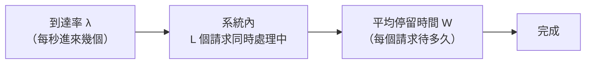

> **System Design 系列** Part 1-2｜上一篇：[一個 HTTP Request 的旅程](/post/systemdesign/request-lifecycle/)｜下一篇：[Napkin Math 容量估算](/post/systemdesign/napkin-math/)｜[系列地圖](/post/systemdesign/system-design-thinking/#系列地圖)

## 情境與問題

壓測報告寫著「平均回應 60 ms，可撐 400 RPS」，大家都很放心。上線後卻陸續有人回報「偶爾會卡好幾秒」。同一週，資料庫因為一個慢查詢變慢，整個服務接著全部逾時，有人提議：「把 Tomcat thread 從 200 調到 1,000，再把連線池加大，就能撐住了。」

這兩件事背後是同一組觀念：**latency 要看分佈而不是平均、throughput 和 latency 透過排隊互相影響**。搞懂這些，才知道為什麼加大 thread 數通常沒有用。

## 最簡單的指標與它的盲點

最常見的報表只有兩個數字：平均回應時間和 QPS。平均值的問題用一個例子就看得出來：1,000 個請求裡，980 個花 20 ms，20 個因為 GC 或鎖等待卡了 2 秒。

```java
import java.util.Arrays;

public class PercentileDemo {

    public static void main(String[] args) {
        long[] latenciesMs = new long[1_000];
        Arrays.fill(latenciesMs, 0, 980, 20);        // 98% 的請求 20 ms
        Arrays.fill(latenciesMs, 980, 1_000, 2_000); // 2% 卡在 2 秒（GC、鎖等待、重試……）
        Arrays.sort(latenciesMs);

        double avg = Arrays.stream(latenciesMs).average().orElseThrow();
        System.out.printf("avg   = %.1f ms%n", avg);
        for (double p : new double[] {50, 95, 98, 99, 99.9}) {
            System.out.printf("p%-4s = %d ms%n", trim(p), percentile(latenciesMs, p));
        }
    }

    // nearest-rank：排序後取第 ceil(p/100 * n) 個樣本
    static long percentile(long[] sorted, double p) {
        int rank = (int) Math.ceil(p / 100.0 * sorted.length);
        return sorted[Math.max(rank, 1) - 1];
    }

    static String trim(double p) {
        return p == Math.floor(p) ? String.valueOf((long) p) : String.valueOf(p);
    }
}
```

執行結果：

```text
avg   = 59.6 ms
p50   = 20 ms
p95   = 20 ms
p98   = 20 ms
p99   = 2000 ms
p99.9 = 2000 ms
```

平均 59.6 ms 這個數字**沒有任何一個請求真的經歷過**：大部分人是 20 ms，少數人是 2 秒。平均值把兩群人揉在一起，兩邊都描述不到。

## 核心機制

### Latency、Response Time、Throughput

- **Response time**：client 從送出請求到收到回應的總時間，包含網路、排隊、處理
- **Latency**：嚴格來說是請求「等待被處理」的時間。實務上兩個詞常混用，本系列說 latency 時指的是 client 看到的回應時間
- **Throughput**：單位時間完成的請求數（RPS、QPS、TPS）

兩者不是簡單的反比。負載低的時候，throughput 增加不太影響 latency；接近飽和時，latency 會急遽上升。

### 百分位數

p99 = 200 ms 的意思是「99% 的請求在 200 ms 內完成，最慢的 1% 超過 200 ms」。SLO 通常定在 p99；流量很大的核心服務會看到 p99.9。

1% 聽起來很少，但一個使用者打開一頁通常會發出幾十個請求，**幾乎每個使用者都會碰到 p99**。而且最慢的請求往往來自資料最多的使用者（訂單最多、購物車最滿），也就是最重要的客戶。

### 扇出（fan-out）放大長尾

如果一個請求要同時呼叫 N 個下游，而且要等全部回來，只要其中一個慢，整個請求就慢：

```java
public class FanOutTail {

    public static void main(String[] args) {
        double slowRate = 0.01; // 每個下游有 1% 的機率超過自己的 p99
        for (int n : new int[] {1, 10, 50, 100}) {
            double atLeastOneSlow = 1 - Math.pow(1 - slowRate, n);
            System.out.printf("扇出 %3d 個下游 -> %.1f%% 的請求會被拖慢%n", n, atLeastOneSlow * 100);
        }
    }
}
```

```text
扇出   1 個下游 -> 1.0% 的請求會被拖慢
扇出  10 個下游 -> 9.6% 的請求會被拖慢
扇出  50 個下游 -> 39.5% 的請求會被拖慢
扇出 100 個下游 -> 63.4% 的請求會被拖慢
```

下游各自只有 1% 的慢請求，扇出 100 個之後，**超過六成的請求都會被拖慢**。微服務拆得越細、聚合頁面呼叫越多服務，長尾問題越嚴重。

### 排隊：使用率越高，等待越久

用最簡單的排隊模型（M/M/1：請求隨機到達、處理時間隨機）來看，平均回應時間 = 處理時間 ÷（1 − 使用率）。假設處理一個請求要 10 ms：

| 使用率 | 平均回應時間 |
|---|---|
| 50% | 20 ms |
| 80% | 50 ms |
| 90% | 100 ms |
| 95% | 200 ms |
| 99% | 1,000 ms |

真實系統不完全符合這個模型，但曲線的形狀一樣：**使用率超過 80% 之後，回應時間不是線性變慢，而是急遽上升**。這就是為什麼容量規劃通常把目標使用率定在 60–70%，留下吸收尖峰的空間。

### Little's Law



**L = λ × W**：系統內同時存在的請求數 = 到達率 × 每個請求的平均停留時間。

這個公式只要求系統處於穩定狀態（進來的速度等於出去的速度），不管請求怎麼分佈、怎麼排隊都成立，所以非常適合拿來估算資源：

- 每秒 400 個請求，每個平均 50 ms → 同時有 400 × 0.05 = **20 個**請求在處理，也就是平均 20 個 thread 在忙
- 如果下游變慢，W 變成 2 秒 → 同時有 400 × 2 = **800 個**請求在系統裡，200 個 thread 根本不夠

第二個例子說明了一件事：**下游變慢，會直接變成上游的資源耗盡**。

## 方案比較：提升 throughput 的手段與對 latency 的影響

| 手段 | Throughput | Latency | 代價 |
|---|---|---|---|
| 水平擴展（加機器） | 提升 | 使用率下降，排隊變少 | 成本；服務要先做到無狀態 |
| Cache | 提升（後端負載降低） | 命中時大幅下降 | 資料一致性、記憶體成本 |
| 批次處理（batch insert、Kafka `linger.ms`） | 提升 | 單筆變慢，要等湊滿一批 | 參數要調 |
| 非同步化（丟進 MQ 就回應） | 前端可接的請求變多 | 回應變快，但端到端完成時間變長 | 最終一致、失敗要另外處理 |
| 加大 thread 數或連線池 | 只有瓶頸不在下游時才有用 | 下游已經飽和時反而更慢 | 記憶體、context switch、把資料庫壓垮 |
| Virtual threads | I/O 密集時可同時處理更多請求 | 單一請求不會變快 | 下游依然是瓶頸；JDK 21–23 在 `synchronized` 內阻塞會 pinning |
| Hedged request（超過 p95 還沒回就再送一份） | 幾乎不變 | 長尾明顯下降 | 增加少量負載；只適用冪等的讀取 |

Virtual threads 的細節見 [Spring Virtual Threads](/post/spring/spring-virtual-threads/)。

## Java 落地

### 1. 用 Little's Law 推算 Tomcat thread 與 HikariCP 連線池

假設單台 instance 尖峰 400 RPS，平均回應 50 ms，其中每個請求平均佔用 DB 連線 8 ms：

| 資源 | 計算 | 平均需要 | 預設值 | 結論 |
|---|---|---|---|---|
| Tomcat thread | 400 × 0.05 s | 20 個 | 200 | 綽綽有餘 |
| HikariCP 連線 | 400 × 0.008 s | 3.2 個 | 10 | 綽綽有餘 |

```yaml
server:
  tomcat:
    threads:
      max: 200                  # 預設值；尖峰平均只需約 20 個忙碌 thread
spring:
  datasource:
    hikari:
      maximum-pool-size: 10     # 預設值；尖峰平均只需約 3~4 個連線
      connection-timeout: 1000  # 取不到連線 1 秒就失敗（預設 30 秒）
```

再用同一個公式看「資料庫變慢」時發生什麼事。假設慢查詢讓每次佔用連線的時間變成 500 ms：

- 連線池能支撐的最大吞吐量 = 連線數 ÷ 每次佔用時間 = 10 ÷ 0.5 s = **20 RPS**
- 到達率仍是 400 RPS，每秒有 380 個請求拿不到連線，只能卡在原地等，每個都佔著一個 Tomcat thread
- 200 個 thread 大約半秒就被吃光，之後新請求在 accept queue 排隊，最後整個服務逾時

這時把連線池加到 200，只會讓已經變慢的資料庫同時承受 20 倍的查詢，變得更慢。正確的做法是：

1. **找出資料庫變慢的原因**（慢查詢、鎖等待），這才是根因
2. **縮短 `connection-timeout`**，讓等不到連線的請求快點失敗、釋放 thread。但只要「到達率 × 等待時間」仍大於 thread 數，thread 還是會被吃光，所以還需要第 3 點
3. **在呼叫端加上熔斷與降載**，不要讓壞掉的下游拖垮上游（Part 6 會談 Circuit Breaker 與 Bulkhead）

連線池大小的實務調校見 [HikariCP 調校](/post/database/hikaricp-tuning/)。

### 2. 讓 Spring Boot 輸出可以聚合的百分位數

```properties
management.metrics.distribution.percentiles-histogram.http.server.requests=true
management.metrics.distribution.slo.http.server.requests=100ms,300ms,1s
```

Micrometer 有兩種輸出百分位數的方式，差別很大：

| 設定 | 計算位置 | 能否跨 instance 聚合 |
|---|---|---|
| `percentiles`（例如 0.99） | 每個 instance 在應用程式內自己算好 | **不能**，各台的 p99 平均起來沒有意義 |
| `percentiles-histogram` | 只輸出 histogram bucket，由監控系統計算 | 能，先加總所有 instance 的 bucket 再算 |

多台 instance 的服務一定要用 histogram。在 Prometheus 中計算整個服務的 p99：

```text
histogram_quantile(0.99, sum by (le, uri) (rate(http_server_requests_seconds_bucket[5m])))
```

`slo` 會額外輸出你指定的邊界（100 ms、300 ms、1 s），可以直接算出「多少比例的請求在 300 ms 內完成」，拿來對照 SLO 很方便。

### 3. 壓測時避開 coordinated omission

大部分壓測工具預設是「收到回應才送下一個請求」（closed model）。當伺服器卡住 2 秒，工具也跟著停 2 秒，這 2 秒內本來應該送出、也應該很慢的請求就**沒有被量到**，結果 p99 看起來比真實情況好很多。

解法是用**固定到達率**（open model）壓測，不管前一個請求回來了沒，都照預定速率送出：wrk2 的 `-R`、k6 的 `constant-arrival-rate` executor、Gatling 的 `constantUsersPerSec` 都是這種模式。

## 踩坑與 Gotchas

- **看平均值**：平均值會把長尾藏起來，最少要看 p50、p99、max 三個數字
- **把百分位數拿來平均**：多台的 p99 取平均、每分鐘的 p99 再平均成每小時，數學上都不成立。要從原始資料或 histogram 重新計算
- **只看成功請求，或成功和失敗混在一起看**：快速失敗的錯誤請求會讓 latency 看起來變好。成功和失敗的 latency 要分開看
- **壓測的 coordinated omission**：closed model 的壓測結果會低估長尾
- **把使用率拉到 90% 以上以為很省**：排隊時間會急遽上升，一點點尖峰就會造成大量逾時
- **一慢就加大 thread 或連線池**：先用 Little's Law 算清楚瓶頸在哪一層。下游飽和時，加大上游的併發只會讓情況更糟

## 何時用／何時別用

- **SLO 用 p99**：流量大、影響營收的核心 API 再加上 p99.9
- **低流量服務小心百分位數**：每分鐘只有 50 個請求時，p99 幾乎等於最大值，樣本數不夠。可以拉長時間窗口，或直接看最大值
- **Little's Law 適用於穩定狀態**：拿來估算連線池、thread pool、佇列長度都很好用；流量劇烈變化的瞬間（例如整點開賣的頭幾秒）不是穩定狀態，要用尖峰值另外估算
- **重新評估的時機**：p99 ÷ p50 的比值持續變大（例如超過 10 倍），代表長尾問題惡化，要開始找 GC、鎖、慢查詢或扇出的問題

## 參考資料

- John D. C. Little, "A Proof for the Queuing Formula: L = λW", *Operations Research*, 1961
- Jeffrey Dean & Luiz André Barroso, "The Tail at Scale", *Communications of the ACM*, 2013
- Google, *Site Reliability Engineering*, Chapter 4 — Service Level Objectives：<https://sre.google/sre-book/service-level-objectives/>
- Martin Kleppmann，《Designing Data-Intensive Applications》，第 1 章 Describing Performance
- Gil Tene, "How NOT to Measure Latency"（coordinated omission）
- Spring Boot Reference — Metrics：<https://docs.spring.io/spring-boot/reference/actuator/metrics.html>
- HikariCP Wiki — About Pool Sizing：<https://github.com/brettwooldridge/HikariCP/wiki/About-Pool-Sizing>
- 互動圖解延伸：Dilum Sanjaya，System Design — an interactive course：<https://designed-to-scale.vercel.app/>
