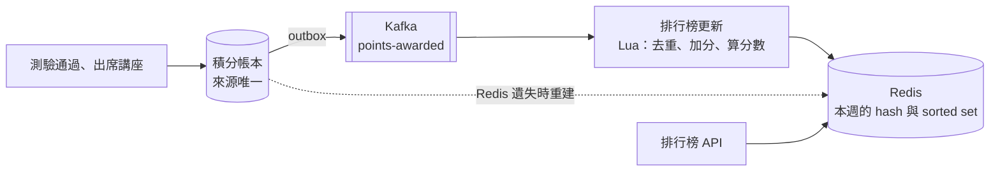

> **System Design 系列** Part 9-6｜上一篇：[通知系統](/post/systemdesign/notification-system/)｜下一篇：[分散式排程](/post/systemdesign/distributed-scheduler/)｜[系列地圖](/post/systemdesign/system-design-thinking/#系列地圖)

## 情境與問題

講座平台推出學習積分：參加講座、通過課後測驗、完成學習路徑都可以得到積分。每週公布積分週榜，前 100 名有獎勵。另外，首頁要顯示「最近 24 小時的熱門講座」。

**功能需求**

- 週榜的前 100 名，以及「我的名次」
- 好友之間的排行
- 同分時，**先達到這個分數的人排在前面**（有獎勵，所以規則要明確）
- 熱門講座：依最近 24 小時的報名數排序，越近的報名權重越高

**規模估算**

| 項目 | 估算 |
|---|---|
| 參與排名的會員 | 1,000 萬 |
| 積分更新 | 日活躍 200 萬 × 每天 5 次 = 每天 1,000 萬次，平均每秒約 116 次 |
| 積分更新的尖峰 | 直播講座結束時，5 萬名觀眾在 1 分鐘內交出測驗 → 每秒約 1,000 次 |
| 查看前 100 名 | 每秒約 50 次 |
| 查看我的名次 | 每秒約 500 次（個人頁面都會顯示） |

## 最簡單的做法與它的極限

積分存在 `member_points` 表，加上 `points` 的索引：

```sql
-- 前 100 名：走索引，很快
SELECT member_id, points FROM member_points ORDER BY points DESC LIMIT 100;

-- 我的名次：要數出比我高分的人有多少
SELECT COUNT(*) + 1 FROM member_points WHERE points > :myPoints;
```

前 100 名沒有問題。「我的名次」對排在 500 萬名的會員，要在索引上掃過 500 萬筆才能數出來（[Index 與 B+Tree 篇](/post/systemdesign/index-btree/)），每次約數百毫秒，每秒 500 次就是資料庫的大部分負載。把結果快取起來，名次又會因為其他人的積分持續變動而過時。

## 核心機制

### Sorted set：名次是 O(log N)

Redis 的 sorted set 在內部同時維護一個雜湊表（成員 → 分數）和一個 skip list（依分數排序），每個節點記錄跨越的距離，所以：

| 操作 | 指令 | 複雜度 |
|---|---|---|
| 更新分數 | `ZADD`／`ZINCRBY` | O(log N) |
| 前 100 名 | `ZREVRANGE 0 99 WITHSCORES` | O(log N + 100) |
| 我的名次 | `ZREVRANK` | O(log N) |
| 某個分數以上有多少人 | `ZCOUNT` | O(log N) |

1,000 萬名會員，log N 約 23，「我的名次」從數百毫秒降到 1 毫秒以內。

**記憶體**：每個成員在 sorted set 裡約佔數十到一百位元組，再加上另外存放積分的 hash，1,000 萬名會員約 1 到 2 GB（粗估，依 Redis 的版本與編碼而定），單一節點放得下。

**吞吐量**：一個 sorted set 是一個 key，只能放在一個 Redis 節點上，無法分散到叢集的多個節點。尖峰每秒 1,000 次更新加上 550 次讀取，對單一節點來說不是問題；更新經過 Kafka，瞬間的尖峰由佇列吸收，排行榜晚幾秒更新是可以接受的。

### 同分時，先達到的人排前面

sorted set 對同分的成員依**成員名稱的字典順序**排列，這對使用者來說是隨機的。規則是「先達到的人排前面」，所以要把時間也編碼進分數裡：

```
分數 = 積分 × 2²¹ + （本週結束前剩餘的秒數）
```

- 一週是 604,800 秒，小於 2²¹（2,097,152），所以剩餘秒數放得進低位的 21 個位元
- 越早達到這個積分，剩餘的秒數越多，分數越高，名次越前面
- sorted set 的分數是 64 位元浮點數，整數只能精確到 2⁵³（[News Feed](/post/systemdesign/news-feed/) 遇過同樣的問題）。扣掉 21 個位元，積分的上限約 2³² = 43 億，綽綽有餘

但這也代表**不能直接用 `ZINCRBY`**：加了積分之後，低位的時間也要換成這一次的時間。所以把每個人的積分另外存在 hash 裡，用一段 Lua script 原子地完成「加積分、算新分數、寫入 sorted set」（[秒殺搶票](/post/systemdesign/flash-sale-ticketing/)用過同樣的方式）。

如果業務規則是「同分同名次」（1、2、2、4），名次改成「積分比我高的人數 + 1」，用 `ZCOUNT` 查詢分數大於 `(我的積分 + 1) × 2²¹` 的成員數量即可。

### Redis 不是帳本

積分的權威是資料庫裡的**積分帳本**：每一筆積分都記錄來源（哪一次測驗、哪一場講座），來源有唯一鍵，同一次測驗不會給兩次積分（[冪等性篇](/post/systemdesign/idempotency-key/)）。排行榜是從帳本衍生出來的：



- **更新要冪等**：Kafka 是 at-least-once，同一筆積分事件可能處理兩次，而 `HINCRBY` 不是冪等的。Lua script 先以帳本 ID 做 `SET NX`，已經處理過的就略過
- **可以重建**：Redis 遺失資料時，從帳本依週彙總：每位會員本週的積分總和，以及最後一筆積分的時間，算出同樣的分數
- **歸到哪一週，用事件發生的時間**：週日 23:59:59 交出的測驗，在週一 00:00:01 才被處理，仍然屬於上一週。週榜在週一 01:00 才結算，留一小時給延遲的事件（[批次與串流篇](/post/systemdesign/batch-vs-stream/)的 grace period）。週的界線以平台的時區（Asia/Taipei）為準

### 讀取

- **前 100 名**：每個人看到的都一樣，在應用程式的記憶體快取 5 秒，避免每秒 50 次都打到同一個熱點 key（[Cache 篇](/post/systemdesign/caching/)）
- **我的名次**：每個人不同，直接查 `ZREVRANK`
- **好友排行**：好友最多 500 人，用 pipeline 一次取得所有好友的分數，在應用程式裡排序
- **大範圍的名次**：排在 500 萬名的會員，與其顯示「第 4,999,872 名」，不如顯示「贏過了 50% 的會員」。百分位數可以從積分的分布直方圖算出來，不需要精確的名次

### 規模再大時

單一 sorted set 的上限是單一節點的記憶體與 CPU。會員數成長到數億時：

- **依會員分片**：N 個 sorted set，每個放一部分會員。前 100 名是 N 個分片各自前 100 名的合併；精確的名次要對 N 個分片各做一次 `ZCOUNT` 再加總
- **只精確排名前段**：只把積分超過門檻的會員放進 sorted set，其他人顯示百分位數

### 熱門講座：分桶加上時間衰減

「最近 24 小時的報名數」是一個滑動視窗。做法是**每小時一個分桶**：

- 每一筆報名確認時，對當下這個小時的 sorted set `ZINCRBY 講座ID 1`，分桶設定 25 小時後過期
- 每分鐘由排程把最近 24 個分桶加權合併（`ZUNIONSTORE ... WEIGHTS`）成一個結果，權重隨時間衰減，例如第 k 個小時前的分桶權重為 0.9ᵏ
- 讀取時直接讀合併後的結果，前 20 名再快取 1 分鐘

計算只在排程裡做，每分鐘一次，和讀取的次數無關。這是[批次與串流篇](/post/systemdesign/batch-vs-stream/)的滑動視窗，用分桶近似。

## 方案比較

| 決策 | 選擇 | 放棄的替代方案與原因 |
|---|---|---|
| 排名的資料結構 | Redis sorted set | SQL 的 `COUNT(*)`：低名次的會員查詢很慢；定期批次計算所有名次：名次不即時 |
| 同分規則 | 把時間編碼進分數的低位 | 依成員名稱排序：對使用者是隨機的；名次並列：要和業務確認獎勵怎麼分 |
| 權威資料 | 資料庫的積分帳本，Redis 可以重建 | 只存在 Redis：故障轉移時遺失的積分無法追回 |
| 更新路徑 | 帳本 → Kafka → Lua（去重） | 在 API 裡同步寫 Redis：和資料庫的交易無法一致 |
| 熱門講座 | 每小時分桶 + 加權合併 | 每次讀取都計算：成本隨讀取次數增加；只看總報名數：舊的熱門講座永遠在榜上 |

## Java 落地

### 1. 積分帳本

```sql
CREATE TABLE point_ledger (
    id           BIGINT       PRIMARY KEY,
    member_id    BIGINT       NOT NULL,
    source_type  VARCHAR(32)  NOT NULL,     -- QUIZ_PASSED、LECTURE_ATTENDED
    source_id    BIGINT       NOT NULL,
    points       INT          NOT NULL,
    occurred_at  TIMESTAMP(3) NOT NULL,
    UNIQUE KEY uk_source (member_id, source_type, source_id),
    KEY idx_occurred (occurred_at)
);
```

積分由伺服器依來源計算，不接受用戶端送來的分數。

### 2. 更新排行榜

```java
@Component
public class WeeklyLeaderboard {

    static final ZoneId PLATFORM_ZONE = ZoneId.of("Asia/Taipei");
    private static final long TIE_BITS = 1L << 21;                    // 2,097,152 > 一週的秒數

    // KEYS[1] 已處理的帳本 ID、KEYS[2] 積分 hash、KEYS[3] 排行榜 sorted set
    // ARGV[1] 會員 ID、ARGV[2] 本次積分、ARGV[3] 本週結束前剩餘的秒數、ARGV[4] 去重紀錄的存活秒數
    private static final RedisScript<Long> AWARD = RedisScript.of("""
            if redis.call('SET', KEYS[1], '1', 'NX', 'EX', ARGV[4]) == false then
              return -1
            end
            local points = redis.call('HINCRBY', KEYS[2], ARGV[1], ARGV[2])
            local remaining = tonumber(ARGV[3])
            local old = redis.call('ZSCORE', KEYS[3], ARGV[1])
            if old then
              remaining = math.min(remaining, tonumber(old) % 2097152)   -- 事件亂序時，保留較晚的時間
            end
            redis.call('ZADD', KEYS[3], points * 2097152 + remaining, ARGV[1])
            return points
            """, Long.class);

    private final StringRedisTemplate redis;

    public WeeklyLeaderboard(StringRedisTemplate redis) {
        this.redis = redis;
    }

    @KafkaListener(topics = "points-awarded", groupId = "weekly-leaderboard")
    public void onAwarded(PointsAwarded event) {
        Week week = Week.of(event.occurredAt());                       // 依事件發生的時間，不是處理的時間
        long remaining = Duration.between(event.occurredAt(), week.end()).toSeconds();
        String tag = "{lb:" + week.id() + "}";                         // 例如 {lb:2026-W48}，同一週的 key 在同一個 slot
        redis.execute(AWARD,
                List.of(tag + ":applied:" + event.ledgerId(), tag + ":points", tag + ":rank"),
                Long.toString(event.memberId()), Integer.toString(event.points()),
                Long.toString(remaining), Long.toString(Duration.ofHours(1).toSeconds()));
    }

    public List<RankedMember> top(Week week, int n) {
        Set<ZSetOperations.TypedTuple<String>> tuples =
                redis.opsForZSet().reverseRangeWithScores("{lb:" + week.id() + "}:rank", 0, n - 1);
        List<RankedMember> result = new ArrayList<>();
        int rank = 1;
        for (ZSetOperations.TypedTuple<String> t : tuples) {
            long points = t.getScore().longValue() / TIE_BITS;          // 去掉低位的時間
            result.add(new RankedMember(rank++, Long.parseLong(t.getValue()), points));
        }
        return result;
    }

    public OptionalLong rankOf(Week week, long memberId) {
        Long zeroBased = redis.opsForZSet().reverseRank("{lb:" + week.id() + "}:rank", Long.toString(memberId));
        return zeroBased == null ? OptionalLong.empty() : OptionalLong.of(zeroBased + 1);
    }

    public record Week(String id, Instant end) {
        static Week of(Instant at) {
            LocalDate date = at.atZone(PLATFORM_ZONE).toLocalDate();
            LocalDate monday = date.with(DayOfWeek.MONDAY);
            String id = "%d-W%02d".formatted(date.get(IsoFields.WEEK_BASED_YEAR), date.get(IsoFields.WEEK_OF_WEEK_BASED_YEAR));
            return new Week(id, monday.plusWeeks(1).atStartOfDay(PLATFORM_ZONE).toInstant());
        }
    }
}
```

- 週的 ID 用 ISO 週（`IsoFields.WEEK_BASED_YEAR`），不是日曆年：2026 年 12 月 28 日屬於 2026-W53，2027 年 1 月 1 日也是。用日曆年組出的週 ID 會在跨年那週分裂成兩個
- 去重紀錄只保存 1 小時：Kafka 的重新投遞（消費者當機、重新平衡）通常在幾分鐘內發生。每天 1,000 萬筆積分，保存 14 天會累積上億個 key、超過 10 GB，而且因為 hash tag 全部落在同一個節點，比排行榜本身還大。要重新處理更早的事件（例如重設 offset）時，不要重播事件，改為從帳本重建這一週
- 事件亂序時（例如某一筆重試成功得比較晚），低位保留較晚的時間，和從帳本以 `MAX(occurred_at)` 重建的結果一致
- 週榜在結算之後設定過期，並把前 100 名寫回資料庫保存

### 3. 好友排行

```java
public List<FriendRank> friendsOf(Week week, long memberId, List<Long> friendIds) {
    String key = "{lb:" + week.id() + "}:rank";
    List<Long> ids = new ArrayList<>(friendIds);
    ids.add(memberId);
    List<Object> scores = redis.executePipelined(new SessionCallback<Object>() {
        @Override
        @SuppressWarnings({"unchecked", "rawtypes"})
        public Object execute(RedisOperations operations) {
            for (Long id : ids) {
                operations.opsForZSet().score(key, Long.toString(id));
            }
            return null;
        }
    });
    List<FriendRank> ranks = new ArrayList<>();
    for (int i = 0; i < ids.size(); i++) {
        Double score = (Double) scores.get(i);
        ranks.add(new FriendRank(ids.get(i), score == null ? 0 : (long) (score / 2097152), score == null ? -1 : score));
    }
    ranks.sort(Comparator.comparingDouble(FriendRank::sortKey).reversed());
    return ranks;
}
```

好友名單由呼叫端從好友服務取得，數量有上限（500 人），pipeline 一次來回就能取得所有分數。

### 4. 熱門講座：加權合併最近 24 個分桶

```java
@Component
public class TrendingLectures {

    private static final DateTimeFormatter HOUR = DateTimeFormatter.ofPattern("yyyyMMddHH");

    // KEYS[1] 結果、KEYS[2..] 每小時的分桶；ARGV 依序是每個分桶的權重
    private static final RedisScript<Long> MERGE = RedisScript.of("""
            local args = {'ZUNIONSTORE', KEYS[1], #KEYS - 1}
            for i = 2, #KEYS do table.insert(args, KEYS[i]) end
            table.insert(args, 'WEIGHTS')
            for i = 1, #ARGV do table.insert(args, ARGV[i]) end
            redis.call(unpack(args))
            redis.call('EXPIRE', KEYS[1], 600)
            return #KEYS - 1
            """, Long.class);

    private final StringRedisTemplate redis;

    public TrendingLectures(StringRedisTemplate redis) {
        this.redis = redis;
    }

    public void onRegistrationConfirmed(long lectureId, Instant at) {
        String bucket = "{trend}:" + HOUR.format(at.atZone(WeeklyLeaderboard.PLATFORM_ZONE));
        redis.opsForZSet().incrementScore(bucket, Long.toString(lectureId), 1);
        redis.expire(bucket, Duration.ofHours(25));
    }

    @Scheduled(cron = "0 * * * * *")
    public void merge() {
        ZonedDateTime now = ZonedDateTime.now(WeeklyLeaderboard.PLATFORM_ZONE);
        List<String> keys = new ArrayList<>(List.of("{trend}:current"));
        List<String> weights = new ArrayList<>();
        for (int k = 0; k < 24; k++) {
            keys.add("{trend}:" + HOUR.format(now.minusHours(k)));
            weights.add(Double.toString(Math.pow(0.9, k)));          // 越久以前的報名，權重越低
        }
        redis.execute(MERGE, keys, weights.toArray());
    }
}
```

- 不存在的分桶在 `ZUNIONSTORE` 裡視為空集合，剛上線或深夜沒有報名的小時不會出錯
- 合併的結果整個替換，讀取的一方不會看到合併到一半的狀態
- 多台伺服器都會執行這個排程，結果相同所以無害，但浪費資源；只讓一台執行，可以用[分散式鎖篇](/post/systemdesign/distributed-lock/)的 ShedLock

> 以上程式碼依 Spring Boot 4.1、Spring Data Redis 4.1（`RedisScript`、`executePipelined`）、Spring for Apache Kafka 與 Java 21（`IsoFields`）官方文件撰寫，沒有實際編譯與執行。`PointsAwarded`、`RankedMember`、`FriendRank` 是示意的型別。

## 踩坑與 Gotchas

- **同分依成員名稱排序**：得獎的人取決於會員 ID 的字典順序，引發爭議
- **把時間編碼進分數之後仍然用 `ZINCRBY`**：低位的時間被加總，排序錯亂
- **分數超過 2⁵³**：浮點數失去精確度，相鄰的分數變成一樣
- **用處理時間決定屬於哪一週**：週末最後一刻的積分被算到下一週
- **跨年的週 ID 用日曆年**：同一週被拆成兩個排行榜
- **Redis 是唯一的紀錄**：故障轉移遺失了幾秒的積分，而且無法追回
- **更新不冪等**：重新投遞的事件讓積分加了兩次
- **每次讀取都計算熱門排行**：讀取越多，Redis 的 CPU 越高

### 威脅模型

| STRIDE | 威脅 | 講座平台的情境 | 防禦 |
|---|---|---|---|
| Spoofing 冒充 | 假帳號刷分 | 註冊大量帳號參加免費講座、交測驗，再把分數集中到一個帳號；用假帳號報名衝高熱門排行 | 有獎勵的排行榜要求驗證過的帳號；熱門排行只計算確認的報名，每位會員對每場講座只算一次（[8-5](/post/systemdesign/abuse-prevention/)） |
| Tampering 竄改 | 用戶端回報分數；重送積分請求 | 修改「測驗通過，得 100 分」的請求；同一份測驗交 50 次 | 積分只由伺服器依來源計算；帳本的來源唯一鍵 |
| Repudiation 否認 | 名次爭議 | 會員質疑「我明明比他早達到」 | 帳本保存每一筆積分的來源與時間，可以重算 |
| Information disclosure 洩漏 | 排行榜暴露個人資料；列舉名次 | 排行榜顯示真實姓名；「查詢任意會員的名次」API 被用來追蹤特定人的學習狀況 | 只顯示暱稱，會員可以選擇不公開；名次 API 只能查自己與公開的前 100 名 |
| Denial of service 阻斷 | 昂貴的範圍查詢 | `GET /leaderboard?limit=10000000` 讓 Redis 傳回整個排行榜 | 分頁大小上限；前 100 名從快取讀取 |
| Elevation of privilege 提權 | 管理後台調整積分 | 內部人員為自己或朋友加分 | 積分調整也寫入帳本，來源為「人工調整」，需要雙人覆核並寫入稽核紀錄 |

## 何時用／何時別用

- **用 SQL**：參與排名的人數在數十萬以內，或者只需要前 N 名、不需要每個人的精確名次
- **用 Redis sorted set**：需要即時的個人名次，而且人數在單一節點的容量內
- **分片或近似**：人數到數億，或者單一節點的寫入跟不上時；先問業務是否真的需要每個人的精確名次
- **定期批次計算**：名次一天更新一次就夠了，例如月度的貢獻排行

## 參考資料

- Redis Documentation — Sorted sets、`ZUNIONSTORE`、`ZREVRANK`：<https://redis.io/docs/latest/develop/data-types/sorted-sets/>
- William Pugh, "Skip Lists: A Probabilistic Alternative to Balanced Trees", Communications of the ACM, 1990
- Spring Data Redis Reference — Scripting、Pipelining：<https://docs.spring.io/spring-data/redis/reference/>
- Java SE API — `java.time.temporal.IsoFields`
- 互動圖解延伸：Dilum Sanjaya，System Design — an interactive course：<https://designed-to-scale.vercel.app/>
