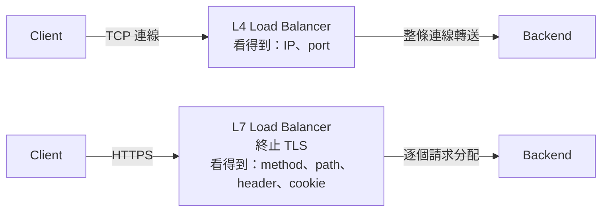

> **System Design 系列** Part 2-2｜上一篇：[垂直擴展、水平擴展與無狀態服務](/post/systemdesign/scaling-stateless/)｜下一篇：[Cache 深入](/post/systemdesign/caching/)｜[系列地圖](/post/systemdesign/system-design-thinking/#系列地圖)

## 情境與問題

服務已經做到無狀態，前面放了 Load Balancer，後面十台 instance。某天發生了三件事：

1. 其中一台因為鄰居搶 CPU，處理時間從 10 ms 變成 100 ms。它沒有掛，health check 照樣回 200，Load Balancer 繼續把十分之一的流量送給它，**那十分之一的使用者一直逾時**
2. 每次部署，監控上都固定出現一小段 502
3. 資料庫抖了 3 秒。因為 health check 有檢查資料庫，十台 instance 同時被判定為不健康，**全站停擺的時間遠比資料庫抖動的 3 秒還長**

這三件事分別對應 Load Balancer 的三個核心問題：**怎麼分配、怎麼判斷健康、怎麼上下線**。

## 最簡單的做法與它的極限：DNS Round Robin

最簡單的負載平衡是在 DNS 放多筆 A record，讓 client 自己挑一個 IP。它的問題是：

- **沒有健康檢查**：一台掛了，DNS 還是會把它的 IP 發出去
- **移除不即時**：client、resolver、JVM 都會快取 DNS 結果，改了 DNS 要等 TTL 過期才會生效
- **分配粒度太粗**：client 拿到 IP 後，後續所有請求都打同一台

DNS 適合做「把使用者導到最近的機房」這種粗粒度的分配（GeoDNS），機房內部的分配還是要交給真正的 Load Balancer。

## 核心機制

### L4 與 L7



| | L4（傳輸層） | L7（應用層） |
|---|---|---|
| 看得到什麼 | IP、port、TCP/UDP | HTTP method、path、header、cookie |
| 分配的單位 | **連線** | **請求** |
| TLS | 可以直接轉送（passthrough），由後端終止 | 必須終止 TLS 才看得到 HTTP 內容 |
| 能做的事 | 極高吞吐、低延遲、支援任何 TCP 協定 | 依路徑路由、重試、改寫 header、灰度發布、WAF |
| 代表產品 | AWS NLB、LVS、HAProxy TCP 模式 | AWS ALB、Nginx、Envoy、HAProxy HTTP 模式 |

「分配的單位」這一列影響最大。HTTP/2 和 gRPC 會在**一條長連線上多工傳送大量請求**，L4 只能決定這條連線接到哪台，連線建立之後，上面所有請求都打同一台。結果是：某個流量很大的 client 把一台 backend 打滿，其他台卻很閒；新增的 instance 也分不到既有連線的流量。這類協定需要 L7 或 client-side 負載平衡。

### 演算法：遇到慢節點時的差異

用一個模擬來比較：10 台 backend，其中 1 台處理一個請求要 100 ms，其他 9 台只要 10 ms；每秒 500 個請求，用 Poisson 分佈隨機到達，每台一次處理一個請求、其餘排隊。

<details>
<summary>完整模擬程式（JDK 21，<code>java LoadBalancerSimulation.java</code> 直接執行）</summary>

```java
import java.util.ArrayDeque;
import java.util.Arrays;
import java.util.Random;

public class LoadBalancerSimulation {

    static final int SERVERS = 10;
    static final int REQUESTS = 200_000;
    static final double ARRIVALS_PER_MS = 0.5;               // 每秒 500 個請求
    static final double[] SERVICE_MS = new double[SERVERS];   // 每台處理一個請求要多久

    static {
        Arrays.fill(SERVICE_MS, 10);   // 9 台正常：10 ms
        SERVICE_MS[0] = 100;           // 1 台變慢（GC、鄰居搶 CPU）：100 ms
    }

    interface Picker {
        int pick(int requestNo, int[] inFlight, Random random);
    }

    public static void main(String[] args) {
        run("Round Robin", (n, inFlight, r) -> n % SERVERS);
        run("Random", (n, inFlight, r) -> r.nextInt(SERVERS));
        run("P2C", (n, inFlight, r) -> {                 // 隨機挑兩台，選處理中較少的
            int a = r.nextInt(SERVERS);
            int b = r.nextInt(SERVERS);
            return inFlight[a] <= inFlight[b] ? a : b;
        });
        run("Least Outstanding", (n, inFlight, r) -> {   // 全部比較，選處理中最少的
            int best = 0;
            for (int s = 1; s < SERVERS; s++) {
                if (inFlight[s] < inFlight[best]) {
                    best = s;
                }
            }
            return best;
        });
    }

    @SuppressWarnings("unchecked")
    static void run(String name, Picker picker) {
        Random random = new Random(42);
        ArrayDeque<Double>[] completions = new ArrayDeque[SERVERS];
        double[] lastFinish = new double[SERVERS];
        for (int i = 0; i < SERVERS; i++) {
            completions[i] = new ArrayDeque<>();
        }
        int[] inFlight = new int[SERVERS];
        double[] latency = new double[REQUESTS];
        int toSlowServer = 0;
        double now = 0;

        for (int n = 0; n < REQUESTS; n++) {
            now += -Math.log(1 - random.nextDouble()) / ARRIVALS_PER_MS; // Poisson 到達
            for (int s = 0; s < SERVERS; s++) {                          // 移除已完成的請求
                while (!completions[s].isEmpty() && completions[s].peekFirst() <= now) {
                    completions[s].pollFirst();
                }
                inFlight[s] = completions[s].size();
            }
            int s = picker.pick(n, inFlight, random);
            double start = Math.max(now, lastFinish[s]);                 // 單一 worker，FIFO 排隊
            double finish = start + SERVICE_MS[s];
            lastFinish[s] = finish;
            completions[s].addLast(finish);
            latency[n] = finish - now;
            if (s == 0) {
                toSlowServer++;
            }
        }

        Arrays.sort(latency);
        System.out.printf("%-18s slow=%5.2f%%  p50=%6.0f ms  p99=%9.0f ms%n",
                name, 100.0 * toSlowServer / REQUESTS,
                latency[REQUESTS / 2], latency[(int) (REQUESTS * 0.99)]);
    }
}
```

</details>

執行結果（`slow` 是慢機器分到的流量比例）：

```text
Round Robin        slow=10.00%  p50=    10 ms  p99=  1439295 ms
Random             slow=10.00%  p50=    12 ms  p99=  1439619 ms
P2C                slow= 2.00%  p50=    10 ms  p99=      249 ms
Least Outstanding  slow= 1.99%  p50=    10 ms  p99=      136 ms
```

- **Round Robin 和 Random 完全看不到後端狀態**：慢機器每秒只處理得了 10 個請求，卻照樣分到 10%（每秒 50 個），佇列每秒多 40 個、無限變長。模擬裡 p99 高達 24 分鐘，真實系統會先逾時，結果就是**固定 10% 的錯誤率**
- **P2C（Power of Two Choices）**：每次隨機挑兩台，選處理中請求較少的那台。慢機器因為佇列比較長，自然少被選到，流量降到 2%，剛好接近它的處理能力
- **Least Outstanding**：每次比較所有 backend，表現最好，但要掌握全部節點的即時狀態

既然全部比較最好，為什麼大規模系統常用 P2C？因為 Load Balancer 本身通常也有很多台，各自看到的狀態都有延遲。如果大家都選「目前最閒」的那台，**所有 LB 會在同一瞬間把流量倒給同一台**，把它打爆後再一起倒向下一台。P2C 的隨機性避開了這種一窩蜂現象，又保留了大部分的好處。理論上，n 台機器用純隨機分配時，最忙那台的負載約是 ln n ÷ ln ln n；改成隨機挑兩台取較閒的，降到約 ln ln n ÷ ln 2，是指數級的改善。

另外要注意：這台慢機器的 health check 一直是健康的。**「慢但沒死」的灰色故障（gray failure），主動式健康檢查抓不到**，只能靠會看即時負載的演算法，或是被動的異常偵測。

### 健康檢查：檢查什麼、不檢查什麼

| 檢查 | 回答的問題 | 失敗時的動作 | 不要放進去的東西 |
|---|---|---|---|
| Liveness | 程序還活著嗎？有沒有死結？ | 重啟 instance | **任何外部依賴** |
| Readiness | 這台現在能接流量嗎？（暖機完成、不在關機中） | 從 LB 名單暫時移除 | **所有 instance 共用的依賴**（資料庫、Redis） |
| 被動檢查 | 真實流量的錯誤率、逾時比例 | 暫時移除一段時間 | — |

情境 3 的全站停擺，就是把共用的資料庫放進 readiness 造成的：資料庫一抖，十台同時不健康。在 Kubernetes 上，Service 會因此沒有任何 endpoint，所有請求直接失敗；就算資料庫恢復了，還要等每台連續通過好幾次檢查，才會被加回名單。AWS ALB 為了避免這種情況，設計成 target group 裡全部 target 都不健康時改為 fail open，照樣把流量送給所有 target。這等於承認了「全部不健康」通常代表檢查本身有問題，而不是每一台都壞了。比較好的做法是讓請求照常進來，由應用程式自己處理資料庫錯誤（逾時、熔斷、降級），至少能回傳快取資料或友善的錯誤訊息。

Liveness 檢查外部依賴更糟：資料庫一掛，所有 instance 被不斷重啟，重啟期間的冷啟動又拖慢資料庫恢復後的處理能力。

另一個常被忽略的是**偵測時間**：偵測時間 = 檢查間隔 × 連續失敗門檻。以 AWS ALB 的預設值（間隔 30 秒、連續失敗 2 次才移除、連續成功 5 次才加回）來算，一台掛掉要約 60 秒才會被移除，恢復後要約 150 秒才會被加回。

### 上線與下線：連線排空與慢啟動

- **連線排空（connection draining / deregistration delay）**：instance 被移出名單後，LB 不再送新請求，但會等進行中的請求完成。等待時間太短會切斷長請求，太長則讓部署變慢（AWS ALB 預設 300 秒）。設成「最長請求時間再多一點」即可
- **慢啟動（slow start）**：新 instance 剛啟動時 JIT 還沒編譯熱點程式、本機快取是空的、連線池也還沒建立。立刻分到全額流量，前幾十秒的延遲會很難看。可以在 LB 設定慢啟動讓流量逐步增加，或在 instance 宣告 ready 之前先暖機

### Keep-alive：誰的逾時要比較長

[Part 1](/post/systemdesign/request-lifecycle/) 提過，client 的閒置逾時要比 server 短。LB 與 backend 之間也一樣，只是這時 **LB 是 client，backend 是 server**：

```text
LB 閒置逾時（例如 ALB 60 秒）＜ backend 的 keep-alive 逾時（例如 75 秒）
```

如果反過來，backend 先把閒置連線關掉，LB 剛好在同一瞬間拿這條連線送請求，就會收到連線被重置，回給使用者 502。這種錯誤是**間歇性的**，量很少、很難重現，常常被當成「網路抖一下」帶過。統一的原則是：**負責重用連線的那一方，閒置逾時要比較短**。

## 方案比較

### 演算法

| 演算法 | 原理 | 適合 | 弱點 |
|---|---|---|---|
| Round Robin | 輪流分配 | 後端規格相同、每個請求成本相近 | 看不到後端狀態，慢節點照樣分 |
| Weighted Round Robin | 依權重輪流 | 後端規格不同 | 權重是靜態的，無法反映即時狀況 |
| Random | 隨機 | 多台 LB 之間不共享狀態 | 同 Round Robin |
| Least Connections / Outstanding | 選處理中最少的 | 請求成本差異大、可能有慢節點 | 需要全域即時狀態；多台 LB 會一窩蜂 |
| P2C | 隨機挑兩台，選較閒的 | 大規模、多台 LB 的環境 | 需要追蹤每台處理中的請求數 |
| Hash／一致性雜湊 | 依 key 決定送到哪台 | 需要快取親和性，同一個 key 固定到同一台 | 熱門 key 造成負載不均（Part 4 詳談） |

Linkerd、Finagle 這類 service mesh 和 RPC 框架，常用 P2C 再搭配 EWMA（指數加權移動平均）延遲，同時考慮處理中請求數和最近的回應速度。

### Server-side 與 Client-side 負載平衡

| | Server-side（集中式 LB） | Client-side（呼叫端自己選） |
|---|---|---|
| 做法 | 所有請求先經過 LB | 呼叫端從服務註冊中心拿到名單，自己挑 |
| 網路跳數 | 多一跳 | 少一跳 |
| 長連線（gRPC）| L4 不均，需要 L7 | 呼叫端可以逐請求分配 |
| 實作成本 | 集中在 LB，語言無關 | 每個語言、每個 client 都要實作 |
| 代表 | ALB、Nginx、Envoy | Spring Cloud LoadBalancer、gRPC client、service mesh sidecar |

Client-side 需要服務註冊與發現，留到 Part 7 的 Service Discovery 再談。

## Java 落地

### 1. P2C 的 client-side 實作

```java
public final class P2cLoadBalancer {

    private final List<Endpoint> endpoints;

    public P2cLoadBalancer(List<URI> uris) {
        this.endpoints = uris.stream().map(Endpoint::new).toList();
    }

    public <T> T call(Function<URI, T> request) {
        Endpoint chosen = choose();
        chosen.inFlight.incrementAndGet();
        try {
            return request.apply(chosen.uri);
        } finally {
            chosen.inFlight.decrementAndGet();   // 不論成功或失敗都要扣回來
        }
    }

    private Endpoint choose() {
        ThreadLocalRandom random = ThreadLocalRandom.current();
        Endpoint a = endpoints.get(random.nextInt(endpoints.size()));
        Endpoint b = endpoints.get(random.nextInt(endpoints.size()));
        return a.inFlight.get() <= b.inFlight.get() ? a : b;
    }

    private static final class Endpoint {
        final URI uri;
        final AtomicInteger inFlight = new AtomicInteger();

        Endpoint(URI uri) {
            this.uri = uri;
        }
    }
}
```

核心只有 `choose()` 裡的三行。`inFlight` 一定要在 `finally` 扣回，否則一次例外就會讓某台的計數永遠偏高，再也分不到流量。兩次隨機可能挑到同一台，實務上影響很小，要避免的話第二次改從剩下的節點中挑即可。

### 2. Spring Boot 的 readiness 與 liveness

```yaml
management:
  endpoint:
    health:
      probes:
        enabled: true
      group:
        readiness:
          include: "readinessState"   # 預設值：不把 db、redis 這類共用依賴放進來
```

Spring Boot 預設不會把任何外部依賴加進 readiness 和 liveness，這是刻意的設計：要不要放，是應用程式自己的判斷。只有「這台 instance 獨有」的依賴（例如本機的暫存目錄、sidecar）才適合放進 readiness。

**暖機**：Spring Boot 要等所有 `ApplicationRunner`、`CommandLineRunner` 執行完，才會把 readiness 設成可接流量。所以暖機邏輯放在 runner 裡，就能保證暖機完成前 LB 不會送流量進來：

```java
@Component
public class CacheWarmUpRunner implements ApplicationRunner {

    private final ProductCatalog catalog;

    public CacheWarmUpRunner(ProductCatalog catalog) {
        this.catalog = catalog;
    }

    @Override
    public void run(ApplicationArguments args) {
        catalog.preloadHotProducts();   // 載入熱門商品到本機快取，順便讓 JIT 先編譯熱點路徑
    }
}
```

**手動排空**：要把某台暫時移出流量（例如排查問題），可以主動把 readiness 改成拒絕流量：

```java
AvailabilityChangeEvent.publish(eventPublisher, this, ReadinessState.REFUSING_TRAFFIC);
```

### 3. Nginx upstream 設定

```nginx
upstream order_service {
    least_conn;
    server 10.0.1.11:8080 max_fails=3 fail_timeout=10s;
    server 10.0.1.12:8080 max_fails=3 fail_timeout=10s;
    server 10.0.1.13:8080 max_fails=3 fail_timeout=10s;
    keepalive 32;                        # 每個 worker 保留的閒置 upstream 連線數
}

server {
    location /api/ {
        proxy_pass http://order_service;
        proxy_http_version 1.1;          # upstream keep-alive 需要 HTTP/1.1
        proxy_set_header Connection "";  # 清掉 client 帶來的 Connection header
        proxy_connect_timeout 1s;
        proxy_read_timeout 5s;
        proxy_next_upstream error timeout http_502 http_503;
        proxy_next_upstream_tries 2;
    }
}
```

幾個容易誤解的地方：

- **Nginx 開源版只有被動健康檢查**：`max_fails=3 fail_timeout=10s` 的意思是「10 秒內失敗 3 次，就在接下來的 10 秒不送流量給它」。主動式的 `health_check` 是 NGINX Plus 的功能
- **沒有 `proxy_http_version 1.1` 和清空 `Connection`，`keepalive` 不會生效**：每個請求都會和 backend 重新建立 TCP 連線
- **`proxy_next_upstream` 預設不會重試非冪等請求**：POST、PATCH 等方法在請求已送出後失敗，Nginx 不會自動換一台重送，除非明確加上 `non_idempotent`。這是對的預設值，不要隨便打開，否則一筆下單請求可能被處理兩次

### 4. Backend 的 keep-alive 逾時

```properties
# ALB 閒置逾時 60 秒，backend 要比它長
server.tomcat.keep-alive-timeout=75s
```

Tomcat 沒設定 `keep-alive-timeout` 時會沿用 `connection-timeout`。最危險的是兩邊剛好相等，或 backend 比 LB 短。

### 5. 拿到真正的 client IP

經過 L7 LB 之後，backend 看到的來源 IP 都是 LB 的。限流、稽核紀錄、地區判斷都會因此出錯。Spring Boot 要設定信任代理送來的 header：

```properties
server.forward-headers-strategy=native
```

Tomcat 只信任 `server.tomcat.remoteip.internal-proxies` 範圍內（預設是各種私有網段）的代理，並從 `X-Forwarded-For` 的**最右邊往左**找，第一個不在信任範圍內的 IP 才是 client IP。client 自己偽造的值會排在最左邊，因此會被忽略。最常見的漏洞反而是自己寫 `request.getHeader("X-Forwarded-For")` 再取第一個值，那個值是 client 想填什麼就填什麼。

## 踩坑與 Gotchas

- **Health check 檢查共用依賴**：資料庫一抖，全部 instance 同時被移除，局部故障變成全站停擺
- **Liveness 檢查外部依賴**：外部服務掛掉時，所有 instance 被不斷重啟
- **Health check 只看「活著」**：慢但沒死的節點會持續吃流量。要搭配會看負載的演算法或被動異常偵測
- **LB 重試非冪等請求**：逾時不代表 backend 沒處理，重送可能造成重複下單。需要重試的寫入請求，要先做好冪等性（Part 5）
- **每一層都重試**：client、LB、服務間呼叫各自最多嘗試 3 次，一個請求到最下游最多被放大成 3 × 3 × 3 = 27 次，正好在系統最脆弱時壓垮它（Part 6）
- **長連線在 L4 下負載不均**：HTTP/2、gRPC、WebSocket 建立後就固定在某台。新增 instance 後舊連線不會重新分配，可以設定連線的最長存活時間，讓 client 定期重連
- **Backend 的 keep-alive 比 LB 短**：出現間歇性 502
- **排空時間設定不當**：太短會切斷進行中的請求，太長讓部署動輒好幾分鐘
- **新 instance 冷啟動直接吃滿流量**：前幾十秒延遲飆高，誤觸告警或自動擴容
- **沒有設定信任代理**：所有請求的來源 IP 都是 LB，依 IP 的限流全部失效

### 資安相關

- **只有 client 到 LB 這段有加密**：TLS 在 LB 終止後，LB 到 backend 是明文。在同一個私有網路內通常可以接受，但有合規要求或採零信任架構時，要重新加密到 backend（Part 8）
- **WAF 只能放在 L7**：L4 看不到 HTTP 內容，SQL injection、路徑探測這類規則只能在 L7 的 LB 或 CDN 上執行
- **管理端點跟著對外開放**：LB 把所有路徑轉給 backend，`/actuator` 也就一起對外了。把 Actuator 放到獨立的 `management.server.port`，LB 只轉送應用程式的 port，health check 另外指定管理 port，走內部網路
- **自己解析 `X-Forwarded-For`**：取最左邊的值當 client IP，等於讓 client 自己決定 IP，依 IP 的限流與稽核全部可以被繞過（見上面 Java 落地第 5 點）

## 何時用／何時別用

- **雲端環境**：HTTP 服務用 L7（ALB），需要固定 IP、極低延遲或非 HTTP 協定時用 L4（NLB）
- **自建環境**：Nginx、HAProxy、Envoy 都很成熟。需要動態設定、gRPC 感知、細緻的重試與熔斷時選 Envoy
- **演算法**：有 least outstanding 或 P2C 就優先用；後端同質、請求又快又均勻時，Round Robin 也足夠
- **重新評估的時機**：各台 instance 的 p99 差異很大；加了 instance 延遲卻沒有下降（可能是長連線沒重新分配）；部署期間的錯誤率明顯上升

## 參考資料

- Michael Mitzenmacher, "The Power of Two Choices in Randomized Load Balancing", *IEEE Transactions on Parallel and Distributed Systems*, 2001
- Peng Huang et al., "Gray Failure: The Achilles' Heel of Cloud-Scale Systems", HotOS 2017
- Google, *Site Reliability Engineering*, Chapter 19 — Load Balancing at the Frontend：<https://sre.google/sre-book/load-balancing-frontend/>
- Google, *Site Reliability Engineering*, Chapter 20 — Load Balancing in the Datacenter：<https://sre.google/sre-book/load-balancing-datacenter/>
- NGINX — ngx_http_upstream_module：<https://nginx.org/en/docs/http/ngx_http_upstream_module.html>
- NGINX — ngx_http_proxy_module：<https://nginx.org/en/docs/http/ngx_http_proxy_module.html>
- AWS Elastic Load Balancing — Health checks for Application Load Balancer target groups：<https://docs.aws.amazon.com/elasticloadbalancing/latest/application/target-group-health-checks.html>
- Spring Boot Reference — Application Availability、Kubernetes Probes：<https://docs.spring.io/spring-boot/reference/features/spring-application.html>
- 互動圖解延伸：Dilum Sanjaya，System Design — an interactive course：<https://designed-to-scale.vercel.app/>
