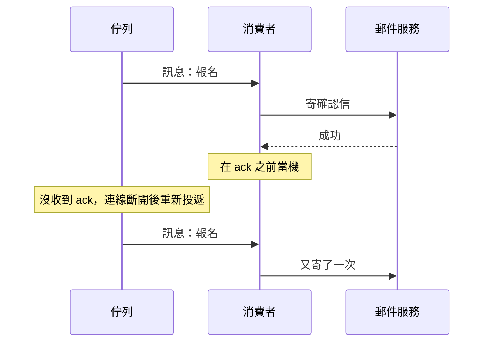

> **System Design 系列** Part 5-2｜上一篇：[REST、gRPC 與 GraphQL](/post/systemdesign/rest-grpc-graphql/)｜下一篇：[Pub/Sub 與投遞語意](/post/systemdesign/pubsub-delivery-semantics/)｜[系列地圖](/post/systemdesign/system-design-thinking/#系列地圖)

## 情境與問題

報名成功之後，系統還要做三件事：寄確認信、通知講者、把報名紀錄送去推薦系統。目前全部在報名的 API 裡同步執行，問題接連出現：

1. **慢**：報名 API 的延遲等於這四件事的總和，其中寄信最慢
2. **連帶失敗**：郵件服務當機時，報名也跟著失敗。使用者明明已經搶到名額，卻看到錯誤
3. **尖峰**：熱門講座開放報名的那 10 分鐘湧入 3 萬筆報名，但郵件服務商限制每秒最多送 50 封。同步呼叫時，超過的請求只能失敗

## 最簡單的做法與它的極限

- **`@Async` 丟到執行緒池**：報名 API 變快了，但工作只存在記憶體裡。服務重啟或當機，還沒執行的工作全部消失，也沒有地方看得到失敗了哪些
- **資料庫當佇列**：報名時在同一個交易裡寫一筆「待寄信」紀錄，背景程式用 `SELECT ... FOR UPDATE SKIP LOCKED` 取出處理。工作和報名一起提交，不會遺失，多台背景程式也不會搶到同一筆。**量不大時這是很好的選擇**，它的極限在於輪詢的負擔、大量更新造成的鎖競爭與表膨脹，以及每增加一種消費者就要再多一張表或一個狀態欄位

需要更大的量、更多種消費者、更完整的重試與監控時，才輪到專門的 message broker。

## 核心機制

### 佇列提供的三件事

- **時間上的解耦**：生產者送出訊息就可以回應使用者，消費者晚一點處理、甚至暫時停機都沒關係
- **削峰**：生產速度和消費速度不必相同，差額暫存在佇列裡。3 萬封信以每秒 50 封的速度寄送，需要 600 秒，也就是尖峰過後約 10 分鐘全部寄完，而不是 2 萬 9 千筆請求失敗
- **失敗隔離與重試**：郵件服務當機時，訊息留在佇列裡等待重試，報名本身不受影響

代價是**最終一致**：報名成功的那一刻，確認信還沒寄出。產品要接受這段延遲，介面上也要能表達「處理中」。

### 競爭消費者與 prefetch

多個消費者訂閱同一個佇列，每則訊息只交給其中一個。消費者跟不上時，加開實例就能提高處理速度。

**Prefetch** 決定 broker 一次最多推給每個消費者幾則還沒確認的訊息。值越大，吞吐量越高，因為消費者不必每處理完一則就等下一則；但訊息會堆在消費者的記憶體裡，也分配得比較不平均。Spring AMQP 的預設值是 250。訊息很大、處理很慢、或需要嚴格順序時，要調低。

### Ack 的時機決定投遞語意

Broker 送出訊息後，要等消費者回覆 ack 才會刪除它：



| Ack 時機 | 當機時 | 語意 |
|---|---|---|
| 處理完才 ack | 訊息重送，可能處理兩次 | at-least-once（至少一次） |
| 收到就 ack | 訊息遺失 | at-most-once（最多一次） |

絕大多數情況選擇處理完才 ack，**所以消費者一定會收到重複的訊息**，處理邏輯必須是冪等的。除了當機，重複還來自生產者在逾時後重送、網路中斷後重新連線等。冪等的做法在 [Part 5 的冪等性篇](/post/systemdesign/idempotency-key/)詳談。

消費者也不能處理太久不回覆。RabbitMQ 預設 30 分鐘內沒有 ack，就關閉該消費者的 channel，把訊息重新投遞給別人。

### 失敗分類：暫時性與永久性

| 類型 | 例子 | 處理 |
|---|---|---|
| 暫時性 | 郵件服務逾時、回應 503、資料庫連線不足 | 等一下再重試，間隔逐漸拉長 |
| 永久性 | email 格式錯誤、訊息無法反序列化、對應的報名已被刪除 | 重試也不會成功，直接送到 DLQ |

**毒訊息**（poison message）是一直處理失敗的訊息。如果每次失敗都立刻放回佇列，它會不停地被重送，佔用消費者，甚至擋住後面的訊息。處理方式：

- **限制重送次數**：RabbitMQ 的 quorum queue 會記錄每則訊息失敗的投遞次數，超過上限就轉送到 dead letter exchange；沒有設定 DLX 時直接丟棄。RabbitMQ 4.0 起這個上限預設是 20，官方建議每個 quorum queue 都設定 DLX，避免訊息無聲地消失
- **Dead letter queue（DLQ）**：存放處理不了的訊息，監控它的長度並告警，修正問題後可以把訊息搬回原佇列重新處理
- **延遲重試**：立刻重送等於快速連續重試，對正在恢復的下游是額外的壓力。可以在消費者端以退避間隔重試，或把失敗的訊息送到一個設了 TTL 的重試佇列，到期後再轉回原佇列

### 順序

單一佇列本身是先進先出的，但**處理順序**不一定：多個消費者平行處理、某則訊息失敗後被重送，都會讓後送出的訊息先處理完成。

如果「取消報名」比「報名成功」先處理，就會寄出一封錯誤的確認信。做法：

- **讓順序不重要**：訊息帶上版本或狀態，消費者處理前比對資料庫裡的最新狀態，而不是依訊息到達的順序行事
- **依 key 分區**：同一場報名的訊息永遠進同一個分區、由同一個消費者依序處理。這是 Kafka 這類 log 型 broker 的做法，下一篇詳談
- **單一消費者**：RabbitMQ 的 single active consumer 只讓一個消費者處理整個佇列，換來順序，失去平行處理

### 耐久性

Broker 當機時訊息不能遺失，要同時做到：

- **佇列要複寫**：RabbitMQ 的 quorum queue 用 Raft 把訊息複寫到多數節點（[共識與 Raft 篇](/post/systemdesign/consensus-raft/)）
- **生產者要確認 broker 收到了**：開啟 publisher confirms，broker 把訊息安全存下之後才回覆。沒有確認就當作送出成功，broker 當機時訊息就遺失了

### 雙寫問題

報名要寫入資料庫、也要送出訊息，這兩件事無法放在同一個交易裡：

| 順序 | 中途當機的後果 |
|---|---|
| 先送訊息，再提交交易 | 交易回滾，訊息卻已送出：替一筆不存在的報名寄了確認信 |
| 先提交交易，再送訊息 | 訊息沒送出：報名成功，卻永遠不會寄確認信 |

上面「資料庫當佇列」的做法剛好沒有這個問題，因為「待處理的工作」和報名在同一個交易裡。把這個概念和 broker 結合，就是 transactional outbox：先在交易內寫入 outbox 表，再由另一個程序把 outbox 的內容送到 broker（[Outbox Pattern](/post/architecture/outbox-pattern/)，[Part 7 詳談](/post/systemdesign/saga-outbox/)）。

### 訊息的內容

- **只放 ID，還是放完整的資料**：只放 ID，消費者要回頭查詢，查到的是最新狀態，但多了一次查詢、也依賴生產者的資料庫；放完整的資料，消費者自給自足，但拿到的可能是舊狀態，訊息也比較大
- **大檔案不要放進訊息**：講義 PDF 這類大型內容存到物件儲存，訊息只放它的位置（claim check，[物件儲存篇](/post/systemdesign/object-storage/)）
- **訊息格式要能演進**：生產者和消費者不會同時部署，新增欄位要讓舊的消費者能忽略，刪除欄位前要確認所有消費者都不再使用

## 方案比較

| 方案 | 特色 | 適合 |
|---|---|---|
| 資料庫表 + `SKIP LOCKED` | 和業務資料同一個交易，不需要新的基礎設施 | 量不大、消費者種類少 |
| RabbitMQ（quorum queue） | 路由彈性大（exchange、routing key）、每則訊息個別確認、DLX 與重送上限 | 工作佇列、需要細緻路由與重試 |
| Amazon SQS | 全代管、visibility timeout、redrive policy 轉送 DLQ；standard 佇列至少一次且不保證順序，FIFO 佇列保證順序 | 在 AWS 上、不想維運 broker |
| Kafka | 訊息是保留下來的 log，可以多個消費群組各自讀取、重播 | 事件串流、多個訂閱者、需要重播，下一篇詳談 |
| Redis Streams | 輕量、已經有 Redis 時容易導入 | 量不大、可以接受 Redis 的耐久性 |

## Java 落地

### 1. 宣告佇列、DLX 與重送上限

```java
@Configuration
public class RegistrationMessagingConfig {

    public static final String EXCHANGE = "registration";
    public static final String EMAIL_QUEUE = "registration.confirmation-email";
    public static final String EMAIL_DLQ = EMAIL_QUEUE + ".dlq";

    @Bean
    public Declarables registrationTopology() {
        DirectExchange exchange = new DirectExchange(EXCHANGE);
        DirectExchange deadLetters = new DirectExchange(EXCHANGE + ".dlx");
        Queue emailQueue = QueueBuilder.durable(EMAIL_QUEUE)
                .withArgument("x-queue-type", "quorum")
                .deliveryLimit(5)                           // 失敗投遞超過 5 次就轉到 DLX
                .deadLetterExchange(deadLetters.getName())
                .deadLetterRoutingKey(EMAIL_QUEUE)
                .build();
        Queue emailDlq = QueueBuilder.durable(EMAIL_DLQ)
                .withArgument("x-queue-type", "quorum")
                .build();
        return new Declarables(exchange, deadLetters, emailQueue, emailDlq,
                BindingBuilder.bind(emailQueue).to(exchange).with("registered"),
                BindingBuilder.bind(emailDlq).to(deadLetters).with(EMAIL_QUEUE));
    }

    @Bean
    public MessageConverter jsonMessageConverter() {
        return new JacksonJsonMessageConverter();
    }
}
```

### 2. 交易提交之後才送出訊息

```java
@Service
public class RegistrationService {

    private final RegistrationRepository registrations;
    private final ApplicationEventPublisher events;

    public RegistrationService(RegistrationRepository registrations, ApplicationEventPublisher events) {
        this.registrations = registrations;
        this.events = events;
    }

    @Transactional
    public Registration register(long lectureId, long memberId) {
        Registration registration = registrations.save(new Registration(lectureId, memberId));
        events.publishEvent(new RegistrationConfirmed(registration.getId(), lectureId, memberId));
        return registration;
    }
}

@Component
public class RegistrationEventRelay {

    private final RabbitTemplate rabbitTemplate;

    public RegistrationEventRelay(RabbitTemplate rabbitTemplate) {
        this.rabbitTemplate = rabbitTemplate;
    }

    @TransactionalEventListener(phase = TransactionPhase.AFTER_COMMIT)
    public void relay(RegistrationConfirmed event) {
        rabbitTemplate.convertAndSend(RegistrationMessagingConfig.EXCHANGE, "registered", event);
    }
}
```

`@TransactionalEventListener` 讓訊息在交易提交之後才送出，避免「替回滾的報名寄信」。但它沒有解決另一半：提交之後、送出之前當機，或 broker 暫時連不上，訊息就遺失了。對確認信來說，可以搭配定期掃描「已報名但沒寄信」的補償作業；不能遺失的訊息要用 outbox。

### 3. 消費者：區分永久性失敗，並且冪等

```java
@Component
public class ConfirmationEmailListener {

    private final EmailSender emailSender;
    private final SentEmailRepository sentEmails;

    public ConfirmationEmailListener(EmailSender emailSender, SentEmailRepository sentEmails) {
        this.emailSender = emailSender;
        this.sentEmails = sentEmails;
    }

    @RabbitListener(queues = RegistrationMessagingConfig.EMAIL_QUEUE)
    public void onRegistered(RegistrationConfirmed event) {
        if (sentEmails.exists(event.registrationId())) {
            return;                                             // 重複投遞：已經寄過了
        }
        try {
            // 郵件服務商支援冪等鍵時帶上報名 ID，同一個鍵只會寄出一次
            emailSender.sendConfirmation(event.memberId(), event.lectureId(), "registration-" + event.registrationId());
        } catch (InvalidRecipientException e) {
            throw new AmqpRejectAndDontRequeueException("invalid recipient", e);   // 永久性失敗：直接進 DLQ
        }
        sentEmails.markSent(event.registrationId());
    }
}
```

- **暫時性失敗**（逾時、連線錯誤）讓例外直接拋出，訊息被拒絕並重新投遞，失敗超過 5 次轉到 DLQ。Spring AMQP 4.0.6 起，listener container 會逐則拒絕失敗的訊息，確保每次失敗都計入 broker 的重送上限
- **永久性失敗**拋出 `AmqpRejectAndDontRequeueException`，訊息不再重送，直接轉到 DLX
- **冪等**：寄信前檢查是否已寄過。「寄出之後、標記之前」當機仍會重寄，這段空隙由郵件服務的冪等鍵涵蓋；服務商不支援時，確認信偶爾重複一封是可以接受的代價。撥款就不行（[分散式鎖篇](/post/systemdesign/distributed-lock/)）
- Spring Boot 也可以開啟 listener 端的重試（預設關閉），在同一個消費者裡以退避間隔重試，用完之後拒絕訊息、交給 DLX

> 以上程式碼依 Spring AMQP 4.1、Spring Boot 4.1 與 RabbitMQ 官方文件撰寫，沒有實際編譯與執行。

## 踩坑與 Gotchas

- **沒有設定 DLX**：quorum queue 超過重送上限的訊息會被直接丟棄；舊版本則是沒有上限，毒訊息永遠重送
- **以為訊息只會處理一次**：at-least-once 代表一定會有重複，所有消費者都要冪等
- **在交易內送出訊息**：交易回滾時訊息已經送出，消費者處理了一筆不存在的資料
- **消費者處理太久**：超過 broker 的 ack 逾時，channel 被關閉、訊息被重送給別的消費者，同一則訊息同時被處理兩次。長時間的工作要拆小，或改成「收到訊息 → 寫入工作表 → 立刻 ack」
- **用 nack 退回訊息**：RabbitMQ 4.3 起，`basic.nack` 不計入失敗投遞次數，只有 `basic.reject` 會。自己處理 ack 時，要用 reject 才會被重送上限擋下
- **Prefetch 太大配上很慢的工作**：一個消費者手上壓著幾百則訊息，其他消費者閒著；那個消費者當機時，幾百則訊息一起重送
- **只監控有沒有錯誤**：佇列的長度、最舊訊息的等待時間、消費速度才是重點。佇列持續成長代表消費能力不足，要在使用者發現之前告警
- **佇列無上限地成長**：消費者長時間停擺時，broker 的磁碟與記憶體被塞滿，影響其他佇列。設定 `max-length` 並選擇溢出時的行為（例如拒絕新訊息，讓生產者知道）
- **DLQ 沒有人看**：DLQ 是待處理的工作，不是垃圾桶。要有告警、有負責人、有重新投遞的工具

### 資安相關

- **訊息也是不受信任的輸入**：能寫入佇列的不只是自家的生產者，被入侵的服務、設定錯誤的權限、重播的舊訊息都可能出現。消費者要驗證訊息的格式與內容，再次檢查授權（例如這個會員真的報名了這場講座），而不是因為「訊息來自內部」就照單全收
- **不要用 Java 序列化格式**：反序列化不受信任的資料可能導致遠端執行程式碼。使用 JSON 這類資料格式，並由 listener 的參數型別決定要轉換成哪個類別，而不是讓訊息標頭指定任意類別
- **Broker 的帳號權限**：每個服務用自己的帳號，只授予需要的 vhost 與 exchange、queue 的讀寫權限。報名服務只能寫入 `registration` exchange，郵件服務只能讀取自己的佇列。預設的 `guest` 帳號在正式環境停用
- **連線加密**：生產者、消費者與 broker 之間使用 TLS，訊息裡常有 email、姓名這類個人資料
- **DLQ 裡的個人資料**：DLQ 的訊息可能存放很久，而且查看的人比較多。設定保留期限，查看與重新投遞的權限要控管，訊息內容盡量只放 ID
- **用佇列塞爆系統**：攻擊者透過大量觸發會產生訊息的操作（例如反覆報名再取消），讓佇列暴增、拖慢所有消費者。在產生訊息的 API 上做速率限制，佇列設定長度上限

## 何時用／何時別用

- **用 message queue**：耗時或依賴外部服務的工作、需要削峰、需要失敗後自動重試、生產者不需要立刻知道結果
- **先考慮資料庫當佇列**：量不大、只有一兩種背景工作、希望和業務資料在同一個交易裡
- **別用**：使用者需要立刻得到結果的操作（例如扣名額本身）、只是為了「看起來比較解耦」卻沒有上述需求的同步呼叫。佇列帶來最終一致、重複處理、監控與維運的成本

## 參考資料

- RabbitMQ Documentation — Quorum Queues（Poison Message Handling）：<https://www.rabbitmq.com/docs/quorum-queues>
- RabbitMQ Documentation — Consumers（Delivery Acknowledgement Timeout）：<https://www.rabbitmq.com/docs/consumers>
- RabbitMQ Documentation — Negative Acknowledgements：<https://www.rabbitmq.com/docs/nack>
- RabbitMQ Documentation — Consumer Acknowledgements and Publisher Confirms：<https://www.rabbitmq.com/docs/confirms>
- RabbitMQ Documentation — Dead Letter Exchanges：<https://www.rabbitmq.com/docs/dlx>
- Spring AMQP Reference — Resilience: Recovering from Errors and Broker Failures：<https://docs.spring.io/spring-amqp/reference/amqp/resilience-recovering-from-errors-and-broker-failures.html>
- Spring AMQP Reference — Message Converters：<https://docs.spring.io/spring-amqp/reference/amqp/message-converters.html>
- Spring Boot Reference — AMQP：<https://docs.spring.io/spring-boot/reference/messaging/amqp.html>
- Gregor Hohpe, Bobby Woolf, *Enterprise Integration Patterns*, Addison-Wesley, 2003（Competing Consumers、Dead Letter Channel、Claim Check）
- 互動圖解延伸：Dilum Sanjaya，System Design — an interactive course：<https://designed-to-scale.vercel.app/>
