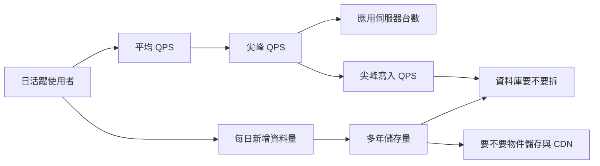

> **System Design 系列** Part 1-3｜上一篇：[Latency、Throughput 與 p99](/post/systemdesign/latency-throughput/)｜下一篇：[垂直擴展、水平擴展與無狀態服務](/post/systemdesign/scaling-stateless/)｜[系列地圖](/post/systemdesign/system-design-thinking/#系列地圖)

## 情境與問題

新專案的啟動會議上，PM 說「預計上線一年後日活躍使用者 200 萬」，主管轉頭問你：

- 應用伺服器要準備幾台？
- 資料庫三年後會長到多大？需要 sharding 嗎？
- 商品圖片放哪裡？

沒有壓測、沒有真實資料，但你要在會議中給出**數量級正確**的答案。

## 最簡單的做法與它的極限

最簡單的做法是「先上線再說，不夠再加」。對可以水平擴展的無狀態服務，這樣其實行得通，加機器就好。

問題在於有些決定**很難回頭**：資料庫要不要 sharding、sharding key 選什麼、圖片存在資料庫還是物件儲存。這些在上線後才發現選錯，要付出資料搬遷的代價。

估算的目的不是精準，而是回答這類**數量級的問題**：一台夠不夠？需不需要分散式？差 2 倍無所謂，差 100 倍架構就完全不同。

## 核心機制

### 1. 必背的換算

| 換算 | 近似值 |
|---|---|
| 2^10 / 2^20 / 2^30 / 2^40 | 約 1 千 / 1 百萬 / 10 億 / 1 兆（KB / MB / GB / TB） |
| 一天的秒數 | 86,400，心算時可用 10^5（誤差約 16%） |
| 一個月的秒數 | 約 2.6 × 10^6 |
| 一年的秒數 | 約 3.15 × 10^7 |
| 每天 100 萬次 | 約 12 次/秒 |
| 每天 1 億次 | 約 1,160 次/秒 |
| 1 Gbps | 約 125 MB/s（bit 和 byte 差 8 倍） |

### 2. 延遲數字（數量級）

| 操作 | 數量級 |
|---|---|
| CPU L1 cache 存取 | 約 1 ns |
| 主記憶體存取 | 約 100 ns |
| NVMe SSD 隨機讀 4 KB | 約 10–100 µs |
| 同機房網路來回（RTT） | 約 0.1–0.5 ms |
| Redis GET（同機房，含網路） | 約 0.2–1 ms |
| MySQL 主鍵查詢（資料在 buffer pool，含網路） | 約 0.5–2 ms |
| 傳統硬碟隨機尋道 | 約 5–10 ms |
| 台北 ↔ 東京 RTT | 約 30–40 ms |
| 台北 ↔ 美西 RTT | 約 130–160 ms |
| SSD 循序讀 1 GB | 約 0.3–1 s |
| 1 Gbps 網路傳 1 GB | 約 8–10 s |

這張表的數字會隨硬體世代變動，重點是看**數量級之間的差距**：

- 記憶體比 SSD 快 100–1,000 倍，這是 cache 存在的理由
- 同機房網路來回比讀記憶體慢數千倍。一個請求裡如果有 N+1 問題，連續呼叫 Redis 100 次，光網路就要 20–100 ms
- 跨洲 RTT 是同機房的數百倍，[上一篇](/post/systemdesign/request-lifecycle/)已經看過它的影響

### 3. 估算公式



| 項目 | 公式 |
|---|---|
| 平均 QPS | 日活躍使用者 × 每人每日請求數 ÷ 86,400 |
| 尖峰 QPS | 平均 QPS × 尖峰係數（一般服務 2–3；有整點活動、搶購時 10 以上） |
| 寫入 QPS | 尖峰 QPS × 寫入比例 |
| 機器數 | 尖峰 QPS ÷（單機壓測上限 × 目標使用率），再加上冗餘 |
| 儲存 | 每日新增筆數 × 每筆大小 × 保存天數 × 索引與額外負擔 × 複本數 |
| 頻寬 | 尖峰 QPS × 平均回應大小 |

目標使用率通常取 60–70%，原因見[上一篇的排隊模型](/post/systemdesign/latency-throughput/)。

## 方案比較：估算、壓測、監控回推

| 方法 | 何時用 | 準確度 | 成本 |
|---|---|---|---|
| Napkin math | 專案初期、架構選型、面試 | 數量級 | 幾分鐘 |
| 壓測 | 上線前、大改版後，取得「單機上限」這個關鍵參數 | 中到高，受測試情境影響 | 數天 |
| 監控資料回推 | 已上線，做年度容量規劃 | 高 | 需要累積歷史資料 |

三者不是互相取代：napkin math 用到的假設（單機上限、尖峰係數、讀寫比）要用壓測和監控資料去校正，校正後的數字再拿來做下一次估算。

## Java 落地：一個完整的估算範例

假設一個中型電商（虛構的數字）：

- 日活躍使用者 200 萬，每人每日 50 次 API 請求，尖峰係數 5，讀寫比 20:1
- 單台 Spring Boot 壓測上限 800 QPS（在 p99 < 200 ms 的條件下），目標使用率 60%
- 5% 的使用者每天會下單，平均 1.2 筆；每筆訂單（主檔加明細）約 2 KB，索引與額外負擔 ×1.5，1 主 2 從共 3 份，保存 3 年
- 每天新上架 5,000 個商品，每個 8 張圖、每張 300 KB；尖峰每秒 3,000 次縮圖請求，每張 100 KB

把假設集中在程式開頭，之後拿到真實資料只要改數字重跑：

```java
public class CapacityEstimate {

    static final double SECONDS_PER_DAY = 86_400;

    public static void main(String[] args) {
        // ---- 假設：全部集中在這裡，之後用壓測與監控校正 ----
        double dau = 2_000_000;
        double requestsPerUserPerDay = 50;
        double peakFactor = 5;
        double writeRatio = 1.0 / 21;         // 讀:寫 = 20:1
        double maxQpsPerInstance = 800;       // 單機壓測上限（p99 < 200 ms 的條件下）
        double targetUtilization = 0.6;

        double orderingUserRatio = 0.05;      // 5% 的日活躍使用者會下單
        double ordersPerOrderingUser = 1.2;
        double bytesPerOrder = 2_000;         // 主檔 + 明細，未含索引
        double indexOverhead = 1.5;
        double replicas = 3;                  // 1 主 2 從
        double retentionYears = 3;

        double newProductsPerDay = 5_000;
        double imagesPerProduct = 8;
        double bytesPerImage = 300_000;
        double peakImageRequestsPerSec = 3_000;
        double bytesPerThumbnail = 100_000;

        // ---- 流量與機器數 ----
        double avgQps = dau * requestsPerUserPerDay / SECONDS_PER_DAY;
        double peakQps = avgQps * peakFactor;
        double peakWriteQps = peakQps * writeRatio;
        double instances = Math.ceil(peakQps / (maxQpsPerInstance * targetUtilization));

        // ---- 訂單儲存 ----
        double ordersPerDay = dau * orderingUserRatio * ordersPerOrderingUser;
        double orderBytesPerYear = ordersPerDay * bytesPerOrder * 365;
        double orderBytesTotal = orderBytesPerYear * retentionYears * indexOverhead * replicas;

        // ---- 圖片 ----
        double imageBytesPerYear = newProductsPerDay * imagesPerProduct * bytesPerImage * 365;
        double peakImageBitsPerSec = peakImageRequestsPerSec * bytesPerThumbnail * 8;

        System.out.printf("平均 QPS            : %,.0f%n", avgQps);
        System.out.printf("尖峰 QPS            : %,.0f%n", peakQps);
        System.out.printf("尖峰寫入 QPS        : %,.0f%n", peakWriteQps);
        System.out.printf("應用伺服器台數      : %.0f%n", instances);
        System.out.printf("每日訂單            : %,.0f 筆%n", ordersPerDay);
        System.out.printf("訂單原始資料 / 年   : %s%n", human(orderBytesPerYear));
        System.out.printf("訂單 3 年總磁碟用量 : %s%n", human(orderBytesTotal));
        System.out.printf("圖片 / 年           : %s%n", human(imageBytesPerYear));
        System.out.printf("尖峰圖片頻寬        : %.1f Gbps%n", peakImageBitsPerSec / 1e9);
    }

    // 估算一律用 10 進位單位（1 KB = 1,000 bytes）
    static String human(double bytes) {
        String[] units = {"B", "KB", "MB", "GB", "TB", "PB"};
        int i = 0;
        while (bytes >= 1_000 && i < units.length - 1) {
            bytes /= 1_000;
            i++;
        }
        return String.format("%.1f %s", bytes, units[i]);
    }
}
```

執行結果（`java CapacityEstimate.java`）：

```text
平均 QPS            : 1,157
尖峰 QPS            : 5,787
尖峰寫入 QPS        : 276
應用伺服器台數      : 13
每日訂單            : 120,000 筆
訂單原始資料 / 年   : 87.6 GB
訂單 3 年總磁碟用量 : 1.2 TB
圖片 / 年           : 4.4 TB
尖峰圖片頻寬        : 2.4 Gbps
```

### 解讀：數字怎麼變成架構決策

- **應用伺服器 13 台**：無狀態服務，水平擴展沒問題。要注意的是**冗餘怎麼算**：部署在 2 個可用區（AZ），而且要在一個 AZ 故障時仍撐住尖峰，每個 AZ 都要能獨自扛 13 台的量，共 26 台；改成 3 個 AZ，壞一個還剩兩個，每個 AZ 只要 7 台（13 ÷ 2 進位），共 21 台。多一個 AZ 反而更省
- **尖峰寫入 276 QPS**：對單一 MySQL 主庫來說是很輕鬆的量級，**不需要 sharding**。讀取可以靠從庫和 cache 分擔
- **訂單 3 年 1.2 TB**（含 3 份複本，單份約 400 GB）：單機 MySQL 能承受，但要開始規劃歷史訂單的歸檔策略，避免熱資料表無限長大
- **圖片每年 4.4 TB、尖峰 2.4 Gbps**：一定要放物件儲存（例如 S3），前面加 CDN。放資料庫或應用伺服器的硬碟都不合理，單台機器的網路卡也扛不住這個頻寬

結論：這個規模用「無狀態應用 + MySQL 主從 + Redis + 物件儲存 + CDN」就夠了，**不需要一開始就做 sharding 或拆微服務**。這就是估算的價值：它告訴你哪些複雜度現在還不用付。

## 踩坑與 Gotchas

- **用平均 QPS 規劃機器**：忘了乘尖峰係數，上線第一個晚上就被打爆
- **單位錯誤**：Mbps 和 MB/s 差 8 倍；KB 和 KiB 差 2.4%（估算可忽略，bit 和 byte 不行）
- **忘了複本、索引、binlog、備份**：實際磁碟用量常常是原始資料的好幾倍
- **單機上限用猜的**：「一台 Spring Boot 大概可以撐 1,000 QPS」這種數字差異可以到十倍以上，取決於每個請求做什麼。這個參數一定要壓測
- **只用平均回應大小算頻寬**：少數大檔（圖片、匯出報表）往往占了大部分頻寬，要分開估
- **算得太精確**：估算算到小數點後兩位沒有意義，保留一位有效數字就好，重點是數量級和假設是否合理
- **只估第一年**：資料是累積的，流量是成長的，至少估 1 年和 3 年兩個時間點
- **忘了內部流量放大**：入口一個請求可能打 Redis 3 次、資料庫 2 次、其他服務 1 次，下游的 QPS 是入口的好幾倍

## 何時用／何時別用

- **用**：做架構選型之前（要不要 sharding、要不要 cache、要不要物件儲存）、編列雲端預算、評估新功能對既有系統的衝擊、system design 面試
- **別單獨依賴**：已經有監控資料時，以真實資料為準；也不要拿估算結果直接設定連線池大小這類參數，一定要壓測驗證
- **重新評估的時機**：真實流量和估計值差 3 倍以上、新功能改變讀寫比（例如加入即時通知）、商業模式改變（例如開始辦整點限時搶購，尖峰係數從 5 變成 50）

## 參考資料

- Jeff Dean, "Designs, Lessons and Advice from Building Large Distributed Systems", LADIS 2009（Numbers Everyone Should Know）
- Colin Scott, "Latency Numbers Every Programmer Should Know"（依年份推算的互動版）：<https://colin-scott.github.io/personal_website/research/interactive_latency.html>
- Martin Kleppmann，《Designing Data-Intensive Applications》，第 1 章 Describing Load
- AWS Well-Architected Framework — Reliability Pillar：<https://docs.aws.amazon.com/wellarchitected/latest/reliability-pillar/welcome.html>
- 互動圖解延伸：Dilum Sanjaya，System Design — an interactive course：<https://designed-to-scale.vercel.app/>
