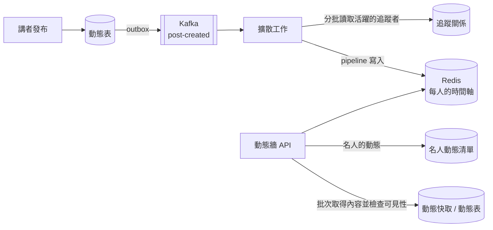

> **System Design 系列** Part 9-2｜上一篇：[URL Shortener](/post/systemdesign/url-shortener/)｜下一篇：[聊天系統](/post/systemdesign/chat-system/)｜[系列地圖](/post/systemdesign/system-design-thinking/#系列地圖)

## 情境與問題

會員可以追蹤講者與主辦單位。首頁的動態牆依時間顯示追蹤對象的新動態：新開的講座、講者的短文、講座錄影上架。

**功能需求**

- 講者發布動態；追蹤者在動態牆看到，最新的在前面
- 往下捲動可以持續載入更舊的動態
- 講者刪除動態或改成「僅付費會員可見」後，不該再被看不到的人看到
- 會員取消追蹤後，不再看到那位講者的新動態

**非功能需求**

- 開啟動態牆的 p99 在 200 毫秒以內
- 新動態幾秒到一分鐘內出現在追蹤者的動態牆，不要求即時
- 少數講者有上百萬追蹤者

**規模估算**

| 項目 | 估算 |
|---|---|
| 會員 | 月活躍 1,000 萬，日活躍 200 萬 |
| 追蹤關係 | 每人平均追蹤 50 位講者 → 5 億條追蹤關係 |
| 講者 | 10 萬位活躍講者，平均每人追蹤者約 5,000，分布極度不均，最多的約 300 萬 |
| 發布量 | 每天 20 萬則 → 平均每秒 2.3 則，尖峰約 20 則 |
| 讀取量 | 每位日活躍會員每天開 10 次 → 每天 2,000 萬次，平均每秒約 230 次，尖峰約 1,200 次 |

```diagram
title: 一則動態要送到多少人的牆上
row: SPK 講者 | POST 動態服務 | F 追蹤者的動態牆
row: BIG 熱門講者 | . | U 會員
step: 發布動態
  講者發布動態，追蹤者在動態牆看到，最新的在前面。每天 20 萬則，平均每秒 2.3 則；平均每位講者有約 5,000 位追蹤者。
SPK -> POST: 新動態
POST => F: 通知 5,000 人
step: 打開動態牆
  每位日活躍會員每天開 10 次，尖峰每秒約 1,200 次，p99 要在 200 毫秒以內。
U => F: 每秒 1,200 次
note U: p99 200 ms 以內
step: 300 萬追蹤者
  追蹤者的分布極度不均，最多的講者有約 300 萬追蹤者。讀取比發布多 100 倍，但每次發布要通知的人數才是重點。
BIG => POST: 一則動態
POST => F: 通知 300 萬人 [danger]
step: 刪除或改成付費可見
  講者刪除動態或改成「僅付費會員可見」後，已經送到牆上的動態，不該再被看不到的人看到。
SPK -> POST: 刪除或改付費
note F: 不該再被看到 [danger]
```

讀取次數比發布次數多了 100 倍，但**每次發布要通知的人數**才是重點。

## 最簡單的做法與它的極限

讀取時直接查詢：

```sql
SELECT p.* FROM post p
  JOIN follow f ON f.followee_id = p.author_id
 WHERE f.follower_id = :me
 ORDER BY p.created_at DESC
 LIMIT 20;
```

追蹤 50 人時，這個查詢要從 50 位講者各自的動態中合併排序。動態表成長到數億列、分片之後（[Sharding 篇](/post/systemdesign/sharding/)），50 位講者的資料散在不同分片上，每次開啟動態牆都要跨分片查詢再合併。每秒 1,200 次讀取乘上 50 位講者，就是每秒 6 萬次對動態表的查詢。

## 核心機制

### 寫入時擴散與讀取時合併

| 策略 | 做法 | 讀取成本 | 寫入成本 |
|---|---|---|---|
| 寫入時擴散（fan-out on write，推） | 發布時，把動態 ID 寫進每個追蹤者的時間軸 | 讀一個預先算好的清單，很便宜 | 一則動態要寫入「追蹤者人數」次 |
| 讀取時合併（fan-out on read，拉） | 讀取時才去每位追蹤對象那裡拿最新的動態並合併 | 每次讀取要查詢「追蹤人數」次並合併 | 發布只寫一次 |

用講座平台的數字估算推的成本：每天 20 萬則動態 × 平均 5,000 位追蹤者 = 每天 10 億次時間軸寫入，平均每秒約 1.2 萬次。這可以承受，但問題在**分布的尾端**：一位有 300 萬追蹤者的講者發一則動態，就要寫入 300 萬次。以每秒 5 萬次寫入計算，需要一分鐘才擴散完，這段時間擴散工作佔滿資源，其他講者的動態也跟著延遲。

### 混合策略：一般講者推，名人拉

- **一般講者**（追蹤者少於 1 萬）：發布時擴散到追蹤者的時間軸
- **名人講者**（追蹤者超過 1 萬）：不擴散，只寫入自己的動態清單。讀取動態牆時，把「我追蹤的名人」的最新動態拉過來，和預先算好的時間軸合併

每個會員追蹤的名人通常只有幾位，讀取時多查幾次是可以接受的；而最昂貴的那幾次擴散完全消失了。

再加上一個簡單的優化：**只擴散給活躍的會員**。1,000 萬名月活躍會員裡，最近 7 天有登入的若只有一半，擴散的寫入量就少了一半。不活躍的會員回來時，用讀取時合併的方式重建時間軸。

### 時間軸存什麼、存多少

時間軸只存**動態的 ID 與時間**，不存內容。內容在讀取時再批次取得（hydration），因為：

- 動態被編輯或刪除，只要改一個地方
- 可見性要在讀取時重新檢查（後面說明）
- 時間軸的記憶體用量小很多

每個時間軸只保留最新的 120 則：會員很少往下捲超過幾十則，更舊的部分用讀取時合併取得。上限刻意低於 Redis 的 `zset-max-listpack-entries`（預設 128）：在這個數量以內，sorted set 使用精簡的 listpack 編碼；超過就改用 skiplist，每個成員的記憶體多出好幾倍。200 萬個活躍會員、每人 120 則，粗估約 10 GB（依 Redis 的版本與成員長度而定），一個小型的 Redis Cluster 就夠了。時間軸是**可以重建的快取**，遺失時從動態表與追蹤關係重新產生。

### 分頁用游標，不用頁碼

動態牆持續有新的動態插入最前面。用頁碼分頁（`OFFSET 20`），使用者在看第一頁時進來了 5 則新動態，第二頁就會重複看到第一頁的最後 5 則（[Index 與 B+Tree 篇](/post/systemdesign/index-btree/)的 keyset 分頁）。

游標記錄「上一頁最後一則的時間與 ID」，下一頁從它之後繼續。這裡有一個實作上的陷阱：Redis sorted set 的分數是 64 位元浮點數，只能精確表示 2⁵³ 以內的整數。Snowflake 這類 64 位元的 ID 超過這個範圍（[分散式 ID 篇](/post/systemdesign/distributed-id/)），直接當分數會失去精確度，相鄰的 ID 變成同一個分數。所以分數使用毫秒時間戳，成員才是動態 ID，游標同時帶著兩者。

### 讀取時檢查可見性

擴散時寫入的是「當時可以看到」的動態，之後情況可能改變：

- 講者刪除了動態，或改成「僅付費會員可見」
- 會員取消追蹤、被講者封鎖
- 講者的帳號被停權

如果動態牆直接顯示時間軸裡的所有 ID，這些已經不該看到的動態仍然會出現。所以 hydration 時**一定要重新檢查**每一則的狀態與可見性，這是[授權篇](/post/systemdesign/authorization-owasp-api-top10/)「每一條讀取路徑都要有相同的條件」在動態牆上的版本。被過濾掉的數量太多時（例如取消追蹤了一位常發文的講者），再多取一些補足一頁。

### 擴散工作的流程



- 發布與擴散分開：發布只寫動態表與 outbox（[Saga 與 Outbox 篇](/post/systemdesign/saga-outbox/)），擴散在背景進行
- 擴散天生冪等：把同一個 ID 加進 sorted set 兩次，結果相同，所以 at-least-once 的投遞不需要額外的去重（[冪等性篇](/post/systemdesign/idempotency-key/)）
- 一則動態的擴散拆成多個批次（每批 1,000 位追蹤者），讓不同講者的擴散可以交錯進行，名人的大批次不會一直佔住同一個消費者

## 方案比較

| 決策 | 選擇 | 放棄的替代方案與原因 |
|---|---|---|
| 擴散策略 | 一般講者推、名人拉、只推給活躍會員 | 全部推：名人造成寫入尖峰；全部拉：讀取成本與延遲太高 |
| 時間軸 | Redis sorted set，只存 ID 與時間，上限 120 則 | 存完整內容：記憶體大、編輯與刪除難以同步 |
| 分頁 | 時間戳加 ID 的游標 | 頁碼：新動態插入造成重複與遺漏 |
| 可見性 | 讀取時重新檢查 | 擴散時決定：之後的刪除、封鎖、權限變更都無法反映 |
| 排序 | 依時間 | 依互動預測排序：需要候選產生與評分模型，第一版不需要 |

名人門檻（1 萬）要依實際的擴散延遲調整：門檻越低，讀取時要合併的名人越多；門檻越高，擴散的尖峰越大。

## Java 落地

### 1. 擴散工作

```java
@Component
public class FanOutWorker {

    private static final int CELEBRITY_THRESHOLD = 10_000;
    private static final int BATCH = 1_000;
    private static final int TIMELINE_CAP = 120;

    private final JdbcClient jdbc;
    private final StringRedisTemplate redis;

    public FanOutWorker(JdbcClient jdbc, StringRedisTemplate redis) {
        this.jdbc = jdbc;
        this.redis = redis;
    }

    @KafkaListener(topics = "post-created", groupId = "feed-fanout")
    public void onPostCreated(PostCreated event) {
        if (event.authorFollowerCount() >= CELEBRITY_THRESHOLD) {
            return;                                              // 名人：讀取時再合併
        }
        long lastFollowerId = 0;
        while (true) {
            List<Long> followers = jdbc.sql("""
                            SELECT f.follower_id FROM follow f
                              JOIN member_activity a ON a.member_id = f.follower_id
                             WHERE f.followee_id = :author AND f.follower_id > :last
                               AND a.last_seen_at > NOW() - INTERVAL 7 DAY
                             ORDER BY f.follower_id
                             LIMIT :batch
                            """)
                    .param("author", event.authorId())
                    .param("last", lastFollowerId)
                    .param("batch", BATCH)
                    .query(Long.class)
                    .list();
            if (followers.isEmpty()) {
                return;
            }
            pushToTimelines(followers, event.postId(), event.createdAtMillis());
            lastFollowerId = followers.getLast();
        }
    }

    @SuppressWarnings({"unchecked", "rawtypes"})
    private void pushToTimelines(List<Long> followers, long postId, long createdAtMillis) {
        String member = Long.toString(postId);
        redis.executePipelined(new SessionCallback<Object>() {
            @Override
            public Object execute(RedisOperations operations) {
                for (Long follower : followers) {
                    String key = "timeline:" + follower;
                    operations.opsForZSet().add(key, member, createdAtMillis);   // 重複加入結果相同
                    operations.opsForZSet().removeRange(key, 0, -(TIMELINE_CAP + 1));   // 只保留最新的 120 則
                }
                return null;
            }
        });
    }
}
```

- 追蹤者用 keyset 分頁讀取（`follower_id > :last`），需要 `(followee_id, follower_id)` 的索引
- 名人的判斷用事件裡的追蹤者人數，避免每次都計算
- 一個批次寫入失敗，整則事件會被重新投遞，已經寫入的時間軸再寫一次也沒有關係

### 2. 讀取動態牆

```java
public record FeedCursor(long millis, long postId) {
}

@Service
public class FeedService {

    private static final int PAGE = 20;

    private final StringRedisTemplate redis;
    private final CelebrityPosts celebrityPosts;
    private final PostHydrator hydrator;

    public FeedService(StringRedisTemplate redis, CelebrityPosts celebrityPosts, PostHydrator hydrator) {
        this.redis = redis;
        this.celebrityPosts = celebrityPosts;
        this.hydrator = hydrator;
    }

    public FeedPage read(long memberId, FeedCursor cursor) {
        double max = cursor == null ? Double.POSITIVE_INFINITY : cursor.millis();
        // 多取一些：同一毫秒的動態、被可見性過濾掉的動態
        Set<ZSetOperations.TypedTuple<String>> pushed = redis.opsForZSet()
                .reverseRangeByScoreWithScores("timeline:" + memberId, Double.NEGATIVE_INFINITY, max, 0, PAGE * 2);

        List<FeedEntry> candidates = new ArrayList<>();
        for (ZSetOperations.TypedTuple<String> t : pushed) {
            candidates.add(new FeedEntry(Long.parseLong(t.getValue()), t.getScore().longValue()));
        }
        candidates.addAll(celebrityPosts.latestOfFollowedCelebrities(memberId, cursor, PAGE * 2));

        List<FeedEntry> page = candidates.stream()
                .filter(e -> cursor == null || e.isBefore(cursor))                // 排除游標之前已經看過的
                .distinct()
                .sorted(Comparator.comparingLong(FeedEntry::millis).thenComparingLong(FeedEntry::postId).reversed())
                .toList();

        // 批次取得內容，並重新檢查：是否已刪除、是否仍可見、是否仍在追蹤、是否被封鎖
        List<PostView> visible = hydrator.hydrateVisible(memberId, page, PAGE);
        FeedCursor next = visible.isEmpty() ? null
                : new FeedCursor(visible.getLast().createdAtMillis(), visible.getLast().postId());
        return new FeedPage(visible, next);
    }
}
```

- `FeedEntry.isBefore(cursor)` 比較（時間, ID）的組合，同一毫秒的動態也不會重複或遺漏
- 時間軸不存在時（不活躍的會員、Redis 的資料遺失），`PostHydrator` 之前要先用讀取時合併的方式重建
- 游標回傳給用戶端前，可以簽章或加密，避免用戶端竄改後造成奇怪的查詢；游標本身不能包含任何授權資訊

> 以上程式碼依 Spring Boot 4.1、Spring Data Redis 4.1 與 Spring for Apache Kafka 官方文件撰寫，沒有實際編譯與執行。`CelebrityPosts`、`PostHydrator` 是示意的元件。

## 踩坑與 Gotchas

- **Snowflake ID 當 sorted set 的分數**：超過 2⁵³ 後失去精確度，排序與分頁出錯
- **用頁碼分頁**：新動態插入時重複或遺漏
- **擴散時決定可見性**：刪除與權限變更無法反映
- **名人的擴散阻塞了整個佇列**：一則動態寫 300 萬次，後面所有講者的動態都在排隊。用門檻排除名人，並把擴散拆成小批次
- **擴散給所有人**：大部分的寫入給了永遠不會回來的會員
- **熱門名人的動態清單成為熱點**：每個追蹤者讀取時都去讀同一個 key。這個 key 要快取在應用程式的記憶體裡幾秒鐘，或複製多份（[Cache 篇](/post/systemdesign/caching/)的熱點 key）
- **取消追蹤後的殘留**：時間軸裡還有舊的動態 ID。讀取時過濾，或在取消追蹤時非同步清除

### 威脅模型

| STRIDE | 威脅 | 講座平台的情境 | 防禦 |
|---|---|---|---|
| Spoofing 冒充 | 以講者的身分發文 | 發文 API 用請求裡的 `authorId` | 作者一律取自驗證過的身分（[8-2](/post/systemdesign/authorization-owasp-api-top10/)） |
| Tampering 竄改 | 修改別人的動態 | 編輯 API 只檢查登入 | 物件層授權；保留編輯紀錄 |
| Repudiation 否認 | 講者否認發布過某則內容 | 爭議內容被編輯或刪除後無法追查 | 動態的版本與刪除紀錄保存一段時間 |
| Information disclosure 洩漏 | 看到已刪除或僅限付費會員的動態；看到別人的動態牆 | 時間軸裡的舊 ID 沒有重新檢查；`GET /feed?memberId=123` | 讀取時檢查可見性；動態牆只讀取自己的，`memberId` 來自 token |
| Denial of service 阻斷 | 擴散風暴；大量追蹤 | 假帳號大量發文觸發擴散；一個帳號追蹤數十萬位講者，讀取時的合併成本暴增 | 發文與追蹤的速率與數量上限；名人門檻（[8-5](/post/systemdesign/abuse-prevention/)） |
| Elevation of privilege 提權 | 儲存型 XSS；連結預覽的 SSRF | 動態內容裡的腳本在所有追蹤者的瀏覽器執行，取得他們的 session | 輸出時依情境跳脫；CSP；預覽功能套用 SSRF 防護 |

動態牆把一則內容送到成千上萬個人面前，所以**儲存型 XSS 的影響範圍**和追蹤者人數成正比。BFF 架構下 token 不在瀏覽器裡（[8-1](/post/systemdesign/authentication-session-token-oidc/)），但攻擊者的腳本仍然能以受害者的身分發出請求，例如讓每個看到動態的人自動追蹤某個帳號。

## 何時用／何時別用

- **只用讀取時合併**：使用者少、追蹤數少，或者資料都在同一個資料庫、查詢夠快時。這是最簡單的起點
- **加入寫入時擴散**：讀取量大、讀取延遲要求高，而且大多數作者的追蹤者數量適中
- **混合策略**：追蹤者數量分布極度不均，出現名人問題時
- **依互動排序**：動態數量多到依時間排列會讓重要內容被淹沒時，才值得導入排序模型與它帶來的複雜度

## 參考資料

- Martin Kleppmann, *Designing Data-Intensive Applications*, O'Reilly, 2017, Chapter 1 "Describing Load"（以 Twitter 的時間軸說明擴散的取捨）
- Raffi Krikorian, "Timelines at Scale", QCon San Francisco, 2012
- Redis Documentation — Sorted sets：<https://redis.io/docs/latest/develop/data-types/sorted-sets/>
- Spring Data Redis Reference — Pipelining：<https://docs.spring.io/spring-data/redis/reference/redis/pipelining.html>
- 互動圖解延伸：Dilum Sanjaya，System Design — an interactive course：<https://designed-to-scale.vercel.app/>
