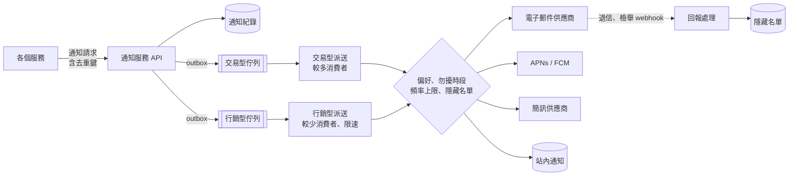

> **System Design 系列** Part 9-5｜上一篇：[秒殺搶票](/post/systemdesign/flash-sale-ticketing/)｜下一篇：[排行榜](/post/systemdesign/leaderboard/)｜[系列地圖](/post/systemdesign/system-design-thinking/#系列地圖)

## 情境與問題

講座平台的各個服務都需要通知會員：

| 通知 | 管道 | 性質 |
|---|---|---|
| 登入驗證碼 | 簡訊、電子郵件 | 交易型，幾秒內必須送達 |
| 報名成功、付款完成、付款期限提醒 | 電子郵件、站內 | 交易型 |
| 講座 15 分鐘後開始 | 推播，沒有推播時改寄電子郵件 | 交易型，時間點集中 |
| 聊天的離線訊息（[聊天系統](/post/systemdesign/chat-system/)） | 推播 | 交易型 |
| 每週精選講座電子報 | 電子郵件 | 行銷型，數量最大 |

每個服務各自串接郵件與推播供應商，會讓退訂、勿擾時段、失效 token 的處理分散在十幾個地方，而且沒有人知道一位會員今天到底收到了多少通知。所以把它集中成一個通知服務。

**規模估算**

| 項目 | 估算 |
|---|---|
| 交易型通知 | 每天約 500 萬則，平均每秒約 60 則 |
| 講座開始提醒 | 晚上 8 點整有多場講座同時開始，1 分鐘內 10 萬則 → 每秒約 1,700 則 |
| 每週電子報 | 1,000 萬封；以每秒 2,000 封的寄送速度，約 1.4 小時寄完 |
| 通知紀錄 | 每則約 500 位元組，每天約 2.5 GB；保存 90 天約 225 GB |

**電子報寄送期間的 1.4 小時裡，驗證碼仍然要在幾秒內送達**。這是設計的核心限制。

## 最簡單的做法與它的極限

所有通知進同一個佇列，依序寄出：

- **排隊**：電子報的 1,000 萬封在佇列裡，後面才進來的驗證碼要等它們寄完
- **重複**：消費者在寄出後、確認前當機，訊息重新投遞，會員收到兩封相同的信
- **寄件信譽**：行銷信的檢舉率拉低了寄件網域的信譽，連交易型的信件也開始被歸到垃圾郵件
- **不尊重使用者**：凌晨 3 點收到行銷推播；退訂後仍然收到；換了手機之後，舊手機的推播 token 一直寄送失敗

## 核心機制

### 架構



### 依優先順序隔離

交易型與行銷型的通知**從佇列開始就分開**：

- 不同的 topic 與消費者群組，交易型的消費者比較多，行銷型的消費者比較少而且限速。電子報再多，也只會讓行銷型的佇列變長
- 供應商的配額也要分開：郵件供應商的每秒寄送上限是共用的，行銷型的派送只能使用其中一部分，保留餘裕給交易型
- **寄件網域分開**：交易型用 `mail.lectures.example.com`，行銷型用 `news.lectures.example.com`。收件端的信譽評分是依網域與 IP 累積的，行銷信的檢舉不會連累驗證碼信件

這是 [Circuit Breaker 與 Bulkhead 篇](/post/systemdesign/circuit-breaker-bulkhead/)的艙壁隔離，用在佇列與外部配額上。

### 去重與狀態機

通知請求來自各個服務的事件，而事件是 at-least-once 投遞的（[訊息佇列篇](/post/systemdesign/message-queue/)）。去重分成兩段：

1. **請求的去重**：呼叫端提供一個去重鍵，例如 `registration-confirmed:{報名 ID}:{會員 ID}:EMAIL`。通知紀錄對它建立唯一鍵，同一個事件處理兩次，只會產生一筆通知
2. **寄送的去重**：派送時先以條件式更新把狀態從 `PENDING` 改成 `SENDING`，改成功的才寄送。重新投遞的訊息看到狀態已經不是 `PENDING`，直接略過

```
PENDING ──取得──▶ SENDING ──成功──▶ SENT
   │                 │
   │                 ├──暫時失敗──▶ 重試（退避），最後進 dead-letter
   │                 └──收件者無效──▶ FAILED
   └──偏好或隱藏名單──▶ SUPPRESSED
```

仍然有一個無法消除的空窗：供應商已經收下信件，但更新成 `SENT` 之前程序當機。卡在 `SENDING` 太久的通知會被重新排入，這時會員可能收到兩封。可以接受偶爾的重複，就不需要更複雜的機制；供應商的 API 支援冪等鍵時，把通知 ID 傳過去，就能消除這個空窗（[冪等性篇](/post/systemdesign/idempotency-key/)）。

### 使用者偏好、勿擾時段與頻率上限

這些檢查放在**派送的時候**，不是建立通知的時候：會員可能在通知排隊的期間退訂，勿擾時段也要用實際寄送的時間判斷。

- **偏好**：每個類別、每個管道各自可以關閉。交易型的通知（驗證碼、付款）不能關閉，但可以選擇管道
- **勿擾時段**：行銷型的推播不在會員當地時間 22:00 到 08:00 送出，延後到時段結束。時區用會員設定的時區，不是伺服器的時區
- **頻率上限**：行銷推播每人每天最多 1 則。超過的直接標記為 `SUPPRESSED`，不是延後，否則隔天會一次收到好幾則
- **隱藏名單**：硬退信（地址不存在）與檢舉過的地址，永遠不再寄送

### 推播 token 與退信

供應商的回應決定了下一步：

| 回應 | 意義 | 處理 |
|---|---|---|
| APNs 410 `Unregistered`；FCM `UNREGISTERED` | App 已移除或 token 已失效 | 刪除這個裝置 token，不要重試 |
| 逾時、5xx、速率限制 | 暫時性問題 | 以帶抖動的退避重試（[Timeout 與 Retry 篇](/post/systemdesign/timeout-retry-backoff/)） |
| 電子郵件的硬退信 | 地址不存在 | 加入隱藏名單 |
| 電子郵件的檢舉 | 收件者按了「這是垃圾郵件」 | 加入隱藏名單，並停止所有行銷信 |

電子郵件的退信與檢舉是**非同步**回來的：寄出時供應商只表示「已接收」，退信在幾分鐘到幾天後才透過 webhook 通知。一直寄送到不存在的地址，或忽略檢舉，寄件信譽就會下降。

會員登出或換帳號時，要把裝置 token 和帳號解除綁定，否則共用裝置的下一位使用者會收到前一位的通知。

### 大量寄送的節奏

- **講座開始提醒**：10 萬則集中在同一分鐘。提前在 7:50 開始，依講座分批放入佇列，每則帶著「最晚送達時間」，超過的就不要送了（講座都開始 30 分鐘了，才收到 15 分鐘後開始的提醒，只會造成困惑）。排程的部分見[分散式排程](/post/systemdesign/distributed-scheduler/)
- **電子報**：依收件網域分散送出，避免短時間內大量寄給同一個信箱服務而被限流；寄送速度依退信率與檢舉率調整，比率升高時自動放慢

### 大型信箱服務對寄件者的要求

Google 與 Yahoo 從 2024 年起，對大量寄件者（以 Gmail 為例，每天寄送超過 5,000 封給 Gmail 使用者）要求：

- 設定 SPF 與 DKIM，並發布 DMARC 政策，`From` 的網域要和 SPF 或 DKIM 的網域一致
- 行銷信提供**一鍵退訂**（RFC 8058），並在兩天內生效
- 垃圾郵件的檢舉率維持在 0.3% 以下

這些已經不是「最佳實務」，而是信件能不能送進收件匣的門檻。詳細的條件以兩家的最新文件為準。

## 方案比較

| 決策 | 選擇 | 放棄的替代方案與原因 |
|---|---|---|
| 佇列 | 交易型與行銷型分開 topic、分開消費者、分開配額 | 單一佇列加上優先權欄位：消費者仍然要先讀過前面的訊息，隔離不完整 |
| 去重 | 請求的去重鍵加上派送前的條件式狀態轉換 | 只靠消費者的 offset：重新投遞時重複寄送 |
| 偏好檢查 | 派送時檢查 | 建立時檢查：排隊期間的退訂不會生效 |
| 寄件網域 | 交易型與行銷型分開 | 共用：行銷信的檢舉連累驗證碼 |
| 自建或使用服務 | 自建派送與偏好管理，寄送交給郵件、推播、簡訊供應商 | 自建郵件伺服器：IP 信譽的培養與維護成本極高 |

## Java 落地

### 1. 通知紀錄

```sql
CREATE TABLE notification (
    id          BIGINT       PRIMARY KEY,
    dedup_key   VARCHAR(200) NOT NULL,
    member_id   BIGINT       NOT NULL,
    channel     VARCHAR(16)  NOT NULL,      -- EMAIL、PUSH、SMS、IN_APP
    priority    VARCHAR(16)  NOT NULL,      -- TRANSACTIONAL、MARKETING
    category    VARCHAR(32)  NOT NULL,      -- 偏好設定的單位，例如 LECTURE_REMINDER、NEWSLETTER
    template    VARCHAR(64)  NOT NULL,
    params      JSON         NOT NULL,
    status      VARCHAR(16)  NOT NULL,      -- PENDING、SENDING、SENT、FAILED、SUPPRESSED
    deliver_by  TIMESTAMP(3) NULL,          -- 超過就不送
    updated_at  TIMESTAMP(3) NOT NULL DEFAULT CURRENT_TIMESTAMP(3) ON UPDATE CURRENT_TIMESTAMP(3),
    created_at  TIMESTAMP(3) NOT NULL DEFAULT CURRENT_TIMESTAMP(3),
    UNIQUE KEY uk_dedup (dedup_key),
    KEY idx_member_created (member_id, created_at),
    KEY idx_status_updated (status, updated_at)
);
```

`idx_status_updated` 給清理程式找出卡在 `SENDING` 太久的通知。

### 2. 派送：取得、檢查、寄送

```java
public sealed interface SendResult {
    record Sent() implements SendResult {}
    record InvalidRecipient(String reason) implements SendResult {}
    record Retryable(String reason) implements SendResult {}
}

@Component
public class NotificationDispatcher {

    private final JdbcClient jdbc;
    private final NotificationStore store;
    private final MemberPreferences preferences;
    private final FrequencyCap frequencyCap;
    private final DelayedQueue delayed;
    private final Map<Channel, ChannelSender> senders;

    public NotificationDispatcher(JdbcClient jdbc, NotificationStore store, MemberPreferences preferences,
                                  FrequencyCap frequencyCap, DelayedQueue delayed, List<ChannelSender> senders) {
        this.jdbc = jdbc;
        this.store = store;
        this.preferences = preferences;
        this.frequencyCap = frequencyCap;
        this.delayed = delayed;
        this.senders = senders.stream().collect(Collectors.toUnmodifiableMap(ChannelSender::channel, s -> s));
    }

    @KafkaListener(topics = "notify.transactional", groupId = "notify-transactional", concurrency = "8")
    public void transactional(NotificationQueued event) {
        dispatch(event.notificationId());
    }

    @KafkaListener(topics = "notify.marketing", groupId = "notify-marketing", concurrency = "2")
    public void marketing(NotificationQueued event) {
        dispatch(event.notificationId());
    }

    private void dispatch(long id) {
        Notification n = store.find(id);
        if (n.status() != Status.PENDING) {
            return;                                                  // 已經處理過的重新投遞
        }
        Instant now = Instant.now();
        if (n.deliverBy() != null && now.isAfter(n.deliverBy())) {
            store.markIfPending(id, Status.SUPPRESSED);              // 太晚了，不送
            return;
        }
        Preferences p = preferences.of(n.memberId());
        if (!p.allows(n.channel(), n.category()) || p.suppressed(n.channel())) {
            store.markIfPending(id, Status.SUPPRESSED);
            return;
        }
        boolean marketing = n.priority() == Priority.MARKETING;
        if (marketing) {
            Instant allowedAt = p.quietHours().nextAllowed(now);
            if (allowedAt.isAfter(now)) {
                delayed.requeueAt(id, allowedAt);                    // 勿擾時段：延後，狀態維持 PENDING
                return;
            }
        }
        // 只有成功把 PENDING 改成 SENDING 的消費者可以寄送；重新投遞的訊息在這裡被略過
        int claimed = jdbc.sql("UPDATE notification SET status = 'SENDING' WHERE id = :id AND status = 'PENDING'")
                .param("id", id).update();
        if (claimed == 0) {
            return;
        }
        if (marketing && !frequencyCap.tryAcquire(n.memberId(), n.channel())) {
            store.mark(id, Status.SUPPRESSED);                       // 取得之後才計數，重複的訊息不會佔用額度
            return;
        }
        switch (senders.get(n.channel()).send(n)) {
            case SendResult.Sent s -> store.mark(id, Status.SENT);
            case SendResult.InvalidRecipient r -> store.mark(id, Status.FAILED);
            case SendResult.Retryable r -> {
                store.mark(id, Status.PENDING);
                throw new RetryableSendException(id, r.reason());   // 交給 Kafka 的錯誤處理器退避重試，最後進 dead-letter topic
            }
        }
    }
}
```

- 偏好與勿擾時段在取得之前檢查，延後的通知維持 `PENDING`，之後重新排入時還能被取得；頻率上限在取得之後才計數
- 重試用盡、進入 dead-letter topic 的通知維持 `PENDING`，由人工或清理程式決定重送或放棄
- 取得之前的狀態更新用 `markIfPending`（條件包含 `status = 'PENDING'`），重新平衡時不會覆寫另一個消費者已經取得、正在寄送的通知
- Spring Kafka 預設的錯誤處理器在原本的分區上重試，重試期間同一個分區後面的通知都在等待。交易型通知可以改用非阻塞的重試（retry topic，`@RetryableTopic`）：失敗的訊息轉到延遲重試的 topic，原分區繼續處理
- `ChannelSender` 依管道實作；推播的實作在收到 `Unregistered`／`UNREGISTERED` 時刪除裝置 token，再回傳 `InvalidRecipient`
- 頻率上限可以用 Redis 的計數器加上到當地午夜的期限（[Rate Limiting 篇](/post/systemdesign/rate-limiting/)）

### 3. 勿擾時段

```java
public record QuietHours(ZoneId zone, LocalTime start, LocalTime end) {

    /** 現在可以送出就回傳 now，否則回傳勿擾時段結束的時間。start 晚於 end 代表跨過午夜，例如 22:00 到 08:00。 */
    public Instant nextAllowed(Instant now) {
        ZonedDateTime local = now.atZone(zone);
        LocalTime t = local.toLocalTime();
        boolean quiet = start.isAfter(end)
                ? !t.isBefore(start) || t.isBefore(end)
                : !t.isBefore(start) && t.isBefore(end);
        if (!quiet) {
            return now;
        }
        ZonedDateTime endToday = local.with(end);
        return (endToday.isAfter(local) ? endToday : endToday.plusDays(1)).toInstant();
    }
}
```

晚上 23:00 落在 22:00 到 08:00 之間，今天的 08:00 已經過了，所以延到明天 08:00；凌晨 03:00 則延到今天的 08:00。

### 4. 電子郵件與一鍵退訂

```java
@Component
public class EmailSender implements ChannelSender {

    private final JavaMailSender mail;
    private final Recipients recipients;
    private final Templates templates;
    private final UnsubscribeTokens unsubscribeTokens;

    public EmailSender(JavaMailSender mail, Recipients recipients, Templates templates, UnsubscribeTokens unsubscribeTokens) {
        this.mail = mail;
        this.recipients = recipients;
        this.templates = templates;
        this.unsubscribeTokens = unsubscribeTokens;
    }

    @Override
    public Channel channel() {
        return Channel.EMAIL;
    }

    @Override
    public SendResult send(Notification n) {
        Recipient to = recipients.of(n.memberId());                              // 寄送時才讀取最新的地址
        Rendered r = templates.render(n.template(), to.locale(), n.params());    // 使用者提供的值一律跳脫
        boolean marketing = n.priority() == Priority.MARKETING;
        try {
            mail.send(message -> {
                MimeMessageHelper helper = new MimeMessageHelper(message, true, "UTF-8");
                helper.setFrom(marketing ? "news@news.lectures.example.com" : "no-reply@mail.lectures.example.com");
                helper.setTo(to.email());
                helper.setSubject(r.subject());
                helper.setText(r.plainText(), r.html());
                message.setHeader("X-Notification-Id", Long.toString(n.id()));   // 退信回報時對應回通知
                if (marketing) {
                    String url = "https://lectures.example.com/u/" + unsubscribeTokens.issue(n.memberId(), n.category());
                    message.setHeader("List-Unsubscribe", "<" + url + ">");
                    message.setHeader("List-Unsubscribe-Post", "List-Unsubscribe=One-Click");
                }
            });
            return new SendResult.Sent();
        } catch (MailException e) {
            return new SendResult.Retryable(e.getMessage());
        }
    }
}

@RestController
public class OneClickUnsubscribeController {

    private final UnsubscribeTokens tokens;
    private final MemberPreferences preferences;

    public OneClickUnsubscribeController(UnsubscribeTokens tokens, MemberPreferences preferences) {
        this.tokens = tokens;
        this.preferences = preferences;
    }

    // 信箱服務直接 POST 這個網址，沒有登入狀態，也沒有 CSRF token
    @PostMapping("/u/{token}")
    public ResponseEntity<Void> unsubscribe(@PathVariable String token) {
        UnsubscribeClaim claim = tokens.verify(token);                 // HMAC 簽章；只能退訂這一個類別
        preferences.optOut(claim.memberId(), claim.category());
        return ResponseEntity.ok().build();
    }
}
```

- 寄送時的錯誤一律視為暫時性；地址是否有效，由之後的退信回報決定，再加入隱藏名單
- 一鍵退訂的端點**不需要登入**，而且要從 CSRF 保護中排除，因為呼叫它的是信箱服務。它可以這樣開放，是因為 token 本身就是授權，而且唯一的效果是退訂一個類別。token 不能拿來做任何其他事，也不能包含可以列舉的會員 ID
- 用 POST 而不是 GET，是因為信箱服務與防毒軟體會預先開啟信件裡的連結，用 GET 的話，會員只是收到信就被退訂了
- `List-Unsubscribe` 這兩個標頭要包含在 DKIM 簽章的範圍內

> 以上程式碼依 Spring Boot 4.1、Spring Framework 7（`JavaMailSender`、`MimeMessageHelper`）、Spring for Apache Kafka 與 Java 21 官方文件撰寫，沒有實際編譯與執行。`NotificationStore`、`MemberPreferences`、`FrequencyCap`、`DelayedQueue`、`Recipients`、`Templates`、`UnsubscribeTokens` 是示意的元件。

## 踩坑與 Gotchas

- **所有通知共用一個佇列**：驗證碼排在電子報後面
- **交易型與行銷型共用寄件網域**：行銷信的檢舉讓驗證碼進了垃圾郵件匣
- **建立時檢查偏好**：排隊期間的退訂沒有生效
- **用伺服器時區判斷勿擾時段**：海外會員在半夜收到推播
- **頻率上限用延後而不是丟棄**：隔天早上一次收到五則
- **不處理失效的 token 與硬退信**：失敗率持續上升，寄件信譽下降，供應商可能停用帳號
- **退訂連結用 GET**：連結預覽與安全掃描把會員退訂了
- **過時的通知照樣送出**：佇列積壓恢復之後，會員收到早就結束的講座提醒。每則通知帶著最晚送達時間

### 威脅模型

| STRIDE | 威脅 | 講座平台的情境 | 防禦 |
|---|---|---|---|
| Spoofing 冒充 | 冒用平台網域寄出釣魚信；偽造退信 webhook | 攻擊者以 `@lectures.example.com` 寄出「付款失敗，請重新輸入信用卡」；偽造退信通知，把特定會員加入隱藏名單，讓他收不到驗證碼 | SPF、DKIM、DMARC 政策逐步提高到 `p=reject`；驗證 webhook 的簽章與來源 |
| Tampering 竄改 | 範本注入 | 會員把暱稱設成「平台通知：退款請點 https://evil.example」，出現在發給講者的信件裡；範本引擎執行了使用者提供的運算式 | 使用者提供的值一律跳脫且不產生連結；範本只能由內部人員編輯，不能評估使用者輸入 |
| Repudiation 否認 | 「我沒有收到驗證碼」 | 客服無法判斷是平台沒寄、供應商沒送，還是被擋 | 每則通知的狀態變化與供應商的回應都保存下來，透過通知 ID 查詢 |
| Information disclosure 洩漏 | 鎖定畫面上的敏感內容；寄給錯的人 | 推播顯示完整的付款金額或私訊內容；共用裝置收到前一位使用者的通知 | 推播只放最少的內容；登出時解除裝置 token 的綁定；電子郵件地址變更前先驗證新地址 |
| Denial of service 阻斷 | 通知轟炸；簡訊灌量 | 攻擊者對受害者的手機號碼反覆觸發「重寄驗證碼」，騷擾受害者並消耗費用 | 速率限制要同時以**收件者**為鍵，不只以請求者為鍵；簡訊的每日預算（[8-5](/post/systemdesign/abuse-prevention/)） |
| Elevation of privilege 提權 | 濫用群發功能 | 內部帳號被盜，用行銷後台對 1,000 萬名會員發出釣魚通知 | 群發需要雙人覆核與 MFA；群發的收件人數與內容寫入稽核紀錄 |

## 何時用／何時別用

- **集中成通知服務**：有多個服務、多種管道，而且需要統一的偏好、退訂與頻率控制時
- **直接呼叫供應商**：只有一兩種通知、只有一個服務在用時，先用供應商的 SDK，等需求增加再集中
- **寄送交給供應商**：除非是郵件服務公司，否則不要自建郵件伺服器與 IP 信譽
- **重新評估的時機**：交易型通知的送達延遲開始受到行銷寄送影響，或者退信率、檢舉率接近信箱服務的門檻時

## 參考資料

- RFC 8058, "Signaling One-Click Functionality for List Email Headers"
- RFC 7489, "Domain-based Message Authentication, Reporting, and Conformance (DMARC)"
- Google — Email sender guidelines：<https://support.google.com/a/answer/81126>
- Apple Developer Documentation — Handling notification responses from APNs
- Firebase Cloud Messaging — HTTP v1 API reference，ErrorCode（`UNREGISTERED`）
- Spring Framework Reference — Email：<https://docs.spring.io/spring-framework/reference/integration/email.html>
- 互動圖解延伸：Dilum Sanjaya，System Design — an interactive course：<https://designed-to-scale.vercel.app/>
