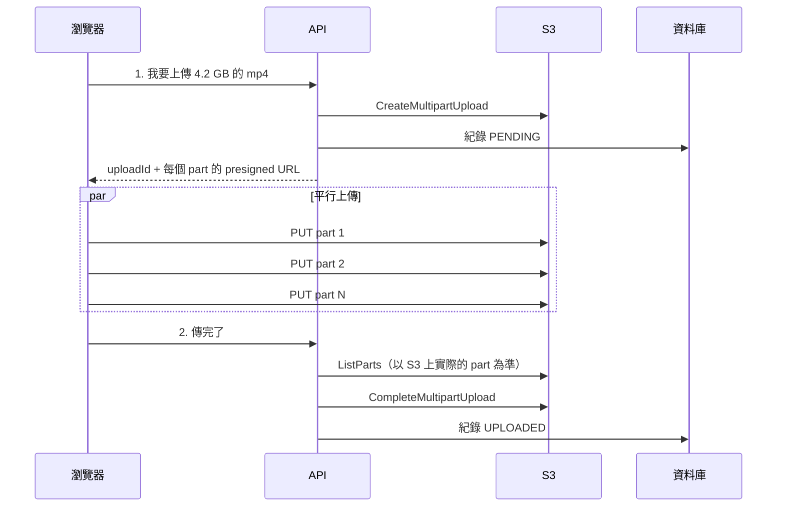
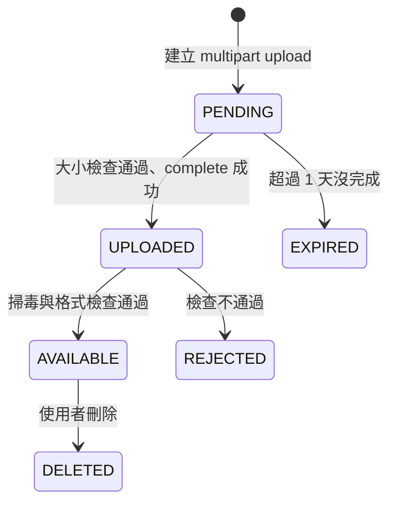

> **System Design 系列** Part 3-5｜上一篇：[交易與隔離等級](/post/systemdesign/transaction-isolation/)｜下一篇：[Bloom Filter 與 HyperLogLog](/post/systemdesign/bloom-filter-hyperloglog/)｜[系列地圖](/post/systemdesign/system-design-thinking/#系列地圖)

## 情境與問題

講座辦完後，平台要開放三種上傳：講者上傳錄影（每支 1–5 GB）、講義 PDF，以及會員的大頭貼。第一版的做法是 Spring Boot 用 `MultipartFile` 收下檔案，存到應用伺服器的 `/data/uploads`，路徑寫進資料庫。很快就出現問題：

1. 服務擴展成三台後，A 機器收到的檔案，B 機器讀不到
2. 講者用 50 Mbps 的上行網路傳 5 GB 錄影：5 × 10⁹ × 8 ÷ (50 × 10⁶) ≈ 800 秒，**一個 Tomcat 執行緒被佔住 13 分鐘**。Tomcat 預設最多 200 條執行緒，幾十位講者同時上傳，一般 API 就開始排隊
3. 傳到 90% 時 Wi-Fi 斷線，只能從頭再傳一次
4. 有人把資料庫當檔案櫃，改存成 BLOB：buffer pool 被大檔擠滿，備份從 20 分鐘變成 3 小時，replica 延遲飆高
5. 資安掃描發現，有人上傳了副檔名是 `.png`、內容其實是 HTML 的「大頭貼」

## 最簡單的做法與它的極限

[無狀態服務篇](/post/systemdesign/scaling-stateless/)已經給過第一步：檔案放物件儲存（S3），伺服器只發一個 presigned URL，讓瀏覽器直接 `PUT` 上去，檔案的位元組完全不經過應用伺服器。問題 1、2、4 都解決了。

但單次 `PUT` 有它的極限：

- **單次 `PUT` 最大 5 GiB**：剛好卡在錄影的上限
- **不能續傳**：斷線就得整個重來
- **不能平行**：一條連線傳到底，頻寬用不滿

更麻煩的是**一致性**：檔案在 S3，紀錄在資料庫，兩邊沒有共同的交易（[交易篇](/post/systemdesign/transaction-isolation/)的交易只管得到資料庫內部）。前端傳完檔案卻沒回報，S3 上就多了一個沒人知道的物件；資料庫先寫了紀錄，上傳卻失敗，就留下一筆指向不存在檔案的資料。

## 核心機制

### 三種儲存

| | Block（區塊） | File（檔案） | Object（物件） |
|---|---|---|---|
| 例子 | 雲端硬碟（EBS）、本機 SSD | NFS、EFS | S3、GCS、MinIO |
| 存取方式 | 作業系統看到一顆磁碟，自己掛檔案系統 | 透過網路掛載的目錄，POSIX 操作 | HTTP API，用 key 存取整個物件 |
| 修改 | 任意位置讀寫 | 任意位置讀寫、append、鎖 | 只能整個覆寫 |
| 多台共享 | 通常一次掛一台 | 可以 | 可以 |
| 延遲 | 最低 | 中 | 最高（每次都是 HTTP 請求） |
| 擴展性 | 單顆有容量上限 | 中 | 幾乎無上限 |
| 適合 | 資料庫、需要低延遲隨機讀寫的程式 | 需要共享目錄的既有程式 | 圖片、影音、文件、備份、日誌封存 |

### 物件儲存為什麼能幾乎無限擴展

物件儲存刻意放棄了檔案系統的許多能力，換來擴展性：

- **扁平的命名空間**：只有 bucket 和 key，沒有真正的目錄。`media/2026/talk.mp4` 裡的 `/` 只是字元，主控台用前綴（prefix）模擬出資料夾的樣子
- **物件不可部分修改**：只能整個寫入或覆寫，沒有 append，也沒有檔案鎖。這讓同一個物件的多份副本很容易保持一致
- **沒有 rename**：「移動資料夾」實際上是逐一複製每個物件再刪除，不是原子操作，物件多的時候又慢又貴
- **資料以冗餘方式分散存放**：最直觀的是存多份副本；大型系統更常用 erasure coding，把資料切成 k 份、再算出 m 份校驗，任意遺失 m 份都能還原：

| 方式 | 儲存成本 | 可容忍同時損壞 | 修復一份要讀 |
|---|---|---|---|
| 3 份副本 | 3.0 倍 | 2 份 | 1 份 |
| Reed–Solomon (6, 3) | 1.5 倍 | 3 份 | 6 份 |
| Reed–Solomon (10, 4) | 1.4 倍 | 4 份 | 10 份 |

erasure coding 用一半的空間換到更高的容錯，代價是修復時要讀更多資料、算更多東西。Ceph、MinIO、HDFS 3 都支援這種做法；S3 沒有公開內部用的方案，只承諾耐久性等級。

**一致性**：S3 目前對 `PUT` 與 `DELETE` 提供強一致的 read-after-write：寫入成功後，馬上讀就讀得到新內容。網路上「S3 是最終一致」的說法，是 2020 年 12 月之前的狀況了。同時寫同一個 key 時，預設是後寫的覆蓋先寫的；需要「只有不存在才建立」，可以加上 `If-None-Match: *` 條件，第二個寫入會收到 `412 Precondition Failed`。

**請求速率**：S3 每個 prefix 至少能承受每秒 3,500 次寫入（`PUT`/`COPY`/`POST`/`DELETE`）與 5,500 次讀取（`GET`/`HEAD`），bucket 裡的 prefix 數量沒有上限，所以需要更高吞吐量時就把 key 分散到更多 prefix。擴展是逐步進行的，流量突然升高時會先收到 `503 Slow Down`，要搭配退避重試。

### Multipart upload

大檔案切成多個 part 分別上傳，全部傳完再合併成一個物件：



- **每個 part 可以平行上傳**，失敗只要重傳那一個 part
- **斷線可以續傳**：`uploadId` 還在，已經傳完的 part 不必重傳
- **限制**：每個 part 5 MiB 到 5 GiB（最後一個 part 沒有下限）、最多 10,000 個 part，單一物件最大 48.8 TiB（舊資料常見的 5 TB 已經過時）

part 大小是取捨：part 越大，請求數越少；part 越小，單次失敗要重傳的量越少、平行度越高。依物件大小計算 part 大小：

```java
package media;

/** 依 S3 multipart 的限制決定 part 大小：每個 part 5 MiB 到 5 GiB，最多 10,000 個。 */
public final class PartSizes {

    static final long MIB = 1024L * 1024;
    static final long MAX_PART = 5L * 1024 * MIB;
    static final int MAX_PARTS = 10_000;
    static final long DEFAULT_PART = 64 * MIB;

    private PartSizes() {
    }

    public static long partSize(long objectBytes) {
        long needed = (objectBytes + MAX_PARTS - 1) / MAX_PARTS;   // 至少要這麼大，part 數才不會超過 10,000
        long size = Math.max(DEFAULT_PART, needed);
        size = (size + MIB - 1) / MIB * MIB;                        // 取整到 MiB
        if (size > MAX_PART) {
            throw new IllegalArgumentException("超過單一物件的上限");
        }
        return size;
    }

    public static int partCount(long objectBytes, long partSize) {
        return (int) ((objectBytes + partSize - 1) / partSize);
    }

    public static void main(String[] args) {
        long gib = 1024 * MIB;
        long[] sizes = {200 * MIB, 5 * gib, 1024 * gib, 10 * 1024 * gib, 10_000 * 5 * gib, 49 * 1024 * gib};
        String[] labels = {"200 MiB", "5 GiB", "1 TiB", "10 TiB", "48.8 TiB", "49 TiB"};
        for (int i = 0; i < sizes.length; i++) {
            try {
                long part = partSize(sizes[i]);
                System.out.printf("%-9s part %,6d MiB × %,6d 個%n", labels[i], part / MIB, partCount(sizes[i], part));
            } catch (IllegalArgumentException e) {
                System.out.printf("%-9s %s%n", labels[i], e.getMessage());
            }
        }
    }
}
```

```text
200 MiB   part     64 MiB ×      4 個
5 GiB     part     64 MiB ×     80 個
1 TiB     part    105 MiB ×  9,987 個
10 TiB    part  1,049 MiB ×  9,996 個
48.8 TiB  part  5,120 MiB × 10,000 個
49 TiB    超過單一物件的上限
```

一般的檔案用 64 MiB 就夠；物件超過約 625 GiB 時，才需要放大 part 以免超過 10,000 個。

**沒完成的 multipart upload 會一直佔空間**：已上傳的 part 在 complete 或 abort 之前都會保留並計費，而且列物件時看不到它們。一定要設定 lifecycle 規則自動清除。

### 資料庫與檔案的一致性

檔案和紀錄分在兩個系統，沒辦法用一個交易包起來，所以改用**狀態機**，讓每一種失敗都有明確的收拾方式：



- **只有 `AVAILABLE` 的檔案會出現在任何查詢與下載裡**
- **物件有、紀錄沒有，或紀錄停在 `PENDING`**：物件建立時帶著 `state=pending` 的 tag，通過檢查才改成 `available`；lifecycle 規則刪除超過 1 天仍是 `pending` 的物件，資料庫端的排程把逾時的 `PENDING` 改成 `EXPIRED`
- **紀錄有、物件沒有**：紀錄永遠到不了 `AVAILABLE`，使用者看不到它
- **刪除**：先把紀錄改成 `DELETED`，使用者立刻看不到；再刪除物件，失敗了可以重試，不影響使用者

## 方案比較

### 檔案放哪裡

| | 應用伺服器本機磁碟 | 共享檔案系統 | 資料庫 BLOB | 物件儲存 |
|---|---|---|---|---|
| 水平擴展 | 不行 | 可以 | 可以 | 可以 |
| 大檔 | 受限於單機磁碟 | 可以 | 拖慢 buffer pool、備份與 replication | 可以 |
| 和業務資料同一個交易 | 不行 | 不行 | **可以** | 不行，要靠狀態機 |
| 成本 | 低 | 高 | 最高（資料庫的儲存最貴） | 最低 |
| 適合 | 暫存檔 | 需要 POSIX 操作的既有程式 | 幾 KB、必須和資料一起交易的少量資料 | 幾乎所有使用者上傳的檔案 |

### 上傳方式

| | 經過應用伺服器 | presigned `PUT` | multipart + presigned |
|---|---|---|---|
| 伺服器負擔 | 執行緒與頻寬全程被佔用 | 只有發網址 | 發網址、complete |
| 單檔上限 | 自訂 | 5 GiB | 48.8 TiB |
| 續傳、平行 | 要自己做 | 不行 | 可以 |
| 伺服器能否檢查內容 | 上傳過程中就能 | 上傳後才能 | 上傳後才能 |
| 適合 | 小檔且需要即時處理 | 100 MB 以下的一般檔案 | 大檔、網路不穩的環境 |

## Java 落地

### 1. 上傳流程

用 AWS SDK for Java 2.x（2.59.7）實作上面的流程。資料庫紀錄與擁有者檢查放在呼叫它的 service 裡，這裡只保留和 S3 互動的部分：

```java
package media;

import java.net.URL;
import java.nio.charset.StandardCharsets;
import java.time.Duration;
import java.util.ArrayList;
import java.util.List;
import java.util.Map;
import java.util.UUID;
import org.springframework.http.ContentDisposition;
import software.amazon.awssdk.services.s3.S3Client;
import software.amazon.awssdk.services.s3.model.CompletedPart;
import software.amazon.awssdk.services.s3.model.Part;
import software.amazon.awssdk.services.s3.model.Tag;
import software.amazon.awssdk.services.s3.presigner.S3Presigner;

public class MediaUploadService {

    static final long MAX_BYTES = 5L * 1024 * 1024 * 1024;                  // 講座錄影上限 5 GiB
    static final Duration UPLOAD_URL_TTL = Duration.ofMinutes(30);
    static final Map<String, String> ALLOWED_TYPES = Map.of("video/mp4", "mp4", "application/pdf", "pdf");

    private final S3Client s3;
    private final S3Presigner presigner;
    private final String bucket;

    public MediaUploadService(S3Client s3, S3Presigner presigner, String bucket) {
        this.s3 = s3;
        this.presigner = presigner;
        this.bucket = bucket;
    }

    public record StartedUpload(String key, String uploadId, long partSize, List<URL> partUrls) {}

    /** 第一步：檢查宣告的大小與類型，建立 multipart upload，發出每個 part 的上傳網址。 */
    public StartedUpload start(long declaredBytes, String contentType) {
        if (declaredBytes <= 0 || declaredBytes > MAX_BYTES) {
            throw new IllegalArgumentException("檔案大小超出限制");
        }
        String extension = ALLOWED_TYPES.get(contentType);
        if (extension == null) {
            throw new IllegalArgumentException("不支援的檔案類型");
        }
        String key = "media/" + UUID.randomUUID() + "." + extension;       // key 由伺服器產生
        String uploadId = s3.createMultipartUpload(b -> b.bucket(bucket).key(key)
                .contentType(contentType)
                .tagging("state=pending"))                                  // 沒走完流程的物件，由 lifecycle 清掉
                .uploadId();

        long partSize = PartSizes.partSize(declaredBytes);
        List<URL> urls = new ArrayList<>();
        for (int part = 1; part <= PartSizes.partCount(declaredBytes, partSize); part++) {
            int partNumber = part;
            urls.add(presigner.presignUploadPart(p -> p.signatureDuration(UPLOAD_URL_TTL)
                    .uploadPartRequest(u -> u.bucket(bucket).key(key).uploadId(uploadId).partNumber(partNumber)))
                    .url());
        }
        return new StartedUpload(key, uploadId, partSize, urls);
    }

    /** 第二步：不採信前端回報的 ETag 與大小，以 S3 上實際存在的 part 為準。 */
    public void complete(String key, String uploadId, long declaredBytes) {
        List<Part> parts = s3.listPartsPaginator(b -> b.bucket(bucket).key(key).uploadId(uploadId))
                .parts().stream().toList();
        long actualBytes = parts.stream().mapToLong(Part::size).sum();
        if (actualBytes != declaredBytes) {
            s3.abortMultipartUpload(b -> b.bucket(bucket).key(key).uploadId(uploadId));
            throw new IllegalStateException("上傳大小與宣告不符");
        }
        List<CompletedPart> completed = parts.stream()
                .map(p -> CompletedPart.builder().partNumber(p.partNumber()).eTag(p.eTag()).build())
                .toList();
        s3.completeMultipartUpload(b -> b.bucket(bucket).key(key).uploadId(uploadId)
                .multipartUpload(m -> m.parts(completed))
                .ifNoneMatch("*"));                                         // 同名物件已存在就失敗，不覆寫
    }

    /** 第三步：掃毒與格式檢查通過後，才把物件標成可用。 */
    public void markAvailable(String key) {
        s3.putObjectTagging(b -> b.bucket(bucket).key(key)
                .tagging(t -> t.tagSet(Tag.builder().key("state").value("available").build())));
    }

    /** 下載一律以附件形式回應，瀏覽器不會直接在我們的網域下開啟它。 */
    public URL downloadUrl(String key, String originalFilename) {
        String disposition = ContentDisposition.attachment()
                .filename(originalFilename, StandardCharsets.UTF_8)
                .build()
                .toString();
        return presigner.presignGetObject(p -> p.signatureDuration(Duration.ofMinutes(5))
                .getObjectRequest(g -> g.bucket(bucket).key(key).responseContentDisposition(disposition)))
                .url();
    }
}
```

- **`start`**：大小與類型在發網址之前就檢查；key 用 UUID 由伺服器產生；每個 part 一個 presigned URL，只能上傳到指定的 `uploadId` 與 part 編號
- **`complete`**：presigned URL 沒辦法限制每個 part 的實際大小，所以完成前用 `ListParts` 取得 S3 上真正存在的 part，加總後和宣告的大小比對，不符就直接 abort。ETag 也從 `ListParts` 拿，前端不必回報，CORS 也就不用開放 `ETag` header
- **`ifNoneMatch("*")`**：就算兩個流程意外用到同一個 key，也不會互相覆寫

### 2. Lifecycle 規則

```json
{
  "Rules": [
    {
      "ID": "expire-unfinished-media",
      "Status": "Enabled",
      "Filter": { "Tag": { "Key": "state", "Value": "pending" } },
      "Expiration": { "Days": 1 }
    },
    {
      "ID": "abort-incomplete-multipart",
      "Status": "Enabled",
      "Filter": { "Prefix": "media/" },
      "AbortIncompleteMultipartUpload": { "DaysAfterInitiation": 1 }
    }
  ]
}
```

要拆成兩條規則：S3 不允許 `AbortIncompleteMultipartUpload` 出現在用 tag 篩選的規則裡。

### 3. 下載

`downloadUrl` 讓 S3 回應時帶上 `Content-Disposition: attachment`，瀏覽器會直接下載而不是開啟。原始檔名只存在資料庫，下載時才放進 header；Spring 的 `ContentDisposition` 會處理非 ASCII 檔名的編碼：

```text
attachment; filename="_3___.pdf"; filename*=UTF-8''%E7%AC%AC3%E5%A0%B4%E8%AC%9B%E7%BE%A9.pdf
```

`filename` 是給舊瀏覽器的 ASCII 備用名稱，`filename*` 才是完整的 UTF-8 檔名。公開的靜態資源（例如講座封面圖）則放在 CDN 後面，做法見 [CDN 篇](/post/systemdesign/cdn/)。

## 踩坑與 Gotchas

- **以為資料夾真的存在**：「重新命名資料夾」是對每個物件做一次複製加刪除，十萬個物件就是二十萬次請求，而且中途失敗會停在一半
- **用列物件當查詢**：`ListObjectsV2` 一次最多回傳 1,000 個 key，不能依 metadata 篩選。「某場講座的所有附件」這種查詢要靠資料庫
- **流量集中在單一 prefix**：超過每秒數千次請求時會收到 `503 Slow Down`。key 開頭用 UUID 或其他分散的值，並對 503 做退避重試
- **沒有設定清除未完成的 multipart upload**：看不見的 part 持續計費
- **用單次 `PUT` 傳大檔**：超過 5 GiB 直接失敗，接近上限時斷線的成本也最高
- **參考過時的資料**：「S3 是最終一致」「單一物件最大 5 TB」都已經不是現況
- **同時寫入同一個 key**：預設後寫的覆蓋先寫的。需要「只建立一次」就用 `If-None-Match`
- **把物件儲存當資料庫用**：頻繁更新的小資料（計數器、狀態）每次都要整個物件重寫，而且每次都是一個 HTTP 請求

### 資安相關

- **key 一律由伺服器產生**：直接用使用者給的檔名當 key，攻擊者可以猜到或覆蓋別人的檔案（例如上傳一個名為 `avatars/1001.png` 的檔案），檔名裡的特殊字元也可能讓後續處理出錯。原始檔名只存在資料庫，只用在 `Content-Disposition`
- **不要相信副檔名與 `Content-Type`**：兩者都是 client 說了算，要看檔案開頭的 magic bytes 判斷真正的格式。圖片更要先讀尺寸再決定要不要解碼：一個只有幾百 bytes 的 PNG，可以在檔頭宣稱自己有 50,000 × 50,000 像素，解碼時把伺服器的記憶體吃光（decompression bomb）。壓縮檔同理，解壓時要限制總大小與檔案數：

```java
package media;

import java.awt.image.BufferedImage;
import java.io.ByteArrayInputStream;
import java.io.ByteArrayOutputStream;
import java.io.IOException;
import java.nio.ByteBuffer;
import java.nio.charset.StandardCharsets;
import java.util.Arrays;
import java.util.Iterator;
import java.util.zip.CRC32;
import javax.imageio.ImageIO;
import javax.imageio.ImageReader;
import javax.imageio.stream.ImageInputStream;

/** 上傳檔案的基本檢查：看檔頭判斷真正的格式，圖片先讀尺寸、不解碼像素。 */
public final class UploadInspector {

    enum Kind { PDF, PNG, JPEG, MP4, UNKNOWN }

    static final long MAX_PIXELS = 25_000_000;                          // 約 5000 × 5000

    private UploadInspector() {
    }

    static Kind sniff(byte[] head) {
        if (startsWith(head, 0, "%PDF-".getBytes(StandardCharsets.US_ASCII))) {
            return Kind.PDF;
        }
        if (startsWith(head, 0, new byte[] {(byte) 0x89, 'P', 'N', 'G', '\r', '\n', 0x1A, '\n'})) {
            return Kind.PNG;
        }
        if (startsWith(head, 0, new byte[] {(byte) 0xFF, (byte) 0xD8, (byte) 0xFF})) {
            return Kind.JPEG;
        }
        if (startsWith(head, 4, "ftyp".getBytes(StandardCharsets.US_ASCII))) {
            return Kind.MP4;
        }
        return Kind.UNKNOWN;
    }

    /** 只讀檔頭裡的寬高，不配置像素記憶體。 */
    static long[] dimensions(byte[] image) throws IOException {
        try (ImageInputStream in = ImageIO.createImageInputStream(new ByteArrayInputStream(image))) {
            Iterator<ImageReader> readers = ImageIO.getImageReaders(in);
            if (!readers.hasNext()) {
                throw new IOException("無法辨識的圖片格式");
            }
            ImageReader reader = readers.next();
            try {
                reader.setInput(in, true, true);
                return new long[] {reader.getWidth(0), reader.getHeight(0)};
            } finally {
                reader.dispose();
            }
        }
    }

    static String inspectAvatar(String filename, byte[] content) throws IOException {
        Kind kind = sniff(Arrays.copyOf(content, Math.min(content.length, 16)));
        if (kind != Kind.PNG && kind != Kind.JPEG) {
            return filename + "：拒絕，副檔名是圖片，內容其實是 " + kind;
        }
        long[] size = dimensions(content);
        long pixels = size[0] * size[1];
        if (pixels > MAX_PIXELS) {
            return String.format("%s：拒絕，宣稱 %,d × %,d 像素，完整解碼約需 %,.1f GiB 記憶體",
                    filename, size[0], size[1], pixels * 4 / 1024.0 / 1024 / 1024);
        }
        return String.format("%s：通過，%s %d × %d", filename, kind, size[0], size[1]);
    }

    public static void main(String[] args) throws IOException {
        ByteArrayOutputStream out = new ByteArrayOutputStream();
        ImageIO.write(new BufferedImage(64, 64, BufferedImage.TYPE_INT_RGB), "png", out);
        byte[] avatar = out.toByteArray();

        byte[] disguised = "<html><script>alert(document.cookie)</script></html>".getBytes(StandardCharsets.UTF_8);

        byte[] bomb = avatar.clone();                                   // 只改 IHDR 裡的寬高，檔案還是幾百 bytes
        ByteBuffer.wrap(bomb, 16, 8).putInt(50_000).putInt(50_000);
        CRC32 crc = new CRC32();
        crc.update(bomb, 12, 4 + 13);                                   // chunk type + IHDR data
        ByteBuffer.wrap(bomb, 29, 4).putInt((int) crc.getValue());

        System.out.println(inspectAvatar("avatar.png（" + avatar.length + " bytes）", avatar));
        System.out.println(inspectAvatar("cute-cat.png", disguised));
        System.out.println(inspectAvatar("huge.png（" + bomb.length + " bytes）", bomb));
    }

    private static boolean startsWith(byte[] data, int offset, byte[] prefix) {
        return data.length >= offset + prefix.length
                && Arrays.equals(data, offset, offset + prefix.length, prefix, 0, prefix.length);
    }
}
```

```text
avatar.png（91 bytes）：通過，PNG 64 × 64
cute-cat.png：拒絕，副檔名是圖片，內容其實是 UNKNOWN
huge.png（91 bytes）：拒絕，宣稱 50,000 × 50,000 像素，完整解碼約需 9.3 GiB 記憶體
```

- **使用者上傳的內容放在獨立網域**：瀏覽器在你的網域下開啟使用者上傳的 HTML 或 SVG，裡面的 JavaScript 就能讀到你網站的 cookie 與 DOM（stored XSS）。使用者內容用另一個網域提供（不能是共用 cookie 的子網域），回應加上 `Content-Disposition: attachment` 與 `X-Content-Type-Options: nosniff`
- **檢查通過才開放**：上傳完成只代表檔案到了，要經過掃毒（例如 GuardDuty Malware Protection for S3 或 ClamAV）與格式檢查才轉成 `AVAILABLE`，這也是狀態機要有 `UPLOADED` 這一格的原因
- **bucket 不公開，網址要短命**：2023 年 4 月起，新建的 bucket 預設開啟 Block Public Access，不要為了方便關掉它；公開內容走 CDN 並限制只有 CDN 能讀 bucket。presigned URL 會出現在瀏覽器歷史、日誌與 `Referer` 裡，有效期限越短越好。`complete`、`abort`、下載這些 API 也都要確認上傳紀錄屬於目前的使用者，否則就是 BOLA（Part 8）

## 何時用／何時別用

- **物件儲存**：圖片、影音、文件、備份、日誌封存、資料湖，也就是寫一次、讀多次的大型非結構化資料
- **共享檔案系統**：既有程式必須用檔案路徑讀寫、需要部分修改或檔案鎖
- **Block storage**：資料庫，以及需要低延遲隨機讀寫的單機程式
- **資料庫 BLOB**：只限很小、而且必須和業務資料在同一個交易裡的資料
- **multipart 直傳**：100 MB 以上或網路不穩定的使用情境；小檔用單次 presigned `PUT` 就好

## 參考資料

- Irving Reed, Gustave Solomon, "Polynomial Codes over Certain Finite Fields", *Journal of SIAM*, 1960
- Sage Weil et al., "Ceph: A Scalable, High-Performance Distributed File System", OSDI 2006
- Amazon S3 User Guide — Amazon S3 multipart upload limits：<https://docs.aws.amazon.com/AmazonS3/latest/userguide/qfacts.html>
- Amazon S3 User Guide — Best practices design patterns: optimizing Amazon S3 performance：<https://docs.aws.amazon.com/AmazonS3/latest/userguide/optimizing-performance.html>
- Amazon S3 User Guide — How to prevent object overwrites with conditional writes：<https://docs.aws.amazon.com/AmazonS3/latest/userguide/conditional-writes.html>
- Amazon S3 User Guide — Configuring a bucket lifecycle configuration to delete incomplete multipart uploads：<https://docs.aws.amazon.com/AmazonS3/latest/userguide/mpu-abort-incomplete-mpu-lifecycle-config.html>
- Amazon S3 User Guide — Blocking public access to your Amazon S3 storage：<https://docs.aws.amazon.com/AmazonS3/latest/userguide/access-control-block-public-access.html>
- AWS SDK for Java 2.x — Work with Amazon S3 pre-signed URLs：<https://docs.aws.amazon.com/sdk-for-java/latest/developer-guide/examples-s3-presign.html>
- RFC 6266 — Use of the Content-Disposition Header Field in HTTP；RFC 8187 — Indicating Character Encoding and Language for HTTP Header Field Parameters
- OWASP — File Upload Cheat Sheet：<https://cheatsheetseries.owasp.org/cheatsheets/File_Upload_Cheat_Sheet.html>
- 互動圖解延伸：Dilum Sanjaya，System Design — an interactive course：<https://designed-to-scale.vercel.app/>
