> **System Design 系列** Part 6-5｜上一篇：[Rate Limiting](/post/systemdesign/rate-limiting/)｜下一篇：Part 7 架構演進（撰寫中）｜[系列地圖](/post/systemdesign/system-design-thinking/#系列地圖)

## 情境與問題

週五晚上，客服轉來幾則抱怨：「報名按下去要等很久」「有時候會出現錯誤」。

值班工程師打開監控：平均回應時間 120 毫秒，和平常差不多；CPU 40%；錯誤率 0.3%。一切看起來都正常。

但抱怨是真的。實際的情況是：使用某一家銀行信用卡付款的使用者，金流服務呼叫那家銀行時每次都要 8 秒。這些使用者只佔 2%，平均值完全看不出來。要找到它，工程師需要回答一連串的問題：

- 是所有使用者都變慢，還是某一群人？（metrics，依維度切分）
- 一個慢的請求，時間花在哪一段？（trace）
- 那一段發生了什麼事？（log）
- 這件事嚴重到需要半夜叫人起來嗎？（SLO 與告警）

**Monitoring** 回答「已知的問題有沒有發生」：CPU 有沒有超過 80%、磁碟有沒有滿。**Observability** 回答「事先沒想到的問題」：在不修改程式、不重新部署的情況下，從系統輸出的資料推斷出內部發生了什麼事。

## 最簡單的做法與它的極限

- **每台伺服器寫 log 檔，出事時 SSH 上去 `grep`**：12 台伺服器就要登入 12 台，一個請求經過 4 個服務，要在 48 個檔案裡拼湊出來（[無狀態服務篇](/post/systemdesign/scaling-stateless/)）；自動擴充縮減掉的機器，log 跟著消失
- **只看平均值**：平均值會掩蓋長尾，2% 的使用者等 8 秒，平均只增加 0.16 秒（[Latency 與 p99 篇](/post/systemdesign/latency-throughput/)）
- **什麼都告警**：CPU 超過 70%、每個 5xx 都發通知，一天幾百則，值班的人學會忽略所有告警，真正的事故就被淹沒了

## 核心機制

### 三種訊號

| 訊號 | 回答什麼 | 成本特性 | 例子 |
|---|---|---|---|
| Metrics | 整體的趨勢與比例：多少、多快、多常出錯 | 和流量無關，和**維度的組合數**有關 | 報名 API 的 p99 延遲、每秒請求數、錯誤率 |
| Logs | 某個時間點發生了什麼事，細節最多 | 和流量成正比 | `付款失敗 bank=XYZ status=504 duration=8012ms` |
| Traces | 一個請求經過了哪些服務、每一段花了多久 | 和流量成正比，通常要取樣 | 報名 → 金流 → 銀行 API 花了 8 秒 |

三者要能**互相跳轉**才有用：從 metrics 看到 p99 變高，點進去看到那段時間的慢 trace，從 trace 的某一段找到同一個 trace ID 的 log。串起三者的就是 **trace ID**。

### Metrics：要看什麼

服務的 **RED**：

- **Rate**：每秒請求數
- **Errors**：錯誤率
- **Duration**：延遲的分布（p50、p99，不是平均）

資源的 **USE**：

- **Utilization**：使用率，例如連線池用了幾條
- **Saturation**：飽和度，例如排隊等連線的請求數。這個比使用率更早反映問題
- **Errors**：例如取得連線逾時的次數

Google 的 SRE 書稱為四個黃金訊號：延遲、流量、錯誤、飽和度。

### 基數爆炸

每一組不同的標籤值，就是一條獨立的時間序列。`http.server.requests` 依 30 個端點 × 2 種方法 × 6 種狀態碼，大約 360 條；每條 histogram 還要再乘上數十個 bucket。如果再加上 `memberId` 標籤、10 萬個會員，就變成 3,600 萬條，監控系統的記憶體直接被撐爆。

規則是：**metrics 的標籤只能用數量有限的值**（端點、狀態碼、銀行代碼、方案等級），使用者 ID、訂單 ID、email 這類無上限的值放在 log 與 trace 裡。路徑也要用樣板（`/v1/lectures/{id}`），不能用實際的路徑（`/v1/lectures/42`）。Spring 預設就使用樣板，自己寫的 metrics 要特別注意。

### Logs：結構化

```text
2026-11-22 21:03:11 WARN 付款失敗，會員 1024，銀行 XYZ，耗時 8012ms
```

這樣的 log 人看得懂，但要「找出過去一小時銀行 XYZ 所有超過 5 秒的付款」，就要寫正規表示式去解析。**結構化 log** 直接輸出 JSON，每個欄位都可以查詢與彙總：

```json
{"@timestamp":"2026-11-22T13:03:11.482Z","log.level":"WARN","message":"payment failed",
 "traceId":"4bf92f3577b34da6a3ce929d0e0e4736","bank":"XYZ","status":504,"duration_ms":8012}
```

Log 的量很容易失控：12 台伺服器、每台每秒 200 個請求、每個請求寫 10 行、每行 500 bytes，就是每秒 12 MB，一天大約 1 TB。正常的請求只記必要的資訊，詳細的除錯資訊用 trace 或依需要動態調整 log 等級。

### Traces：跨服務的時間軸

```mermaid
gantt
    title 一個慢的報名請求（trace 4bf92f…）
    dateFormat x
    axisFormat %L ms
    section gateway
    POST /v1/registrations      :0, 8240
    section 報名服務
    檢查名額（MySQL）          :20, 35
    呼叫金流                  :60, 8150
    寫入報名（MySQL）          :8160, 8200
    section 金流服務
    呼叫銀行 XYZ               :80, 8110
```



一個請求進入系統時產生 **trace ID**，每經過一段處理產生一個 **span**，記錄開始時間、耗時與屬性。trace ID 透過 HTTP header 傳給下游，W3C Trace Context 標準定義了 `traceparent` header 的格式，OpenTelemetry、Micrometer Tracing 與大部分的服務都支援。

**非同步的邊界**最容易斷掉：請求寫入 Kafka 或 RabbitMQ 後，消費者處理時要從訊息的 header 取回 trace context，否則 trace 就在佇列那裡斷成兩段。Spring Kafka 與 Spring AMQP 的 template 與 listener 都要開啟 observation。

**取樣**：每個請求都記錄完整的 trace，成本和 log 一樣高。Spring Boot 預設取樣 10%。

- **Head sampling**：請求一進來就決定是否記錄。簡單，但 90% 的錯誤與慢請求也被丟掉了
- **Tail sampling**：先收集所有的 span，等整個 trace 結束後，再決定保留哪些：所有錯誤、所有超過 1 秒的、其他的隨機保留 5%。效果好，但需要 collector 暫存資料，架構較複雜（例如 OpenTelemetry Collector 的 tail sampling）

### SLO 與告警

**SLI**（Service Level Indicator）是衡量服務品質的指標，例如「報名請求在 1 秒內成功完成的比例」。**SLO**（Objective）是目標，例如「30 天內 99.9%」。

SLO 定義了**錯誤預算**：30 天 × 24 小時 × 60 分鐘 × 0.1% = 43.2 分鐘。在預算內的失敗是可以接受的，不需要叫人起來；預算消耗得太快，才需要處理。

**燃燒率**（burn rate）是預算消耗的速度。燃燒率 1 代表剛好在 30 天用完；燃燒率 14.4 代表 1 小時就用掉 2% 的預算，照這個速度兩天多就會用完。Google 的 SRE Workbook 建議的多視窗告警：

| 燃燒率 | 長視窗 | 短視窗 | 消耗的預算 | 處理方式 |
|---|---|---|---|---|
| 14.4 | 1 小時 | 5 分鐘 | 2% | 立即呼叫值班 |
| 6 | 6 小時 | 30 分鐘 | 5% | 立即呼叫值班 |
| 1 | 3 天 | 6 小時 | 10% | 開工單，上班時間處理 |

長視窗確保問題夠嚴重，短視窗確保問題「現在」仍在發生，避免已經恢復了還在告警。

**依症狀告警，而不是依原因**：「報名的錯誤率燃燒率超過 14.4」是使用者感受得到的症狀；「CPU 超過 80%」是可能的原因，但 CPU 80% 而使用者沒受影響，就不需要半夜叫人。原因類的指標放在儀表板上，用來排查，而不是用來呼叫人。

### 稽核紀錄不是一般的 log

一般的 log 用來除錯，可以取樣、可以在 7 天後刪除。**稽核紀錄**用來回答「誰在什麼時候做了什麼事」，例如使用者堅稱自己沒有取消報名、管理員修改了講者的分潤比例：

- 不能取樣，每一筆都要記錄
- 只能新增，不能修改或刪除
- 保存期限依法規與業務需求，通常比一般 log 長得多
- 存放在和一般 log 分開、權限更嚴格的地方

## 方案比較

| 做法 | 優點 | 代價 |
|---|---|---|
| 各自的工具（Prometheus、ELK、Jaeger） | 每一種都成熟、可以自己架設 | 三套系統，跳轉與關聯要自己整合 |
| OpenTelemetry + 單一後端 | 標準化的資料格式與傳遞方式，換後端不需要改程式 | 生態系仍在快速變化 |
| 商用的 SaaS | 不需要維運，三種訊號整合好 | 依資料量計費，量大時很貴；遙測資料離開自己的環境 |

講座平台的選擇：應用程式用 Micrometer 與 OpenTelemetry 產生資料，透過 OTLP 送到 collector，collector 負責取樣、遮罩敏感資料，再轉送到後端。程式只依賴標準，後端可以替換。

## Java 落地

### 1. 依賴與設定

```xml
<dependency>
    <groupId>org.springframework.boot</groupId>
    <artifactId>spring-boot-starter-actuator</artifactId>
</dependency>
<dependency>
    <groupId>org.springframework.boot</groupId>
    <artifactId>spring-boot-starter-opentelemetry</artifactId>
</dependency>
<dependency>
    <groupId>io.micrometer</groupId>
    <artifactId>micrometer-registry-prometheus</artifactId>
</dependency>
```

```yaml
spring:
  application:
    name: registration-service

management:
  server:
    port: 9090                          # 管理端點用獨立的連接埠，不對外開放
  endpoints:
    web:
      exposure:
        include: health,prometheus      # 只開放需要的端點
  metrics:
    distribution:
      percentiles-histogram:
        http.server.requests: true      # 輸出 histogram，才能在後端計算任意時間範圍的 p99
  tracing:
    sampling:
      probability: 1.0                  # 全部送到 collector，由 collector 做 tail sampling
  opentelemetry:
    tracing:
      export:
        otlp:
          endpoint: http://otel-collector.internal:4318/v1/traces

logging:
  structured:
    format:
      console: ecs                      # JSON 格式，MDC 裡的 traceId、spanId 會自動帶上
```

- 取樣率設 1.0 的前提是有 collector 做 tail sampling；直接送到後端時，維持預設的 10% 或依流量調整
- 在應用程式裡算好的 p99（percentiles）無法跨多台伺服器合併；histogram 可以在後端合併後再計算

### 2. 業務指標與自訂的 observation

```java
@Service
public class CheckoutService {

    private final PaymentGateway payments;
    private final ObservationRegistry observations;
    private final MeterRegistry meters;

    public CheckoutService(PaymentGateway payments, ObservationRegistry observations, MeterRegistry meters) {
        this.payments = payments;
        this.observations = observations;
        this.meters = meters;
    }

    public ChargeResult charge(ChargeRequest request, String idempotencyKey) {
        ChargeResult result = Observation.createNotStarted("registration.payment", observations)
                .lowCardinalityKeyValue("bank", request.bankCode())        // 銀行代碼有限，可以當標籤
                .highCardinalityKeyValue("member.id", String.valueOf(request.memberId()))  // 只進 trace，不進 metrics
                .observe(() -> payments.charge(request, idempotencyKey));
        meters.counter("registration.payment.result", "result", result.status().name()).increment();
        return result;
    }
}
```

- 一個 `Observation` 同時產生 metrics（計時器）與 trace（span）
- `lowCardinalityKeyValue` 會成為 metrics 的標籤；`highCardinalityKeyValue` 只出現在 trace 裡。會員 ID 放錯地方，就是基數爆炸
- 「依銀行切分付款延遲」這個維度，正是情境裡找出問題的關鍵

### 3. 稽核紀錄

```java
@Component
public class AuditLog {

    // 獨立的 logger，在 logging 設定裡導向獨立的 appender 與儲存位置
    private static final Logger AUDIT = LoggerFactory.getLogger("AUDIT");

    public void record(String actor, String action, String target, String outcome) {
        AUDIT.atInfo()
                .addKeyValue("audit.actor", actor)
                .addKeyValue("audit.action", action)          // 例如 registration.cancel
                .addKeyValue("audit.target", target)          // 例如 registration:918
                .addKeyValue("audit.outcome", outcome)
                .setMessage("audit")
                .log();
    }
}
```

ECS 格式會把 `addKeyValue` 的欄位與 MDC 裡的 trace ID 一起輸出。稽核紀錄的 appender 寫到只能新增的儲存（例如開啟 Object Lock 的物件儲存），和一般 log 分開保存與授權。法規要求更嚴格時，稽核紀錄應該和業務資料在同一個交易裡寫入資料庫，或透過 [Outbox](/post/architecture/outbox-pattern/) 送出，確保「做了這件事」與「記錄了這件事」不會只有一邊成功。

### 4. 燃燒率告警

```yaml
# Prometheus 告警規則：報名 API 的可用性 SLO 99.9%
groups:
  - name: registration-slo
    rules:
      - alert: RegistrationErrorBudgetFastBurn
        expr: |
          (
            sum(rate(http_server_requests_seconds_count{uri="/v1/registrations",status=~"5.."}[1h]))
            / sum(rate(http_server_requests_seconds_count{uri="/v1/registrations"}[1h]))
          ) > (14.4 * 0.001)
          and
          (
            sum(rate(http_server_requests_seconds_count{uri="/v1/registrations",status=~"5.."}[5m]))
            / sum(rate(http_server_requests_seconds_count{uri="/v1/registrations"}[5m]))
          ) > (14.4 * 0.001)
        labels:
          severity: page
        annotations:
          summary: "報名 API 1 小時內已消耗 2% 的錯誤預算"
```

> 以上設定與程式碼依 Spring Boot 4.1、Micrometer 與 Prometheus 官方文件撰寫，沒有實際執行。

## 踩坑與 Gotchas

- **只看平均值**：長尾完全被掩蓋
- **用使用者 ID 當 metrics 標籤**：時間序列的數量爆炸，監控系統比應用程式先倒
- **在應用程式裡計算百分位數**：每台伺服器各自的 p99 無法平均成整體的 p99，要輸出 histogram
- **trace 在非同步邊界斷掉**：佇列、`@Async`、自己建立的執行緒池沒有傳遞 context
- **Head sampling 丟掉了錯誤**：取樣 10% 時，90% 的錯誤 trace 都沒有保存，偏偏那是最需要的
- **告警太多**：依原因告警、門檻太敏感，值班的人開始忽略告警。每一則會叫醒人的告警，都要對應一個需要人立即處理的狀況
- **儀表板只有工程師看得懂**：事故時，客服與主管也需要知道影響範圍。SLO 與錯誤預算是大家都看得懂的語言
- **監控系統和被監控的系統一起壞掉**：監控部署在同一個可用區、依賴同一個資料庫，事故時看不到任何東西。至少要有一個從外部探測的檢查
- **log 等級設定錯誤**：正式環境開著 DEBUG，log 的量和成本暴增，還可能把敏感資料寫進去

### 資安相關

- **Log 裡的機密與個資**：`Authorization` header、session cookie、密碼、完整的請求內容、身分證字號、信用卡號，都不應該出現在 log 裡。結構化 log 的好處之一是可以依欄位遮罩；collector 也可以再過濾一次。log 系統的存取權限通常比資料庫寬鬆，寫進去就等於外洩給更多人
- **Log injection**：使用者輸入裡的換行字元，可以在純文字 log 裡偽造出一行假的紀錄，誤導事後調查。結構化 log 會把整個值當成一個 JSON 字串跳脫，比較安全；純文字格式要過濾換行
- **管理端點外洩**：Actuator 的 `heapdump` 包含記憶體裡的所有資料（連線密碼、token、使用者資料），`env` 與 `configprops` 可能洩漏設定。管理端點用獨立的連接埠、只開放需要的端點、只允許內部網路存取，並加上驗證
- **外部傳入的 trace context**：網際網路上的用戶端可以自己送 `traceparent` 與 `baggage` header。攻擊者可以強制「要取樣」來增加你的成本，或透過 baggage 把任意資料帶進內部服務。在邊界上重新產生 trace，或只信任來自內部的 context，並且不要把 baggage 的內容當成可信的資料使用
- **Metrics 的基數也是攻擊面**：如果某個標籤的值來自使用者輸入（例如把請求的路徑原樣當成標籤），攻擊者送出大量不同的路徑，就能撐爆監控系統。Spring 對不存在的路徑使用固定的標籤值，自己寫的 metrics 也要遵守同樣的原則
- **稽核紀錄要防竄改**：攻擊者入侵後的第一件事通常是清除痕跡。稽核紀錄寫到攻擊者用同一組權限無法修改的地方（另一個帳號、只能新增的儲存）；需要更強的保證時，每一筆紀錄包含前一筆的雜湊，形成可以驗證的鏈。所有伺服器的時間要同步，否則事後無法還原事件的順序
- **誰看了稽核紀錄，也要記錄**：稽核紀錄本身包含敏感資訊，查詢它的行為也要被稽核
- **用監控偵測攻擊**：登入失敗率、403 比例、限流觸發次數、異常國家的流量，都是資安事件的早期訊號（[Rate Limiting 篇](/post/systemdesign/rate-limiting/)）。這些指標要有告警，並且能從告警跳到相關的 log 與 trace
- **遙測資料送到外部服務**：使用 SaaS 監控服務時，log 與 trace 裡的個資會離開你的環境，可能涉及個資法與資料落地的要求。在 collector 先遮罩或移除，再送出

## 何時用／何時別用

- **一定要做**：結構化 log 加上 trace ID、RED 指標的 histogram、至少一個面向使用者的 SLO 與燃燒率告警、稽核紀錄與一般 log 分開
- **依規模決定**：分散式追蹤在只有一兩個服務時價值有限，服務數量增加、呼叫鏈變長之後幾乎不可或缺；tail sampling 在流量大到成本成為問題時再導入
- **別做**：把每一個 metrics 都設告警；在 metrics 裡放無上限的標籤；在沒有遮罩機制之前，把完整的請求內容寫進 log

## 參考資料

- Google, *Site Reliability Engineering*, Chapter 6 "Monitoring Distributed Systems"：<https://sre.google/sre-book/monitoring-distributed-systems/>
- Google, *The Site Reliability Workbook*, Chapter 5 "Alerting on SLOs"：<https://sre.google/workbook/alerting-on-slos/>
- W3C Recommendation — Trace Context：<https://www.w3.org/TR/trace-context/>
- OpenTelemetry Documentation — Sampling：<https://opentelemetry.io/docs/concepts/sampling/>
- Spring Boot Reference — Tracing、Metrics、Observability：<https://docs.spring.io/spring-boot/reference/actuator/tracing.html>
- Spring Boot Reference — Structured Logging：<https://docs.spring.io/spring-boot/reference/features/logging.html>
- Micrometer Documentation — Observation API：<https://docs.micrometer.io/micrometer/reference/observation.html>
- Brendan Gregg, "The USE Method"：<https://www.brendangregg.com/usemethod.html>
- OWASP — Logging Cheat Sheet：<https://cheatsheetseries.owasp.org/cheatsheets/Logging_Cheat_Sheet.html>
- 互動圖解延伸：Dilum Sanjaya，System Design — an interactive course：<https://designed-to-scale.vercel.app/>
